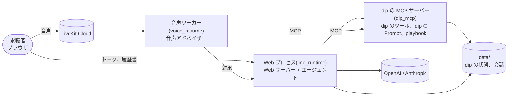

# aica

**求職者と話して、アルバイト・パートから正社員まで、その人に合う仕事探しを相談と提案で支える AI エージェント。**

- LINE 公式アカウントの AI アシスタント(バイトル)を手元で再現する検証環境(旧称 line-sim)から始まりました
- **LINE 側(会話の頭脳)と dip 側(求人とユーザー理解)を MCP で分ける**という本番の境界を、そのまま作っています
- 確かめたいのは「dip が書ける Prompt とツールの中身だけで、狙った会話体験になるか」です
- 求人、店舗、ユーザー、FAQ はすべて架空のデータです。社内資料の数値は含めていません

旧リポジトリ `jyoka/aica_ra_a2a_poc`(main、コミット `cda42fd`)から、履歴なしで移植しました。旧リポジトリの評価結果、
作業ログ、アーカイブは持ってきていません。履歴書の読み取り(`resume_intake/`)は task 63、音声相談(`voice_resume/`)は task 62 で移しました。

## しくみ



- エージェントは業務の知識を持ちません。LINE の共通ルールと、dip から受け取る dip の Prompt と playbook で話します
- dip のツールは LLM を使わず、事実だけを返します。求人カードは、dip が返した求人だけをコードで描きます
- 音声相談もトークと同じ雇用区分、playbook、プロフィールを使い、結果はトークに戻ります

部品とデータの流れは [HLD](docs/architecture/hld.md) にあります。

## 動かし方

必要なもの: Python 3.12、OpenAI の API キー。

```bash
# リポジトリ直下で
python3.12 -m venv .venv && ./.venv/bin/pip install -r requirements.txt
# リポジトリ直下の .env に OPENAI_API_KEY=... を書く(git には入らない)
./.venv/bin/python -m line_runtime.server   # トーク画面 http://127.0.0.1:8030/ 、開発者画面 http://127.0.0.1:8030/dev
./.venv/bin/python -m pytest -q             # テスト(実 API を呼ばない)
```

- 既定(`LINE_SIM_PROVIDER=openai`)では、`OPENAI_API_KEY` が無いと Web プロセスは起動の途中で止まります
- トーク画面を開くと、エージェントが挨拶のために実 API を呼び、費用がかかります(最後のやりとりから 30 分以内の開き直しは除く)。
  開発者画面は、シナリオを選ぶまで呼びません。話すとターンごとに呼びます
- `LINE_SIM_PROVIDER=anthropic` にすると、エージェントは Anthropic のモデルになります(`ANTHROPIC_API_KEY` が要る)。
  履歴書の読み取り、意味検索、音声相談は常に OpenAI です

### 音声相談も使う

```bash
# .env に足す: LIVEKIT_URL、LIVEKIT_API_KEY、LIVEKIT_API_SECRET、DEEPGRAM_API_KEY、CARTESIA_API_KEY、AICA_INTERNAL_KEY
./.venv/bin/python -m voice_resume.agent download-files   # 初回だけ(VAD と turn detector のモデル)
./.venv/bin/python -m line_runtime.server                 # 1 つ目のターミナル: Web プロセス
./.venv/bin/python -m voice_resume.agent dev              # 2 つ目のターミナル: 音声ワーカー
```

- 2 つのプロセスは、リポジトリ直下で同じ venv と同じ `.env` を使います
- `AICA_INTERNAL_KEY` は、2 つのプロセスで同じ値の長い乱数です(例: `python3 -c "import secrets; print(secrets.token_urlsafe(32))"`)
- 画面で入力欄の「+」→「音声で相談する」を押し、マイクを許可します。声が途切れるときはイヤホンを使います

## 画面

| 画面 | URL | 中身 |
|---|---|---|
| トーク画面 | `/` | 求職者が使うスマホ向けの 1 画面。トーク、保存した求人、プロフィール。履歴書のアップロードと音声相談は、入力欄の「+」か、エージェントが出すボタンから入る |
| 開発者画面 | `/dev` | 評価と説明のため。左でシナリオを選んで dip から見た状態を見て、中央で話し、右で構成図とこのターンの処理の流れを見る |
| LIFF 画面 | `/liff/*` | dip の画面のモック。応募フォーム、読み取り結果、下書き |

- ブラウザごとに匿名ユーザーIDを Cookie で発行します。認証はありません(URL を知っている知人だけが使う前提)
- 1 日あたりのターン数に上限があります(下の「設定」)
- シナリオは 15 件で、開発者画面と評価で同じ一覧(`evals/scenarios.json`)です

画面の細かい動きは [LLD の 4.10](docs/architecture/lld.md#410-画面) にあります。

## 主なコマンド

`python` は `./.venv/bin/python` のことです。「実 API」の列が「使う」のコマンドは費用がかかります。

| コマンド | すること | 実 API |
|---|---|---|
| `python -m line_runtime.server` | Web プロセスを起動する(`127.0.0.1:8030`) | 挨拶と会話で使う |
| `python -m voice_resume.agent dev` | 音声ワーカーを起動する | 使う |
| `python -m dip_mcp.server --http 8020` | dip の MCP サーバーを別プロセスで起動する。Web プロセスには `DIP_MCP_URL=http://127.0.0.1:8020/mcp` を渡す | - |
| `python -m pytest -q` | テスト | 使わない |
| `python -m evals.run [--only B-exit] [--judge] [--repeat 2]` | 評価。模擬ユーザーとシナリオを会話させて採点する。予算台帳の累計が $4 で止まる | 使う |
| `python -m evals.run --rejudge 結果.json` | 保存した会話を、ジャッジだけで判定し直す | 使う |
| `python3 evalkit/aggregate.py diff 前.json 後.json` | 評価の結果の前後を比べる | 使わない |
| `python -m evals.budget` | 予算台帳の累計と、実行ごとの内訳 | 使わない |
| `python -m evals.search_eval eval` | 意味検索の再現率(保存済みのベクトルで測る) | 使わない |
| `python -m line_runtime.ledger [--date 2026-09-27] [--by-user-id] [--json]` | 費用台帳を人と日ごとに表で集計する(合計の行つき)。`--by-user-id` はシナリオユーザーを匿名ユーザーIDにまとめない | 使わない |
| `python -m resume_intake.cli <ファイル>` | 履歴書を 1 つ読み取る | 使う |
| `python -m scripts.gen_jobs` | 架空のアルバイト・パートの求人(`fixtures/jobs.json`)を作り直す | 使う |
| `python -m scripts.gen_job_vectors` | 求人のベクトルを作り直す。求人を変えたら回す | 使う |

評価の判定と回し方は [LLD の 4.8](docs/architecture/lld.md#48-評価の-1-シナリオevalsrunrun_scenario)、テストの仕組みは
[LLD の 10 章](docs/architecture/lld.md#10-テストと評価の仕組み)にあります。

## 設定

API キーなどの秘密は、リポジトリ直下の `.env` に書きます(すでにある環境変数は上書きしません)。

**`.env` で効くのは、下の表で「`.env` 可」としたものだけです。** ほかは起動のときに読むので、コマンドの前に環境変数として渡します
(例: `SIM_NOW=2026-10-01T09:00:00+09:00 ./.venv/bin/python -m line_runtime.server`)。理由は
[review-2026-10.md の R21](docs/architecture/review-2026-10.md#r21-設定の一部が-env-では効かない)にあります。

| 環境変数 | 既定 | 用途 | `.env` |
|---|---|---|---|
| `OPENAI_API_KEY` | なし(必須) | エージェント、履歴書の読み取り、意味検索、音声アドバイザー、下書き | 可 |
| `ANTHROPIC_API_KEY` | なし | `LINE_SIM_PROVIDER=anthropic` のとき | 可 |
| `LINE_SIM_PROVIDER` | `openai` | LLM のプロバイダ(`openai`、`anthropic`)。エージェント、模擬ユーザー、ジャッジのモデルが変わる | 不可 |
| `LINE_SIM_MODEL` | `gpt-6-sol`(anthropic なら `claude-opus-5`) | エージェントのモデル | 不可 |
| `LINE_SIM_EFFORT` | `low` | エージェントの思考の深さ | 不可 |
| `LINE_SIM_PORT` | `8030` | Web サーバーのポート | 不可 |
| `LINE_SIM_DATA_DIR` | `data/` | 会話、費用台帳、ターン数の置き場 | 不可 |
| `DIP_MCP_URL` | なし(stdio の子プロセス) | 別プロセスの dip の MCP サーバーの URL | 不可 |
| `DIP_STATE_PATH` | `data/state.json` | dip の状態 | 不可 |
| `SIM_NOW` | `2026-09-23T12:00:00+09:00` | dip の時計(固定) | 不可 |
| `RESUME_INTAKE_MODEL` | `gpt-6-sol` | 履歴書の読み取りのモデル | 不可 |

ターン数の上限です。`0` 以下にすると、その上限はありません。既定値の理由は [LLD の 5.3](docs/architecture/lld.md#53-費用台帳とターン数) にあります。

| 環境変数 | 既定 | 上限 | `.env` |
|---|---|---|---|
| `LINE_SIM_DAILY_TURN_LIMIT` | 50 | 匿名ユーザーIDごとのターン数 | 可 |
| `AICA_DAILY_TURN_LIMIT_PER_IP` | 150 | 同じ IP からのターン数の合計 | 可 |
| `AICA_DAILY_NEW_IDS_PER_IP` | 20 | 同じ IP から 1 日に使える匿名ユーザーIDの数 | 可 |
| `AICA_DAILY_TURN_LIMIT_TOTAL` | 1000 | 全体のターン数の合計 | 可 |
| `AICA_DAILY_NEW_IDS_TOTAL` | 300 | 全体で 1 日に使える匿名ユーザーIDの数 | 可 |
| `AICA_TRUST_PROXY` | なし | `1` のときだけ、IP を `X-Forwarded-For` の最後の値から取る。プロキシの後ろに置くときに使う | 可 |

音声相談で使うものです。トークだけを試すなら要りません。

| 環境変数 | 既定 | 用途 | `.env` |
|---|---|---|---|
| `LIVEKIT_URL`、`LIVEKIT_API_KEY`、`LIVEKIT_API_SECRET` | なし(必須) | LiveKit Cloud(URL は `wss://<project>.livekit.cloud`)。Web プロセスが部屋の接続トークンを発行し、音声ワーカーが部屋に入る | 可 |
| `DEEPGRAM_API_KEY` | なし(必須) | 文字起こし | 可 |
| `CARTESIA_API_KEY` | なし(必須) | 読み上げ | 可 |
| `AICA_INTERNAL_KEY` | なし(必須) | 内部の鍵。音声ワーカーが `POST /api/voice/result` に付け、Web サーバーが照合する。無いと結果は 401 で届かない | 可 |
| `VOICE_RESUME_TALK_URL` | `http://127.0.0.1:8030` | 音声ワーカーが結果を返す Web サーバーの URL | 不可 |
| `VOICE_RESUME_OUT_DIR` | `data/voice-resume` | 下書き、文字起こし、求人の提案の置き場 | 不可 |
| `VOICE_RESUME_*`(モデル、ボイス、ターンの判定) | [LLD の 7.1](docs/architecture/lld.md#71-音声の部品の設定) | STT、LLM、読み上げの設定 | 不可 |

## 文書

| 知りたいこと | 文書 |
|---|---|
| 全体の図、部品、データの流れ、信頼の境界、用語 | [docs/architecture/hld.md](docs/architecture/hld.md)(HLD) |
| モジュール、HTTP の口、dip のツール、主な流れ、データの形、失敗の扱い、テスト | [docs/architecture/lld.md](docs/architecture/lld.md)(LLD) |
| 設計の問題と直し方の案 | [docs/architecture/review-2026-10.md](docs/architecture/review-2026-10.md) |
| 業務の語の定義 | [CONTEXT.md](CONTEXT.md) |
| シナリオごとの会話設計と経緯 | [docs/design/line-sim-scenarios.md](docs/design/line-sim-scenarios.md) |
| aica v2(正社員まで広げる)の要件と予算 | [docs/prd/aica-v2-fulltime.md](docs/prd/aica-v2-fulltime.md)(PRD) |
| 決めたことの記録 | [ADR-0001](docs/adr/0001-track-and-playbook-as-dip-tools.md) 雇用区分と playbook を dip のツールにする、[ADR-0002](docs/adr/0002-one-job-model-with-employment-type.md) 正社員の求人を同じ形で扱う |
| イベントの受け付けと Resume Draft の契約を 1 か所にする設計メモ | [docs/design/consolidate-resume-draft-and-event-turn.md](docs/design/consolidate-resume-draft-and-event-turn.md) |
| 応募の先の設計の調査 | [docs/research/apply-flow.md](docs/research/apply-flow.md) |
| 評価の結果の集計と比較 | [evalkit/README.md](evalkit/README.md) |
