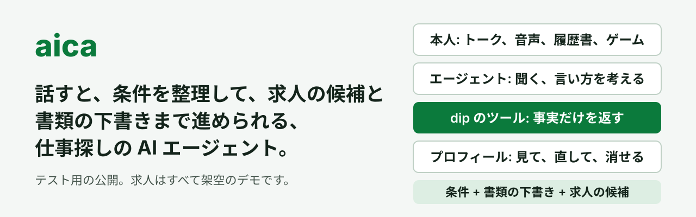
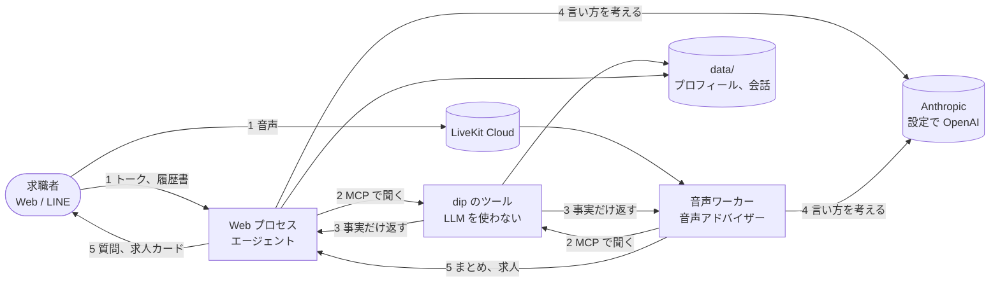
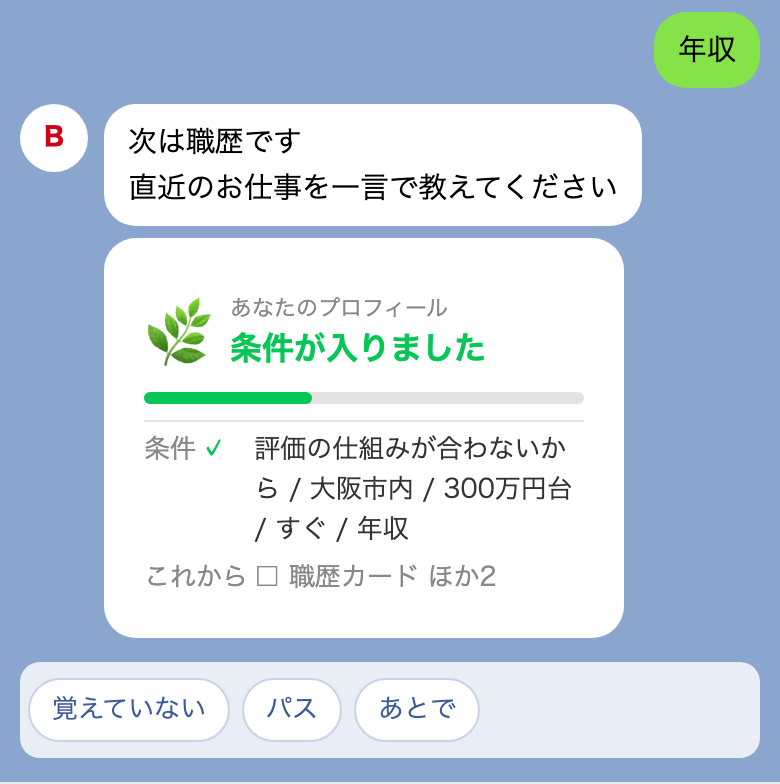
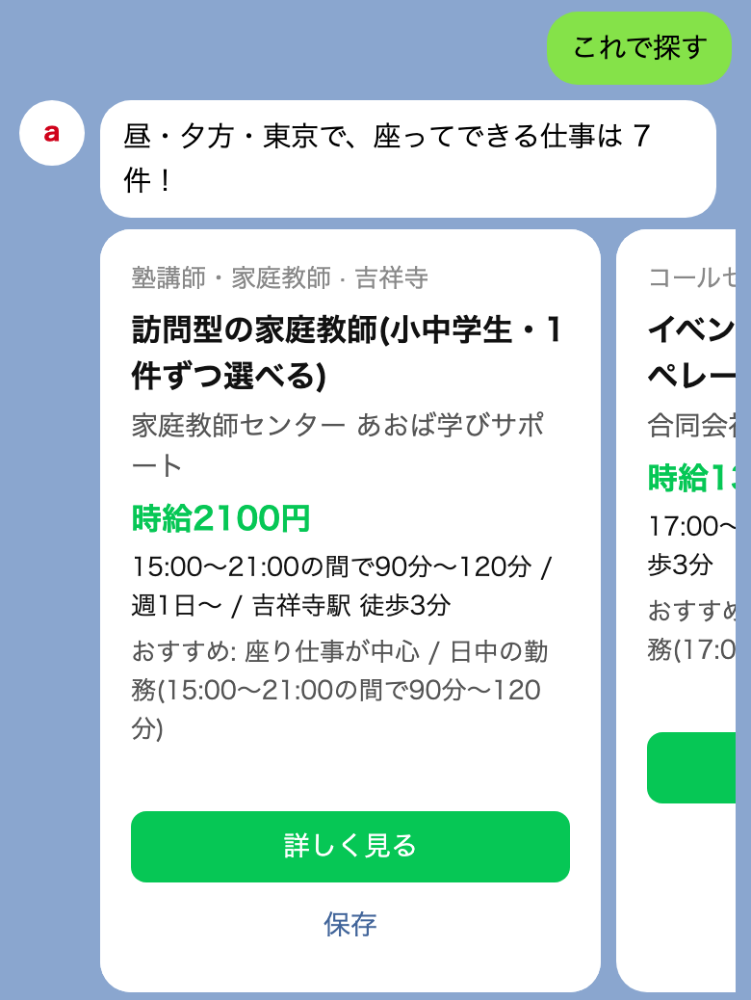
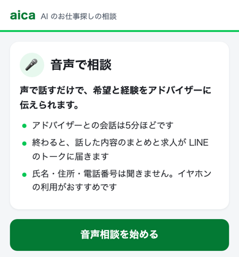
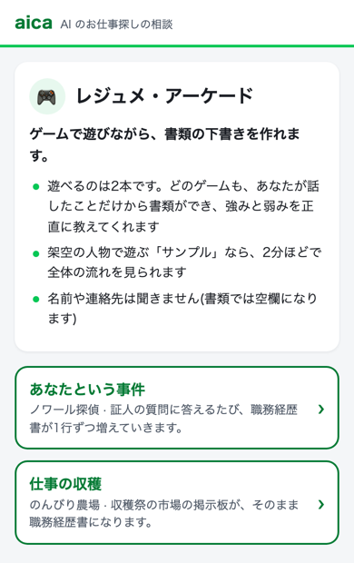

<picture>
  <source media="(prefers-color-scheme: dark)" srcset="assets/brand/banner-dark.svg">
  
</picture>

# aica

**話すと、条件を整理して、求人の候補と書類の下書きまで進められる、仕事探しの AI エージェント。**

アルバイト・パートから正社員まで、本人の話から希望と経歴をつかみ、次に何をすればよいかを提案します。

> **テスト用の公開です。** 求人、店舗、FAQ、開発用のユーザーは架空のデータで、応募しても実際の応募になりません。社内資料の数値は含めていません。使う人が話した内容の扱いは[プライバシーポリシー](docs/legal/privacy-policy.md)にあります。

エージェントは業務の知識を持たず、dip のツール(MCP)を通してだけ dip の事実を得ます。
確かめたいのは「dip が書ける Prompt とツールの中身だけで、狙った会話体験になるか」です。
経緯は [docs/brand.md](docs/brand.md#6-経緯) にあります。

## しくみ



- エージェントは、LINE の共通ルールと、dip から受け取る dip の Prompt と playbook で話します([ADR-0003](docs/adr/0003-agent-gets-facts-only-through-dip-tools.md))
- dip のツールは LLM を使いません。求人カードは、dip が返した求人だけをコードで描きます
- 音声相談もトークと同じ雇用区分、playbook、プロフィールを使い、結果はトークに戻ります

部品とデータの流れは [HLD](docs/architecture/hld.md) にあります。

## 特長

<table>
  <tr>
    <td width="50%" valign="top">
      <a href="docs/usage.md"></a><br>
      <b>トーク</b><br>
      Web と LINE で話す。答えるとプロフィールが育つ。
    </td>
    <td width="50%" valign="top">
      <a href="docs/architecture/hld.md"></a><br>
      <b>求人カード</b><br>
      dip が返した求人だけを、コードで描く。
    </td>
  </tr>
  <tr>
    <td width="50%" valign="top">
      <a href="docs/usage.md"></a><br>
      <b>音声相談</b><br>
      5 分ほど話すと、まとめと求人がトークに届く。
    </td>
    <td width="50%" valign="top">
      <a href="docs/prd/resume-arcade.md"></a><br>
      <b>レジュメ・アーケード</b><br>
      ゲームで答えると、本人が話したことだけから書類の下書きができる。
    </td>
  </tr>
</table>

写っている求人と人は、どれも架空です。

- **相談のハーネス**: アルバイト・パートと正社員で、聞くことと終わりをコードが決め、モデルは読み取りと言い方を受け持ちます
- **履歴書の読み取り**: ファイルから経歴を読み、一から書かずに相談を続けます
- **LINE**: LIFF 画面、リッチメニュー、アカウント連携(dip の会員と結ぶ)が使えます。LINE は設定したときだけ開きます([LINE で試す](docs/usage.md#line-で試す))
- **プロフィール**: 本人が見て、直して、消せます
- **開発者画面**: シナリオごとに、dip から見た状態と、ターンごとの処理の流れを見られます
- **評価**: 模擬ユーザーとジャッジで会話を採点し、モックの LLM で回帰を回します
- **費用の上限**: 1 日のターン数の上限と費用台帳で、費用を抑えます

## はじめる

要るもの: Python 3.12、Anthropic の API キー、OpenAI の API キー(求人の意味検索の埋め込みだけに使う)。

```bash
python3.12 -m venv .venv && ./.venv/bin/pip install -r requirements.txt
# リポジトリ直下の .env に ANTHROPIC_API_KEY=... と OPENAI_API_KEY=... を書く(git には入らない)
./.venv/bin/python -m line_runtime.server   # トーク画面 http://127.0.0.1:8030/ 、開発者画面 http://127.0.0.1:8030/dev
```

- `ANTHROPIC_API_KEY` が無いと、Web プロセスは起動の途中で止まります。`OPENAI_API_KEY` が無いと、検索は部分一致に戻ります
- 音声相談、Render での公開、LINE で試す手順は [docs/usage.md](docs/usage.md) にあります
- 環境変数の全部は [docs/configuration.md](docs/configuration.md) にあります

## 使い方

1. トーク画面(`http://127.0.0.1:8030/`)を開き、同意の画面で「同意して始める」を押す。
   押すとエージェントが挨拶のために実 API を呼び、費用がかかります
2. トークに希望を書くと、エージェントが質問し、dip が返した求人をカードで出します
3. 入力欄の「+」から、履歴書のアップロードと音声相談に入れます
4. 開発者画面(`/dev`)では、左でシナリオを選び、中央で話し、右で構成図とこのターンの処理の流れを見ます。シナリオを選ぶまで実 API を呼びません

画面の一覧、LINE、LIFF、リッチメニュー、マイクの確認、アカウント連携の手順は [docs/usage.md](docs/usage.md) にあります。

## コマンド

`python` は `./.venv/bin/python` のことです。全部の一覧と「実 API」の列は [docs/usage.md の「主なコマンド」](docs/usage.md#主なコマンド)にあります。

| コマンド | すること | 実 API |
|---|---|---|
| `python -m line_runtime.server` | Web プロセスを起動する(`127.0.0.1:8030`) | 挨拶と会話で使う |
| `python -m voice_resume.agent dev` | 音声ワーカーを起動する | 使う |
| `python -m pytest -q` | テスト | 使わない |
| `python -m evals.baito_sim` | アルバイト・パートのハーネスの回帰(モックの LLM) | 使わない |
| `python -m evals.career_sim` | 正社員のヒアリングのハーネスの回帰(モック) | 使わない |
| `python -m evals.scenes` | 会話の層の場面の一覧を回して、入り口ごとの点を出す(台本の LLM) | 使わない |
| `python -m evals.run` | 評価。模擬ユーザーとシナリオを会話させて採点する | 使う |
| `python -m line_runtime.ledger` | 費用台帳を人と日ごとに集計する | 使わない |

## ドキュメント

| 知りたいこと | 読むもの |
|---|---|
| 動かし方、LINE、LIFF、リッチメニュー、マイクの確認、アカウント連携、画面、コマンドの全部 | [docs/usage.md](docs/usage.md) |
| 設定、環境変数、保存する期間、ターン数の上限 | [docs/configuration.md](docs/configuration.md) |
| Render での公開の手順、通知とメモリ不足の毎日の点検、環境変数、置くデータ | [docs/deploy/render.md](docs/deploy/render.md) |
| 落ちたとき、メモリが足りなくなったときの手順と担当(runbook) | [docs/deploy/runbook.md](docs/deploy/runbook.md) |
| 運用の決定(段階、7 つの関門、落ちたときの対応、次にやること) | [docs/architecture.md](docs/architecture.md)(Architecture Brief) |
| 何を作るか(aica v2、レジュメ・アーケード、アルバイト・パートのハーネス) | [docs/prd/](docs/prd/) |
| 全体の図、部品、データの流れ、信頼の境界、用語 | [docs/architecture/hld.md](docs/architecture/hld.md)(HLD) |
| モジュール、HTTP の口、dip のツール、データの形、失敗の扱い、テスト | [docs/architecture/lld.md](docs/architecture/lld.md)(LLD) |
| 設計の問題と直し方の案 | [docs/architecture/review-2026-10.md](docs/architecture/review-2026-10.md) |
| 決めたことの記録 | [docs/adr/](docs/adr/) |
| 機能ごとの設計メモ(シナリオごとの会話設計、個人情報など) | [docs/design/](docs/design/) |
| 利用規約とプライバシーポリシー | [docs/legal/](docs/legal/README.md) |
| 応募の先の設計の調査 | [docs/research/apply-flow.md](docs/research/apply-flow.md) |
| 1 文、機能の文、バナー、経緯 | [docs/brand.md](docs/brand.md) |
| 業務の語の定義 | [CONTEXT.md](CONTEXT.md) |
| 評価の結果の集計と比較 | [evalkit/README.md](evalkit/README.md) |

主な文書の一覧(ADR の 1 件ずつなど)は [docs/usage.md の「文書の一覧」](docs/usage.md#文書の一覧)にあります。

## 開発

```bash
python -m pytest -q            # テスト(実 API を呼ばない。.env を置かずに回す)
./.venv/bin/ruff check .       # lint
python -m evals.baito_sim      # アルバイト・パートのハーネスの回帰
```

エージェントで作業するときは [AGENTS.md](AGENTS.md)、人の決まり(書き方、置き場所、回帰の合格基準)は [CONTRIBUTING.md](CONTRIBUTING.md) を読んでください。
