# HLD: aica の全体設計

aica が何でできていて、データがどこを流れるかの全体図です。新しい機能を考えるときは、まずこの図のどこに
手を入れるかを決めます。

- 2026-10-11 の main(`7521952`)のコードから書き起こしました。コードと食い違ったら、コードが正です。
  4.7 の時計は、2026-10-12 の決定を実装した後のコード(jyoka/tasks#175)に合わせました
- LINE 公式アカウントのチャネル(4.8)は、2026-10-21 のユーザーの依頼で足しました(jyoka/tasks#177)
- 4.9 の行動データと状況の要約は、task 180 で足しました。ツールが要約を読むところは task 181 で足しました
- 4.10 の LINE のアカウント連携は、2026-10-21 のユーザーの依頼で、task 182 で足しました
- 4.8 の LINE の会話の区切り(30 分空いたら新しい会話)は、2026-10-21 のユーザーの決定で、task 184 で足しました
- 4.11 のレジュメ・アーケード(ゲームの LIFF 画面)は、[PRD](../prd/resume-arcade.md) の (2/3) として task 187 で足しました。
  ゲームの AI と下書きの保存(`resume_arcade/`、`resume_lines/`、`dip_mcp/arcade.py`)は (3/3) として task 188 で足しました
- 4.8 の LIFF 画面を LINE の本人で開く(LIFF の ID トークン)は、2026-10-25 のユーザーの方針で、task 203 で足しました
- 4.8 の LINE のトークから LIFF 画面で音声相談・履歴書・レジュメ・アーケードを使うことと、エージェントに窓口を伝えることは、
  2026-10-25 のユーザーの方針で、task 204 で足しました
- 4.8 の LIFF の中でマイクを試す画面は、2026-10-25 のユーザーの方針で、task 205 で足しました
- 4.8 と 4.11 の LINE でレジュメ・アーケードのボタンを出し、LIFF の中のゲームで AI と保存を LINE の本人で使うことは、task 219 で足しました
- 語は 10 章の「用語」に従います。業務の語の定義の正本は [CONTEXT.md](../../CONTEXT.md) です
- 部品の中身、関数、ファイルの形式は [LLD](lld.md) に書きます
- なぜそう決めたかは [ADR](../adr/) と [PRD](../prd/aica-v2-fulltime.md) に書きます。ここでは繰り返しません
- 書く中で見つけた設計の問題は [review-2026-10.md](review-2026-10.md) にまとめました

## 1. 目的と範囲

求職者と話して、アルバイト・パートから正社員まで、その人に合う仕事探しを相談と提案で支える AI エージェントです。
求職者はトーク(文字)と音声相談で話し、aica は雇用区分に合った相談と、架空の求人の提案をします。

aica は、LINE 公式アカウントの AI アシスタント(バイトル)を手元で再現する検証環境(line-sim)から始まりました。
確かめたいのは「dip が書ける Prompt とツールの中身だけで、狙った会話体験になるか」です。そのため、次の境界を守ります
([ADR-0003](../adr/0003-agent-gets-facts-only-through-dip-tools.md))。

- **エージェントは、dip のツールを通してだけ dip の事実を得る**。dip の事実とは、求人、ユーザーの状況、業務の規則です
- 業務の知識はすべて dip 側に置きます。エージェントの指示と、エージェントへの入力を作る LINE 側のコードには書きません。
  今のコードには、まだ合っていないところが 2 か所あります(1.1)
- web 検索や時給の相場のような、dip の事実ではない外の情報は、この境界の外です(1.1)
- Web サーバーと評価は、dip の関数を直接呼んでかまいません。画面と API はこの境界の外です
- `line_runtime`、`LINE_SIM_*`、`line_user_id` は line-sim の頃の名前です。その場所を触るときに aica の名前に寄せます

新しい機能をどちら側に置くかは 1.1 で決めます。

いまは知人に試してもらう本番のトーク画面(`/`)と、評価と説明のための開発者画面(`/dev`)の両方を持っています。
求職者と話すチャネルは 2 つです。Web のトーク画面(LINE 風の画面)と、LINE 公式アカウント(Messaging API の webhook、4.8)です。
LINE のチャネルは、設定(`LINE_CHANNEL_SECRET`、`LINE_CHANNEL_ACCESS_TOKEN`)があるときだけ開きます。
そのときは LINE のユーザーIDを作る鍵(`AICA_ID_KEY`)も要り、無ければ Web サーバーは起動で止まります。

範囲外:

- 本物の求人、応募、選考(求人、店舗、ユーザー、FAQ はすべて架空のデータ)
- LINE での、ファイルの受け取り、音声相談、プッシュ。LINE で扱うのは、テキストの会話と友だち追加の挨拶です(4.8)。
  ファイルの受け取りは、LINE の後続のタスク(3 つのうちの 2 つ目)で足します
- 認証と招待(URL を知っている知人だけが使う前提)
- 公開そのもの(Render のサービスを作るのは運営者の作業。image、Blueprint、smoke、手順は [docs/deploy/render.md](../deploy/render.md))
- 複数台、複数プロセスでの配置

以前の構成(転職の求職者エージェント ca-agent と aica-poc)は、LLM に多くを任せる作りでした。aica(line-sim)は事業者のツールを
決定的にし、LLM には会話だけをさせる作りです。Opus 5 での費用は 1 ターン $0.021(ca-agent は $0.036)、
1 会話 $0.074(ca-agent は $0.32)でした。課題の重さが違うので、単純には比べられません。比較の詳細は旧リポジトリ
`jyoka/aica_ra_a2a_poc` の `docs/design/ca-agent-vs-line-sim.md` にあります。この数字はこのリポジトリでは測り直していません。

### 1.1 境界と、新しい機能を置く場所

守る境界は、エージェントと dip の間の 1 本だけです。LINE 側と dip 側のパッケージの import は
境界にしません(3.2)。2026-10-12 に決めました([review-2026-10.md](review-2026-10.md) の R1、案 B)。

ここでのエージェントは、トークのエージェントです。音声アドバイザーも、dip の事実は dip のツール(`voice_resume/dip.py`)で
得ていて、同じ決まりに合っています。ユーザーの決定の言葉は「エージェント」だけなので、音声アドバイザーに当てはめるのは
この文書での読み方です。

エージェントが dip の事実を得る道は、次の 2 つだけです。

- dip のツール(3.1)の結果
- イベントの入力に添えた事実。本番の LINE で、イベントに事実が載って届く形をまねています。次のものがあります
  - プッシュの根拠(`push_trigger`)と知らせ(`profile.notice`)。dip の関数が作ります
  - 音声相談の結果。`record_voice_result` が dip の求人データで作り直したものです
  - 履歴書のアップロード。読み取れたときは、dip に保存した読み取り結果から LINE 側が作った確認の吹き出し
    (`resume_confirm.resume_bubbles`)です。読み取れなかったときは、Web サーバーの読み取り結果から作った案内で、
    dip には保存しません
  - ゲーム(レジュメ・アーケード)で保存した下書きの知らせ。dip に保存した下書きの記録(`arcade.save_draft` の結果)から
    LINE 側が作った返信(`arcade_reply.arcade_reply`)です。下書きの中身は、エージェントは dip の要約の `arcade_draft` で読みます

dip の事実ではない外の情報は、境界の外です。音声アドバイザーの `web_research`、`research_company`(web 検索)と
`wage_average`(`data/wage_reference.json` の時給の相場)がこれにあたります。求人やユーザーの状況のように dip が
持つ事実を、こうした道から得ることはしません。

新しい機能は、次の問いを上から順に当てて置き場所を決めます。

| 問い | はいなら置く場所 | 例 |
|---|---|---|
| 求人、ユーザーの状況、業務の規則(判定、保存してよい値、並び順、期限)を持つか、決めるか | dip 側の関数(`dip_mcp/`)。LLM を使わない | `push_trigger`、`match_score`、`save_preferences` |
| エージェントか音声アドバイザーが、その事実を読むか、会話から記録するか | 上の関数を dip のツール(`dip_mcp/server.py`)にする | `recommend_jobs`、`set_search_track` |
| 会話の進め方、聞く順、言い方か | dip の Prompt か playbook(`dip_mcp/prompts/`、`dip_mcp/playbooks/`) | 再訪の挨拶、相談の掘り下げ方 |
| 画面、HTTP の API、Cookie、ターン数の上限、費用台帳、会話の保存、返信の描画、イベントの入力の文言か | LINE 側(`line_runtime/`)。dip の状態が要るときは dip の関数を直接呼んでよい | プロフィールの API、LIFF 画面、`render`、`event_input` |
| dip の事実ではない外の情報(web 検索、相場)か | 境界の外。使うエージェントの側のツールにする | `web_research`、`wage_average` |

- 1 つの機能が両方にまたがるときは、業務の規則を dip 側の関数に置き、LINE 側はそれを呼ぶだけにします。
  たとえばプロフィールの API は LINE 側にありますが、保存してよい値の決まりは `dip_mcp/profile.py` と `logic` にあります
- LINE 側は、dip の事実を描いたり照合したりはします(求人カード、`CARD_KEYS`)。ただし、求人、ユーザーの状況、業務の規則を
  自分で作ってエージェントに渡すことはしません
- dip のツールの中身は、Web サーバーと評価が呼ぶ dip の関数と同じものにします。ツールと関数で決まりを二重に持ちません
- LLM を使うが、会話でも業務の規則でもない部品(履歴書の読み取り `resume_intake/`、ゲームの AI `resume_arcade/`)は、
  どちら側にも入れない独立のパッケージにします。結果を保存してよいかの決まりは dip の関数に置きます
  (`logic.save_resume_upload`、`arcade.save_draft`)

イベントの入力の文言(`line_runtime/runtime.py` の `event_input`、`voice_event`)は LINE 側に置きます。書いてよいのは、
何が起きたかと、画面に出したものを繰り返さないための指示までです。何を聞くか、雇用区分の扱いのような会話の決まりは、
dip の Prompt か playbook に書きます。今のコードには、この線を越えているところが 2 か所あります。

- `runtime.py` の `event_input` は、読み取れなかったアップロードのとき「経歴か希望を1問だけ聞いて」と、何を聞くかを指示します
- `runtime.py` の `voice_event` は、雇用区分が変わっていたら `get_counseling_playbook` を読み直し、`employment_type` も
  合わせるよう指示します。同じ決まりは dip の Prompt(`dip_mcp/prompts/baitoru_assistant.md`)にもあり、二重です(ADR-0001)

どちらも、その場所を触るときに dip の Prompt か playbook に移します。

## 2. システムの文脈(C4 レベル 1)

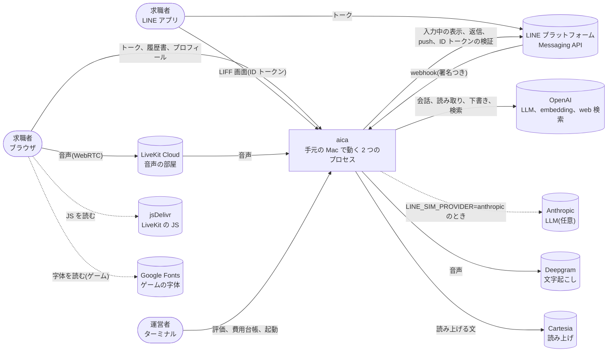

- 状態の正本は手元の `data/` です。dip の状態は `data/state.json`、会話は `data/line_checkpoints.db` にあります
- 求人と、開発者画面のシナリオユーザーの初期状態は `fixtures/` の架空のデータです
- 外のサービスのキーは、リポジトリ直下の `.env` に置きます(6 章)
- 外のサービスには、学習に使わせず、先方に残る量が減る設定で送ります(6 章「個人情報」、LLD の 7 章)。
  LiveKit Cloud の Agent Observability(録音、文字起こし、ログを 30 日残す)には、ワーカーが `record=False` で何も送りません。
  プロジェクトの設定で有効かどうかと、プランは確かめていません([privacy.md](../design/privacy.md) の 6 章)

LLM のプロバイダは `LINE_SIM_PROVIDER` で選びます(`line_runtime/config.py`)。

| 使うところ | `openai`(既定) | `anthropic` |
|---|---|---|
| エージェント | `gpt-6-sol` | `claude-opus-5` |
| エージェントの思考の深さ | `LINE_SIM_EFFORT`(既定 `low`) | 同じ |
| 模擬ユーザー、ジャッジ(`evals/run.py`) | `gpt-6-luna` | `claude-haiku-4-5` |
| 履歴書の読み取り、音声アドバイザー、下書き、意味検索 | 常に OpenAI | 常に OpenAI |

## 3. 部品(C4 レベル 2)

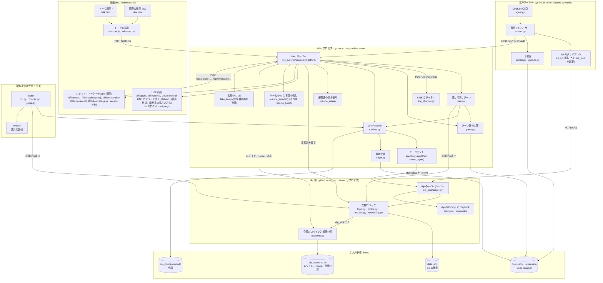

| 部品 | 役割 | 書いてよいもの |
|---|---|---|
| 画面(`line_runtime/static/`) | トーク、保存した求人、プロフィール、音声相談のシート、開発者画面の処理の流れ、レジュメ・アーケードのゲーム(4.11) | 何も持たない。Cookie の匿名ユーザーIDだけ。ゲームの答えと進み具合は、そのブラウザの localStorage だけに置く |
| Web サーバー(`line_runtime/server.py`) | Cookie と本人の確かめ、イベントの結果の HTTP と NDJSON への書き出し、LIFF 画面、プロフィールの API、履歴書のアップロード、音声相談の結果の受け取り、ゲームの AI と下書きの API(4.11) | dip の状態、会話、`quota.json`、費用台帳(履歴書の読み取り、ゲームの AI)。`data/voice-resume/` の下書きを消す |
| LINE のチャネル(`line_runtime/line_channel.py`) | webhook の署名の確かめ、LINE の userId から LINE のユーザーIDを作る、再送の見分け、返信を LINE のメッセージにする、Messaging API の呼び出し(linkToken の発行を含む)、アカウント連携の文とボタン。FastAPI に依存しない | `data/line_events.json`(受けた webhook のイベントの ID) |
| 偽物の LINE(`line_runtime/fake_line.py`) | アカウント連携の LINE の役(linkToken の発行、accountLink の画面、webhook のイベント)。テストと、開発者画面から試す Web の匿名ユーザーの連携で使う | 何も書かない(出した linkToken はメモリだけ) |
| 会員のログインと連携の表(`dip_mcp/accounts.py`) | dip の会員のログイン、nonce、bot が出した linkToken、連携の表(4.10)。LLM を使わない | `data/dip_accounts.db` |
| 受け付けとターン(`line_runtime/turn.py`) | イベントの受け付け(検証、ターン数の上限、プッシュの判定、stale、知らせ)と、LineRuntime を呼んだ後の記録。`POST /api/event` と `POST /api/event/stream` が共通に使う。FastAPI に依存しない | dip の状態(開いた記録、知らせの渡し終わり、`push_trigger` が残す接触)、`quota.json` |
| LineRuntime(`line_runtime/runtime.py`) | 1 ターンを進める。会話の番号、ユーザーごとの排他、返信の描画(`render`) | 会話(チェックポイント)、費用台帳 |
| エージェント(`agent.py`) | LINE の共通ルールと dip の Prompt で会話し、`LineReply` を返す | 何も書かない。dip のツールを呼ぶだけ |
| dip の MCP サーバー(`dip_mcp/`) | 求人、ユーザーの状況、プロフィール、雇用区分、playbook、会話の結果。LLM を使わない | dip の状態 |
| 履歴書の読み取り(`resume_intake/`) | 履歴書のファイルを Resume Draft にする | 何も書かない(CLI とサンプルの検証だけ `data/resume_intake/` に書く) |
| ゲームの AI(`resume_arcade/`) | ゲームの段ごとの指示の文と出力の形、LLM の呼び出し、事実の確かめ、書類の Markdown を Resume Draft に写す(4.11) | 何も書かない |
| 書類の行の決まり(`resume_lines/`) | 数字の検出(日付は数えない)、数字の空欄、事実の確かめ。ほかのパッケージに依存しない | 何も書かない |
| 音声ワーカー(`voice_resume/`) | LiveKit の部屋で音声アドバイザーと話す。下書きを作り、結果をトークへ返す | dip の状態(dip のツール経由)。`data/voice-resume/` は開発で `VOICE_RESUME_WRITE_FILES=1` のときだけ |
| 評価(`evals/`、`evalkit/`) | 模擬ユーザーと会話させて採点し、集計する | 一時ファイルの dip の状態、`evals/results/`、予算台帳 |

### 3.1 dip のツール(MCP)

エージェントと音声アドバイザーが使う dip の口です。ツールは LLM を使わず、速く、決定的に、事実だけを返します。
例外は `recommend_jobs` の keywords の意味検索で、問い合わせ文の embedding を 1 回呼びます(4.1)。

| ツール | 役割 |
|---|---|
| `get_user_conversation_summary` | dip の要約。今の雇用区分、直近の応募、フォームの途中離脱、閲覧の傾向、直近の接触、本人が話した希望、相談のまとめ、アップロードした履歴書、ゲームで作った下書きの要点(`arcade_draft`。空欄のある行を 5 行までと、下書きの画面の URL `view_url`)、ゲームの URL(`arcade_url`。Web のユーザーと、LIFF の設定があるときの LINE のユーザー)。行動の事実がいつ時点か(`as_of`)。会話の最初に呼ぶ。閲覧した求人名は返さない |
| `get_user_recent_applications`、`get_application_status` | 応募と選考の状況(`get_application_status` は `as_of` つき) |
| `get_user_form_exit`、`resume_application_form` | 途中の応募フォームの続き。個人情報の項目はトークで受け取らず、LIFF 画面へ回す |
| `recommend_jobs` | 条件に合う求人を最大 3 件、理由と `match_score` つきで返す |
| `relax_conditions` | 求人が少ないとき、どの条件を外すと何件になるか |
| `answer_job_question` | 仕事内容や面接などの質問に答える材料(FAQ と求人の情報) |
| `save_job` | 求人の保存 |
| `save_user_preferences` | 本人が話した希望と、本人のこと(経験、目的、強みなど)の保存 |
| `set_search_track` | 雇用区分の切り替え。根拠は本人の発言そのまま。履歴と取り消しも記録する(ADR-0001) |
| `get_counseling_playbook` | 雇用区分とチャネル(`chat`、`voice`)の playbook と、会話の決まりの値 |
| `record_conversation_outcome` | 会話の段階の結果(提案・相談・支援・待つ)と相談のまとめの記録。待つ(wait)は本人が断ったときだけ |

ほかに、Resource `baitoru://faq` と、入口ごとの dip の Prompt を返す Prompt `baitoru_assistant(entry)` があります。

本人の行動(応募、閲覧、保存、離脱、接触)について、ツールが読むのは 1 人 1 行の状況の要約と、その人が会話の中で書いた分だけです。
行動の元データは読みません(4.9、ADR-0006)。

### 3.2 パッケージの依存

守る境界はエージェントと dip の間だけで、エージェントの情報の流れは MCP だけです(1.1)。パッケージの import は境界にしません。
`line_runtime` と `evals` が `dip_mcp` の `logic`、`profile`、`State` を直接使うのは、認めた形です。

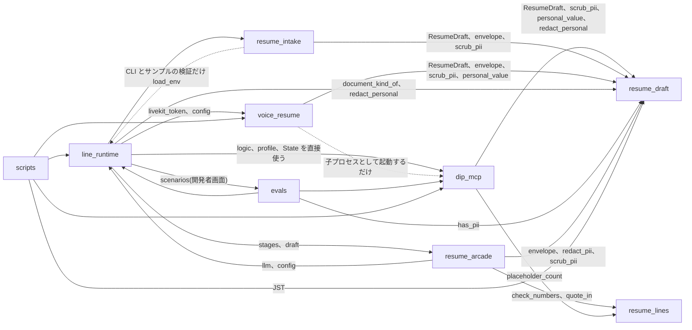

- `voice_resume` は `dip_mcp` を import しません。職種、エリア、雇用区分の一覧は写しを持ち、テストで同期を確かめます
- `dip_mcp` は `resume_arcade` と `line_runtime` を import しません。ゲームの書類の行の決まり(数字の空欄)は、依存の無い
  `resume_lines` を `dip_mcp` と `resume_arcade` の両方が使います
- Resume Draft の形と個人情報の決まりは `resume_draft` の 1 か所にあり、読み取り、下書き、dip の保存が同じものを使います。
  `resume_draft` はほかのパッケージに依存しません
- 境界の決定は [ADR-0003](../adr/0003-agent-gets-facts-only-through-dip-tools.md) にあります

## 4. データの流れ

### 4.1 トークの 1 ターン

画面は `POST /api/event/stream` を呼び、1 行 1 件の JSON(NDJSON)で途中経過を受け取ります。`POST /api/event` は
同じ処理で返信だけをまとめて返します。受け付けとターンの手順は `line_runtime/turn.py` の 1 か所にあり、
2 つの API は Cookie の照合と書き出しの形だけを受け持ちます。

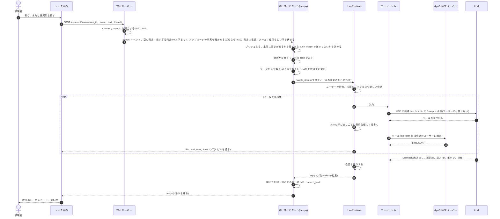

会話の入口は次の 5 つのイベントです(`runtime.py` の `EVENTS`)。

| イベント | 入口 | 始まり方 | 送ってよいか |
|---|---|---|---|
| `message` | A: トーク | 本人が書く | - |
| `resume_upload` | A: トーク | 本人が履歴書をアップロードした(4.2) | - |
| `visit` | visit: 初回訪問 | こちらから挨拶する(新しい会話) | 常に挨拶する |
| `revisit` | revisit: 再訪 | こちらから挨拶する(新しい会話) | 常に挨拶する |
| `form_exit` | D: 応募フォームの途中離脱 | こちらからプッシュする(新しい会話) | dip の `push_trigger` が決める |

- 入口は会話の途中で変えず、指示にユーザーIDを載せません。プロンプトキャッシュを保つためです(ユーザーIDを載せないのは個人情報のためでもあります。6 章)
- 本番のトーク画面を開くと `POST /api/talk/open` が決めます。最後のやりとりから 30 分以内なら今の会話を続け(LINE の発言も同じ決まり。4.8)、
  `GET /api/talk/history` で描き直します。それ以外は dip が初回訪問か再訪かを決め、画面がそのイベントで挨拶を呼びます
- 画面は表示している会話の番号(`thread`)を発言に付けます。別のタブで新しい会話が始まっていれば、発言は stale になり、
  LLM を呼ばず、ターンも数えません
- 再訪の挨拶は、保存した希望があれば確認形で 1 問、無ければ最近の閲覧に 1 回だけ触れて 1 問です
- 挨拶では、本人が気づきにくい 3 つの入口(音声相談、履歴書の読み込み、レジュメ・アーケード)も案内します。初回訪問は窓口で使えるものを全部、
  押せる形(`actions` の `voice_consult` と `resume_upload`、ゲームは `buttons`)で出し、文字の選択肢「求人を探す / まず相談する / 今はいい」も残します。
  再訪は要約に合わせて 1 つだけ勧めます(下書きの空欄 → 経歴が分からなければ履歴書 → 相談のまとめが無ければ音声 → 下書きが無ければゲーム)。
  決まりは dip の Prompt(`baitoru_assistant.md` の「挨拶で3つの入口を案内する」)にあり、LINE 側のランタイムは何も足していません。
  理由と評価は [設計メモの 12 章](../design/line-sim-scenarios.md#12-挨拶から-3-つの入口へ案内する2026-10-25会話の改善-23) にあります
- 開発者画面はシナリオを選ぶと `POST /api/scenarios/{id}/start` でシナリオユーザーの dip の状態を初期に戻し、
  続けて 1 通目のイベントを呼びます。どのシナリオもエージェントの 1 通目から始まります
- 開発者画面の右には、構成図と処理の流れ(LLM の時間、トークン、キャッシュから読めた分、ツールの引数と結果)が出ます
- 画面との接続が途中で切れても、ターンは最後まで進めます。ツールの結果が無い会話を保存しないためです

求人の検索(`recommend_jobs`)は、条件(エリア、時間帯、職種、時給の下限、希望年収、属性)で絞り、keywords があれば
意味検索で絞り直します。求人側のベクトルは `scripts/gen_job_vectors.py` で前もって作り `fixtures/job_vectors.json` に
置きます。検索のときの外部の呼び出しは、問い合わせ文の embedding 1 回だけです。API が使えないときと、問い合わせがどの求人とも近くないとき(類似度の最高値が中央値から `SIM_PEAK` 以上抜けないとき)は、部分一致に戻ります。

### 4.2 履歴書のアップロード

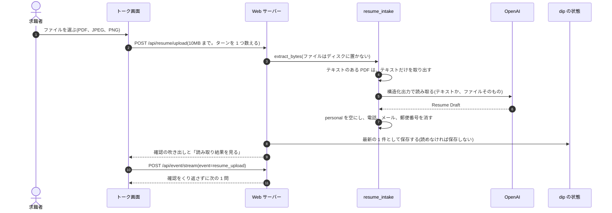

- アップロードは本人の 1 ターンです。読み取りと続くターンで、ターンを 2 つ数えます
- ファイル名は保存せず、トークにも出しません。トークには「履歴書(PDF)」のような種類だけを出します
- テキストのある PDF は、取り出したテキストだけを OpenAI に送り、顔写真などの画像を送りません。テキストの無い PDF
  (スキャンなど)と、JPEG、PNG は、ファイルをそのまま送ります(6 章)
- 読めないファイルのときは、前に読み取れた結果を上書きしません。読めなかった前提で 1 問返します

### 4.3 音声相談

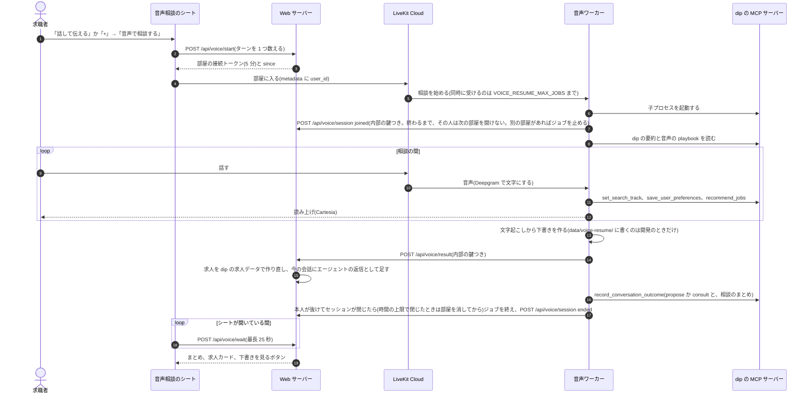

- 音声アドバイザーはチャットと同じ雇用区分、playbook、保存の仕組みを使います(aica v2 の G)
- 結果をトークに足すときは LLM を呼ばず、ターンも数えません(`LineRuntime.add_voice_result`、`voice_reply.py`)
- 音声側から待つ(wait)は記録しません。断っていない人を wait にしない決まりのためです
- 相談の途中で本人が「すべて消す」をしていたら、その前の部屋の結果は 410 で断ります。ワーカーは会話の段階の結果を
  記録せず、書き出したファイルがあれば消します
- ワーカーの dip への書き込み(雇用区分、希望、会話の段階の結果)には部屋の名前が付きます。dip は「すべて消す」の前の部屋の
  書き込みを断るので、消した後も通話が続いても、その後に話したことは dip に残りません(`docs/design/privacy.md` の 3.8 の案 A)
- 下書きは、トークが受け取った結果として dip の状態(`voice_results`)に入ります。既定では `data/voice-resume/` にファイルを
  書き出しません。書き出すのは開発で `VOICE_RESUME_WRITE_FILES=1` にしたときだけです([privacy.md](../design/privacy.md) の 3.3)
- Web サーバーは、プロフィールで下書きを消すとき、ワーカーが書いたファイルがあればパスで消します(`server.py` の `_remove_voice_files`)
- 下書きの書類は雇用区分で決まります。正社員なら職務経歴書、それ以外は履歴書です

### 4.4 プロフィールを直す、消す

プロフィール画面(`/api/profile/*`)は dip の状態を直接書き換えます。中身は `dip_mcp/profile.py` です。

- 直すときにも保存と同じ決まり(決まった項目だけ、個人情報らしい値と長すぎる値は 400)を効かせます
- 会話の途中で変えたら、次の本人のターンの直前に「知らせ」としてエージェントに渡します(画面の履歴には出しません)
- 「すべて消す」は会話を消してから dip の状態を消します。同じ Cookie のシナリオユーザーの分も消します。
  ターン数の上限の数は消しません。費用台帳は、その人の行のユーザーIDを `deleted` に置き換え、金額とトークン数は残します
- 「データを書き出す」(`GET /api/profile/export`)は、本人の保存内容(プロフィール、dip の状態の行、連携、会話、費用台帳の行)を
  1 つの JSON のファイルで返します。範囲は「すべて消す」と同じです([privacy.md](../design/privacy.md) の 3.7)
- 履歴書を消すと、今の会話を閉じ、それまでの会話をすべて消します。アップロードの要点が会話に残らないためです
- トークの「切り替えの表示」のボタン(`POST /api/talk/track/undo`)は、直前の区分の切り替えだけを取り消します
- LINE のユーザーはプロフィール画面を開けないので、トークの決まった文(「データを見る」「データを消す」)で見て、消します(4.8)。
  「データを消す」の後の確かめで「すべて消す」を押すと、Web の「すべて消す」と同じ処理で消します

### 4.5 評価

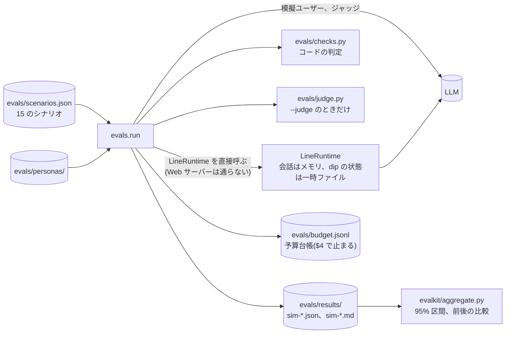

- シナリオの一覧は開発者画面と同じです。始める前にそのユーザーの dip の状態を初期に戻します
- 採点はコードが中心です。1 ターン 1 問、選択肢の数、吹き出しの字数、求人は最大 3 件、事実性、雇用区分の切り替え、
  相談の進め方などを見ます。LLM ジャッジは相談の深さとトーンを見ます。既定ではオフです
- 実 API を使うので費用がかかります。PRD の予算は $5 で、予算台帳の累計が $4 に達すると止まります
- 実 API を使わないテストは `pytest` です。LLM と外部の API はスタブにします

### 4.6 保存するデータ

| 場所 | 中身 | 書く部品 | 消えるとき |
|---|---|---|---|
| `data/state.json` | dip の状態: ユーザーごとのプロフィール、雇用区分の履歴、会話の段階の結果、履歴書の読み取り結果、音声相談の結果、ゲームで作った下書き(ゲームごとに最新の 1 件)と遊びの記録(ゲームごとに最新の 1 件。新しい `start` で置き換わる。答えの中身は持たない)、会話の中で dip に書いた行動のイベント(`dip_writes`。要約に入るまで重ねて読む分) | Web サーバー、dip の MCP サーバー(Web の子プロセスと、音声相談ごとの子プロセス) | 最後の利用(`last_seen_at`)から 180 日で、掃除がその人の行を丸ごと外す。プロフィールの「すべて消す」(持ち越した部屋の名前は 1 日、行は 180 日で掃除が外す)、LINE の「データを消す」、開発者画面のシナリオの開始 |
| `data/line_checkpoints.db` | 会話(LangGraph のチェックポイント)。本人の発言、ツールの結果、返信 | LineRuntime | 会話ごとに最後のやりとりから 30 日で、掃除が消して VACUUM する。「すべて消す」、LINE の「データを消す」、履歴書を消したとき |
| `data/costs.jsonl` | 費用台帳。LLM の呼び出し 1 回 1 行(user_id つき。ゲームは `event` が `arcade:<game>:<段>`) | LineRuntime、Web サーバー(履歴書の読み取り、ゲームの AI) | 90 日を過ぎた行は、掃除がユーザーIDの無い日ごとの合計の 1 行にする。「すべて消す」と LINE の「データを消す」では、その人の行のユーザーIDを `deleted` にする。合計は消さない |
| `data/quota.json` | その日のターン数(人ごと、IP ごと)と、その日に使われた匿名ユーザーID、AI つきで始めたゲームの回数(人ごと)。全体の数はここから数える | ターン数の上限 | 日付が変わると数え直す。「すべて消す」では消えない |
| `data/line_events.json` | 受けた LINE の webhook のイベントの ID(直近 2,000 件)。ユーザーは分からない | Web サーバー(LINE のチャネル) | 古いものから消える |
| `data/voice-resume/` | 相談ごとの下書き、文字起こし、求人の提案。本番では書かない(既定)。書くのは開発で `VOICE_RESUME_WRITE_FILES=1` のときだけ。下書きは本番でも `data/state.json` の音声相談の結果に入る | 音声ワーカー(開発のときだけ) | プロフィールで下書きを消したとき、「すべて消す」、LINE の「データを消す」 |
| `evals/results/`、`evals/budget.jsonl` | 評価の結果と予算台帳 | 評価 | 結果は git に入れない。予算台帳は git に入れる |
| `data/dip_events.db` | dip の行動の元データ: 会員とイベントのログ(4.9)。シミュレーションのデータ | 生成器(`python -m scripts.gen_dip_events`)、dip のツール(会話の中の保存、フォームの答え、応募、接触の追記)、最初に要約が無いときの準備(シナリオのユーザー) | 生成器の `--replace` で作り直すとき。イベントは追記だけ |
| `data/dip_summaries.db` | 状況の要約: 会員 1 人 1 行(4.9) | 要約のバッチ(`python -m dip_mcp.summarize`)、最初に要約が無いときの準備 | バッチのたびに全員分を置き換える |
| `data/dip_accounts.db` | dip の会員のログイン(パスワードはハッシュ)、nonce、bot が出した linkToken(nonce と linkToken はハッシュ)、連携の表(4.10) | Web サーバー(dip のログイン、アカウント連携)、`State.reset` と `State.reset_user`(シナリオの連携を写す、外す)、最初に作るとき(fixtures の会員のログインとシナリオの連携) | 連携の解除、「すべて消す」、LINE の「データを消す」、使われなくなった人の掃除(180 日)、開発者画面のシナリオの開始(写し元の連携に戻す) |

`data/` と `evals/results/` は `.gitignore` に入っています。

期間で消す掃除(`line_runtime/purge.py`)は、Web プロセスの中で起動時と 1 日 1 回走ります。ターンと交差しないよう、ユーザーごとに
`user_lock` を取って消します。期間の数と理由は [docs/design/privacy.md](../design/privacy.md) の 3.3 です。
ブラウザの Cookie `aica_uid` も、最後に画面を開いた日から 180 日で切れます(画面を開くたびに同じ ID で書き直す)。

### 4.7 時計

「今」は、どこで使うかで 2 つあります。2026-10-12 に決めました
([ADR-0004](../adr/0004-fixed-clock-only-for-scenarios.md)、[review-2026-10.md](review-2026-10.md) の R4)。

**決まったこと**

| どこで | 使う「今」 | 効くところ |
|---|---|---|
| LINE 側(Web サーバー、ターン数の上限、費用台帳) | 実際の時刻 | 会話を続ける 30 分、ターン数の日付、費用台帳の時刻。シナリオユーザーでも同じ |
| dip 側の、本番のユーザー(匿名ユーザーID `w-…`、LINE のユーザーID `l-…`) | 実際の時刻 | dip の状態に書く時刻(応募、保存、希望、区分の切り替え、トークを開いた記録、履歴書、音声相談の結果、会話の段階の結果、接触)と、90 日、30 日、3 日の判定 |
| dip 側の、シナリオユーザーと評価のユーザー | 固定の時計 `SIM_NOW`(既定 2026-09-23 12:00) | 同上 |

- `SIM_NOW` は、評価と開発者画面のシナリオユーザーにだけ効かせます。本番のユーザーには効きません
- 固定の時計を使うのは、fixtures の初期状態(「2 時間前に離脱」「9/19 に応募」など)が `SIM_NOW` から見た時刻で書いてあるからです。
  固定の時計で読むと、毎回同じ会話を再現できます
- 評価のユーザーは fixtures のユーザー(`sim-new` など)、シナリオユーザーは `<匿名ユーザーID>:<fixtures のユーザー>` です(10 章)

**今のコード**

- dip の「今」はユーザーごとに替えます。`data.now(line_user_id)` は、`data.uses_sim_clock` が真なら `SIM_NOW`、
  偽なら実際の時刻(日本時間)を返します。dip の状態に書く時刻と、期間の判定(`logic._days_ago`)は、すべてこの値を使います
- 固定の時計を使うのは、fixtures の初期状態から始まるユーザーです。ユーザーIDが fixtures のユーザー(評価のユーザー)か、
  `:` の後ろが fixtures のユーザー(シナリオユーザー)なら固定の時計です。ユーザーの無い呼び出し(評価の検索)も固定です。
  ほかのユーザー(本番の匿名ユーザーIDと LINE のユーザーID)は実際の時刻です
- `State` ごとには替えません。Web サーバーの 1 つの `State` に、本番のユーザーとシナリオユーザーが同居するからです
- 例外は新着の絞り込み(`posted_within_days`)です。誰が探しても `SIM_NOW` から数えます。求人の掲載開始の日付は
  fixtures のシミュレーションの値で、`SIM_NOW` から見て書いてあるからです(実際の時刻から数えると、本番のユーザーには新着がいつも 0 件になります)
- 実装の前に本番のユーザーについて保存した記録は、`SIM_NOW` の時刻のまま残します。書き換える処理は作りません
- LINE 側は、すでに実際の時刻です(`server.clock`、`quota.py`、`ledger.py`)
- Web プロセスと dip の子プロセスで `SIM_NOW` が分かれる問題(R21)は、シナリオユーザーと評価の中だけに残ります

### 4.8 LINE のトーク(Messaging API)

LINE 公式アカウントは、Web のトーク画面に並ぶ 2 つ目のチャネルです。LINE プラットフォームが `POST /line/webhook` に
イベントを送り、Web サーバーは Web のトークと同じターンの処理(`turn.py`)で返信を作って、Messaging API で返します。

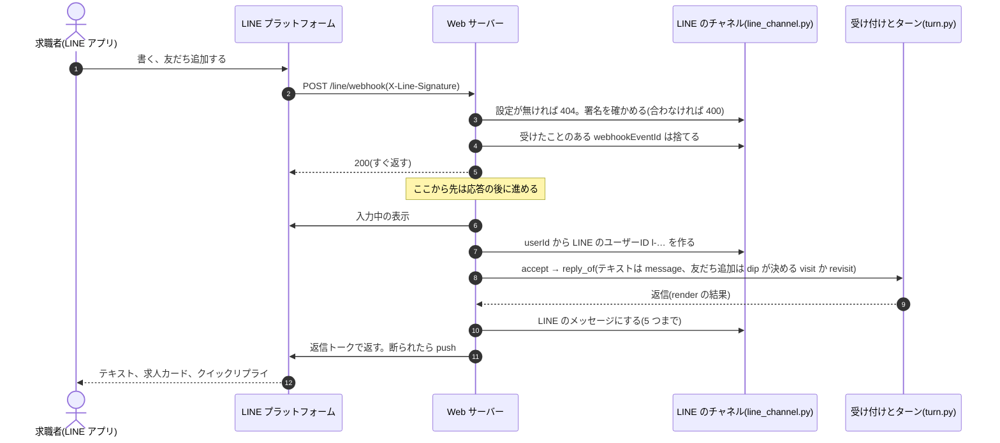

- 答えるのは、1 対 1 のトークのテキストのメッセージと、友だち追加(`follow`)と、アカウント連携の結果(`accountLink`。4.10)と、
  「データを消す」の確かめのクイックリプライ(`postback`)だけです。
  ほかのイベントは 200 で無視します。トークに送られたファイルと写真(`file`、`image`)も読みません。履歴書は LIFF 画面で読み込みます(下)。テキストが「アカウント連携」「連携解除」のときは、ターンに流さず連携を始める、外す(4.10)
- テキストが「データを見る」なら、プロフィール画面と同じ中身をテキストで返します。「データを消す」なら、消す範囲と確かめのクイックリプライ
  (postback)を返し、「すべて消す」を押したら Web の「すべて消す」と同じ処理で消します。確かめは 10 分、1 回だけです。どちらも LLM を
  呼ばず、ターン数も数えません。LINE のユーザーが自分のデータを見る、消す手段です([個人情報の設計メモ](../design/privacy.md) の 3.7)
- 友だち解除(`unfollow`。ブロック)では消しません。間違えて押すこともあり、もう一度友だち追加すれば前の続きから使えるほうが分かりやすいからです。
  使われなくなったユーザーは、期間で消す掃除(設計メモの 3.3。まだ入っていない)に任せます
- LINE のユーザーIDは `l-<16桁hex>` です。LINE の userId から、aica 専用の鍵 `AICA_ID_KEY` つきのハッシュ(HMAC-SHA256)で作ります
  ([ADR-0008](../adr/0008-keyed-line-user-id.md))。鍵を知らなければ、userId を知っていても `l-…` を作れません。
  鍵を変えると全員の ID が変わり、それまでのデータとつながりません。匿名ユーザーID(`w-…`)とも、
  シナリオユーザーとも重なりません。LINE の userId そのものは保存しません。返信と push の宛先にだけ、処理の間メモリで使います
- LINE のユーザーは本番のユーザーです。dip の時計は実際の時刻です(4.7)
- ターン数は、LINE のユーザーごとと全体で数えます。IP ごとには数えません。どの人の webhook も LINE のサーバーから届くからです
- 会話は Web と同じく、友だち追加の挨拶で新しい会話を始めます。テキストのメッセージは、Web のトーク画面を開いたときと同じ決まり
  (`server.talk_continues`)で、最後のやりとりから 30 分以内なら今の会話に続け、それより空いたら新しい会話を始めます。
  毎回 LLM に渡す履歴が伸び続けないためです。新しい会話でも、最初に dip の要約を読むので、保存した希望と相談のまとめは引き継がれます
- 間が空いた後の新しい会話は、本人の発言から始まります(入口は A: トーク)。Web の再訪のように先に挨拶はしません。
  LINE には「開いた」ときが無く、本人がもう書いているからです。再訪の挨拶は、まだ何も書いていない人に向けた 1 問なので、
  挟むと本人の発言に答える前に別の問いを出し、LLM の呼び出しとターンも 2 回分使います。入口 A も、要約を読んだうえで、
  前回の条件があれば確認形で使います
- 返信の形は Web と同じ `render` の結果です。求人カードは dip のツールが返した求人だけで、Flex Message の carousel で送ります。
  LIFF 画面のボタンは、LIFF の設定があれば LIFF URL(下)、無ければ公開 URL(`AICA_PUBLIC_URL`)の後ろにパスを付けたリンクにします。
  操作(`actions` の `resume_upload` と `voice_consult`)は、LIFF の設定があれば LIFF 画面へのボタンにし(下の「LINE のトークから
  LIFF 画面で使う」)、無ければ「LINE ではまだ…」の文で案内します(守り)。レジュメ・アーケードのボタンは、LIFF の設定があるときだけ出します
- エージェントには、システムプロンプトの「窓口」で今の窓口(Web か LINE か)と、LINE で使えるもの・使えないものを伝えます
  (`agent.channel_note`。使えるものは `line_channel.liff_features`)。使えないものは勧めないように言うので、本文でファイルを勧めた直後に
  断りの文が続く、という並びにしません
- エージェントが LINE でボタンを出すのは、応募フォームの続き(プッシュの後)と、読み取り結果と下書きの画面と、レジュメ・アーケードです。
  レジュメ・アーケードは、LIFF の設定があれば dip が LINE のユーザーにもゲームの URL(`arcade_url`)を渡し、エージェントは Web と同じ場面
  (シナリオと playbook の「ゲームで書類を作る」、本人が書類を作りたいと言ったとき)でボタンを出します(4.11)。
  LIFF の中のゲームは、AI と保存の API(`/api/liff/arcade/…`)を LIFF の本人で呼ぶので、AI(回数の上限は Web と同じ)も保存も LINE の本人で動きます。
  保存すると、その本人の LINE のトークに知らせが届きます(下の「LINE のアプリで遊ぶゲーム」)
- 友だち追加の挨拶(初回訪問)には、LINE で使える入口のボタン(LIFF の設定があれば履歴書とゲーム、LiveKit の設定もあれば音声相談)が出ます(4.1)。
  使えないものは、エージェントがボタンも文も出しません
- リッチメニュー(トークの下に常に出しておけるメニュー)は、音声相談、履歴書の読み込み、ゲーム、求人を探すの 4 つです。前の 3 つは
  トークのボタンと同じ LIFF URL(`line_channel.liff_page_url`)を直に開き、「求人を探す」はその文を本人の発言として送ります。
  どれも新しいイベントを作りません(押した後はトークのボタンから開いたときと同じ)。音声相談は LiveKit の設定があるときだけ置き、
  LIFF の設定が無いときは作りません。LINE に登録するのは人で、`scripts/line_rich_menu.py`(画像も作る)を使います(README の「LINE のリッチメニュー」)。
  登録と表示が月のメッセージ数に数えられるかは、LINE の公式の資料に書いてなく不明です(README)

LIFF 画面を LINE の本人で開く(task 203):

LINE のアプリで開いた LIFF 画面は、LIFF SDK の ID トークンを LINE に確かめてもらい、トークと同じ LINE のユーザーID(`l-…`)の本人にします。
設定(`LINE_LIFF_ID`、`LINE_LIFF_CHANNEL_ID`。前の名前の `LINE_LOGIN_CHANNEL_ID` も読む)が無ければ、LINE のボタンは今までどおり公開 URL の画面を開き、
LINE のユーザーが開いても本人の画面になりません(Cookie の匿名ユーザーIDで決めるため)。

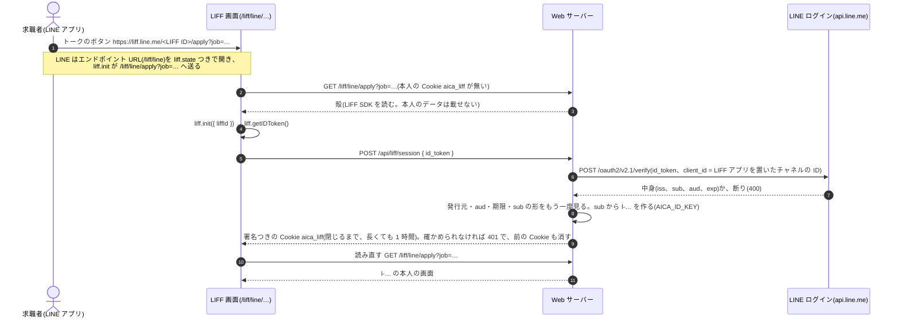

- LINE のボタンは `https://liff.line.me/<LIFF ID>/<パスの /liff/ より後>` です(`line_channel.liff_url_of`)。LIFF URL にするのは
  `/liff/line` の下にもある画面(応募フォームの続き、読み取り結果、下書き、レジュメ・アーケードとその下書き)と、操作の画面(音声相談、履歴書の読み込み)です。
  LINE ミニアプリの LIFF ID でも、この形の URL で開けます。LIFF アプリのエンドポイント URL は
  `<公開 URL>/liff/line` で、LINE はその後ろに続きを付けて開きます。Web のブラウザの `/liff/…` は今までどおり Cookie の匿名ユーザーIDです
- `/liff/line/…` は Cookie の匿名ユーザーID(`aica_uid`)を見ません。本人は、ID トークンを確かめた LINE のユーザーだけです。
  確かめられない(署名が合わない、期限切れ、別のチャネルの `aud`、LINE につながらない)ときは本人にならず、匿名ユーザーにも切り替えません。
  画面は「本人を確かめられませんでした」と出して止まります。応募の送信(`POST /liff/line/apply`)は 401 です
- トークンはそのまま信用しません。LINE の検証の API が署名・発行元・`aud`・期限を確かめ、Web サーバーも答えの発行元・`aud`・期限・`sub` の形を見ます
- LINE の userId はプロバイダーごとに違います。LIFF アプリを置くチャネル(LINE ミニアプリのチャネル)は、Messaging API のチャネルと同じプロバイダーに作ります。
  別のプロバイダーだと、同じ人でもトークとは別の `l-…` になります
- 確かめた本人は、署名つきの Cookie `aica_liff`(`l-…`、期限、`AICA_ID_KEY` から用途を分けて作った鍵の HMAC-SHA256)で覚えます。
  ブラウザを閉じたら消え、開いたままでも 1 時間で確かめ直します。外のブラウザ(PC など)を人と共用すると、その間は前の人の画面のままです。
  LINE の userId は Cookie にも保存にも載せません。LIFF の設定があるのに `AICA_ID_KEY` が無い、短いときは起動で止まります
- `POST /api/liff/session` は JSON の本文だけを受けます。ほかのサイトのフォームから、別人のトークンで本人を入れ替えさせないためです
- LIFF アプリは LINE ミニアプリ(未認証)のチャネルに作ります(LINE ログインのチャネルの LIFF アプリは、あとでミニアプリに移せないため)。
  ミニアプリは 1 つのチャネルの中に開発中・審査用・公開済みの環境があり、環境ごとに LIFF ID とエンドポイント URL があります。
  開発中の環境を開発用(Tailscale Funnel)に、公開済みの環境を公開用(Render)に使い、それぞれの `.env` に、その環境の LIFF ID と
  チャネル ID(ID トークンの `aud`)を書きます。環境ごとにチャネル ID が違うかは、コンソールで確かめます(このリポジトリでは確かめていません)
- 1 つのアプリの中で、画面はパスで分けます(`/liff/line/apply`、`/resume`、`/voice/draft`、`/voice`、`/resume/upload`、`/arcade`、`/arcade/draft`)。
  パスつきの LIFF URL で開くと、LINE はまずエンドポイント URL を `liff.state=<パス>` つきで開き、`liff.init` がその画面へ送ります。
  入口(`/liff/line`)は本人がいても殻を返して送り先へ渡し、各画面は本人が無ければ殻で本人を確かめてから読み直します

LINE のトークから LIFF 画面で使う(task 204):

返信の `actions` は、LINE では LIFF 画面へのボタンになります(`line_channel.LIFF_ACTIONS`)。`resume_upload` は
`https://liff.line.me/<LIFF ID>/resume/upload`、`voice_consult` は `…/voice`(LiveKit の設定も要る)です。画面は上の流れで
LIFF の本人(`aica_liff`)になってから開きます。結果は、その本人の LINE のトークに push で届きます。

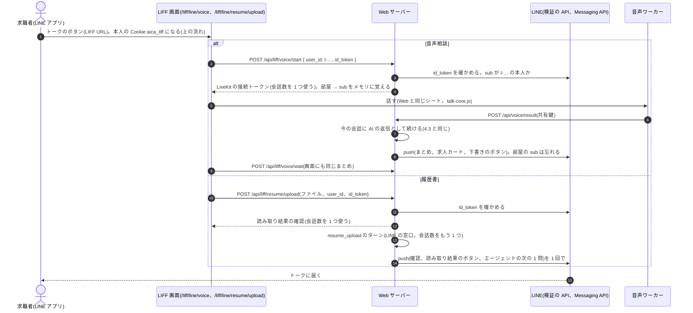

- push の宛先の LINE の userId は、操作を始める API で LIFF の ID トークンをもう一度確かめて受け取ります(Cookie には userId を載せないため)。
  届けるまでメモリにだけ置き、保存もログもしません。音声相談の部屋の宛先は、結果が届くか、始めてから 1 時間たつと忘れます
  (1 時間を過ぎて届いた結果は push しません)。
  Web サーバーを起動し直すと忘れるので、その間に終わった面談の結果は会話には入りますが、LINE のトークには届きません
- 別の人の ID トークン(本人の Cookie と違う `sub`)では始めません(401)。本文のユーザーが Cookie の本人と違えば 403 です
- 会話数は Web と同じです。音声相談は 1 つ、履歴書は読み取りと続きのターンで 2 つ使います。IP ごとには数えません
- 画面の下書きのボタンは `/liff/line/voice/draft`(LIFF の本人のまま開く)、トークに届くボタンは LIFF URL です
- Messaging API の設定が無いと push できないので、履歴書の続きのターンは進めません(画面に確認だけ出します)

LINE のアプリで遊ぶゲーム(task 219):

LINE のトークのゲームのボタン(`https://liff.line.me/<LIFF ID>/arcade/<ゲーム>`)は、上の流れで LIFF の本人になってから
`/liff/line/arcade/<ゲーム>` を開きます。AI と保存につながった 2 本には、サーバーが LIFF の設定(`window.AICA_LIFF`)と LIFF SDK を入れ、
ゲームの部品(`arcade-ai.js`)は Web の `/api/arcade/…` の代わりに `/api/liff/arcade/…` を呼びます(中身は同じで、本人だけが違う)。

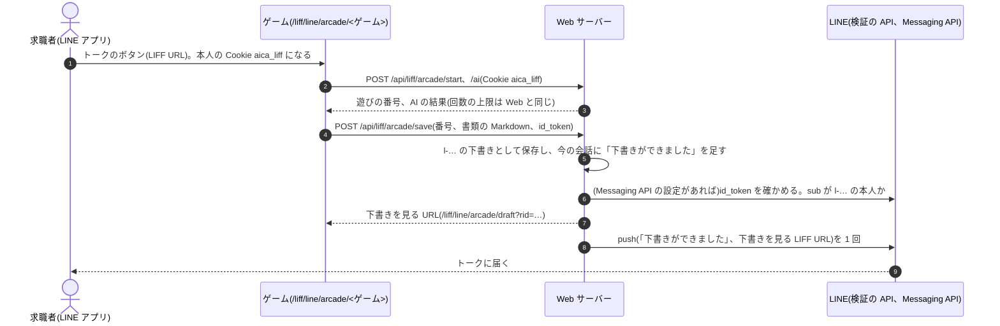

- 本人は Cookie `aica_liff` の LINE のユーザー(`l-…`)です。Cookie が無い、期限切れなら 401 です。ゲームの部品は、401 のとき
  ID トークンで 1 回だけ確かめ直します(遊んでいる間に 1 時間を過ぎても続けられるように)。`scenario_user` は見ません
- 会話数(AI つきで始めるときの 1 つ)と 1 日の AI つきの遊びは、LINE のユーザーごとと全体で数えます。IP ごとには数えません
- push は保存 1 回につき 1 通で、1 人 1 日 3 通までです(月のメッセージ数に数えられます。保存は何度でもでき、AI なしの遊びは会話数も使わないため。
  超えた保存も下書きと会話には入ります)。宛先の LINE の userId は保存の本文の ID トークンから受け取り、
  届けるまでメモリにだけ置きます。ID トークンが無い、確かめられない、別の人のものなら、保存だけして push しません
  (本人の書類を失わないため。別の人には送りません)。Messaging API の設定が無いときも push しません
- 保存した下書きは、その LINE のユーザーの要約(`arcade_draft`)と「データを見る」に出ます。下書きの画面
  (`/liff/line/arcade/draft`)で見て直せます

LIFF の中でマイクを試す(task 205):

LINE から音声相談を使えるようにする前に、LIFF の画面の中でマイク(`getUserMedia`)と WebRTC が使えるかを、人が実機(iPhone、Android)で確かめます。
画面は `/liff/line/mic-check` で、本人を決めません。結果(使えたか、エラーの名前、音の大きさ、LIFF の環境)だけをサーバーのログに 1 行書き、
声もその文字起こしも送りません。使えなかったときの逃げ道として、外のブラウザで同じ確認を開けます(`liff.openWindow`)。
外のブラウザで同じ本人のまま音声相談を始める仕組みは、実機の結果を見てから作ります

### 4.9 dip の行動データと状況の要約

dip の行動データは、行動の元データと状況の要約に分けて持ちます(2026-10-21 に決定、[ADR-0005](../adr/0005-separate-event-log-and-member-summary.md))。
元データは dip の会員(`dip_id` が鍵)と行動のイベントのログで、追記だけです。要約のバッチが元データから全員分の要約を作り直し、
dip のツールは要約だけを読みます。エージェントに渡るのは要約から作った事実だけで、生のログは渡りません。
会話の中で書くことは元データに追記し、次のバッチまでは、書いた本人の分だけ要約に重ねて読みます
(2026-10-21 に決定、[ADR-0006](../adr/0006-tools-read-summary-and-overlay-own-writes.md))。

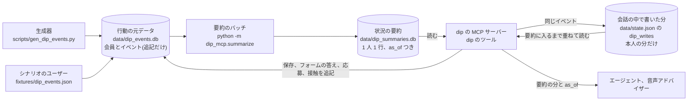

- イベントは、訪問、閲覧、保存(と取り消し)、応募フォームの離脱、応募、選考の状態の変化、問い合わせ、dip から本人への接触です
- 要約は 1 人 1 行で、訪問(直近の日時と 30 日の回数)、直近の閲覧、応募と選考の状態、保存、離脱、接触、職種・エリア・時間帯の傾向を持ちます。
  応募と保存と応募済みの求人は全件を持ち、画面とツールの中の絞り込み(応募済みの求人を推薦から外す、求人を指定した選考状況)は全件を使います。
  件数で切るのはエージェントに渡す一覧だけで、応募は新しい順に 5 件、保存は 10 件と「ほかに N 件」です。
  長さの上限(3,500 字)は、1 行ではなくエージェントに渡しうる分にかけます。中身は [LLD の 5.8](lld.md#58-dip-の行動の元データと状況の要約)にあります
- 要約は `as_of`(どの時刻までのイベントで作ったか)と `through_seq`(取り込んだイベントの最後の番号)を持ちます。バッチの後に足したイベントは、
  次のバッチまで要約に入りません
- 元データはシミュレーションのデータで、生成器が作ります(既定は 1,000 人 × 6 か月、乱数の種を固定)。シナリオの 4 人
  (`fixtures/users.json` で dip ID のある人)も同じイベントの形で入ります。生成器とバッチの時刻は `SIM_NOW` から見て作ります

**会話の中で書いたことと、いつ時点の情報か**

- 会話の中で書くもの(`save_job`、`resume_application_form`、LIFF 画面の応募の確定、プッシュの接触、プロフィールの保存の取り消し)は、
  元データにイベントとして追記します。要約は次のバッチまで変わりません
- 同じイベントを、その LINE のユーザーの `dip_writes` にも残し、要約にまだ入っていない分を読むときに重ねます。保存した直後の
  「保存した求人」、要約の `saves_30d`、プロフィールに、保存がすぐ出ます。同じシナリオから始めた別のユーザーには重なりません
- 重ねるのは書いた事実だけです。傾向(`tendency`)と閲覧の数は次のバッチを待ちます
- エージェントに渡す要約は `as_of`(要約を作った時刻)を持ちます。dip の Prompt に「行動の事実は `as_of` 時点のもので、その後の行動は
  入っていないことがある」と書いてあります。期間の判定(90 日、7 日)は、読む側がそのユーザーの「今」(4.7)でもう一度絞ります
- dip と連携していない人は会員がいないので、元データには書かず、`dip_writes` にだけ残ります。`dip_id` はあっても元データの会員に
  無い人(シナリオの会員を入れずに作った元データ、連携の表と dip のずれ)も同じです
- LINE のユーザーIDから `dip_id` を引くのは 1 か所(`dip_mcp/behavior.py` の `dip_id`)です。読むのは連携の表です(4.10)

**今のコード**

- 元データ、生成器、要約のバッチ(task 180)と、要約を読むツール(task 181)があります。行動を読み書きするのは `dip_mcp/behavior.py` です
- 元データと要約は `State` と同じディレクトリに置きます。要約が無ければ、シナリオのユーザーの元データを入れて `SIM_NOW` で
  バッチを 1 回回してから始めます(評価とテストは実行ごとの一時ディレクトリなので、毎回この状態から始まります)
- シナリオの 5 人で、行動を読むツールの結果は task 180 の時点と同じで、違うのは `as_of` だけです(`tests/test_dip_summary_read.py`)

### 4.10 LINE のアカウント連携

LINE のユーザーと dip の会員を、LINE の Messaging API の「アカウント連携」の流れで結びます
(2026-10-21 に決定、[ADR-0007](../adr/0007-line-account-link-table.md))。結んだ対応は連携の表(`data/dip_accounts.db`)に置き、
dip のツールは連携の表で `dip_id` を引きます。表に無い人は「dip ID と未連携の新規」の扱いです。関数と表の形は
[LLD の 4.12](lld.md#412-line-のアカウント連携) にあります。

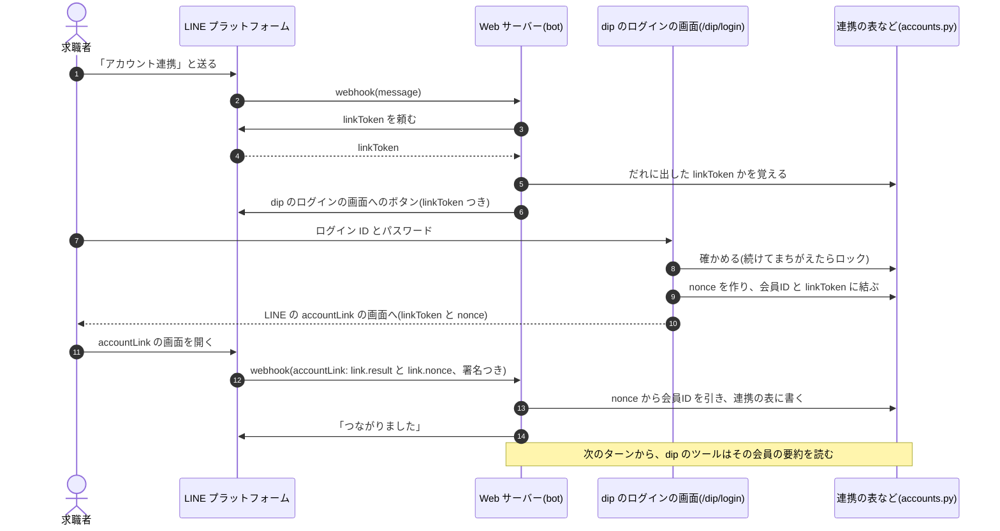

- 連携を始める、外すのは決まった文(「アカウント連携」「連携解除」。リッチメニューのボタンが送る文)です。LLM を使わず、ターン数も数えません
- nonce は推測できない乱数(256 ビット)です。1 回だけ使え、10 分で切れます。使い終わり、期限切れ、`link.result` が ok でない、
  nonce を作ったときの linkToken が webhook のユーザーに出したものでない、のどれかなら連携しません。署名の無い webhook は 400 です(4.8)
- ログインのパスワードはハッシュだけを持ちます。同じログインID で続けて 5 回まちがえると 15 分ログインできません(会員にいない ID も同じ)
- LINE の userId そのものは保存しません。連携の表の鍵は LINE のユーザーID(`l-…`)です。nonce と linkToken もハッシュで持ちます
- 連携を解除すると、未連携の扱いに戻ります。会話の中で書いた分(`dip_writes`)は書いたときの会員を持ち、今の会員の分だけを重ねるので、
  前の会員の行動は重なりません。会話の途中でつないだ・解除したことは、次のターンの前にエージェントへ知らせます(4.4 の知らせと同じ)
- シナリオのユーザーは最初から連携済みです(`fixtures/users.json` の `dip_id` が種)。開発者画面のブラウザごとのシナリオユーザーも、
  写し元と同じ会員と連携済みで始まります。評価の結果は変わりません
- Web のトーク画面の匿名ユーザーは、開発者画面の「アカウント連携(偽物の LINE)」から同じ流れを試せます。LINE の役は偽物の LINE
  (`line_runtime/fake_line.py`)がします。テストも同じ偽物の LINE を使い、実 LINE は呼びません

### 4.11 レジュメ・アーケード

ドット絵のゲームで、遊びながら職務経歴書を作る LIFF 画面です。決めたことと続きの作業は
[PRD](../prd/resume-arcade.md) にあります。

- ハブ(`GET /liff/arcade`)と 8 本のゲーム(`GET /liff/arcade/{game}`、`game` はファイル名)を、`line_runtime/static/arcade/` の
  HTML のまま返します。LINE のアプリでは、LIFF の本人を確かめてから `/liff/line/arcade`、`/liff/line/arcade/{game}` で同じ HTML を返し、
  ハブのリンクも `/liff/line/arcade/…` になります(task 204)。AI と保存につながった 2 本には、LIFF の設定と LIFF SDK を入れます(task 219。4.8)。
  LIFF の設定が無ければ、ゲームのボタンを LINE に出しません。
  知らない名前は 404 です。ハブに出すのは、案内の部品がそろい、AI と保存がつながった 2 本(あなたという事件、
  仕事の収穫)だけです。残りの 6 本は開発者画面からだけリンクし、AI を使わず、本人のデータも読み書きしません
- 日本語の答えの判定(数字の検出、字数のあいまいさ、言い切り、数字の空欄、職務経歴書の Markdown)は、共通部品
  `arcade-ja.js` に 1 つだけ置き、2 本が使います。AI と保存の API を呼ぶ部品は `arcade-ai.js` です
- ゲームの画面は Cookie を発行も要求もしません。2 本は、ほかの LIFF 画面と同じく Cookie の匿名ユーザーIDの本人として API を呼びます。
  LINE のアプリで開いたときは、LIFF の本人(`aica_liff`)として `/api/liff/arcade/…` を呼びます(4.8 の「LINE のアプリで遊ぶゲーム」)。
  トーク画面を開いていない(Cookie が無い)ときは、簡易分析で最後まで遊べて、保存のボタンを出しません
- 氏名と連絡先は聞きません。書類には `[氏名]` と `[メール] · [電話] · [居住地] · [リンク]` の空欄が残り、本人が後で書きます

AI の呼び出しと保存の流れです。画面は LLM を直接呼ばず、指示の文も送りません。

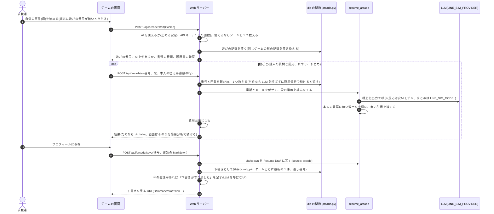

- 費用の上限: 1 回の遊びの反応は 50 回まで(`AICA_ARCADE_REACTIONS_PER_PLAY`)、まとめは 2 回(証拠のまとめは最後のまとめの
  1 回を残す)、1 人 1 日の AI つきの遊びは 3 回(`AICA_ARCADE_DAILY_AI_PLAYS`)。ターン数の上限を超えていたら AI なしで始めます。
  `AICA_ARCADE_AI=0` で AI を止めます。答えは 600 字、まとめで送る書類の行は 1 行 120 字、引用 40 字、1 職場 6 行、合計 4,000 字まで
- 遊びの番号: 無い、ほかの人の、置き換えられた、「すべて消す」の前の番号では、`/ai` は LLM を呼ばず、`/save` は 403 です。
  始めてから 24 時間を過ぎたら `/ai` は簡易分析を返しますが、保存はできます
- 書類の種類は雇用区分で決めます(正社員は職務経歴書、アルバイト・パートは履歴書)。未定なら保存のときに本人が選びます。
  ゲームは雇用区分を変えません。履歴書なら書類に自己PR が入ります。未定のときも最後のまとめは自己PR を書いておくので、
  本人が後で選び直しても AI を呼び直しません。AI を使わない簡易分析でも、本人の行から簡易の自己PR を作ります
- エージェントは、下書きを dip の要約の `arcade_draft` で読み、ボタンにするゲームの URL は要約の `arcade_url` だけを使います。
  下書きの空欄の数字を本人が答えたら、`arcade_draft` の `view_url`(下書きの画面)を「下書きを見る」のボタンにします。
  aica は下書きに書き込まず、数字は本人が画面で入れます。
  LINE のユーザーには、LIFF の設定があるときだけ `arcade_url` と `view_url` を載せます。無ければ載せず、LINE のメッセージも `/liff/arcade` の
  ボタンを出しません(4.8)。dip は `line_runtime` を import しないので、LIFF の設定の判定(`arcade.liff_configured`)を
  `line_channel.liff_configured` と同じ環境変数で持ちます
- 下書きは、プロフィールの「ゲームで作った下書き」から見て、直して(`/liff/arcade/draft`)、消せます。「すべて消す」で消え、
  通し番号は持ち越すので、古いリンクが新しい下書きを開くことはありません

## 5. 責任の分担

LINE 側と dip 側のどちらに置くかは 1.1 で決めます。この章は、LLM とコードの分担です。

| 判断が要る(LLM) | 決まっている(コード) |
|---|---|
| 返信の文面と、次に何を聞くか(エージェント、音声アドバイザー) | プッシュしてよいか(`push_trigger`) |
| 会話の段階と、いつ提案するか | 求人の絞り込みと並び順(`match_score`) |
| 雇用区分を切り替えるか(本人の発話から) | 切り替えの記録、取り消し、画面の表示 |
| 何を希望として保存するか | 保存してよい項目と値(個人情報、長さ) |
| 相談のまとめを書く | ターン数の上限、費用台帳 |
| 履歴書を読み取る、下書きを書く | 個人情報の項目を空にする、電話とメールを消す |
| 評価のジャッジ(相談の深さ、トーン) | 評価の判定(形式、事実性、切り替え) |

コードが決めている主な規則です。

| 規則 | 中身 | 場所 |
|---|---|---|
| プッシュの判定 | dip ID と未連携、直近 3 日以内に接触済み、根拠の事実が無い、のどれかなら送らない。許可したら接触として記録し、根拠の事実を LINE 側に渡す。3 日はシミュレーション用の仮の値 | `dip_mcp/logic.py` の `push_trigger` |
| 求人カード | dip のツールが返した求人だけをカードにする。モデルが選ぶのは求人 ID だけ。音声の結果も dip の求人データで作り直す | `runtime.py` の `render`、`logic.record_voice_result` |
| ボタン | `/liff/` で始まる dip の画面の URL だけを出す | `runtime.py` の `render` |
| 並び順 | 点の合計(`match_score`、内訳 `score_breakdown`)。職種の傾向は 1 番目 2 点、2 番目 1 点。時間帯の傾向 1 点(両方の区分を混ぜるときは使わない)。エリアの傾向 1 点。駅近 0〜1 点(徒歩 10 分以上は 0)。給与は時給 ÷ 2,000 円、年収と月給は年収の中央値 ÷ 800 万円(上限なし)。keywords の意味の近さ × 24。希望年収を超える 100 万円ごとに 1 点(3 点まで) | `logic.match_breakdown`、`logic.recommend` |
| 本人の傾向 | 90 日以内の応募と、30 日以内の閲覧と保存から数える。応募済みの求人は推薦に出さない | `logic.preferences`、`logic.recommend` |
| 待つ(wait) | 本人が断ったときだけ記録できる。音声側からは記録しない | `logic.record_outcome`、`voice_resume/dip.py` |
| 会話の決まり | 雇用区分ごとの質問の数、吹き出しの字数、何回目の返信までに会話の段階に入るか。playbook、dip の Prompt、評価が同じ値を使う | `logic.CONVERSATION_RULES` |

LLM に dip の Prompt で守らせ、評価がコードで確かめる規則です(`dip_mcp/prompts/baitoru_assistant.md`)。

- 1 回の返信で質問は 1 つ。初回は必ず質問で終える。決まった回数の返信までに会話の段階に入る
- 相談は playbook に沿って 1 問ずつ聞く。相談の途中は上の期限を当てない
- 選択肢は最大 4 つ。問いの選択肢は、答えの候補 2〜3 個と「今はいい」にする(逃げ道は「今はいい」1 つ)。候補が作れない自由な問いは選択肢を付けずに文で答えてもらう。それ以外の返信は必ず選択肢で終える
- 「今はいい」「送らないで」は理由を聞かずに短く終え、wait を記録する
- 履歴には 90 日以内の行動だけに、確認形で 1 回だけ触れる。閲覧した求人名は挙げない
- 個人情報はトークで受け取らず、LIFF 画面を案内する

## 6. 信頼の境界

### 個人情報

- 履歴書と下書きの `personal`(氏名、住所、電話、メール、生年月日)は、何が来ても空で保存します
- 希望とプロフィールの値は、決まった項目だけを受け付け、電話、メール、住所らしい値は保存しません(`logic.save_preferences`)
- 応募フォームの続きは、個人情報の項目と、値に電話、メール、住所らしい所を含む項目をトークで受け取らず、LIFF 画面を案内します(`logic.resume_form`)
- 履歴書のファイル本体とファイル名は保存しません。ファイル名は OpenAI にも送りません(PDF は形式だけの固定の名前 `resume.pdf` で送る)
- テキストのある PDF は、テキストをローカルで取り出し、テキストだけを OpenAI に送ります。顔写真などの画像は届きません
  ([privacy.md](../design/privacy.md) の 3.2 の案 B)。氏名と住所はテキストに残るので、本人に隠してもらう案内は要ります
  - ファイルをそのまま送るのは、テキストの無いページ、ページの 1 割以上を覆う画像(OCR の文字を重ねたスキャン、画像で貼った表)、
    リンク以外の注釈(閲覧アプリで書き込んだ文字、フォームの入力欄)、読めない字ばかりのテキスト、ToUnicode の無いフォント、
    取り出しきれないテキスト(Form XObject の中)のどれかがある PDF と、読めない PDF、大きすぎる PDF です。
    テキストだけでは書いた中身が欠けるためです。JPEG と PNG も、そのまま送ります
  - 手元の解析は、展開しながら上限(1MB)で止めます。作り込んだ PDF で Web サーバーのメモリと CPU を使わせないためです(LLD の 4.3)
- 外のサービスに残る量を減らします([privacy.md](../design/privacy.md) の 3.2)
  - OpenAI: Responses API の呼び出しはすべて `store=False` で、応答を残させません。エージェントは前の応答の ID を使わず、
    毎回会話の全文を送ります。reasoning は暗号化した中身(`reasoning.encrypted_content`)を受け取って送り返します
  - Deepgram: `mip_opt_out=true` で、声を改善プログラムに使わせません
  - LiveKit Cloud: `record=False` で、録音、文字起こし、ログを LiveKit Cloud に残しません
  - 本番の STT は Deepgram に固定します(`VOICE_RESUME_STT_PROVIDER=deepgram`)。`openai` にすると声そのものが OpenAI に届きます
  - 先方の保持(OpenAI の不正利用の監視のログなど)は、aica からは消せません
- レジュメ・アーケードのゲームは、氏名と連絡先を聞きません。進み具合と答えはそのブラウザの localStorage に残ります。AI の段では
  答え(まとめでは書類の行)が Web サーバーを通って LLM のプロバイダに送られますが、サーバーには保存せず、ログにも出しません。
  送る前に電話とメールを伏せます(`redact_pii`)。保存するのは本人が保存した書類だけで、`scrub_pii` をかけます(4.11)
- 本人がトークに書いた文(Web と LINE)は、電話、メール、住所らしい所を `[個人情報を削除]` に置き換えてから(`turn.accept`、`redact_personal`)、
  会話に保存し、LLM のプロバイダに送ります。aica はどれも使わないので、伏せた後の文だけが LLM にも会話の保存にも届きます。
  伏せたときは、画面が本人の吹き出しの下に「電話番号などは送らないようにしました」と出します。氏名はコードでは見分けられないので伏せません
- system prompt に LINE のユーザーIDを載せません。ツールの `line_user_id` には `me` を入れさせ、`PinUserMiddleware` が会話のユーザーに置き換えます。
  dip のツールの結果にもユーザーIDは入りません
- 音声アドバイザーの調べもの(`web_research`、`research_company`、`wage_average` の web の分)は、問いに電話、メール、住所らしい所があれば、
  調べずに断ります(`personal_value`)。問いは OpenAI を通って検索エンジンにも届くからです
- 音声相談の文字起こしは、本番ではファイルに残しません。下書きを作る間だけ音声ワーカーのメモリにあります。
  `data/voice-resume/` に書き出すのは、開発で `VOICE_RESUME_WRITE_FILES=1` にしたときだけです
- 保存したものには期間があり、掃除が機械で消します(4.6)。会話は最後のやりとりから 30 日、使われなくなった人は最後の利用から 180 日、
  費用台帳のユーザーIDは 90 日です。180 日で消すときは「すべて消す」と違い、持ち越す値も残さずに行を丸ごと外します
- 本人は、プロフィール画面の「データを書き出す」で保存内容を受け取れます。「すべて消す」の後も残る費用台帳の行は、ユーザーIDを外します(例外は LLD の 4.6)
- ログに出すのは、ユーザーID、イベントや処理の種類、件数、値があるかないか、例外の型名だけです。本人の発言、希望、文字起こし、
  ファイル名、例外の文は出しません。API のエラーの文に、送った本文が入ることがあるからです。ログはホスティングの決まりで残り、
  本人が消せません。本番では SDK(livekit-agents、OpenAI、Anthropic、httpx など)のロガーを WARNING にします。
  INFO や DEBUG で本文を出しうるからです(`line_runtime/log_policy.py`。LLD の 8 章、[設計メモ](../design/privacy.md)の 3.4)
- 個人情報の決まりは `resume_draft/pii.py` の 1 か所です。電話とメールを探す `has_pii`、住所らしい所を探す `ADDRESS_LIKE` と、
  Resume Draft から電話、メール、郵便番号を消す `scrub_pii`(読み取り結果、下書き、dip への保存)があります。
  dip は、本人の値を受け取るかを `personal_value`(電話、メール、住所。希望の保存、まとめを直す、フォームの続き)で決め、
  文の中を `redact_personal`(同じ 3 つ。相談の理由とまとめ、雇用区分の根拠)で伏せます。
  どれも全角の数字やハイフンを `fold_pii` でそろえてから照合します
- 住所らしい所は、同じ文に住んでいる所を言う言葉(「住んでいる」「住所」「在住」「自宅」「家は」「引っ越し」など)があるときだけ住所とみなします。
  「住所:」のような見出しだけの行は、次の行も同じ文とみなします(見出しと住所を別の行に書く連絡先の貼り付け)。
  駅の名前(`新宿三丁目`)や数の幅(`5-10人`)は住所と同じ形になることがあり、形だけで見分けると、`新宿三丁目5分以内で探して` のような
  求人の検索の条件が消えるからです。電話とメールは、住む言葉が無くても伏せます。言葉の一覧と理由は LLD の 1.8 です。
  伏せるのは住所の部分(地名から番地・建物まで。前に書いた郵便番号も含む)だけで、同じ文の残り(「に住んでいて近くのカフェで働きたい」)は LLM に届きます
  住む言葉と同じ文では、伏せ漏れしない側に倒します。地名の後ろの数の並び(`みほん町552`、`あおば町12の3`、`西新宿2-8`)は、数が 1 つでも住所とみなし、
  外すのは後ろに単位が続く数(`時給1200円`、`5-10人`、`20代`)だけです。そのため、住所でない数まで伏せることがあります
- 応募フォームの続き(LIFF 画面)は、求人が架空のデモなので、欄に架空の値を最初から入れ、本物の情報を入れないよう画面に書きます。
  送られた値は読まず、保存しません。応募の確定だけを dip の状態に書きます
- 利用規約とプライバシーポリシーの原文は `docs/legal/` の 1 か所です。Web サーバーが HTML にして `/legal/terms`、`/legal/privacy` で出し、
  トーク画面と LIFF 画面の下から開けます。版は `line_runtime.legal` の定数で、同意の記録が残します(下の「同意」)。
  ポリシーは [設計: 個人情報の扱い](../design/privacy.md) の推奨を実装した後の姿を書いているので、公開はそれぞれの task の後です
  ([docs/legal/README.md](../legal/README.md) の「ポリシーの文が頼る実装」)

### 同意

[privacy.md](../design/privacy.md) の 3.6 です。海外の事業者(OpenAI など)に送るので、何をどの国へ送るかを先に示し、明示のボタンで同意を取ります。
文言と記録は `line_runtime/consent.py` の 1 か所です。

| 場所 | 取り方 |
|---|---|
| Web: 初めてトークを開いたとき | 挨拶の前に、トークの上に同意の画面を重ねる。要点と、規約とポリシーへのリンクと、「同意して始める」。押すまで LLM を呼ばない |
| LINE: 友だち追加と、同意の前の発言 | 要点と、規約とポリシーの URL と、クイックリプライ「同意して始める」(postback)を返す。押したら挨拶する。発言はターンに流さず、残さない |
| 履歴書のアップロード | ファイルを選ぶ直前に、追加の説明と「同意してファイルを選ぶ」(初回だけ) |
| 音声相談 | シートを開く直前に、追加の説明と「同意して始める」(初回だけ) |

- 同意は dip の状態の本人の行に `consents: {terms|resume|voice: {version, at}}` として残します。`version` は規約とポリシーの版
  (`line_runtime.legal`)です。どちらかの版が上がったら、3 つとも取り直します
- 同意は人ごとです。開発者画面のシナリオユーザーは、同じブラウザの匿名ユーザーの同意を見ます
- 画面は示した版を送り返し、今の版と違えば記録しません(示していない文言への同意を残さない)
- 同意の前は、LLM のプロバイダに何も送らず、本人のデータを足しません。ターン(`turn.accept`)、履歴書の読み取り、音声相談のトークン、
  ゲームの AI、プロフィールに足す・直す口、シナリオと連携の開始は、画面を通らずに呼ばれても、同意がまだなら断ります。
  データを見る、消すは同意の前もできます
- 「すべて消す」と、期間で消す掃除では、同意も行と一緒に消えます。次に使うときに取り直します
- 18 歳未満の方には、保護者の同意を得てから使うよう、同意の画面に書きます。年齢は聞きません
- アカウント連携の画面に連携先へ渡すものを書くこと(3.6 の表の最後の行)は、まだしていません。連携先は架空のデモです

### ユーザーの分離

- 画面を開いたとき(`GET /`、`GET /dev`)だけ、匿名ユーザーID(`w-<16桁hex>`)を Cookie `aica_uid` で発行します
- ブラウザから呼ぶ API は、正しい Cookie が無ければ 401 です。扱えるのは Cookie の匿名ユーザーIDのユーザーと、
  その匿名ユーザーIDのシナリオユーザーだけで、ほかは 403 です
- 本人のデータを指す URL にユーザーIDを載せません。LIFF 画面は Cookie から本人を決めます。Web のブラウザの `/liff/…` は匿名ユーザーIDの
  Cookie(`aica_uid`)、LINE のアプリの `/liff/line/…` は、LIFF の ID トークンを LINE に確かめてもらった本人の署名つきの Cookie(`aica_liff`)だけです(4.8)
- エージェントが呼ぶ dip のツールの `line_user_id` は、会話のユーザーに固定します(`agent.py` の `PinUserMiddleware`)。
  LLM にはユーザーIDを渡さず、`line_user_id` には `me` を入れさせます
- 同じシナリオから始めた別のブラウザのシナリオユーザーは、同じ dip の会員の要約を読みます。会話の中で書いた分(保存など)は
  本人にだけ重なるので、互いに見えません(4.9)
- 評価は Web サーバーを通らないので、Cookie を使いません
- dip のログインの画面(`/dip/login`)は Cookie を使わず、dip の会員のログインで会員を決めます。ログインできた後の nonce は、
  webhook のユーザーに bot が出した linkToken とだけ組み合わせられます(4.10)。偽物の LINE の accountLink の画面は、開いた Cookie の
  匿名ユーザーが linkToken のユーザーのときだけ連携します
- LINE の webhook は、Cookie ではなく署名(`X-Line-Signature`。チャネルシークレットで本文の HMAC-SHA256 を取った値の base64)で
  守ります。署名が無い、違うときは 400 で、エージェントを動かしません。LINE のユーザーIDは LINE の userId からだけ作るので、
  ブラウザから LINE のユーザーを名乗ることはできません(Cookie の形は `w-…` だけ)

### API キーと内部の鍵

- 外のサービスのキー(`OPENAI_API_KEY`、`LIVEKIT_*`、`DEEPGRAM_API_KEY`、`CARTESIA_API_KEY` など)は
  リポジトリ直下の `.env` に置きます。git には入れません
- dip の MCP サーバーの子プロセスは、親の環境変数をすべて受け取ります
- ブラウザに渡すのは、LiveKit の部屋ごとの接続トークン(有効期限 5 分)だけです
- LINE のチャネルシークレットとチャネルアクセストークン(`LINE_CHANNEL_SECRET`、`LINE_CHANNEL_ACCESS_TOKEN`)も `.env` に置きます
- LINE のユーザーIDを作る鍵(`AICA_ID_KEY`)も `.env` に置きます。漏れると、userId を知っている人が `l-…` を作れます。
  LIFF の本人の Cookie の署名の鍵もここから作るので、漏れると LIFF 画面で誰にでもなれます
- LIFF ID とチャネル ID(`LINE_LIFF_ID`、`LINE_LIFF_CHANNEL_ID`)は秘密ではありませんが、ほかの LINE の設定と同じく `.env` に置きます
- 音声ワーカーから Web サーバーへの `POST /api/voice/result` と `POST /api/voice/session` は、Cookie ではなく内部の鍵 `AICA_INTERNAL_KEY`
  (`Authorization: Bearer`)で守ります。鍵が無い、違う、サーバーに設定が無いときは 401 です。音声相談の設定(`LIVEKIT_*`)があるのに
  鍵が無い、短いときは、Web サーバーも音声ワーカーも起動で止まります(結果が届かないまま相談だけ進むのを防ぐ)

### LLM の出力と外のデータ

- エージェントが読む dip の事実は、dip のツールの結果と、イベントに添えた dip の事実だけです(1.1)
- LLM の出力はデータとして扱います。求人カード、ボタン、ユーザーIDは、コードが dip の事実と照合してから使います
- dip のツールの結果と本人の発言は、エージェントの入力にそのまま入ります。プロンプトインジェクションの被害は、
  ツールの `line_user_id` の固定と、カード、ボタンの照合で絞っています
- 音声アドバイザーは、本人が気になったことを web 検索します(`web_research`、`research_company`)。問いに電話、メール、住所らしい所があれば調べません
- 音声相談のシートは LiveKit のブラウザ用ライブラリを jsDelivr から読みます
- レジュメ・アーケードのゲームは、字体を Google Fonts から読みます。本人のブラウザが Google に接続します(自前で置くかは未定。PRD の「決まっていないこと」の 7)

### 費用

- 1 日あたりのターン数に、匿名ユーザーIDごと、IP ごと、全体の上限があります(`line_runtime/quota.py`)。対象は Web の API と
  LINE の webhook で、評価にはかかりません。LINE のユーザーは、LINE のユーザーIDごとと全体で数えます(4.8)
- LINE の返信トークで返せなかったときの push は、LINE 公式アカウントの月のメッセージ数に数えられます
- 音声相談は始めるときにターンを 1 つ数えます
- レジュメ・アーケードのゲームは、AI つきで始めるときにターンを 1 つ数え、1 回の遊びと 1 人 1 日の回数にも上限があります(4.11)。
  2026-10-25 に実 API(OpenAI)で 1 回遊んだ費用は $0.016(証人 2 人と最後のまとめ)でした

## 7. 配置

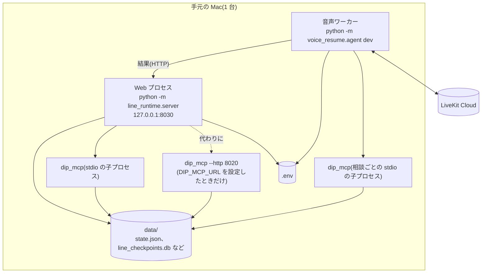

- 2 つのプロセスは同じリポジトリ、同じ venv、同じ `.env` で動かします
- dip の状態は 1 つの JSON ファイルで、複数のプロセスがファイルロック(`fcntl`)を取って読み書きします。
  そのため、同じマシンの同じファイルシステムに置く必要があります
- Web プロセスは 1 つだけを前提にしています。ターンの排他、音声相談の待ち合わせ、読み取れなかったアップロードは
  プロセスのメモリにあります
- 期間で消す掃除は、Web プロセスの中で起動時と 1 日 1 回走ります(cron などの外の定期実行は要りません)。手で走らせる
  `python -m line_runtime.purge` は、Web プロセスの内部の口(`POST /api/internal/purge`、`AICA_INTERNAL_KEY`)を呼ぶだけです。
  別のプロセスが自分で消すと、Web プロセスのメモリにある `user_lock` を取れず、進んでいるターンが消した内容を書き戻すためです
- Web サーバーは `127.0.0.1` で待ち受けます。プロキシの後ろに置くとき(cloudflared のトンネルも含む)だけ `AICA_TRUST_PROXY=1` にします
- LINE で試すときは、トンネル(cloudflared など)で手元の Web サーバーを https で公開し、その URL を LINE Developers の
  Webhook URL と `AICA_PUBLIC_URL` に設定します(手順は README)。トンネルの URL を知っていれば、誰でも Web のトーク画面も開けます
- 公開は Render の 1 コンテナです(`Dockerfile`、`render.yaml`)。上の 2 つのプロセスと dip の子プロセスが同じコンテナで動き
  (音声ワーカーは `AICA_VOICE_WORKER=1` のときだけ)、`data/` はコンテナの `/app/data` につないだ永続ディスクです。
  Web サーバーは `0.0.0.0:$PORT` で待ち受け、`AICA_TRUST_PROXY=1` と `AICA_SECURE_COOKIE=1` で動きます。
  `.env` は image に入れず、API キーは Render の環境変数に置きます。手順は [docs/deploy/render.md](../deploy/render.md)

## 8. 品質の目標

| 項目 | 目標と、守っている仕組み |
|---|---|
| 費用 | 1 人 1 日 50 ターン、全体 1 日 1,000 ターン(1 ターン約 $0.05 で 1 日約 $50 が天井)。1 ターンは発言 5000 字まで、モデルの呼び出し 10 回まで。評価は予算台帳で $4 に達したら止まる |
| 速さ | 入口を会話の途中で変えず、ユーザーIDを指示に載せず、プロンプトキャッシュを効かせる(評価の指標 `cache_hit_rate`)。途中経過は NDJSON で順に出す |
| 決まった答え | dip のツールは LLM を使わない。意味検索が使えないときは部分一致に戻り、検索を止めない |
| 事実性 | 求人カードは dip が返したものだけ。評価が返信の金額、日付、徒歩分数、件数、求人名を dip の事実と本人の発言に照合する |
| 壊れない | dip の状態は一時ファイルから置き換える。会話を消すときは 1 つのトランザクション。画面の接続が切れてもターンは最後まで進める |
| ユーザーの分離 | Cookie の本人だけ。URL にユーザーIDを載せない。ツールの `line_user_id` は固定 |
| テスト | `pytest` は実 API を呼ばない。評価は実 API を使い、95% 区間つきで前後を比べる |

## 9. 拡張の入口

新しい機能は、まず 1.1 の問いでどちら側に置くかを決め、次の入口から足します。

| 足したいもの | 入口 | 一緒に変えるもの |
|---|---|---|
| dip のツール | `dip_mcp/server.py` に `@mcp.tool()`、中身は `dip_mcp/logic.py` | 音声でも使うなら `voice_resume/dip.py` |
| 会話の入口(イベント) | `runtime.py` の `EVENTS` | `dip_mcp/prompts/entries.json`、`line_runtime/turn.py` |
| playbook | `dip_mcp/playbooks/{区分}_{チャネル}.md` | `logic.PLAYBOOK_FILES` |
| 雇用区分 | `logic.TRACKS`、`CONVERSATION_RULES`、`PLAYBOOK_FILES` | `voice_resume/jobs.py` の写し、評価の `FORMAT_RULES` |
| 求人 | `fixtures/*.json` | `python -m scripts.gen_job_vectors` でベクトルを作り直す(ADR-0002) |
| 行動のイベントの種類 | `dip_mcp/events.py` の `KINDS` | 要約に入れるなら `dip_mcp/summarize.py` の `fold` と `build_summary`、生成器(4.9) |
| 評価のシナリオ | `evals/scenarios.json`(開発者画面にも出る) | 期待の値、`evals/checks.py` |
| LLM のプロバイダ | `agent.build_model`、`line_runtime/llm.py` | `ledger.PRICES` の料金表 |
| 画面 | `line_runtime/static/talk-core.js`(`/` と `/dev` で共通) | 返信の形は `render` と同じ |
| LINE で答えるイベント、LINE のメッセージの形 | `server._line_kind`、`line_channel.to_messages` | 返信の形は `render` と同じ |
| アカウント連携の決まり(期限、ログインの失敗の上限、連携の文) | `dip_mcp/accounts.py` の `NONCE_TTL`、`MAX_FAILURES`、`LOCK`、`line_channel.LINK_TEXT` | 偽物の LINE(`fake_line.py`)、4.10 |
| Resume Draft の形 | [LLD の 5.5](lld.md#55-resume-draft) | `resume_draft/schema.py`、`tests/fixtures/resume_draft_schema.json` |

## 10. 用語

この文書と、LLD と README は、次の語を使います。業務の語の定義は [CONTEXT.md](../../CONTEXT.md) と同じです。
「使わない語」は、同じものを別の語で呼ばないための一覧です。コードの名前に残っているものは、そのコードを指すときだけ使います。

### システムと部品

| 語 | 意味 | 使わない語 |
|---|---|---|
| aica | このシステムの全体 | line-sim(旧称。コードと古い文書に残る) |
| LINE 側 | 会話の頭脳。`line_runtime/` の Web サーバー、LineRuntime、エージェント | LY Runtime(本番の名前) |
| dip 側、dip | 事業者の側。求人とユーザー理解を持つ。`dip_mcp/` | baitoru-mcp(MCP サーバーの名前としてだけ使う) |
| Web サーバー | `line_runtime/server.py` の FastAPI アプリ | API サーバー |
| LineRuntime | 1 ターンを進める LINE 側の部品(`line_runtime/runtime.py`) | ランタイム(単独で使わない) |
| エージェント | トークで話す LINE 側の LLM エージェント(`agent.py`)。求職者から見れば aica そのもの | LINE AI、AI モード |
| Web プロセス | Web サーバーを動かすプロセス(`python -m line_runtime.server`) | - |
| 音声ワーカー | LiveKit の部屋に入るプロセス(`python -m voice_resume.agent dev`) | 音声プロセス、voice-resume のワーカー |
| 音声アドバイザー | 音声相談で話す LLM エージェント(`voice_resume/advisor.py`) | キャリアアドバイザー |
| dip のツール | dip の MCP サーバーが公開するツール(3.1) | Tool |
| dip の Prompt | 入口ごとの会話の骨格とルール(`baitoru_assistant.md` と `entries.json`)。エージェントの指示に入る | 対話シナリオ、シナリオ |
| dip の要約 | `get_user_conversation_summary` の結果 | サマリー |
| 行動の元データ | dip の会員と行動のイベントのログ(`data/dip_events.db`)。追記だけ(4.9) | 生ログ、アクセスログ(本番の dip のものを指すときだけ使う) |
| 状況の要約 | 会員 1 人 1 行の、直近の状況の要約(`data/dip_summaries.db`)。要約のバッチが作る(4.9) | 行動サマリー、dip の要約(ツールの結果と区別する) |
| 要約のバッチ | 元データから全員分の状況の要約を作り直す処理(`python -m dip_mcp.summarize`) | 集計ジョブ |
| アカウント連携 | LINE のユーザーと dip の会員を、LINE の Messaging API の流れ(linkToken、dip のログイン、nonce、accountLink)で結ぶこと(4.10) | ID 連携、ひも付け |
| 連携の表 | aica のユーザーIDと `dip_id` の対応(`data/dip_accounts.db` の `links`)。dip のツールはここで `dip_id` を引く | ひも付けテーブル |
| 偽物の LINE | テストと開発者画面で LINE の役をする部品(`line_runtime/fake_line.py`) | モック LINE |
| playbook | 雇用区分とチャネルごとの、相談の進め方の指針 | 台本、シナリオ、ステージ指針 |
| 会話の決まり | 雇用区分ごとの質問の数、吹き出しの字数、期限(`CONVERSATION_RULES`) | 形式ルール |
| LIFF 画面 | `/liff/*` の画面。dip の画面のモック(応募フォーム、読み取り結果、下書き)と、レジュメ・アーケード。LINE のアプリで開く `/liff/line/*` は LIFF の ID トークンで本人を決める(4.8) | LIFF ページ |
| レジュメ・アーケード | 職務経歴書を作るゲームとハブの全体(4.11) | Resume Arcade(コードの名前としてだけ使う) |
| ゲーム | レジュメ・アーケードの 1 本のゲームの LIFF 画面(`/liff/arcade/{game}`) | 筐体(ハブの中の言い方としてだけ使う) |
| ハブ | ゲームを選ぶ LIFF 画面(`/liff/arcade`) | トップ |
| 簡易分析 | AI を使わずに、ブラウザの中の判定でゲームを進める形。画面には「オフライン：AIを使わない簡易分析」と出す | オフラインモード |
| 遊びの番号 | ゲームの 1 回の遊び(`POST /api/arcade/start` が返す乱数)。AI の回数と保存をこれに結びつける | セッション |

### 会話

| 語 | 意味 | 使わない語 |
|---|---|---|
| トーク | トーク画面での文字の会話 | チャット画面 |
| チャット、音声 | チャネルの名前。トークの会話はチャット、音声相談は音声 | テキスト会話 |
| LINE のチャネル | LINE 公式アカウント(Messaging API)での会話。Web のトーク画面に並ぶ 2 つ目の入り口 | LINE 連携 |
| トーク画面 | 本番の画面 `/`。トーク、保存した求人、プロフィール | 本番画面 |
| 音声相談のシート | トーク画面の上に重ねる通話中の画面 | 通話画面 |
| 開発者画面 | `/dev`。シナリオの起動、dip から見た状態、処理の流れ | デモ画面 |
| 会話 | 1 つの会話の番号(`thread_id` = `ユーザーID:番号`)のやりとり。挨拶かプッシュで始まる | スレッド |
| ターン | LLM を呼ぶ 1 往復。ターン数の上限で数える単位 | 会話(ターンの意味で使わない) |
| イベント | 画面が送る種類(`message`、`resume_upload`、`visit`、`revisit`、`form_exit`) | - |
| 入口 | dip の Prompt を選ぶ鍵(A、visit、revisit、D) | エントリー |
| 挨拶 | 初回訪問(visit)と再訪(revisit)の 1 通目 | follow(旧称) |
| プッシュ | dip が許可した、こちらから話しかける 1 通目 | CRM、配信 |
| 会話の段階 | 相談・提案・支援・待つ。ターンごとに動く | モード、分岐(旧称) |
| 返信 | エージェントの 1 回の出力(`LineReply` を `render` した形) | 応答 |
| 求人カード | dip のツールが返した求人を、コードが描くカード | Flex |
| 知らせ | プロフィールを画面で変えたことを、次のターンの前にエージェントに渡す文 | 通知 |

### 本人について

| 語 | 意味 | 使わない語 |
|---|---|---|
| プロフィール | aica が求職者について覚えていることの全体 | 相談プロファイル、長期メモリ |
| 本人が話した希望 | `save_user_preferences` で保存した項目(`stated_preferences`) | 相談プロファイル |
| 相談のまとめ | 会話を締めるときに残す 200 字以内の記録 | 要約、メモ |
| 雇用区分 | アルバイト・パート、正社員、未定(`track`) | 雇用形態、モード |
| 区分の切り替え | 本人の発話を根拠に雇用区分を変えること | モードシフト |
| 目的 | その仕事探しで本人が得たいもの | 動機づけ |
| 職種 | 求人の仕事の種類。雇用区分ごとの一覧 | ジャンル、カテゴリ |
| 匿名ユーザーID | Cookie `aica_uid` の `w-<16桁hex>`。本番のトーク画面のユーザーID | LINE ユーザーID |
| LINE のユーザーID | LINE 公式アカウントで話すユーザーの ID `l-<16桁hex>`。LINE の userId から、鍵 `AICA_ID_KEY` つきのハッシュで作る(4.8) | - |
| LINE の userId | LINE プラットフォームが付ける ID(`U` + 32 桁)。aica は保存しない | - |
| シナリオユーザー | 開発者画面のユーザー。ID は `<匿名ユーザーID>:<fixtures のユーザー>`(例 `w-…:sim-new`)。`fixtures/users.json` の初期状態を写す | - |

### 書類

| 語 | 意味 | 使わない語 |
|---|---|---|
| Resume Draft | 履歴書と職務経歴書の共通の形(`ResumeDraft` と envelope)。[LLD の 5.5](lld.md#55-resume-draft) | 履歴書 JSON |
| 書類の種類 | Resume Draft の `document_kind`。履歴書か職務経歴書 | - |
| 読み取り結果 | アップロードした履歴書から作った Resume Draft | 解析結果 |
| 下書き | 音声相談か、レジュメ・アーケードのゲームで作った Resume Draft と、その Markdown | ドラフト |
| 書類の行 | 本人の 1 つの答えから作った、職務経歴書の 1 行(レジュメ・アーケード) | 戦利品、証拠(ゲームの中の言い方としてだけ使う) |
| 数字の空欄 | `[+X% ← 数字を入れる]` などの、本人が後で埋める欄 | プレースホルダー |

### 評価と運用

| 語 | 意味 | 使わない語 |
|---|---|---|
| シナリオ | 評価と開発者画面で使う会話の型。決まったユーザーと 1 通目から始まる(`evals/scenarios.json`) | dip の Prompt の意味で使わない |
| ペルソナ | 模擬ユーザーの設定と架空の経歴(`evals/personas/`) | - |
| 模擬ユーザー | 評価で求職者の代わりに話す LLM | シミュレーター |
| ジャッジ | 相談の深さとトーンを判定する LLM(`evals/judge.py`) | - |
| ターン数の上限 | 1 日あたりのターン数の上限(`quota.py`) | 会話数の上限(コードに残る) |
| 費用台帳 | `data/costs.jsonl`。Web の API の LLM の費用 | - |
| 予算台帳 | `evals/budget.jsonl`。評価の実 API の費用の累計 | 費用台帳(評価の意味で使わない) |
| 内部の鍵 | `AICA_INTERNAL_KEY`。サーバー間の経路を守る鍵 | 共有鍵 |
