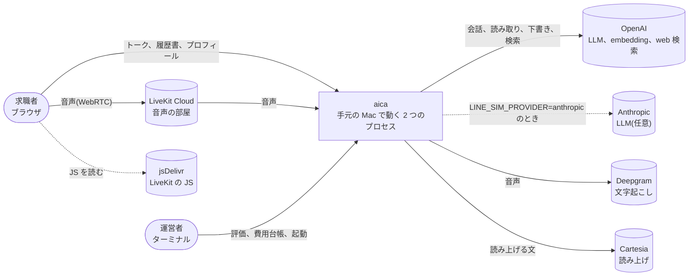
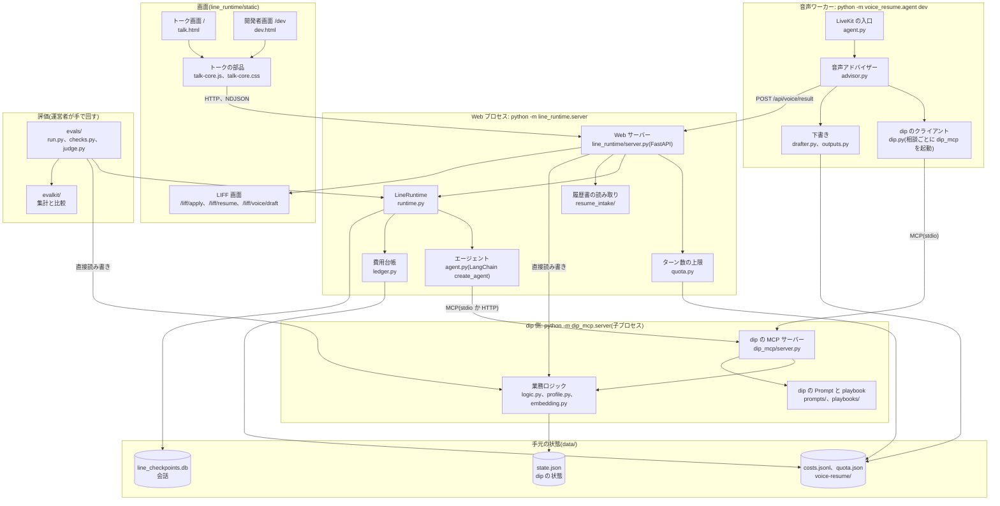
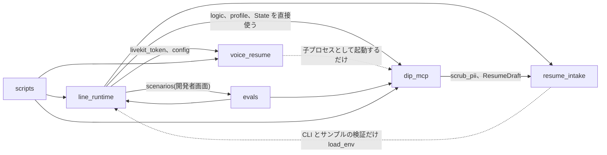
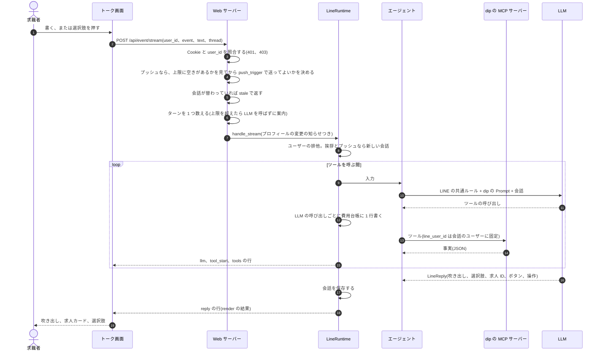
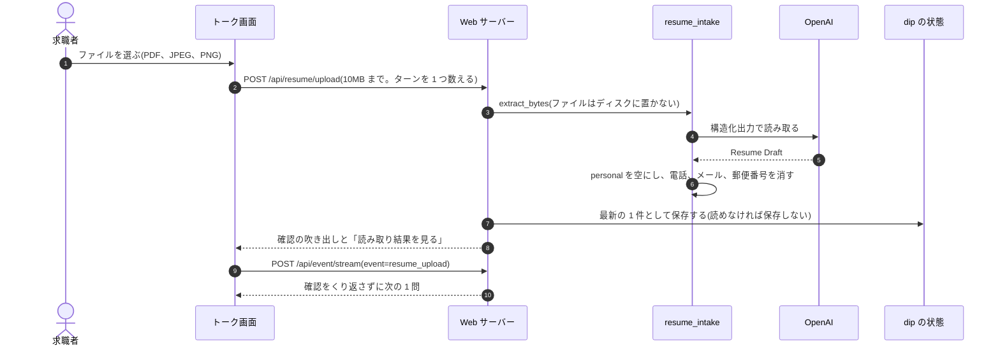
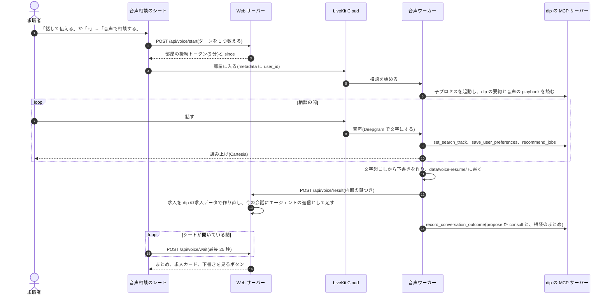
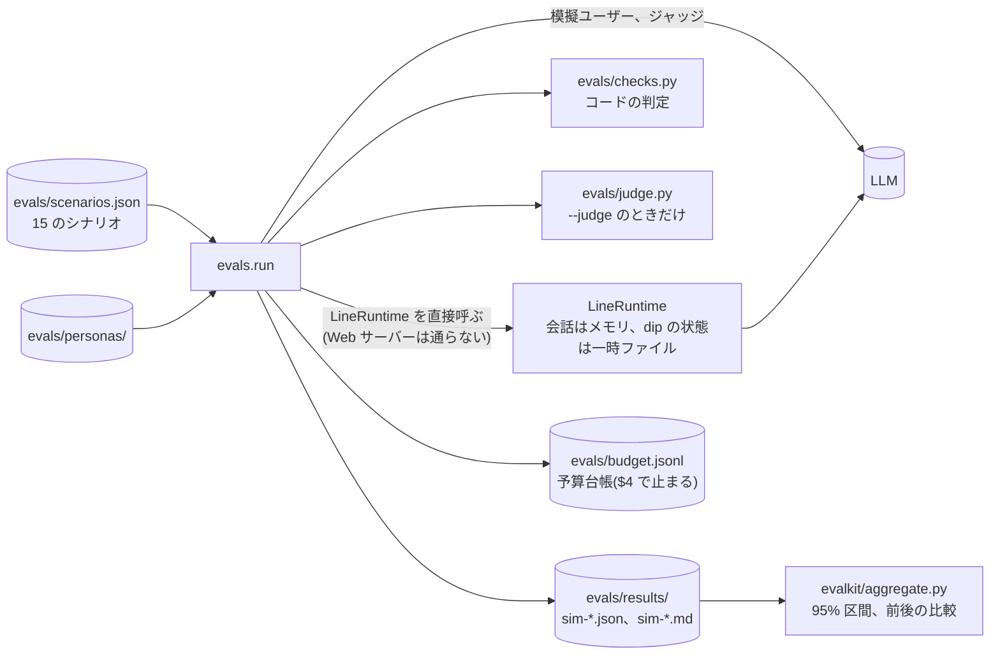
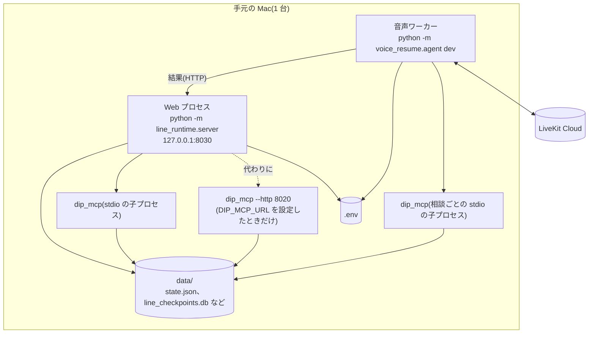

# HLD: aica の全体設計

aica が何でできていて、データがどこを流れるかの全体図です。新しい機能を考えるときは、まずこの図のどこに
手を入れるかを決めます。

- 2026-10-11 の main(`7521952`)のコードから書き起こしました。コードと食い違ったら、コードが正です
- 語は 10 章の「用語」に従います。業務の語の定義の正本は [CONTEXT.md](../../CONTEXT.md) です
- 部品の中身、関数、ファイルの形式は [LLD](lld.md) に書きます
- なぜそう決めたかは [ADR](../adr/) と [PRD](../prd/aica-v2-fulltime.md) に書きます。ここでは繰り返しません
- 書く中で見つけた設計の問題は [review-2026-10.md](review-2026-10.md) にまとめました

## 1. 目的と範囲

求職者と話して、アルバイト・パートから正社員まで、その人に合う仕事探しを相談と提案で支える AI エージェントです。
求職者はトーク(文字)と音声相談で話し、aica は雇用区分に合った相談と、架空の求人の提案をします。

aica は、LINE 公式アカウントの AI アシスタント(バイトル)を手元で再現する検証環境(line-sim)から始まりました。
そのため、次の境界を本番のつもりで作っています。

- **LINE 側(会話の頭脳)と dip 側(求人とユーザー理解)を MCP で分ける**
- 確かめたいのは「dip が書ける Prompt とツールの中身だけで、狙った会話体験になるか」です
- LINE 側のエージェントは業務の知識を持ちません。業務の知識はすべて dip 側にあります

いまは知人に試してもらう本番のトーク画面(`/`)と、評価と説明のための開発者画面(`/dev`)の両方を持っています。

範囲外:

- 本物の求人、応募、選考(求人、店舗、ユーザー、FAQ はすべて架空のデータ)
- LINE Messaging API への接続(LINE 風の画面で代わりにする)
- 認証と招待(URL を知っている知人だけが使う前提)
- 公開(Render への配置は人の作業で、まだ始めていない。jyoka/tasks#64)
- 複数台、複数プロセスでの配置

以前の構成(転職の求職者エージェント ca-agent と aica-poc)は、LLM に多くを任せる作りでした。aica(line-sim)は事業者のツールを
決定的にし、LLM には会話だけをさせる作りです。Opus 5 での費用は 1 ターン $0.021(ca-agent は $0.036)、
1 会話 $0.074(ca-agent は $0.32)でした。課題の重さが違うので、単純には比べられません。比較の詳細は旧リポジトリ
`jyoka/aica_ra_a2a_poc` の `docs/design/ca-agent-vs-line-sim.md` にあります。この数字はこのリポジトリでは測り直していません。

## 2. システムの文脈(C4 レベル 1)

- 状態の正本は手元の `data/` です。dip の状態は `data/state.json`、会話は `data/line_checkpoints.db` にあります
- 求人と、開発者画面のシナリオユーザーの初期状態は `fixtures/` の架空のデータです
- 外のサービスのキーは、リポジトリ直下の `.env` に置きます(6 章)

LLM のプロバイダは `LINE_SIM_PROVIDER` で選びます(`line_runtime/config.py`)。

| 使うところ | `openai`(既定) | `anthropic` |
|---|---|---|
| エージェント | `gpt-6-sol` | `claude-opus-5` |
| エージェントの思考の深さ | `LINE_SIM_EFFORT`(既定 `low`) | 同じ |
| 模擬ユーザー、ジャッジ(`evals/run.py`) | `gpt-6-luna` | `claude-haiku-4-5` |
| 履歴書の読み取り、音声アドバイザー、下書き、意味検索 | 常に OpenAI | 常に OpenAI |

## 3. 部品(C4 レベル 2)

| 部品 | 役割 | 書いてよいもの |
|---|---|---|
| 画面(`line_runtime/static/`) | トーク、保存した求人、プロフィール、音声相談のシート、開発者画面の処理の流れ | 何も持たない。Cookie の匿名ユーザーIDだけ |
| Web サーバー(`line_runtime/server.py`) | 受け付け(Cookie、ターン数の上限、プッシュの判定、stale)、LIFF 画面、プロフィールの API、履歴書のアップロード、音声相談の結果の受け取り | dip の状態、会話、`quota.json`、費用台帳(履歴書の読み取り)。`data/voice-resume/` の下書きを消す |
| LineRuntime(`line_runtime/runtime.py`) | 1 ターンを進める。会話の番号、ユーザーごとの排他、返信の描画(`render`) | 会話(チェックポイント)、費用台帳 |
| エージェント(`agent.py`) | LINE の共通ルールと dip の Prompt で会話し、`LineReply` を返す | 何も書かない。dip のツールを呼ぶだけ |
| dip の MCP サーバー(`dip_mcp/`) | 求人、ユーザーの状況、プロフィール、雇用区分、playbook、会話の結果。LLM を使わない | dip の状態 |
| 履歴書の読み取り(`resume_intake/`) | 履歴書のファイルを Resume Draft にする | 何も書かない(CLI とサンプルの検証だけ `data/resume_intake/` に書く) |
| 音声ワーカー(`voice_resume/`) | LiveKit の部屋で音声アドバイザーと話す。下書きを作り、結果をトークへ返す | dip の状態(dip のツール経由)、`data/voice-resume/` |
| 評価(`evals/`、`evalkit/`) | 模擬ユーザーと会話させて採点し、集計する | 一時ファイルの dip の状態、`evals/results/`、予算台帳 |

### 3.1 dip のツール(MCP)

エージェントと音声アドバイザーが使う dip の口です。ツールは LLM を使わず、速く、決定的に、事実だけを返します。
例外は `recommend_jobs` の keywords の意味検索で、問い合わせ文の embedding を 1 回呼びます(4.1)。

| ツール | 役割 |
|---|---|
| `get_user_conversation_summary` | dip の要約。今の雇用区分、直近の応募、フォームの途中離脱、閲覧の傾向、直近の接触、本人が話した希望、相談のまとめ、アップロードした履歴書。会話の最初に呼ぶ。閲覧した求人名は返さない |
| `get_user_recent_applications`、`get_application_status` | 応募と選考の状況 |
| `get_user_form_exit`、`resume_application_form` | 途中の応募フォームの続き。個人情報の項目はトークで受け取らず、LIFF 画面へ回す |
| `recommend_jobs` | 条件に合う求人を最大 3 件、理由と `match_score` つきで返す |
| `relax_conditions` | 求人が少ないとき、どの条件を外すと何件になるか |
| `answer_job_question` | 仕事内容や面接などの質問に答える材料(FAQ と求人の情報) |
| `save_job` | 求人の保存 |
| `save_user_preferences` | 本人が話した希望と、本人のこと(経験、目的、強みなど)の保存 |
| `set_search_track` | 雇用区分の切り替え。根拠は本人の発言そのまま。履歴と取り消しも記録する(ADR-0001) |
| `get_counseling_playbook` | 雇用区分とチャネル(`chat`、`voice`)の playbook と、会話の決まりの値 |
| `record_conversation_outcome` | 会話の段階の結果(提案・相談・支援・待つ)と相談のまとめの記録。待つ(wait)は本人が断ったときだけ |

ほかに、Resource `baitoru://faq` と、入口ごとの dip の Prompt を返す Prompt `baitoru_assistant(entry)` があります。

### 3.2 パッケージの依存

LINE 側と dip 側の境界は、エージェントの情報の流れでは MCP だけです。コードの import では、境界を越えています。

- `voice_resume` は `dip_mcp` を import しません。職種、エリア、雇用区分の一覧は写しを持ち、テストで同期を確かめます
- 境界の扱いは [review-2026-10.md](review-2026-10.md) の R1 に書きました

## 4. データの流れ

### 4.1 トークの 1 ターン

画面は `POST /api/event/stream` を呼び、1 行 1 件の JSON(NDJSON)で途中経過を受け取ります。`POST /api/event` は
同じ処理で返信だけをまとめて返します。

会話の入口は次の 5 つのイベントです(`runtime.py` の `EVENTS`)。

| イベント | 入口 | 始まり方 | 送ってよいか |
|---|---|---|---|
| `message` | A: トーク | 本人が書く | - |
| `resume_upload` | A: トーク | 本人が履歴書をアップロードした(4.2) | - |
| `visit` | visit: 初回訪問 | こちらから挨拶する(新しい会話) | 常に挨拶する |
| `revisit` | revisit: 再訪 | こちらから挨拶する(新しい会話) | 常に挨拶する |
| `form_exit` | D: 応募フォームの途中離脱 | こちらからプッシュする(新しい会話) | dip の `push_trigger` が決める |

- 入口とユーザーIDは会話の途中で変えません。プロンプトキャッシュを保つためです
- 本番のトーク画面を開くと `POST /api/talk/open` が決めます。最後のやりとりから 30 分以内なら今の会話を続け、
  `GET /api/talk/history` で描き直します。それ以外は dip が初回訪問か再訪かを決め、画面がそのイベントで挨拶を呼びます
- 画面は表示している会話の番号(`thread`)を発言に付けます。別のタブで新しい会話が始まっていれば、発言は stale になり、
  LLM を呼ばず、ターンも数えません
- 再訪の挨拶は、保存した希望があれば確認形で 1 問、無ければ最近の閲覧に 1 回だけ触れて 1 問です
- 開発者画面はシナリオを選ぶと `POST /api/scenarios/{id}/start` でシナリオユーザーの dip の状態を初期に戻し、
  続けて 1 通目のイベントを呼びます。どのシナリオもエージェントの 1 通目から始まります
- 開発者画面の右には、構成図と処理の流れ(LLM の時間、トークン、キャッシュから読めた分、ツールの引数と結果)が出ます
- 画面との接続が途中で切れても、ターンは最後まで進めます。ツールの結果が無い会話を保存しないためです

求人の検索(`recommend_jobs`)は、条件(エリア、時間帯、職種、時給の下限、希望年収、属性)で絞り、keywords があれば
意味検索で絞り直します。求人側のベクトルは `scripts/gen_job_vectors.py` で前もって作り `fixtures/job_vectors.json` に
置きます。検索のときの外部の呼び出しは、問い合わせ文の embedding 1 回だけです。API が使えないときと、問い合わせがどの求人とも近くないとき(類似度の最高値が中央値から `SIM_PEAK` 以上抜けないとき)は、部分一致に戻ります。

### 4.2 履歴書のアップロード

- アップロードは本人の 1 ターンです。読み取りと続くターンで、ターンを 2 つ数えます
- ファイル名は保存せず、トークにも出しません。トークには「履歴書(PDF)」のような種類だけを出します
- 読めないファイルのときは、前に読み取れた結果を上書きしません。読めなかった前提で 1 問返します

### 4.3 音声相談

- 音声アドバイザーはチャットと同じ雇用区分、playbook、保存の仕組みを使います(aica v2 の G)
- 結果をトークに足すときは LLM を呼ばず、ターンも数えません(`LineRuntime.add_voice_result`、`voice_reply.py`)
- 音声側から待つ(wait)は記録しません。断っていない人を wait にしない決まりのためです
- 相談の途中で本人が「すべて消す」をしていたら、その前の部屋の結果は 410 で断ります。ワーカーは会話の段階の結果を
  記録せず、書き出したファイルも消します
- Web サーバーは、プロフィールで下書きを消すとき、ワーカーが書いたファイルをパスで消します(`server.py` の `_remove_voice_files`)
- 下書きの書類は雇用区分で決まります。正社員なら職務経歴書、それ以外は履歴書です

### 4.4 プロフィールを直す、消す

プロフィール画面(`/api/profile/*`)は dip の状態を直接書き換えます。中身は `dip_mcp/profile.py` です。

- 直すときにも保存と同じ決まり(決まった項目だけ、個人情報らしい値と長すぎる値は 400)を効かせます
- 会話の途中で変えたら、次の本人のターンの直前に「知らせ」としてエージェントに渡します(画面の履歴には出しません)
- 「すべて消す」は会話を消してから dip の状態を消します。同じ Cookie のシナリオユーザーの分も消します。
  ターン数の上限の数と費用台帳は消しません
- 履歴書を消すと、今の会話を閉じ、それまでの会話をすべて消します。アップロードの要点が会話に残らないためです
- トークの「切り替えの表示」のボタン(`POST /api/talk/track/undo`)は、直前の区分の切り替えだけを取り消します

### 4.5 評価

- シナリオの一覧は開発者画面と同じです。始める前にそのユーザーの dip の状態を初期に戻します
- 採点はコードが中心です。1 ターン 1 問、選択肢の数、吹き出しの字数、求人は最大 3 件、事実性、雇用区分の切り替え、
  相談の進め方などを見ます。LLM ジャッジは相談の深さとトーンを見ます。既定ではオフです
- 実 API を使うので費用がかかります。PRD の予算は $5 で、予算台帳の累計が $4 に達すると止まります
- 実 API を使わないテストは `pytest` です。LLM と外部の API はスタブにします

### 4.6 保存するデータ

| 場所 | 中身 | 書く部品 | 消えるとき |
|---|---|---|---|
| `data/state.json` | dip の状態: ユーザーごとの行動、応募、保存、プロフィール、雇用区分の履歴、会話の段階の結果、履歴書の読み取り結果、音声相談の結果 | Web サーバー、dip の MCP サーバー(Web の子プロセスと、音声相談ごとの子プロセス) | プロフィールの「すべて消す」、開発者画面のシナリオの開始 |
| `data/line_checkpoints.db` | 会話(LangGraph のチェックポイント)。本人の発言、ツールの結果、返信 | LineRuntime | 「すべて消す」、履歴書を消したとき。それ以外は消さない |
| `data/costs.jsonl` | 費用台帳。LLM の呼び出し 1 回 1 行(user_id つき) | LineRuntime、Web サーバー(履歴書の読み取り) | 消さない |
| `data/quota.json` | その日のターン数(人ごと、IP ごと)と、その日に使われた匿名ユーザーID。全体の数はここから数える | ターン数の上限 | 日付が変わると数え直す |
| `data/voice-resume/` | 相談ごとの下書き、文字起こし、求人の提案 | 音声ワーカー | プロフィールで下書きを消したとき、「すべて消す」 |
| `evals/results/`、`evals/budget.jsonl` | 評価の結果と予算台帳 | 評価 | 結果は git に入れない。予算台帳は git に入れる |

`data/` と `evals/results/` は `.gitignore` に入っています。

## 5. 責任の分担

| 判断が要る(LLM) | 決まっている(コード) |
|---|---|
| 返信の文面と、次に何を聞くか(エージェント、音声アドバイザー) | プッシュしてよいか(`push_trigger`) |
| 会話の段階と、いつ提案するか | 求人の絞り込みと並び順(`match_score`) |
| 雇用区分を切り替えるか(本人の発話から) | 切り替えの記録、取り消し、画面の表示 |
| 何を希望として保存するか | 保存してよい項目と値(個人情報、長さ) |
| 相談のまとめを書く | ターン数の上限、費用台帳 |
| 履歴書を読み取る、下書きを書く | 個人情報の項目を空にする、電話とメールを消す |
| 評価のジャッジ(相談の深さ、トーン) | 評価の判定(形式、事実性、切り替え) |

コードが決めている主な規則です。

| 規則 | 中身 | 場所 |
|---|---|---|
| プッシュの判定 | dip ID と未連携、直近 3 日以内に接触済み、根拠の事実が無い、のどれかなら送らない。許可したら接触として記録し、根拠の事実を LINE 側に渡す。3 日はシミュレーション用の仮の値 | `dip_mcp/logic.py` の `push_trigger` |
| 求人カード | dip のツールが返した求人だけをカードにする。モデルが選ぶのは求人 ID だけ。音声の結果も dip の求人データで作り直す | `runtime.py` の `render`、`logic.record_voice_result` |
| ボタン | `/liff/` で始まる dip の画面の URL だけを出す | `runtime.py` の `render` |
| 並び順 | 点の合計(`match_score`、内訳 `score_breakdown`)。職種の傾向は 1 番目 2 点、2 番目 1 点。時間帯の傾向 1 点(両方の区分を混ぜるときは使わない)。エリアの傾向 1 点。駅近 0〜1 点(徒歩 10 分以上は 0)。給与は時給 ÷ 2,000 円、年収と月給は年収の中央値 ÷ 800 万円(上限なし)。keywords の意味の近さ × 24。希望年収を超える 100 万円ごとに 1 点(3 点まで) | `logic.match_breakdown`、`logic.recommend` |
| 本人の傾向 | 90 日以内の応募と、30 日以内の閲覧と保存から数える。応募済みの求人は推薦に出さない | `logic.preferences`、`logic.recommend` |
| 待つ(wait) | 本人が断ったときだけ記録できる。音声側からは記録しない | `logic.record_outcome`、`voice_resume/dip.py` |
| 会話の決まり | 雇用区分ごとの質問の数、吹き出しの字数、何回目の返信までに会話の段階に入るか。playbook、dip の Prompt、評価が同じ値を使う | `logic.CONVERSATION_RULES` |

LLM に dip の Prompt で守らせ、評価がコードで確かめる規則です(`dip_mcp/prompts/baitoru_assistant.md`)。

- 1 回の返信で質問は 1 つ。初回は必ず質問で終える。決まった回数の返信までに会話の段階に入る
- 相談は playbook に沿って 1 問ずつ聞く。相談の途中は上の期限を当てない
- 選択肢は最大 4 つ。質問するときは「今はいい」か「それ以外」を含める。返信は必ず選択肢で終える
- 「今はいい」「送らないで」は理由を聞かずに短く終え、wait を記録する
- 履歴には 90 日以内の行動だけに、確認形で 1 回だけ触れる。閲覧した求人名は挙げない
- 個人情報はトークで受け取らず、LIFF 画面を案内する

## 6. 信頼の境界

### 個人情報

- 履歴書と下書きの `personal`(氏名、住所、電話、メール、生年月日)は、何が来ても空で保存します
- 希望とプロフィールの値は、決まった項目だけを受け付け、電話、メール、住所らしい値は保存しません(`logic.save_preferences`)
- 履歴書のファイル本体とファイル名は保存しません
- 本人がトークに書いた文は、そのまま会話に保存し、LLM のプロバイダに送ります。個人情報が書かれても消しません
- 音声相談の文字起こしは `data/voice-resume/` に保存します
- 個人情報を見分ける決まりは 2 種類あります。`dip_mcp/data.py` の `has_pii` と、`scrub_pii`(`resume_intake` と
  `voice_resume` に同じものが 2 つ)です。違いは [review-2026-10.md](review-2026-10.md) の R3

### ユーザーの分離

- 画面を開いたとき(`GET /`、`GET /dev`)だけ、匿名ユーザーID(`w-<16桁hex>`)を Cookie `aica_uid` で発行します
- ブラウザから呼ぶ API は、正しい Cookie が無ければ 401 です。扱えるのは Cookie の匿名ユーザーIDのユーザーと、
  その匿名ユーザーIDのシナリオユーザーだけで、ほかは 403 です
- 本人のデータを指す URL にユーザーIDを載せません。LIFF 画面は Cookie から本人を決めます
- エージェントが呼ぶ dip のツールの `line_user_id` は、会話のユーザーに固定します(`agent.py` の `PinUserMiddleware`)
- 評価は Web サーバーを通らないので、Cookie を使いません

### API キーと内部の鍵

- 外のサービスのキー(`OPENAI_API_KEY`、`LIVEKIT_*`、`DEEPGRAM_API_KEY`、`CARTESIA_API_KEY` など)は
  リポジトリ直下の `.env` に置きます。git には入れません
- dip の MCP サーバーの子プロセスは、親の環境変数をすべて受け取ります
- ブラウザに渡すのは、LiveKit の部屋ごとの接続トークン(有効期限 5 分)だけです
- 音声ワーカーから Web サーバーへの `POST /api/voice/result` は、Cookie ではなく内部の鍵 `AICA_INTERNAL_KEY`
  (`Authorization: Bearer`)で守ります。鍵が無い、違う、サーバーに設定が無いときは 401 です

### LLM の出力と外のデータ

- LLM の出力はデータとして扱います。求人カード、ボタン、ユーザーIDは、コードが dip の事実と照合してから使います
- dip のツールの結果と本人の発言は、エージェントの入力にそのまま入ります。プロンプトインジェクションの被害は、
  ツールの `line_user_id` の固定と、カード、ボタンの照合で絞っています
- 音声アドバイザーは、本人が気になったことを web 検索します(`web_research`、`research_company`)
- 音声相談のシートは LiveKit のブラウザ用ライブラリを jsDelivr から読みます

### 費用

- 1 日あたりのターン数に、匿名ユーザーIDごと、IP ごと、全体の上限があります(`line_runtime/quota.py`)。対象は Web の API だけで、
  評価にはかかりません
- 音声相談は始めるときにターンを 1 つ数えます

## 7. 配置

- 2 つのプロセスは同じリポジトリ、同じ venv、同じ `.env` で動かします
- dip の状態は 1 つの JSON ファイルで、複数のプロセスがファイルロック(`fcntl`)を取って読み書きします。
  そのため、同じマシンの同じファイルシステムに置く必要があります
- Web プロセスは 1 つだけを前提にしています。ターンの排他、音声相談の待ち合わせ、読み取れなかったアップロードは
  プロセスのメモリにあります
- Web サーバーは `127.0.0.1` で待ち受けます。プロキシの後ろに置くときだけ `AICA_TRUST_PROXY=1` にします
- 公開の形(Render の 1 コンテナ)は決まっていますが、配置の設定はまだリポジトリにありません

## 8. 品質の目標

| 項目 | 目標と、守っている仕組み |
|---|---|
| 費用 | 1 人 1 日 50 ターン、全体 1 日 1,000 ターン(1 ターン約 $0.05 で 1 日約 $50 が天井)。評価は予算台帳で $4 に達したら止まる |
| 速さ | 入口とユーザーIDを会話の途中で変えず、プロンプトキャッシュを効かせる(評価の指標 `cache_hit_rate`)。途中経過は NDJSON で順に出す |
| 決まった答え | dip のツールは LLM を使わない。意味検索が使えないときは部分一致に戻り、検索を止めない |
| 事実性 | 求人カードは dip が返したものだけ。評価が返信の金額、日付、徒歩分数、件数、求人名を dip の事実と本人の発言に照合する |
| 壊れない | dip の状態は一時ファイルから置き換える。会話を消すときは 1 つのトランザクション。画面の接続が切れてもターンは最後まで進める |
| ユーザーの分離 | Cookie の本人だけ。URL にユーザーIDを載せない。ツールの `line_user_id` は固定 |
| テスト | `pytest` は実 API を呼ばない。評価は実 API を使い、95% 区間つきで前後を比べる |

## 9. 拡張の入口

| 足したいもの | 入口 | 一緒に変えるもの |
|---|---|---|
| dip のツール | `dip_mcp/server.py` に `@mcp.tool()`、中身は `dip_mcp/logic.py` | 音声でも使うなら `voice_resume/dip.py` |
| 会話の入口(イベント) | `runtime.py` の `EVENTS` | `dip_mcp/prompts/entries.json`、Web サーバーの受け付け |
| playbook | `dip_mcp/playbooks/{区分}_{チャネル}.md` | `logic.PLAYBOOK_FILES` |
| 雇用区分 | `logic.TRACKS`、`CONVERSATION_RULES`、`PLAYBOOK_FILES` | `voice_resume/jobs.py` の写し、評価の `FORMAT_RULES` |
| 求人 | `fixtures/*.json` | `python -m scripts.gen_job_vectors` でベクトルを作り直す(ADR-0002) |
| 評価のシナリオ | `evals/scenarios.json`(開発者画面にも出る) | 期待の値、`evals/checks.py` |
| LLM のプロバイダ | `agent.build_model`、`line_runtime/llm.py` | `ledger.PRICES` の料金表 |
| 画面 | `line_runtime/static/talk-core.js`(`/` と `/dev` で共通) | 返信の形は `render` と同じ |
| Resume Draft の形 | [LLD の 5.5](lld.md#55-resume-draft) | `resume_intake/schema.py` と `voice_resume/schema.py` の両方 |

## 10. 用語

この文書と、これから書く LLD と README は、次の語を使います。業務の語の定義は [CONTEXT.md](../../CONTEXT.md) と同じです。
「使わない語」は、同じものを別の語で呼ばないための一覧です。コードの名前に残っているものは、そのコードを指すときだけ使います。

### システムと部品

| 語 | 意味 | 使わない語 |
|---|---|---|
| aica | このシステムの全体 | line-sim(旧称。コードと古い文書に残る) |
| LINE 側 | 会話の頭脳。`line_runtime/` の Web サーバー、LineRuntime、エージェント | LY Runtime(本番の名前) |
| dip 側、dip | 事業者の側。求人とユーザー理解を持つ。`dip_mcp/` | baitoru-mcp(MCP サーバーの名前としてだけ使う) |
| Web サーバー | `line_runtime/server.py` の FastAPI アプリ | API サーバー |
| LineRuntime | 1 ターンを進める LINE 側の部品(`line_runtime/runtime.py`) | ランタイム(単独で使わない) |
| エージェント | トークで話す LINE 側の LLM エージェント(`agent.py`)。求職者から見れば aica そのもの | LINE AI、AI モード |
| Web プロセス | Web サーバーを動かすプロセス(`python -m line_runtime.server`) | - |
| 音声ワーカー | LiveKit の部屋に入るプロセス(`python -m voice_resume.agent dev`) | 音声プロセス、voice-resume のワーカー |
| 音声アドバイザー | 音声相談で話す LLM エージェント(`voice_resume/advisor.py`) | キャリアアドバイザー |
| dip のツール | dip の MCP サーバーが公開するツール(3.1) | Tool |
| dip の Prompt | 入口ごとの会話の骨格とルール(`baitoru_assistant.md` と `entries.json`)。エージェントの指示に入る | 対話シナリオ、シナリオ |
| dip の要約 | `get_user_conversation_summary` の結果 | サマリー |
| playbook | 雇用区分とチャネルごとの、相談の進め方の指針 | 台本、シナリオ、ステージ指針 |
| 会話の決まり | 雇用区分ごとの質問の数、吹き出しの字数、期限(`CONVERSATION_RULES`) | 形式ルール |
| LIFF 画面 | dip の画面のモック(`/liff/*`)。応募フォーム、読み取り結果、下書き | LIFF ページ |

### 会話

| 語 | 意味 | 使わない語 |
|---|---|---|
| トーク | トーク画面での文字の会話 | チャット画面 |
| チャット、音声 | チャネルの名前。トークの会話はチャット、音声相談は音声 | テキスト会話 |
| トーク画面 | 本番の画面 `/`。トーク、保存した求人、プロフィール | 本番画面 |
| 音声相談のシート | トーク画面の上に重ねる通話中の画面 | 通話画面 |
| 開発者画面 | `/dev`。シナリオの起動、dip から見た状態、処理の流れ | デモ画面 |
| 会話 | 1 つの会話の番号(`thread_id` = `ユーザーID:番号`)のやりとり。挨拶かプッシュで始まる | スレッド |
| ターン | LLM を呼ぶ 1 往復。ターン数の上限で数える単位 | 会話(ターンの意味で使わない) |
| イベント | 画面が送る種類(`message`、`resume_upload`、`visit`、`revisit`、`form_exit`) | - |
| 入口 | dip の Prompt を選ぶ鍵(A、visit、revisit、D) | エントリー |
| 挨拶 | 初回訪問(visit)と再訪(revisit)の 1 通目 | follow(旧称) |
| プッシュ | dip が許可した、こちらから話しかける 1 通目 | CRM、配信 |
| 会話の段階 | 相談・提案・支援・待つ。ターンごとに動く | モード、分岐(旧称) |
| 返信 | エージェントの 1 回の出力(`LineReply` を `render` した形) | 応答 |
| 求人カード | dip のツールが返した求人を、コードが描くカード | Flex |
| 知らせ | プロフィールを画面で変えたことを、次のターンの前にエージェントに渡す文 | 通知 |

### 本人について

| 語 | 意味 | 使わない語 |
|---|---|---|
| プロフィール | aica が求職者について覚えていることの全体 | 相談プロファイル、長期メモリ |
| 本人が話した希望 | `save_user_preferences` で保存した項目(`stated_preferences`) | 相談プロファイル |
| 相談のまとめ | 会話を締めるときに残す 200 字以内の記録 | 要約、メモ |
| 雇用区分 | アルバイト・パート、正社員、未定(`track`) | 雇用形態、モード |
| 区分の切り替え | 本人の発話を根拠に雇用区分を変えること | モードシフト |
| 目的 | その仕事探しで本人が得たいもの | 動機づけ |
| 職種 | 求人の仕事の種類。雇用区分ごとの一覧 | ジャンル、カテゴリ |
| 匿名ユーザーID | Cookie `aica_uid` の `w-<16桁hex>`。本番のトーク画面のユーザーID | LINE ユーザーID |
| シナリオユーザー | 開発者画面のユーザー。ID は `<匿名ユーザーID>:<fixtures のユーザー>`(例 `w-…:sim-new`)。`fixtures/users.json` の初期状態を写す | - |

### 書類

| 語 | 意味 | 使わない語 |
|---|---|---|
| Resume Draft | 履歴書と職務経歴書の共通の形(`ResumeDraft` と envelope)。[LLD の 5.5](lld.md#55-resume-draft) | 履歴書 JSON |
| 書類の種類 | Resume Draft の `document_kind`。履歴書か職務経歴書 | - |
| 読み取り結果 | アップロードした履歴書から作った Resume Draft | 解析結果 |
| 下書き | 音声相談から作った Resume Draft と、その Markdown | ドラフト |

### 評価と運用

| 語 | 意味 | 使わない語 |
|---|---|---|
| シナリオ | 評価と開発者画面で使う会話の型。決まったユーザーと 1 通目から始まる(`evals/scenarios.json`) | dip の Prompt の意味で使わない |
| ペルソナ | 模擬ユーザーの設定と架空の経歴(`evals/personas/`) | - |
| 模擬ユーザー | 評価で求職者の代わりに話す LLM | シミュレーター |
| ジャッジ | 相談の深さとトーンを判定する LLM(`evals/judge.py`) | - |
| ターン数の上限 | 1 日あたりのターン数の上限(`quota.py`) | 会話数の上限(コードと README に残る) |
| 費用台帳 | `data/costs.jsonl`。Web の API の LLM の費用 | - |
| 予算台帳 | `evals/budget.jsonl`。評価の実 API の費用の累計 | 費用台帳(評価の意味で使わない) |
| 内部の鍵 | `AICA_INTERNAL_KEY`。サーバー間の経路を守る鍵 | 共有鍵 |
