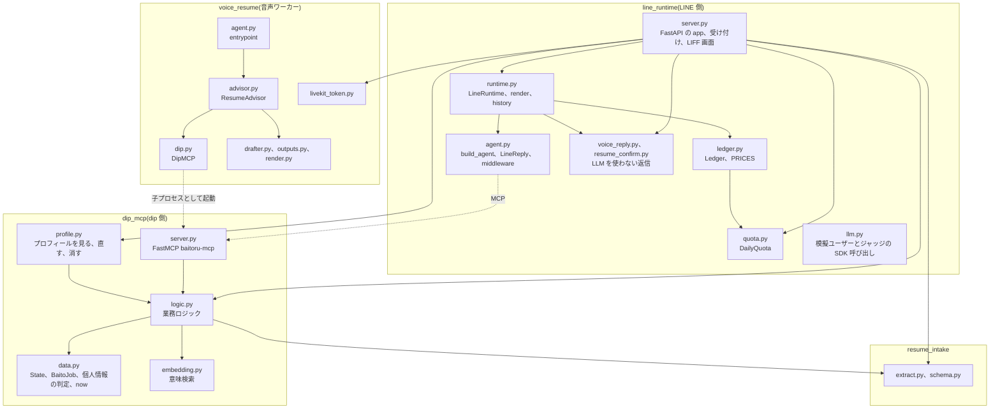
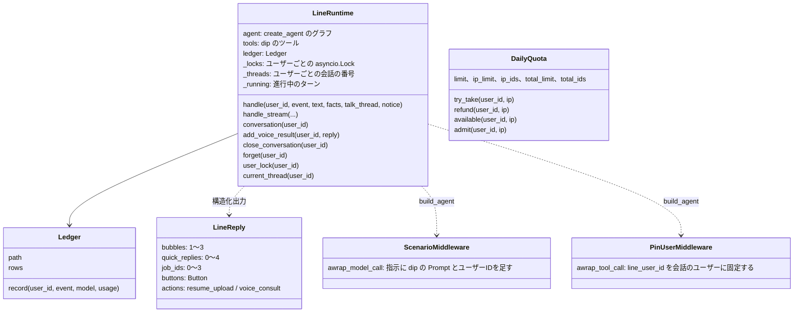
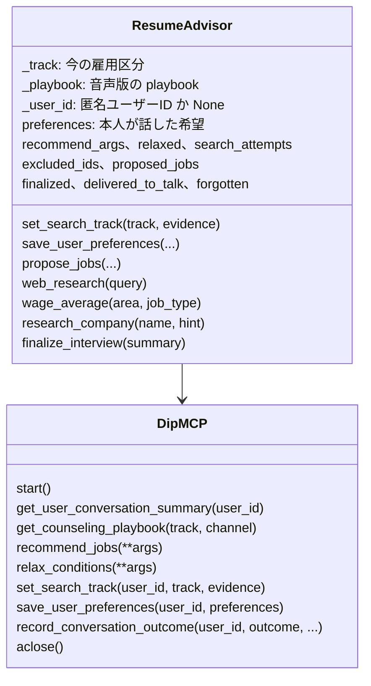
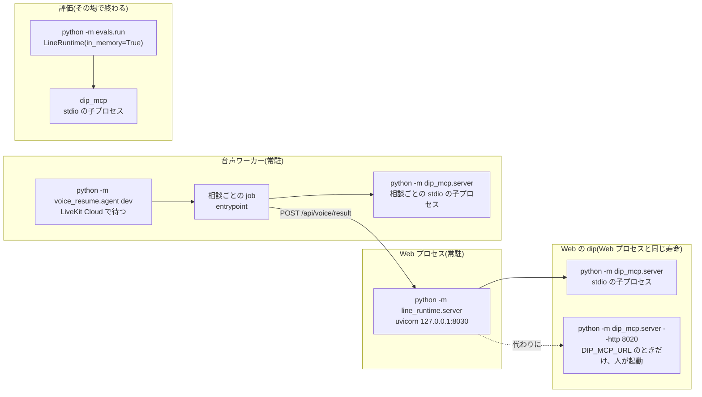
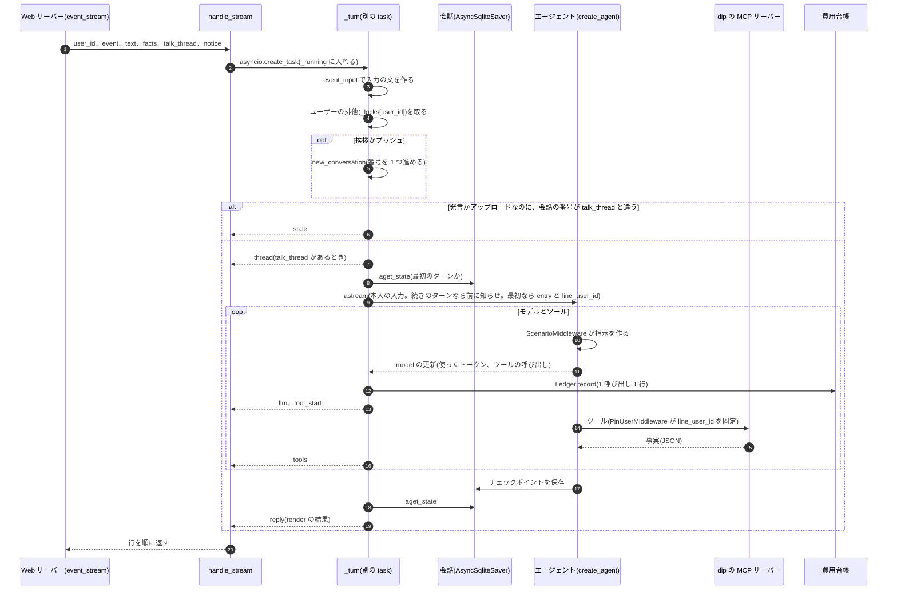
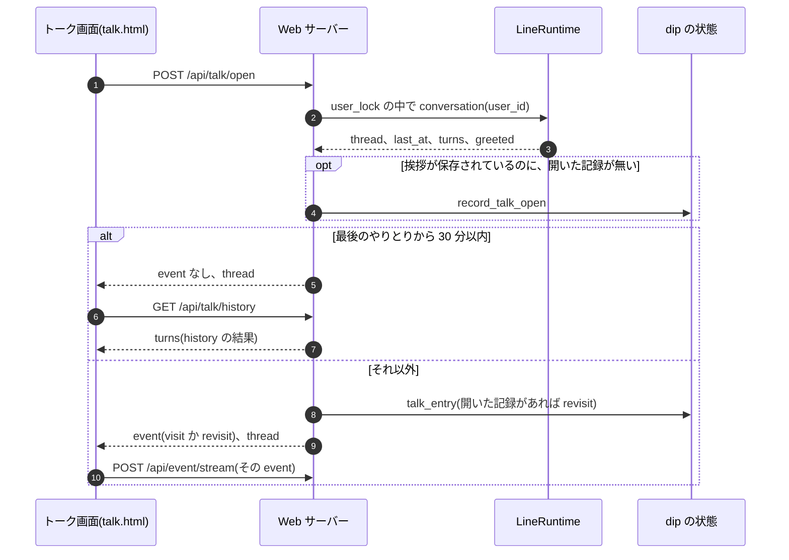
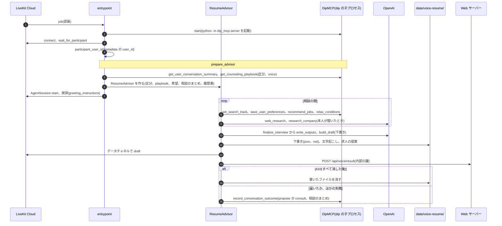
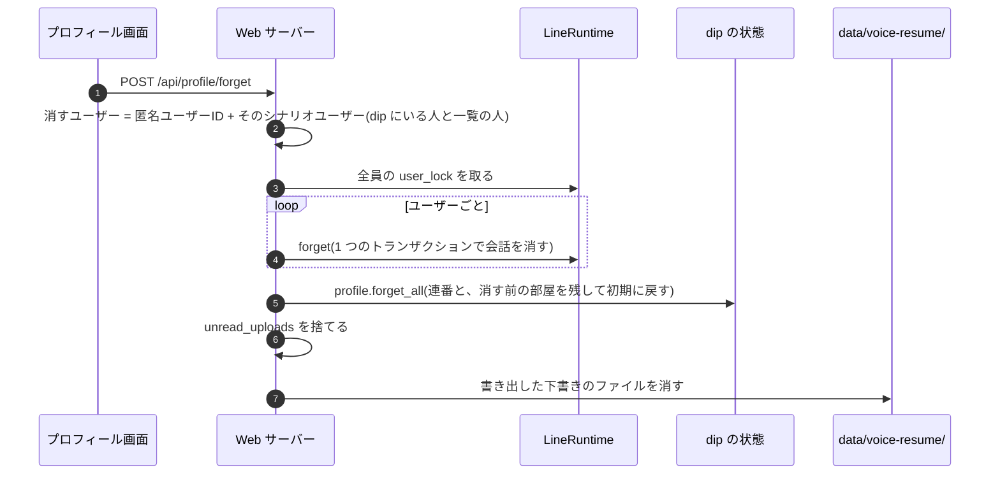
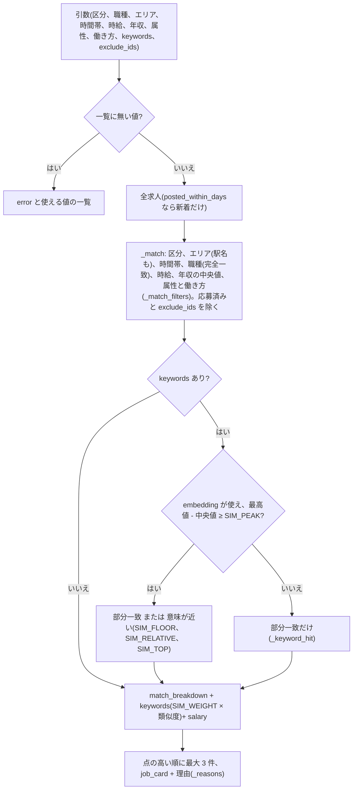
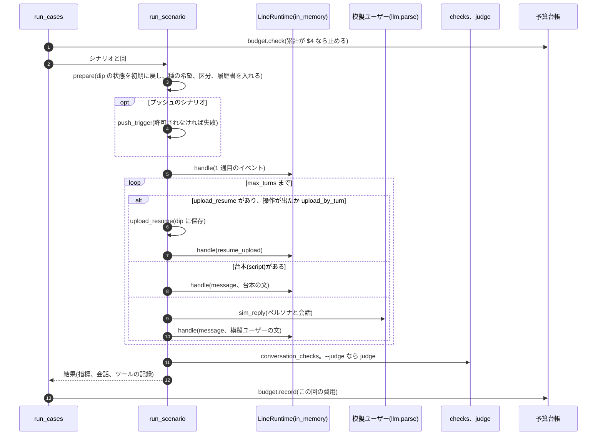

# LLD: aica の詳細設計

[hld.md](hld.md) の部品の中身です。パッケージとモジュール、プロセス、HTTP の口と dip のツール、主な流れ、
保存するデータの形、外部の呼び出し、失敗の扱い、テストで守っている約束を書きます。

- 2026-10-11 の main(`7c73893`)のコードから書き起こしました。コードと食い違ったら、コードが正です
- 語は HLD の 10 章「用語」に従います。コードの名前(`line_user_id`、`ScenarioMiddleware` など)は、そのコードを指すときだけ使います
- 関数名はモジュールの名前と一緒に書きます。行番号は変わるので書きません(`grep -n "def <名前>" <ファイル>` で探します)
- 書く中で見つけた設計の問題は [review-2026-10.md](review-2026-10.md) にまとめました(R17 から後は、この文書を書く中で足したもの)

## 1. パッケージの構成



パッケージの間の依存は HLD の 3.2 にあります。ここでは各パッケージの中を書きます。

### 1.1 line_runtime

| モジュール | 役割 | 主な名前 |
|---|---|---|
| `server.py` | Web サーバー。FastAPI の `app` と `lifespan`、Cookie と本人の確かめ、イベントの受け付け、プロフィール、音声相談、履歴書のアップロード、LIFF 画面 | `_issue`、`_owner`、`_require_own`、`_page_user`、`_require_internal`、`_client_ip`、`_admit`、`event`、`event_stream`、`_stale`、`_profile_notice`、`_record_open`、`_upload_facts`、`_remove_voice_files` |
| `runtime.py` | LineRuntime。1 ターンを進め、会話を保存し、返信を描く | `EVENTS`、`event_input`、`voice_event`、`dip_connection`、`LineRuntime`、`render`、`history`、`track_switch`、`_cards_in`、`CARD_KEYS` |
| `agent.py` | エージェント。LINE の共通ルール(`PLATFORM_PROMPT`)と返信の形 | `LineReply`、`Button`、`LineState`、`ScenarioMiddleware`、`PinUserMiddleware`、`build_model`、`build_agent` |
| `quota.py` | ターン数の上限 | `DailyQuota`、`ip_key`、`person`、`today`、`limit_reply` |
| `ledger.py` | 費用台帳と料金表。`python -m line_runtime.ledger` で集計する | `PRICES`、`cost_usd`、`Ledger`、`summarize` |
| `voice_reply.py` | 音声相談の結果をトークに続ける返信(LLM を使わない) | `voice_reply`、`summary_bubble`、`voice_history_reply`、`draft_button` |
| `resume_confirm.py` | 履歴書をアップロードした直後の確認の吹き出し(LLM を使わない) | `resume_bubbles`、`skill_heading` |
| `llm.py` | 模擬ユーザーとジャッジが SDK を直接呼ぶところの、プロバイダの違いの吸収 | `client`、`parse`、`text` |
| `config.py` | 設定と `.env` の読み込み | `PROVIDER`、`MODEL`、`EFFORT`、`DIP_MCP_URL`、`DATA_DIR`、`load_env` |
| `static/` | 画面。`talk.html`(トーク画面)、`dev.html`(開発者画面)、共通部品 `talk-core.js`、`talk-core.css` | - |



エージェントは `build_agent` が LangChain の `create_agent` で作ります。

- middleware は外側から `ScenarioMiddleware`、`AnthropicPromptCachingMiddleware`(OpenAI では何もしない)、`PinUserMiddleware` の順です
- `ScenarioMiddleware` は、指示を `PLATFORM_PROMPT` + 入口の dip の Prompt + ユーザーIDにします。入口とユーザーIDは会話の state(`entry`、`line_user_id`)から読みます
- 返信は `ProviderStrategy(LineReply)` の構造化出力です
- `build_model` は `config.PROVIDER` で `ChatOpenAI`(Responses API、`reasoning.effort`)か `ChatAnthropic`(`thinking: adaptive`)を作ります

### 1.2 dip_mcp

| モジュール | 役割 | 主な名前 |
|---|---|---|
| `server.py` | dip の MCP サーバー(FastMCP、名前は `baitoru-mcp`)。ツールは引数の説明を持ち、中身は `logic` を呼ぶだけ(3.3) | `mcp`、`state`、`baitoru_assistant`、`faq` |
| `logic.py` | 業務ロジック。LLM を使わない | 下の表 |
| `profile.py` | プロフィール画面の中身と、知らせ | `view`、`edit_item`、`edit_summary`、`set_track`、`undo_switch`、`switch_status`、`delete_resume`、`delete_voice_draft`、`unsave_job`、`forget_all`、`pending_changes`、`take_changes`、`notice` |
| `data.py` | 求人の形、dip の状態の読み書き、個人情報の判定、時計 | `BaitoJob`、`Pay`、`State`、`load_jobs`、`load_users`、`now`、`SIM_NOW`、`PII_VALUE`、`fold_pii`、`has_pii`、`redact_pii`、`pay_text`、`annual_pay_mid` |
| `embedding.py` | 求人の意味検索 | `job_text`、`job_hash`、`embed_query`、`similarities`、`MODEL`、`DIMENSIONS` |
| `prompts/` | dip の Prompt。`baitoru_assistant.md`(どの入口でも同じ骨格)と `entries.json`(入口ごと) | - |
| `playbooks/` | playbook。`{parttime,fulltime,undecided}_{chat,voice}.md` と区分に共通の `common_{chat,voice}.md` | - |

`logic.py` は見出しのコメントで次のように分かれています(R14)。

| 見出し | 主な関数と定数 |
|---|---|
| (先頭)dip の要約、応募、フォーム | `liff_url`、`preferences`(本人の傾向)、`stated_preferences`、`conversation_summary`、`recent_applications`、`form_exit`、`HISTORY_DAYS` |
| 推薦 | `JOB_TYPES`、`FULLTIME_JOB_TYPES`、`AREAS`、`AREA_GROUPS`、`ATTRIBUTE_ARGS`、`FULLTIME_STYLE_ARGS`、`recommend`、`relax`、`match_breakdown`、`job_card`、`_keyword_filter`、`_reasons`、`SIM_FLOOR`、`SIM_RELATIVE`、`SIM_TOP`、`SIM_WEIGHT`、`SIM_PEAK` |
| 相談(FAQ / 求人) | `answer_material`、`application_status`、`MIN_OVERLAP` |
| 手続き(フォームの続き) | `resume_form`、`submit_application`、`save_job`、`saved_jobs` |
| トークを開いた | `talk_entry`、`record_talk_open` |
| 本人が話した希望と、本人について | `PREFERENCE_KEYS`、`FULLTIME_PREFERENCE_KEYS`、`PREFERENCE_VALUE_MAX`、`ADDRESS_LIKE`、`address_spans`、`save_preferences` |
| 雇用区分 | `TRACKS`、`search_track`、`track_history`、`set_search_track` |
| 相談の playbook | `PLAYBOOK_FILES`、`CHANNELS`、`CONVERSATION_RULES`、`VOICE_CONVERSATION_RULES`、`counseling_playbook` |
| 音声相談の結果 | `DOCUMENT_KINDS`、`record_voice_result`、`voice_results_since`、`voice_result`、`document_kind`、`record_voice_room`、`voice_room_forgotten` |
| アップロードした履歴書 | `save_resume_upload`、`resume_upload`、`uploaded_resume` |
| 会話の段階の結果の記録 | `OUTCOMES`、`REFUSAL_WORDS`、`CONSULTATION_SUMMARY_MAX`、`record_outcome`、`consultation_summary` |
| プッシュ | `PUSH_TRIGGERS`、`PUSH_INTERVAL_DAYS`、`push_trigger` |

dip の関数はどれも、1 つ目の引数に `State` を受け取ります。MCP サーバーと Web サーバーと評価は、それぞれ自分の `State()` を作り、
同じファイルを読み書きします(5.1、6 章)。

### 1.3 resume_intake

| モジュール | 役割 | 主な名前 |
|---|---|---|
| `extract.py` | 履歴書のファイルから Resume Draft を作る。OpenAI の Responses API の構造化出力 | `EXTRACT_SYSTEM`、`media_type`、`content_part`、`extract_bytes`、`extract_draft`、`scrub_pii`、`finalize`、`Usage` |
| `schema.py` | Resume Draft の形(5.5)。`FORMAT_VERSION = "1.0"` | `ResumeDraft`、`envelope`、`PERSONAL_KEYS` |
| `config.py` | モデル、上限、出力先 | `MODEL`(既定 `gpt-6-sol`)、`MAX_UPLOAD_BYTES`(10MB)、`OUT_DIR` |
| `cli.py`、`run_samples.py` | 運営者が手で回す読み取りと、サンプルの正解との比較(実 API) | - |
| `samples/` | 架空の履歴書 4 つと正解 3 つ | - |

`client` を引数で受け取るので、テストは `responses.parse` を持つスタブを渡します。Web サーバーは `server.resume_client` で
`AsyncOpenAI` を作ります。

### 1.4 voice_resume

音声ワーカーのパッケージです。音声は「文字起こし → 文章の LLM → 読み上げ」に分けています(旧リポジトリの task 31 で、
OpenAI Realtime の構成から作り直しました)。

```
ブラウザ(マイク) ──WebRTC──▶ LiveKit Cloud(部屋) ──▶ 音声ワーカー(voice_resume/agent.py)
                                                        ├ STT: Deepgram nova-3(ja)+ 用語の keyterm
                                                        ├ LLM: OpenAI gpt-6-sol(reasoning_effort=none)
                                                        ├ TTS: Cartesia sonic-3.5(日本語のボイス、速さ 0.9)
                                                        ├ ターンの判定: Silero VAD + 多言語の turn detector
                                                        ├ dip: dip_mcp を相談ごとに stdio の子プロセスで起動
                                                        └ 終わり: 下書きなどを data/voice-resume/ に書き、
                                                           POST /api/voice/result でトークへ結果を返す
```

| モジュール | 役割 | 主な名前 |
|---|---|---|
| `agent.py` | LiveKit のワーカーの入口。`python -m voice_resume.agent dev` | `prewarm`、`entrypoint`、`participant_user_id`、`prepare_advisor` |
| `advisor.py` | 音声アドバイザー(LiveKit の `Agent`)。ツール(3.4)と、トークへの結果の返送 | `ResumeAdvisor`、`TalkForgotten`、`_post_json`、`_remove_files` |
| `dip.py` | dip のクライアント。音声で使う 7 つのツールだけを公開する | `DipMCP`、`ANON_USER_ID` |
| `prompts.py` | 区分によらない音声の決まり、dip の要約から足す指示、挨拶の指示、下書きの指示 | `advisor_instructions`、`stated_preferences_note`、`consultation_summary_note`、`uploaded_resume_note`、`greeting_instructions`、`DRAFTER_SYSTEM`、`CAREER_DRAFTER_SYSTEM`、`drafter_system` |
| `jobs.py` | 希望から `recommend_jobs` の引数を作る。dip の一覧の写し(R13) | `JOB_TYPES`、`FULLTIME_JOB_TYPES`、`TRACKS`、`AREAS`、`build_recommend_args`、`split_relaxed`、`on_track`、`spoken_job_line`、`relax_option_line` |
| `drafter.py` | 文字起こしから下書きを作る | `build_draft`、`scrub_pii`、`finalize` |
| `outputs.py` | 相談の終わりに 4 つのファイルを書く(5.4) | `write_outputs`、`history_transcript` |
| `render.py` | 下書きの Markdown。書類の種類で見出しと並びを変える(5.5) | `to_markdown` |
| `schema.py` | Resume Draft の形。`FORMAT_VERSION = "1.1"` | `ResumeDraft`、`envelope`、`DOCUMENT_KINDS`、`document_kind_for`、`document_name` |
| `livekit_token.py` | 部屋の接続トークンの発行。Web サーバーが使う | `configured`、`issue_token`、`TOKEN_TTL`(5 分) |
| `stt.py` | STT の作り分け | `create_stt` |
| `flow.py`、`stt_eval.py` | 文字起こしから会話の流れを確かめるチェッカーと、STT の聞き取りの台本(テストと評価で使う) | `verify_flow`、`count_experience_probes`、`find_leading_questions`、`score_transcripts` |
| `wages.py` | 平均時給の参考データ(`data/wage_reference.json`) | `load_reference`、`answer_from_reference` |
| `config.py` | 設定(7.1)と `.env` の読み込み | `OUT_DIR`、`TALK_URL`、`dip_server_command`、`load_env` |
| `results/` | 画面の証跡(PNG) | - |



- `ResumeAdvisor` の dip のツールの `line_user_id` は、LLM の引数ではなく `_user_id` から付けます(`_with_user`、`DipMCP` の各メソッド)。
  LLM が別のユーザーを指す道はありません
- `_user_id` が None(metadata の無い参加者)のときは、dip を読むだけで書きません。`relax_conditions` には固定の `ANON_USER_ID` を渡します
- `DipMCP.record_conversation_outcome` は `propose` と `consult` 以外を `ValueError` で断ります

### 1.5 evals

| モジュール | 役割 |
|---|---|
| `run.py` | 評価のハーネス。模擬ユーザーとエージェントを会話させて採点する(4.7)。`--rejudge` で保存した会話をジャッジだけで判定し直す |
| `scenarios.json`、`scenarios.py` | シナリオの一覧(15 件)と、始める前の準備(`prepare`、`upload_resume`、`load_resume`)。開発者画面と共通 |
| `checks.py` | コードの判定。形式(`turn_violations`、`FORMAT_RULES`)、事実性(`fact_violations`)、希望の保存(`preference_violations`)、聞き直し、相談、雇用区分(`track_expectations`)、アップロード、`conversation_checks` |
| `judge.py` | LLM ジャッジ。相談の深さの 4 項目、トーン、設計への合い方(`design_fit`)、ひとこと(`comment`)。`samples` 回(既定 2)判定してまとめる |
| `meter.py` | Anthropic と OpenAI の SDK の呼び出しをクラスごと包んで、トークンと費用を数える(評価だけで使う) |
| `budget.py`、`budget.jsonl` | 予算台帳。`LIMIT_USD = 4.0` で止まる |
| `personas/` | ペルソナの架空の履歴書(読み取り結果の形) |
| `search_eval.py`、`search_eval_set.json` | 意味検索の評価セットと、上位 3 件の再現率 |
| `jobtype_repro.py`、`semantic_repro.py`、`wait_repro.py` | 個別の問題を実 API で再現するスクリプト |
| `baseline/` | 比較の基準にした評価の結果 |

### 1.6 evalkit

`aggregate.py` は評価の結果ファイル(5.6)を集計して比べる、標準ライブラリだけの道具です。`summary`(95% 区間つきの集計)と
`diff`(前後の比較)があります。`evals/run.py` は自分の Markdown のレポートに `summary_md` を使います。使い方は
[evalkit/README.md](../../evalkit/README.md) にあります。

### 1.7 scripts

| スクリプト | 役割 |
|---|---|
| `gen_jobs.py`、`gen_job_faq.py` | 架空の求人と求人ごとの FAQ を LLM で作る |
| `gen_job_vectors.py` | 求人のベクトル(`fixtures/job_vectors.json`)を作り直す。求人を変えたら回す |
| `voice/e2e_audio_session.py` | 音声の E2E(10 章) |
| `voice/live_room_smoke.py` | LiveKit の部屋の実経路の確かめ |
| `voice/eval_stt.py`、`voice/eval_hearing.py`、`voice/tool_call_probe.py` | STT の比較、ヒアリングの深さ、ツールを同じターンで呼ぶかの計測(実 API) |
| `voice/update_wage_reference.py` | 平均時給の参考データを web 検索で作り直す(年 1 回くらい、1 回 $0.05 前後) |

## 2. プロセス



- Web プロセスは `lifespan` で `.env` を読み、`DailyQuota` を作り、`LineRuntime` に入ります。`LineRuntime.__aenter__` は
  dip と MCP のセッションを 1 本だけ張り(`dip_connection`)、ツールを読み、イベントの入口(`A`、`visit`、`revisit`、`D`)ごとに dip の
  Prompt を読んでから、エージェントを作ります。dip の Prompt を変えたら Web プロセスを起動し直します
- dip の子プロセスは親の環境変数をすべて受け取ります(`env=dict(os.environ)`、R15)
- `LineRuntime.__aexit__` は、進行中のターン(`_running`)が終わるのを待ってから MCP のセッションを閉じます
- 音声ワーカーは LiveKit Agents の CLI で動きます。`prewarm` で Silero VAD を読み、相談(LiveKit の job)ごとに `entrypoint` を呼びます。
  `entrypoint` は `DipMCP.start` で dip の子プロセスを起動し、終わりの callback で閉じます。dip に繋がらなくても相談は続けます
- 評価は Web サーバーを通らず、自分のプロセスで `LineRuntime(in_memory=True)` を使います。会話は SQLite の `:memory:`、
  dip の状態は `DIP_STATE_PATH` に設定した一時ファイル、費用台帳はメモリだけです
- その場で終わるプロセス: `python -m line_runtime.ledger`(費用台帳の集計)、`python -m evals.budget`(予算台帳)、
  `python -m resume_intake.cli`、`python3 evalkit/aggregate.py`

## 3. 口

### 3.1 Web サーバーの HTTP の口

本人の確かめの列の意味です。

- Cookie: `_owner`。Cookie `aica_uid` が無いか形が違えば 401
- 本人: `_require_own`。本文の `user_id` が Cookie の匿名ユーザーIDか、そのシナリオユーザー(`scenarios.json` にあるものだけ)でなければ 403
- 画面: `_page_user`。Cookie の匿名ユーザーIDに、URL の `scenario_user` を付ける
- 書き込みの枠: `_admit`(`DailyQuota.admit`)。この IP か全体で、その日に使える匿名ユーザーIDの数を超えたら 429
- 内部の鍵: `_require_internal`。`Authorization: Bearer <AICA_INTERNAL_KEY>` でなければ 401

| メソッドとパス | 関数 | 本人の確かめ | ターン | 書くもの |
|---|---|---|---|---|
| `GET /`、`GET /dev` | `index`、`dev` | Cookie を発行する(`_issue`) | - | Cookie |
| `GET /static/{name}` | `shared_static` | - | - | -(`talk-core.js`、`talk-core.css` だけ) |
| `GET /api/me` | `me` | Cookie | - | - |
| `POST /api/talk/open` | `talk_open` | Cookie | - | 挨拶が保存されているのに記録が無ければ `record_talk_open` で補う |
| `GET /api/talk/history` | `talk_history` | Cookie | - | - |
| `POST /api/talk/track/undo` | `talk_track_undo` | 本人 + 書き込みの枠 | - | 雇用区分の取り消し、知らせ。直前の切り替えでなければ 409 |
| `GET /api/saved` | `saved` | Cookie | - | - |
| `GET /api/scenarios` | `scenarios` | - | - | - |
| `POST /api/scenarios/{id}/start` | `start_scenario` | Cookie + 書き込みの枠 | - | シナリオユーザーの dip の状態を初期に戻す(`evals.scenarios.prepare`) |
| `POST /api/event` | `event` | 本人 | 1 | 会話、dip の状態(ツール)、費用台帳。`ValueError` は 400 |
| `POST /api/event/stream` | `event_stream` | 本人 | 1 | 同上。途中経過は NDJSON(3.2) |
| `POST /api/dip` | `dip_view` | 本人 | - | -(開発者画面の「dip から見た状態」) |
| `GET /api/profile` | `profile_get` | Cookie | - | - |
| `PUT`、`DELETE /api/profile/items/{key}` | `profile_edit`、`profile_delete` | Cookie + 書き込みの枠 | - | 本人が話した希望か相談のまとめ、知らせ。個人情報らしい値、長すぎる値、空の値、知らない項目は 400(`_checked`)。保存していない項目を消しても 200 |
| `PUT`、`DELETE /api/profile/track` | `profile_track`、`profile_track_delete` | Cookie + 書き込みの枠 | - | 雇用区分、知らせ |
| `DELETE /api/profile/resume` | `profile_resume_delete` | Cookie + 書き込みの枠 | - | 会話を閉じてから読み取り結果を消す(4.6) |
| `DELETE /api/profile/voice/{id}` | `profile_voice_delete` | Cookie + 書き込みの枠 | - | 下書きを空にし、`data/voice-resume/` のファイルを消す。無ければ 404 |
| `DELETE /api/profile/saved/{job_id}` | `profile_unsave` | Cookie + 書き込みの枠 | - | 保存の取り消し、知らせ |
| `POST /api/profile/forget` | `profile_forget` | Cookie | - | 「すべて消す」(4.6) |
| `POST /api/voice/start` | `voice_start` | 本人 | 1 | 部屋の記録(`record_voice_room`)。LiveKit の設定が無ければターンを使わずに 503、上限なら 429 |
| `POST /api/voice/wait` | `voice_wait` | 本人 | - | -(最長 `VOICE_WAIT_MAX` 30 秒、既定 25 秒) |
| `POST /api/voice/result` | `voice_result_in` | 内部の鍵 | - | 音声相談の結果、会話にエージェントの返信を足す。「すべて消す」の前の部屋なら 410 |
| `POST /api/resume/upload` | `resume_upload` | 本人 | 1 | 読み取り結果、費用台帳。形式が違えば 400、10MB を超えたら 413、会話が替わっていれば 409、上限なら 429、API の失敗は 502 |
| `GET /liff/resume` | `liff_resume` | 画面 | - | -(読み取り結果。`rid` が最新でなければ 404) |
| `GET /liff/voice/draft` | `liff_voice_draft` | 画面 | - | -(下書き) |
| `GET`、`POST /liff/apply` | `liff_form`、`liff_submit` | 画面 | - | 応募の確定(`submit_application`)。入力値は保存しない |

- ブラウザから本文で受け取るユーザーIDは、どれも `_require_own` を通します。URL には載せません(`logic.liff_url`)
- ターンを数えるのは `DailyQuota.try_take` を呼ぶ 4 つの口です(R2)。上限のときは LLM を呼びません
- IP は `_client_ip` が決めます。`AICA_TRUST_PROXY=1` のときだけ `X-Forwarded-For` の最後の値を使います

### 3.2 NDJSON の行(`POST /api/event/stream`)

1 行 1 件の JSON で、`kind` が種類です。`POST /api/event` は同じ処理で `reply` の中身だけを返します。

| `kind` | いつ | 中身 |
|---|---|---|
| `start` | 最初に 1 回 | `event`、`entry`、`event_kind`、`model` |
| `gate` | プッシュのとき | `push_trigger` の結果(`allowed`、`reason` か `trigger` と `facts`) |
| `thread` | 本番のトーク画面(`thread` を送ったとき)で、LLM を呼ぶ前 | このターンの会話の番号 |
| `llm` | LLM の呼び出しごと | `ms`、`input_tokens`、`output_tokens`、`cache_read`、`cache_write`、`tool_calls` |
| `tool_start` | ツールの実行の前 | `calls`(名前と引数) |
| `tools` | ツールの実行の後 | `ms`、`calls`(名前、引数、`runtime._summary` の 1 行) |
| `reply` | 最後 | `render` の結果 + `search_track`。プッシュを送らないときは `sent: false` と `reason`、上限のときは `limited: true` |
| `stale` | 別のタブで会話が替わっていた | 今の会話の番号 |
| `error` | 途中で例外 | `型名: 文`(応答を返し始めた後なので HTTP のエラーにできない) |

`render` の結果(返信)は `entry`、`track_switch`、`bubbles`、`quick_replies`、`cards`、`unknown_job_ids`、`buttons`、`actions`、
`tools` です。`track_switch` には Web サーバーが今の状態(`profile.switch_status` の `undoable`、`undone`、`past`、`gone`)を足します。

### 3.3 dip のツール(MCP)と業務ロジック

エージェントは `load_mcp_tools` で全部のツールを読みます。音声アドバイザーは `DipMCP` の 7 つだけを使います。

| ツール | 中身 | 書くもの(dip の状態のキー) | 音声 |
|---|---|---|---|
| `get_user_conversation_summary` | `logic.conversation_summary` | - | 使う |
| `get_user_recent_applications` | `logic.recent_applications` | - | - |
| `get_user_form_exit` | `logic.form_exit` | - | - |
| `recommend_jobs` | `logic.recommend` | - | 使う |
| `relax_conditions` | `logic.relax` | - | 使う |
| `answer_job_question` | `logic.answer_material` | - | - |
| `get_application_status` | `logic.application_status` | - | - |
| `resume_application_form` | `logic.resume_form` | `form_exits` | - |
| `save_job` | `logic.save_job` | `saves` | - |
| `save_user_preferences` | `logic.save_preferences` | `preferences` | 使う |
| `set_search_track` | `logic.set_search_track` | `track_history` | 使う |
| `get_counseling_playbook` | `logic.counseling_playbook` | - | 使う |
| `record_conversation_outcome` | `logic.record_outcome` | `outcomes` | 使う |

- Prompt `baitoru_assistant(entry)` は `prompts/baitoru_assistant.md` に、`entries.json` の入口の文(無い入口は `A`)を足して返します
- Resource `baitoru://faq` は `fixtures/faq.json` をそのまま返します
- 一覧に無い職種、エリア、属性の値は、0 件で返さずに `error` と使える値の一覧を返します(`_job_type_error`、`_area_error`、`_filters_error`)。
  エージェントが指定し直せるようにするためです
- 保存のツールは、受け付けなかった項目と理由を返します(`save_preferences` は `rejected` と `note`、`resume_form` は `rejected_pii` と `note`)
- `record_outcome` は、`wait` の理由に `REFUSAL_WORDS` の断りの言葉が無ければ記録しません。相談のまとめが 200 字を超えても記録しません。
  理由とまとめからは電話、メール、住所らしい所を消します(`redact_pii`、`address_spans`)
- `set_search_track` は根拠の発言が空なら記録しません。根拠からは電話とメールを消し、200 字で切ります

Web サーバーと評価がツールを通さずに直接呼ぶ dip の関数は、`push_trigger`、`talk_entry`、`record_talk_open`、`search_track`、
`saved_jobs`、`form_exit`、`submit_application`、`save_resume_upload`、`resume_upload`、`record_voice_result`、`voice_results_since`、
`voice_result`、`voice_result_count`、`document_kind`、`record_voice_room`、`voice_room_forgotten`、`liff_url`、`_md`、
`conversation_summary`(開発者画面)、`save_preferences` と `set_search_track`(シナリオの準備の `evals.scenarios.prepare`)と、
`profile` の関数です(R1)。

### 3.4 音声アドバイザーのツールと、画面とのやりとり

`ResumeAdvisor` の `@function_tool` です。説明の文は LLM への指示を兼ねます。

| ツール | 中身 |
|---|---|
| `set_search_track(track, evidence)` | dip に記録し(ユーザーが分かるとき)、今の区分で使わない希望を外し、音声版の playbook を読み直して `update_instructions` で指示を入れ替える |
| `save_user_preferences(...)` | 今の区分で使う項目だけを `_DIP_PREF_KEYS` の範囲で dip に保存する(`on_track`) |
| `propose_jobs(...)` | 希望から `build_recommend_args` で引数を作り、dip の `recommend_jobs` を呼ぶ。`search_only` でなければ希望を保存する。`relax` で外した条件は `relaxed` に分ける。`exclude_ids` は相談の終わりまで足していく。0 件なら `relax_conditions` で外す候補を返す(`_zero_hit_reply`) |
| `web_research(query)`、`research_company(name, hint)` | OpenAI の Responses API の `web_search` で調べ、出典のリンクを消して話し言葉で返す |
| `wage_average(area, job_type)` | 職種の指定が無く、全国か東京都なら参考データから答える。それ以外は web で調べる |
| `finalize_interview(summary)` | 4.4 の後半。2 回目は保存も送信もしない |

画面とは LiveKit のデータチャネル(topic `voice-resume`)でやりとりします。

| 向き | `type` | 中身 |
|---|---|---|
| ワーカー → 画面 | `status` | 「何をしているか」の表示(`label`)と、その終わり(`done`) |
| ワーカー → 画面 | `jobs` | 検索の結果(`jobs`、`total`) |
| ワーカー → 画面 | `track` | 切り替えた雇用区分 |
| ワーカー → 画面 | `draft` | 下書き(`document_kind`、`markdown`、`files`) |
| 画面 → ワーカー | `end` | 「面談を終える」。ワーカーは `finalize_interview` を呼ぶよう指示して返信を作らせる |

## 4. 主な流れ

### 4.1 トークの 1 ターン(`LineRuntime.handle_stream`)

HLD の 4.1 の、LineRuntime の中です。



- 入力の文は `event_input` が作ります。挨拶とプッシュは `[イベント: ...]` で始まる文です。アップロードは `facts` の確認の吹き出しを入れます
- 知らせ(`notice`)は、続きのターンの本人の入力の直前に `HumanMessage(additional_kwargs={"profile_notice": True})` で置きます。
  新しい会話を始めるターンでは使いません(最初に dip の要約を読むので)
- 受け取り手が切れても `_turn` は最後まで進みます(`handle_stream` は `queue` を読むだけ)。ツールの結果が無い会話を保存しないためです
- `render` は、会話の中のツールの結果と音声相談の結果から `CARD_KEYS` を持つものを拾い、モデルの `job_ids` のうち拾えたものだけをカードにします。
  ボタンは `/liff/` で始まる URL だけを通します。切り替えの表示(`track_switch`)は、そのターンの `set_search_track` の結果の `recorded` から作ります

Web サーバーの受け付け(`event`、`event_stream`)は、`_require_own` → イベントの名前と空の発言の確かめ → アップロードの事実
(`_upload_facts`)→ プッシュなら上限に空きがあるかと `push_trigger` → `_stale` → `try_take` → `_profile_notice` → LineRuntime の順に
進みます。返信が返ったら `_record_open` が、渡した知らせを消し(`profile.take_changes`)、本番のトーク画面(`thread` あり)の挨拶なら開いた記録を残し、
読み取れなかったアップロードの事実を捨てます。LineRuntime が stale を返したら、使ったターンを `refund` で返します。

### 4.2 トークを開く



- 会話の番号は、最初に使うとき `_current` がチェックポイントの最大の番号から復元します。再起動しても古い会話に戻りません
- `LineRuntime.conversation` の `last_at` は、返信のある会話の最後のチェックポイントの時刻です。返信の無い会話は続けません
- `history` は 1 ターン 1 件で、本人の発言(イベントなら None)と返信(`render` と同じ形)を返します。アップロードと音声相談の
  ターンは、会話に添えた `upload`、`voice` から描き直します。画面の URL は記録から取らず、`liff_url` で組み立て直します

### 4.3 履歴書のアップロード

HLD の 4.2 の詳しい手順です。

1. `resume_upload` は拡張子(`media_type`)、空、大きさ(`MAX_UPLOAD_BYTES`)、会話の番号を確かめてから `try_take` します
2. `extract_bytes` がファイルを Responses API の `input_file`(PDF)か `input_image` にして読み取り、出力に `scrub_pii` をかけます。
   使ったトークンは `Ledger.record(user_id, "resume_upload", ...)` で費用台帳に書きます
3. 読み取れた項目が無ければ(`unconfirmed` を除いて空)、dip に保存せず、`app.state.unread_uploads` に事実を置きます
4. 読み取れたら `logic.save_resume_upload` が、`personal` を空にし、もう一度 `scrub_pii` をかけ、`resume_upload_seq` から番号を振って
   最新の 1 件として保存します。`profile.resume_uploaded` が、まだ渡していない「履歴書を消した」知らせを落とします
5. 画面は確認の吹き出しを出し、`/api/event/stream` に `resume_upload` を送ります。`_upload_facts` は dip の読み取り結果か
   `unread_uploads` から事実を作ります(画面からは受け取りません)

### 4.4 音声相談(音声ワーカーの中)

HLD の 4.3 の、音声ワーカーの中です。



- 会話の段階の結果はコードが決めます。求人を提案できたら `propose`、できなければ `consult` です(`ResumeAdvisor._record_outcome`)
- 下書きの書類は今の区分で決まります(`schema.document_kind_for`)。正社員なら職務経歴書、それ以外は履歴書です
- `_deliver_to_talk` が送るのは `user_id`、`jobs`(dip のカードの形)、`draft_markdown`、`document_kind`、`files`、`preferences`
  (今の区分で使う、dip に保存できる項目だけ)、`room` です
- Web サーバー(`voice_result_in`)は `logic.record_voice_result` で求人を dip の求人データから作り直し、`voice_reply` の返信を
  `LineRuntime.add_voice_result` で今の会話に足し、待っているシート(`voice_ready` の `Condition`)に知らせます
- トークに届かなかったとき(410 以外)は、警告のログだけで、会話の段階の結果は記録します(R20)

### 4.5 音声アドバイザーの決まり

相談の進め方(何を明らかにするか、掘り下げ方、選択肢の作り方、保存先)は、チャットと同じく dip の playbook の音声版にあります
(`dip_mcp/playbooks/{区分}_voice.md` と `common_voice.md`)。`prompts.advisor_instructions` は、区分によらない音声の決まりに、
今の区分の playbook を足して指示にします。playbook が読めないときは `FALLBACK_PLAYBOOK` で続けます。

区分によらない決まり:

- 雇用区分: dip の要約の `search_track` の playbook で始めます。未定なら最初に 1 問で確かめます。明示と強い合図なら
  `set_search_track` で切り替えます。履歴書の内容や前に話した希望だけでは切り替えません
- 今の区分で使わない条件(正社員の相談での時給、時間帯、週の日数、アルバイト・パートの相談での希望年収、働き方、時期)は、
  検索にも保存にも入れません(`jobs.on_track`、`PARTTIME_ONLY_KEYS`、`FULLTIME_ONLY_KEYS`)
- 本人が話した希望と本人のことは、その場で本人の言葉のまま保存します。検索のために外した条件と、推測した職種は保存しません
- 0 件のときは `relax_conditions` で「どの条件を外すと何件になるか」を調べ、どれを外すかを本人に 1 回で選んでもらいます
- 出さない求人(電話が中心の求人、すでに出した求人)は `exclude_ids` で外し、相談の終わりまで覚えます。外して探し直して 0 件なら、
  前の提案を残します(本人が聞いた求人はトークに届く。2026-10-04 のユーザーの決定)
- dip の要約に前に話した希望、相談のまとめ、アップロードした履歴書があれば、指示に足して確認形で使います(`stated_preferences_note`、
  `consultation_summary_note`、`uploaded_resume_note`)。履歴書の要点は大事な順に `RESUME_NOTE_MAX_CHARS`(600 字)に収まる行だけを入れ、
  行の途中では切りません。氏名と連絡先は dip の要約に無いので、指示にも入りません
- アルバイト・パートの相談は全体 3〜5 分、6〜8 問、1 つのテーマの掘り下げは 1 回までです(`parttime_voice.md`)。
  正社員は全体 5 分前後で、成果の数字は職歴 1 件につき 1 回だけ聞きます(`fulltime_voice.md`)

誠実さの決まり(`prompts.py` の先頭と下書きの指示):

- 声色、話し方、性格、感情、思考の傾向を推し量りません
- 本人が言ったことと、会話で確かめた事実だけを書きます。あいまいな点は下書きに入れず、`unconfirmed` に分けます
- 「本人の希望」(`preferences`)と「検索に使った条件」(`recommend_args`、`relaxed`、`search_attempts`)を分けて記録します
- 氏名、住所、電話番号、メール、生年月日は聞かず、保存しません(下書きの `personal` は常に空、`drafter.scrub_pii`)
- 下書きは本人が確認して直してから使うものです。画面と Markdown にそう書きます

音声が途切れる、割り込まれる問題への手当て(`agent.entrypoint` と `config`):

- スピーカーの音をマイクが拾って割り込みになるのが主な原因です。ブラウザでエコーキャンセルを有効にし(`talk-core.js`)、
  ワーカーは 0.8 秒より短い音では割り込まず(`MIN_INTERRUPTION_DURATION`)、誤った割り込みなら話を続けます(`resume_false_interruption`)
- 考え中の「えーと」で打ち切らないよう、多言語の turn detector と `MIN_ENDPOINTING_DELAY`(0.8 秒)、`MAX_ENDPOINTING_DELAY`(6 秒)で待ちます
- それでも切れるときはイヤホンを使います

### 4.6 消す



- 会話を消してから dip の状態を消します。途中で失敗しても、もう一度押せばやり直せます
- `forget_all` は `resume_upload_seq`、`voice_result_seq` を残します。古いリンクの番号が、消した後の新しい結果を開かないためです。
  消す前に発行した部屋は `forgotten_voice_rooms` に移し、後から届いた結果を 410 で断ります
- 音声相談の途中で消したときに止まるのは、相談の終わりの処理だけです。ワーカーが結果を送って 410 を受けたときは、
  会話の段階の結果と相談のまとめを記録せず、書き出したファイルも消します(`ResumeAdvisor._deliver_to_talk`、`finalize_interview`)。
  410 以外の理由で届かなかったとき(内部の鍵の設定違いなど)は、記録もファイルも残ります(8 章、R20)。また、消した後も通話が続く間に
  `set_search_track` と `save_user_preferences` で保存した雇用区分と本人が話した希望は、dip の状態に残ります。
  `DipMCP` と dip のツールは消した部屋を見ず、消した部屋を見るのは `server.voice_result_in`(`logic.voice_room_forgotten`)だけだからです(R7)
- 履歴書を消す(`profile_resume_delete`)ときは、`close_conversation` で空の会話 n+1 を書いてから、それまでの会話をすべて消し、
  そのあと読み取り結果を消します。古い会話を開いたタブの発言は stale になります
- ターン数の上限の数と費用台帳は消しません

### 4.7 求人の推薦(`logic.recommend`)



- 本人の傾向(`preferences`)は dip ID と連携したユーザーだけです。90 日以内の応募と、30 日以内の閲覧と保存から数えます
- 両方の区分の求人が残ったら(`mixed`)、時間帯の傾向は点にしません
- `keywords` で 0 件になり、意味検索は使えたが求人を分けられなかったときは、引数で探し直すための `keywords_note` を返します
- `relax` は条件を 1 つずつ外した件数を数え、増えるものを多い順に 3 つ返します。雇用区分と `exclude_ids` は外す候補にしません

### 4.8 評価の 1 シナリオ(`evals.run.run_scenario`)



- 費用は `evals/meter.py` の `Meter` が、このプロセスの SDK の呼び出し(エージェント、模擬ユーザー、ジャッジ)を数えたものです
- 結果は 1 回ごとに `evals/results/sim-<時刻>.json` と `.md` に上書きします。止めても、払った分の結果は残ります
- `--rejudge` は保存した会話を、ジャッジだけで判定し直します(`rejudge`)。`recheck` はコードの判定を保存した材料でやり直します

## 5. 手元のファイルと保存するデータ

| ファイル | 書く者 | 読む者 | 形式 |
|---|---|---|---|
| `.env` | 人 | `line_runtime.config.load_env`、`voice_resume.config.load_env` | `KEY=VALUE`。今の環境変数を上書きしない |
| `data/state.json`(`DIP_STATE_PATH`) | `State._write`(Web プロセス、dip の子プロセス、評価) | `State._read` | JSON(5.1) |
| `data/state.lock` | `State._lock` | 同 | `fcntl.flock` の印 |
| `data/line_checkpoints.db` | `AsyncSqliteSaver`、`LineRuntime._erase` | LineRuntime | SQLite(5.2) |
| `data/costs.jsonl` | `Ledger.record`(追記) | `python -m line_runtime.ledger` | JSON Lines(5.3) |
| `data/quota.json` | `DailyQuota._save` | `DailyQuota.__init__` | JSON(5.3) |
| `data/voice-resume/`(`VOICE_RESUME_OUT_DIR`) | `outputs.write_outputs` | Web サーバー(消すだけ)、人 | 5.4 |
| `data/resume_intake/` | `resume_intake.cli`、`run_samples` | 人 | 読み取り結果の JSON と比較の Markdown |
| `evals/results/` | `evals.run` | `evalkit`、人 | 5.6。git に入れない |
| `evals/budget.jsonl` | `budget.record`(追記) | `budget.check`、`python -m evals.budget` | JSON Lines(5.6)。git に入れる |
| `fixtures/*.json` | 人、`scripts/gen_*.py` | dip、評価 | 5.7 |
| `voice_resume/data/wage_reference.json` | `scripts/voice/update_wage_reference.py` | `wages.load_reference` | `WageReference` |

`data/` の場所は `LINE_SIM_DATA_DIR` で変えられます(LineRuntime と `resume_intake`)。dip の状態は `DIP_STATE_PATH`、音声の出力は
`VOICE_RESUME_OUT_DIR` で別に決まります。

### 5.1 dip の状態(`data/state.json`)

`{"users": {ユーザーID: ユーザー}}` の 1 つの JSON です。ファイルが無ければ `fixtures/users.json` を初期の状態にします。
知らないユーザーは `_new_user`(dip ID と未連携の新規)として読み、書くときに作ります。

| キー | 中身 | 書く関数 |
|---|---|---|
| `line_user_id`、`dip_id`、`label` | ユーザーID、dip ID(無ければ未連携)、開発者画面の説明 | fixtures、`_new_user` |
| `applications` | `{job_id, applied_at, status}` | fixtures、`submit_application` |
| `views` | `{job_id, at}` | fixtures |
| `saves` | `{job_id, at}` | fixtures、`save_job`、`profile.unsave_job` |
| `form_exits` | `{job_id, exited_at, completed: {項目: 値}, remaining: [項目]}` | fixtures、`resume_form`、`submit_application` |
| `contacts` | `{at, channel, message}`(プッシュの記録) | `push_trigger` |
| `outcomes` | `{at, outcome, reason, confidence, summary?}` | `record_outcome` |
| `preferences` | `{項目: {value, at}}`(本人が話した希望。`PREFERENCE_KEYS` の 16 項目) | `save_preferences`、`profile.edit_item` |
| `track_history` | `{id, at, from, track, evidence, undo}`(`id` は乱数) | `set_search_track` |
| `talk_opens` | 挨拶が返った時刻(直近 20 件) | `record_talk_open` |
| `resume_upload`、`resume_upload_seq` | 最新の読み取り結果(5.5 の envelope に `id`、`uploaded_at`、`file` を足した形)と次の番号 | `save_resume_upload` |
| `voice_results`、`voice_result_seq` | `{id, at, cards, draft_markdown, files, preferences, room, document_kind}` と次の番号 | `record_voice_result` |
| `voice_rooms`、`forgotten_voice_rooms` | 発行した部屋と、「すべて消す」の前の部屋(それぞれ直近 20) | `record_voice_room`、`forget_all` |
| `profile_changes` | 知らせ `{at, action, what, value?, undone?}`(最大 20) | `profile._note`、`take_changes` |

時刻は `data.now()` の値です。今は `SIM_NOW`(既定 `2026-09-23T12:00:00+09:00`)に固定されています(R4)。

### 5.2 会話(`data/line_checkpoints.db`)

- LangGraph の `AsyncSqliteSaver` の表(`checkpoints`、`writes`)です。会話の番号は `thread_id = "<ユーザーID>:<番号>"` です
- 1 人の会話を探す条件は `runtime._threads_of` です。範囲の比較で主キーの索引を使い、番号が数字だけの行に絞ります
  (ユーザー `u` の会話に、ユーザー `u:x` の会話を含めない)
- state は `messages`、`structured_response`(`LineReply`)、`entry`(入口)、`line_user_id` です。`entry` と `line_user_id` は
  会話の最初のターンだけで書きます
- 本人側のメッセージの `additional_kwargs` に、画面に描き直す材料を添えます。`upload`(ファイルの種類、確認の吹き出し、`upload_id`、`empty`)、
  `voice`(音声相談の返信そのもの)、`profile_notice`(知らせ。画面には出さない)です
- `LineReply` は msgpack で直列化します(`_SERDE` の `allowed_msgpack_modules`)

### 5.3 費用台帳とターン数

費用台帳(`data/costs.jsonl`)の 1 行です。`cost_usd` は `ledger.cost_usd` が `PRICES` から計算します。

```json
{"at": "2026-10-11T03:00:00+00:00", "user_id": "w-0123456789abcdef", "event": "message", "model": "gpt-6-sol",
 "input_tokens": 12000, "output_tokens": 300, "cache_read": 9000, "cache_write": 0, "cost_usd": 0.0108}
```

- `input_tokens` はキャッシュの読み書きを含む合計です。料金はキャッシュの書き込みが 1.25 倍、読み込みが 0.1 倍です
- `event` は会話のイベントの名前か `resume_upload`(履歴書の読み取り)です
- 集計(`summarize`)は日本時間の日付と人(`quota.person`。シナリオユーザーは匿名ユーザーIDにまとめる)ごとです

ターン数(`data/quota.json`)は `{"day": "2026-10-11", "counts": {人: ターン数}, "ips": {IP の鍵: {人: ターン数}}}` です。
日本時間の日付が変わると数え直します。IP の鍵は `ip_key` が作ります(IPv6 は /64、IPv4 射影は IPv4)。

| 上限 | 環境変数 | 既定 |
|---|---|---|
| 匿名ユーザーIDごとのターン | `LINE_SIM_DAILY_TURN_LIMIT` | 50 |
| IP ごとのターン | `AICA_DAILY_TURN_LIMIT_PER_IP` | 150 |
| IP ごとの匿名ユーザーIDの数 | `AICA_DAILY_NEW_IDS_PER_IP` | 20 |
| 全体のターン | `AICA_DAILY_TURN_LIMIT_TOTAL` | 1000 |
| 全体の匿名ユーザーIDの数 | `AICA_DAILY_NEW_IDS_TOTAL` | 300 |

0 以下は上限なしです。`try_take` は匿名ユーザーID → IP → 全体の順に確かめ、どれかで止めたら、どれにも数えません。

### 5.4 音声相談の出力(`data/voice-resume/`)

`outputs.write_outputs` が、相談ごとに日本時間の時刻(`YYYYmmdd-HHMMSS`)を付けて 4 つのファイルを書きます。

| ファイル | 中身 |
|---|---|
| `resume-draft-<時刻>.json` | 下書きの envelope(5.5、format_version 1.1) |
| `resume-draft-<時刻>.md` | 下書きの Markdown(`render.to_markdown`) |
| `transcript-<時刻>.json` | 文字起こし `[{role, text}]` |
| `job-proposal-<時刻>.json` | `preferences`(本人の希望)、`recommend_args`(最後の検索の条件)、`relaxed`(外した条件)、`search_attempts`(検索の経緯)、`proposed_job_ids`、`jobs` |

ファイルの絶対パスは結果の `files` に入り、dip の状態の `voice_results` にも残ります。Web サーバーはそのパスで消します(R9)。

### 5.5 Resume Draft

履歴書と職務経歴書の共通の形です。読み取り結果(`resume_intake`)と下書き(`voice_resume`)が同じ形を使います。
形のコードは `resume_intake/schema.py` と `voice_resume/schema.py` の 2 か所にあり、同じクラスを持っています(R3)。
形を変えるときは両方を直します。

決まり:

- `personal`(氏名、ふりがな、生年月日、住所、電話、メール)は常に空で出力し、保存します。値は本人が書くものです
- `resume` の中身は、書いてあったこと(読み取り結果)か、本人が言ったこと(下書き)だけです。性格や感情の推定の項目は持ちません
- あいまいなこと(期間、正式名称など)は推測で埋めず、`unconfirmed` に入れます
- 職歴(`work_history`)とは別に、職歴が少ない人のための `other_experience`(部活、委員会、家事、育児、ボランティア、趣味など)を持ちます
- 分からない文字列は空文字、無いリストは空の配列です。null は使いません
- `created_at` はオフセット付きの ISO 8601 で、日本時間(`+09:00`)です
- `self_pr` は `job_summary` の言い換えにしません。材料が無ければ空文字にして、確かめたい点を `unconfirmed` に挙げます
- 文字列から電話、メール、郵便番号を `scrub_pii` で消します。`\d` は全角の数字にも当たりますが、先頭が全角の 0 の電話番号と、
  全角のハイフン(`－`)を使う番号は消せず、一部だけ残ることもあります(R3)

形(format_version 1.0):

```json
{
  "format_version": "1.0",
  "source": "upload",
  "created_at": "2026-09-25T12:34:56+09:00",
  "personal": {
    "name": "", "name_kana": "", "birth_date": "", "address": "", "phone": "", "email": ""
  },
  "resume": {
    "job_summary": "職務要約(事実のみ)",
    "self_pr": "自己PR(事実のみ)",
    "education": [
      { "period": "2018年4月〜2021年3月", "school": "○○高校", "status": "卒業" }
    ],
    "work_history": [
      {
        "period": "2024年6月〜2026年1月",
        "organization": "コンビニ",
        "employment_type": "アルバイト",
        "role": "レジ・品出し担当",
        "duties": ["レジ", "品出し"],
        "achievements": ["お菓子の発注を任され、廃棄を減らした(本人談)"]
      }
    ],
    "other_experience": [
      { "kind": "部活動", "title": "吹奏楽部", "description": "3年間継続。パートリーダー" }
    ],
    "skills": ["接客"],
    "certifications": [ { "name": "普通自動車運転免許", "acquired": "" } ],
    "preferences": {
      "desired_work": ["カフェのホール"],
      "conditions": ["平日夕方と土日"],
      "notes": ["家から近い店がよい"]
    },
    "unconfirmed": ["勤務先の正式名称"]
  }
}
```

- `source` は作ったところです。読み取り結果は `upload`(`resume_intake.extract.finalize`)、下書きは `voice-interview`(`voice_resume.drafter.finalize`)です
- 読み取り結果は 1.0 のまま出します。アップロードしたファイルがどちらの書類かは決めません
- dip に保存した読み取り結果は、envelope に `id`、`uploaded_at`、`file`(「履歴書(PDF)」のような種類だけ)を足した形です(`save_resume_upload`)

format_version 1.1 は、envelope に任意の項目 `document_kind` を足しただけです。`resume` の中身は 1.0 と同じです。

```json
{
  "format_version": "1.1",
  "document_kind": "職務経歴書",
  "source": "voice-interview",
  "created_at": "2026-10-03T12:34:56+09:00",
  "personal": { "name": "", "name_kana": "", "birth_date": "", "address": "", "phone": "", "email": "" },
  "resume": {
    "job_summary": "法人営業を6年経験し、うち2年はチームリーダーとして5人のチームをまとめた。…",
    "work_history": [
      {
        "period": "2020年4月〜現在",
        "organization": "みほん商事",
        "employment_type": "正社員",
        "role": "法人営業・チームリーダー",
        "duties": ["法人顧客への提案営業"],
        "achievements": ["5人のチームで、担当売上を2年で1.3倍にした(本人談)"]
      }
    ],
    "...": "ほかの項目は 1.0 と同じ"
  }
}
```

- `document_kind` は `履歴書` か `職務経歴書` です。無いときは `履歴書` として読みます(`logic.document_kind`、`schema.document_kind_of`)。
  1.0 の下書きはすべて履歴書でした
- 下書きは常に 1.1 で `document_kind` を書きます。相談の終わりの雇用区分が正社員なら職務経歴書、アルバイト・パートと未定なら履歴書です
- 職務経歴書の書き方は `prompts.CAREER_DRAFTER_SYSTEM` にあります。`job_summary` は経歴の全体(業界、年数、役割、主な成果)を
  3〜4 文で、`work_history` は新しい順で、`achievements` に本人が言った数字を書きます。本人が言っていない数字は作らず、
  `unconfirmed` に挙げます。`education` は会話に出たときだけ書きます

下書きの Markdown(`render.to_markdown`)の見出しは書類の種類で変わります。トークのボタンと `GET /liff/voice/draft` の題も同じ書類名です。

| 書類 | 並び |
|---|---|
| 履歴書(`# 履歴書(下書き)`) | 基本情報(本人が書く)→ 職務要約 → 学歴 → 職歴・経験 → その他の経験 → できること・得意なこと → 資格・免許 → 自己PR → 本人の希望 → 確認したい点 |
| 職務経歴書(`# 職務経歴書(下書き)`) | 氏名(本人が書く)→ 職務要約 → 職務経歴(職歴ごとに業務内容と成果)→ 活かせる経験・知識・技術 → 資格・免許 → 自己PR → その他の経験 → 本人の希望 → 確認したい点。学歴は出さない |

読み取り結果は Markdown にせず、`GET /liff/resume` が HTML にします(`server._resume_html`)。

### 5.6 評価の結果と予算台帳

評価の結果ファイル(`evals/results/sim-<時刻>.json`)は evalkit の形です。

```json
{"harness": "line-sim", "config": {"provider": "openai", "model": "gpt-6-sol", "sim_model": "gpt-6-luna", "...": "..."},
 "directions": {"violations": "down", "track_ok": "up", "...": "..."},
 "runs": [{"case": "B-exit", "rep": 0, "status": "ok", "metrics": {"violations": 0, "...": "..."}, "detail": {"...": "..."}},
          {"case": "pii", "rep": 0, "status": "error", "error": "TimeoutError: ..."}],
 "spent_usd": 0.62, "ledger_total_usd": 1.9, "stopped": null}
```

- 指標と向きは `evals/run.py` の `DIRECTIONS` です。`branch_within_3`(会話の段階に 3 ターン以内に入ったか)のような名前は、
  前の結果と比べるために残しています(R5)
- 予算台帳(`evals/budget.jsonl`)の 1 行は `{at, run, cost_usd, case, rep, interrupted?}` です。`search_eval.py record` も 1 行足します

### 5.7 fixtures

| ファイル | 中身 |
|---|---|
| `jobs.json`、`anchor_jobs.json`、`fulltime_jobs.json` | 求人(`BaitoJob`)。アルバイト・パートと正社員が同じ形(ADR-0002) |
| `job_vectors.json` | 求人のベクトル(`{model, dimensions, jobs: {job_id: {hash, v}}}`)。`hash` は `embedding.job_hash` で、求人を変えたのにベクトルが古い求人は意味検索に使わない |
| `search_query_vectors.json` | 検索評価セットの問い合わせのベクトル(評価をオフラインで回すため) |
| `listings.json` | 掲載の開始と終了の日付 |
| `faq.json`、`job_faq.json` | 全体の FAQ と、求人ごとの Q&A |
| `users.json` | 開発者画面と評価のシナリオユーザーの初期状態 |

## 6. 並行と排他

- **ユーザーの排他**: `LineRuntime._locks[user_id]`(`asyncio.Lock`)。1 人のターンは 1 つずつ進みます。Web サーバーは、会話を読む、
  dip の状態を初期に戻す、取り消す、消すときも `user_lock` を取ります(進行中のターンと交差させない)。「すべて消す」は全員分を取ります
- **dip の状態**: `State` は毎回ファイルを読み、`update` は `fcntl.flock`(`state.lock`)の中で読む、変える、書くを行います。書くときは
  プロセスごとの一時ファイルから置き換えます(`State._write`)。メモリには持ちません。読むだけの `user` もロックを取ります
- **会話**: `AsyncSqliteSaver` の 1 つの接続です。`_erase` は saver の `lock` を取り、1 つのトランザクションで消します
- **ターン数**: `DailyQuota._lock`(`threading.Lock`)の中で数えて書きます。ファイルは一時ファイルを使わずに書き直します(R18)
- **費用台帳**: `Ledger._lock` の中で 1 行を追記します
- **音声相談の待ち合わせ**: ユーザーごとの `asyncio.Condition`(`app.state.voice_ready`)。結果が届いたら `notify_all` します
- **プロセスのメモリにあるもの**: `_locks`、`_threads`、`_running`、`voice_ready`、`unread_uploads`、`Ledger.rows`。Web プロセスは
  1 つだけの前提です(HLD 7 章、R12)
- dip の状態の読み書きは同期の呼び出しで、Web サーバーの非同期の処理の中からも呼びます(R8)

## 7. 外部の呼び出しと費用

| 呼び出し | 呼ぶところ | API とモデル | いつ | 台帳 |
|---|---|---|---|---|
| エージェント | `LineRuntime._turn` | OpenAI Responses `gpt-6-sol`(既定)か Anthropic `claude-opus-5` | ターンごとに 1 回以上(ツールを呼ぶたび) | 費用台帳 |
| 履歴書の読み取り | `resume_intake.extract._extract` | OpenAI Responses `gpt-6-sol`(`RESUME_INTAKE_MODEL`) | アップロードごとに 1 回 | 費用台帳 |
| 意味検索の問い合わせ | `dip_mcp.embedding._api_embed`(dip の子プロセス) | OpenAI Embeddings `text-embedding-3-large`、1024 次元、1 回 5 秒で打ち切り、1 回だけ再試行 | `recommend_jobs` の keywords ごとに 1 回(同じ文はプロセスの中で 512 件まで覚える) | なし(R19) |
| 求人のベクトル | `scripts/gen_job_vectors.py` | 同上 | 人が回す | なし |
| 音声の文字起こし | `voice_resume.stt.create_stt` | Deepgram `nova-3`(ストリーミング) | 相談の間ずっと | なし(R6) |
| 音声アドバイザー | `voice_resume.agent.entrypoint` | OpenAI `gpt-6-sol`(`reasoning_effort=none`) | 本人の発話ごと | なし(R6) |
| 読み上げ | 同上 | Cartesia `sonic-3.5` | アドバイザーの発話ごと | なし(R6) |
| 下書き | `voice_resume.drafter.build_draft` | OpenAI Responses `gpt-6-sol` | 相談の終わりに 1 回 | なし(R6) |
| 調べもの | `ResumeAdvisor._search` | OpenAI Responses `gpt-6-sol` + `web_search`(`search_context_size=low`) | 本人が聞いたとき | なし(R6) |
| 部屋 | ブラウザ、ワーカー | LiveKit Cloud | 相談ごと | なし |
| LiveKit のブラウザ用ライブラリ | `talk-core.js` | jsDelivr の `livekit-client@2` | シートを開いたとき | -(R11) |
| 模擬ユーザー、ジャッジ | `evals.run.sim_reply`、`evals.judge` | `gpt-6-luna`(既定)か `claude-haiku-4-5` | 評価のときだけ | 予算台帳 |

料金表は `line_runtime/ledger.py` の `PRICES` が正です(1M トークンあたり、`gpt-6-sol` は入力 $2、出力 $10、`gpt-6-luna` は $0.1、$0.5)。
web 検索は 1 回 $0.01 で数えます。`resume_intake/config.py` にも同じ単価が別にあります(R13)。

### 7.1 音声の部品の設定

どれも `voice_resume/config.py` が環境変数から読みます。

| 設定 | 環境変数 | 既定 |
|---|---|---|
| STT の提供元とモデル | `VOICE_RESUME_STT_PROVIDER`、`VOICE_RESUME_STT_MODEL` | `deepgram`、`nova-3`(`openai` なら `gpt-4o-transcribe` など) |
| STT の用語 | `VOICE_RESUME_STT_KEYTERMS`(カンマ区切り) | 時給、下限、シフト、品出し、ホール、キッチン、求人、履歴書 |
| 会話の LLM | `VOICE_RESUME_LLM_MODEL`、`VOICE_RESUME_LLM_REASONING_EFFORT` | `gpt-6-sol`、`none`(ツールを使うとき必要) |
| 下書き、調べもの | `VOICE_RESUME_DRAFT_MODEL`、`VOICE_RESUME_RESEARCH_MODEL` | `gpt-6-sol` |
| 読み上げ | `VOICE_RESUME_TTS_MODEL`、`VOICE_RESUME_TTS_VOICE`、`VOICE_RESUME_TTS_SPEED` | `sonic-3.5`、日本語のボイス、0.9 |
| ターンの判定 | `VOICE_RESUME_MIN_ENDPOINTING_DELAY`、`VOICE_RESUME_MAX_ENDPOINTING_DELAY` | 0.8 秒、6 秒 |
| 割り込み | `VOICE_RESUME_MIN_INTERRUPTION_DURATION`、`VOICE_RESUME_FALSE_INTERRUPTION_TIMEOUT` | 0.8 秒、1.5 秒 |
| 結果を返す先 | `VOICE_RESUME_TALK_URL` | `http://127.0.0.1:8030` |
| 出力先 | `VOICE_RESUME_OUT_DIR` | `data/voice-resume/` |

STT は聞き間違い(「時給の下限」が「地球の加減」になるなど)を比べて nova-3 と keyterm に決めました(旧リポジトリの task 37、
`scripts/voice/eval_stt.py`)。

### 7.2 音声相談の費用の目安

1 回 5 分の相談で $0.2 前後と見積もっています。単価は 2026-09 時点の各社の公表価格で、このリポジトリでは測っていません(R6)。

| 部品 | 見積もり |
|---|---|
| STT(Deepgram nova-3、$0.0077/分) | 5 分で約 $0.04 |
| LLM(gpt-6-sol、往復 10 回、入力 3 万、出力 2 千トークンほど) | 約 $0.08 |
| 読み上げ(Cartesia、1,500〜2,500 字) | $0.06〜0.10 |
| 下書き(gpt-6-sol) | 約 $0.03 |
| 調べもの(1 回) | 約 $0.02、7〜10 秒 |
| LiveKit Cloud | 無料枠の中 |

## 8. 失敗の扱い

| 失敗 | 扱い | 場所 |
|---|---|---|
| ターンの途中の例外(LLM、MCP) | JSON の口は `ValueError` だけ 400、ほかは 500。NDJSON は `error` の行。使ったターンは返さない | `event`、`event_stream` |
| 画面との接続が切れた | ターンは最後まで進めて会話を保存する | `LineRuntime.handle_stream`、`_running` |
| 別のタブで会話が替わった | LLM を呼ばず stale。使ったターンは返す | `_stale`、`LineRuntime._turn`、`DailyQuota.refund` |
| ターン数の上限 | LLM を呼ばずに案内の返信(`limit_reply`)か 429 | `DailyQuota.try_take` |
| プッシュを送れない | `sent: false` と理由。上限なら dip に聞く前に止める | `push_trigger`、`event_stream` |
| 意味検索が使えない(キーが無い、失敗、時間切れ) | 部分一致に戻る。失敗は覚えない | `embedding.embed_query`、`logic._keyword_filter` |
| 求人のベクトルが古い | その求人は部分一致だけで探す | `embedding.similarities` |
| エージェントが一覧に無い値を渡した | `error` と使える値を返し、指定し直させる | `logic._job_type_error` など |
| 構造化出力が無い | 「(返信を生成できませんでした)」 | `runtime.render` |
| モデルが dip の返していない求人を指した | カードにせず `unknown_job_ids` に出す | `runtime.render` |
| 履歴書を読み取れない(API の失敗) | 502。dip に何も書かない | `server.resume_upload` |
| 履歴書から何も読めない | 前の読み取り結果を残し、読めなかった前提で 1 問 | `server.resume_upload`、`event_input` |
| 消す途中で失敗 | 会話は 1 つのトランザクション。もう一度押せばやり直せる順で消す | `LineRuntime._erase`、`profile_forget`、`profile_resume_delete` |
| dip の MCP に繋がらない(音声) | 相談は始まる。`propose_jobs` は「提案できない」と LLM に伝え、会話を締めさせる | `voice_resume.agent.entrypoint`、`ResumeAdvisor.propose_jobs` |
| dip の要約か playbook が読めない(音声) | 確認なし、`FALLBACK_PLAYBOOK` で始める | `prepare_advisor`、`advisor_instructions` |
| 求人の検索の失敗(音声) | 警告のログを出し、LLM に伝えて会話を締めさせる | `ResumeAdvisor.propose_jobs` |
| 保存、記録、調べものの失敗(音声) | 警告のログを出し、LLM に伝えて会話を続ける | `ResumeAdvisor` の各ツール |
| 下書きの保存の失敗 | LLM に謝らせる。トークへは送らない | `finalize_interview` |
| 結果をトークに届けられない(410) | dip に記録せず、書いたファイルを消す | `ResumeAdvisor._deliver_to_talk` |
| 結果をトークに届けられない(ほか) | 警告のログだけ。ファイルは残り、会話の段階の結果は記録する(R20) | 同上 |
| 画面へのデータチャネルの失敗 | 無視して音声を続ける | `ResumeAdvisor._publish` |
| 評価の 1 シナリオの失敗 | その回を `status: error` にして次へ。払った分は予算台帳に載せる | `evals.run.main` の `run_one`、`to_run`、`run_cases` |

## 9. 守る約束(テストで確かめているもの)

1. 求人カードは dip のツールが返した求人だけです(`tests/test_render.py`、`tests/test_handle.py::test_recommended_jobs_come_back_as_cards`)。
   音声の結果も dip の求人データで作り直します(`tests/test_voice.py::test_record_voice_result_rebuilds_cards_from_dip_jobs_only`)
2. dip のツールの `line_user_id` は会話のユーザーに固定されます(`tests/test_isolation.py::test_dip_tools_are_pinned_to_the_conversation_user`)
3. ブラウザの口は正しい Cookie が要り、他人のユーザーIDでは読めず話せません(`tests/test_isolation.py`、`tests/test_multiuser.py`、
   `tests/test_profile_page.py::test_another_users_profile_can_be_neither_read_nor_changed`)。本人のデータの URL にユーザーIDは載りません
   (`test_links_to_a_users_data_carry_no_user_id`)
4. `POST /api/voice/result` は内部の鍵が要り、ワーカーは鍵を付けて送ります(`test_server_to_server_route_needs_the_shared_key`、
   `test_the_voice_worker_sends_the_shared_key`)
5. ターン数の上限を超えたら LLM を呼ばず、どの数にも数えません。IP と全体の上限、IPv6 の /64、詐称した `X-Forwarded-For` も確かめます
   (`tests/test_quota.py`)。音声相談とアップロードも 1 ターンです(`test_voice_start_counts_against_the_daily_quota`、
   `tests/test_resume_upload.py::test_upload_counts_against_the_daily_quota`)
6. 会話の番号は再起動しても戻らず、消すのはそのユーザーの会話だけです(`tests/test_runtime_threads.py`)
7. 画面との接続が切れてもターンは最後まで進みます(`tests/test_handle.py::test_turn_finishes_even_if_the_client_stops_listening`)
8. 断っていない人を wait にしません(`tests/test_dip.py::test_wait_without_refusal_words_is_not_recorded`)。音声側からは記録できません
   (`DipMCP.record_conversation_outcome`、`tests/voice/test_dip_mcp.py::test_record_conversation_outcome_refuses_wait_client_side`)
9. 個人情報: 読み取り結果と下書きの `personal` は空です(`test_save_resume_upload_blanks_personal_and_scrubs_pii`、
   `tests/voice/test_drafter.py::test_finalize_envelope_has_blank_personal`)。希望には電話、メール、住所らしい値を保存しません
   (`tests/test_dip.py::test_preferences_reject_unknown_keys_and_pii`、`::test_preferences_accept_numbers_and_reject_addresses`)。
   フォーム(`logic.resume_form`)が断るのは、個人情報の項目名と、値の電話とメールです。住所らしい値は断りません
   (`::test_resume_form_rejects_pii_in_values_of_other_fields`、R7)。
   全角の電話番号も `has_pii` で見つけます(`test_fullwidth_and_long_vowel_phone_numbers_are_caught`)
10. 音声の写し(職種、エリア、雇用区分、希望の項目、書類の種類)は dip と同じです(`tests/voice/test_jobs.py` の `*_match_line_sim`)
11. 会話の決まりの値は playbook、dip の Prompt、評価の形式の判定で同じです
    (`tests/test_playbook.py::test_conversation_rules_match_between_playbooks_prompt_and_eval_format_checks`)
12. 求人のベクトルは求人のデータと合っています(`tests/test_embedding.py::test_job_vectors_file_is_in_sync_with_the_job_data`)
13. 「すべて消す」と履歴書を消すことは、途中で失敗しても、もう一度押せばやり直せ、古いリンクが新しい結果を開きません
    (`tests/test_profile_page.py` の `test_forget_all_*`、`test_a_close_that_fails_midway_*`、`test_forget_all_keeps_the_link_numbers_*`)
14. 雇用区分の切り替えの表示は dip の記録から作り、返信の文からは推測しません
    (`tests/test_track_switch.py::test_the_switch_comes_from_the_dip_record_not_from_the_reply_text`)
15. 予算台帳が $4 に達したら評価は次のシナリオを始めず、止めても払った分を載せます(`tests/test_eval_harness.py`)
16. 音声の検索のために外した条件と推測した職種は、本人の希望として保存しません
    (`tests/voice/test_advisor.py::test_relaxed_or_guessed_search_conditions_are_not_saved_as_wishes`)

## 10. テストと評価の仕組み

### pytest(実 API を呼ばない)

```bash
./.venv/bin/python -m pytest -q          # tests/ と tests/voice/
python3 -m unittest discover -s evalkit  # evalkit
./.venv/bin/ruff check .                 # lint(ruff.toml)
```

- LLM は偽物にします。決められた順にツールを呼んで返事をする台本のモデル(`tests/test_handle.py` など)、呼ばれた回数を数えるモデル
  (`tests/test_quota.py`)、`responses.parse` を持つスタブ(履歴書の読み取り、下書き)です
- dip の MCP サーバーは本物を stdio で起動します。dip の状態は `DIP_STATE_PATH` で一時ファイルにします
- Web サーバーは FastAPI の `TestClient` で、`lifespan` ごと動かします。時刻は `server.clock` を、日付は `DailyQuota` の `clock` を差し替えます
- `browser` fixture を使うテストは、Playwright の Chromium で画面を押します。この fixture(`tests/test_talk_actions.py`)は
  `pytest.importorskip` で、playwright が入っていなければ飛ばします
- 音声は、台本(文字起こし)からアドバイザーのツールを呼びます。dip は本物の MCP、トークは本物の HTTP サーバーで、区分の切り替えは
  LiveKit の `AgentSession` の中でも確かめます(`tests/test_voice_track.py`)。LiveKit Cloud、STT、TTS は使いません
- 意味検索は `embedding._api_embed` を差し替えるか、`fixtures/search_query_vectors.json` の保存済みのベクトルを使います

### 評価(実 API を使う、費用がかかる)

```bash
./.venv/bin/python -m evals.run [--only B-exit,T-side-job] [--judge] [--repeat 2] [--max-turns 8]
./.venv/bin/python -m evals.run --rejudge evals/baseline/sim-20260929-100418.json
python3 evalkit/aggregate.py diff evals/results/sim-A.json evals/results/sim-B.json
./.venv/bin/python -m evals.search_eval eval     # 意味検索の再現率(保存済みのベクトルでオフライン)
```

- 採点はコード(`evals/checks.py`)が中心です。LLM ジャッジは `--judge` のときだけです
- 比べるときは evalkit の `diff` を使い、ノイズ幅を超えた差だけを改善か悪化とします
- 1 会話のエージェントのターンは `--max-turns`(既定 8)までです

### 音声の E2E(実 API を使う、費用がかかる)

```bash
./.venv/bin/python scripts/voice/e2e_audio_session.py   # マイク無しで 1 会話(TTS で本人役を合成)
./.venv/bin/python scripts/voice/live_room_smoke.py     # ワーカーを起動してから。LiveKit の部屋の実経路
```

- `e2e_audio_session.py` は本人役の発話を `gpt-4o-mini-tts` で合成し、Deepgram、アドバイザー(gpt-6-sol + dip の MCP)、Cartesia を
  本番と同じ部品で通します。LiveKit の転送とターンの判定は通らないので、ブラウザで確かめます
- 成果物(文字起こし、下書き、求人の提案、費用)は `voice_resume/results/` に残ります
