# LLD: aica の詳細設計

[hld.md](hld.md) の部品の中身です。パッケージとモジュール、プロセス、HTTP の口と dip のツール、主な流れ、
保存するデータの形、外部の呼び出し、失敗の扱い、テストで守っている約束を書きます。

- 2026-10-11 の main(`7c73893`)のコードから書き起こしました。コードと食い違ったら、コードが正です
- 語は HLD の 10 章「用語」に従います。コードの名前(`line_user_id`、`ScenarioMiddleware` など)は、そのコードを指すときだけ使います
- 関数名はモジュールの名前と一緒に書きます。行番号は変わるので書きません(`grep -n "def <名前>" <ファイル>` で探します)
- 書く中で見つけた設計の問題は [review-2026-10.md](review-2026-10.md) にまとめました(R17 から後は、この文書を書く中で足したもの)
- 4.7 と 4.8 の後半、4.9、4.10、5.3 の後半、5.7 の件数、10 章の履歴書の読み取りは、README を書き直したとき(jyoka/tasks#167)に README から移しました
- LINE のチャネル(4.11)は jyoka/tasks#177 で足しました
- dip のツールが行動を要約から読むところ(5.8 の後半、`behavior.py`)は task 181 で足しました
- LINE のアカウント連携(4.12、5.9、`accounts.py`、`fake_line.py`)は task 182 で足しました
- レジュメ・アーケードの画面(1.1 の `static/arcade/`、3.1 の口、4.10 の終わり、10 章の node のテスト)は task 187 で足しました
- レジュメ・アーケードの AI と下書き(1.9、1.10、`dip_mcp/arcade.py`、3.1 の `/api/arcade/…`、4.10 の終わり、5.1、5.3、5.5 の `arcade`)は task 188 で足しました
- LINE のアプリで遊ぶゲーム(`arcade.liff_configured`、LINE のトークから LIFF 画面で使う操作の `/api/liff/arcade/…`、`arcade-ai.js` の LIFF)は task 219 で足しました

## 1. パッケージの構成

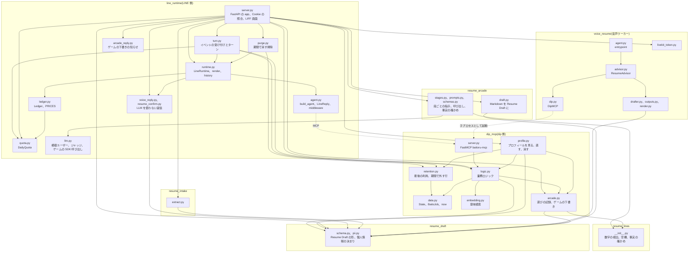

パッケージの間の依存は HLD の 3.2 にあります。ここでは各パッケージの中を書きます。

### 1.1 line_runtime

| モジュール | 役割 | 主な名前 |
|---|---|---|
| `server.py` | Web サーバー。FastAPI の `app` と `lifespan`、Cookie と本人の確かめ、イベントの結果の HTTP と NDJSON への書き出し、プロフィール、音声相談、履歴書のアップロード、LIFF 画面、LINE の webhook、ゲームの AI と下書き(4.10 の終わり) | `arcade_start`、`arcade_ai`、`arcade_save`、`_arcade_start`、`_arcade_ai`、`_arcade_save`、`arcade_client`、`liff_arcade_draft`、`_arcade_draft_page`、`_arcade_draft_edit`、`_issue`、`_owner`、`_require_own`、`_page_user`、`_require_internal`、`_client_ip`、`_admit`、`_deps`、`event`、`event_stream`、`_error_text`、`_remove_voice_files`、`profile_export`、`internal_purge`、`_purge`、`_purge_daily`、`line_webhook`、`line_api`、`_line_kind`、`_line_handle`、`_line_user_events`、`_line_messages`、`_line_link_start`、`_line_data`、`_forget_all`、`account_link`、`_line_turn`、`_unlink`、`dip_login_page`、`dip_login`、`dev_link_start`、`dev_link_unlink`、`fake_line_account_link`、`line_login`、`_liff_page_user`、`_liff_shell`、`liff_session`、`liff_line_entry`、`liff_line_resume`、`liff_line_voice_draft`、`liff_line_form`、`liff_line_submit`、`liff_line_voice`、`liff_line_resume_upload`、`liff_line_arcade`、`liff_line_arcade_game`、`liff_line_arcade_draft`、`liff_arcade_start`、`liff_arcade_ai`、`liff_arcade_save`、`liff_voice_start`、`liff_voice_wait`、`liff_resume_upload`、`_voice_token`、`_line_push`、`liff_line_mic_check`、`liff_mic_check_log`、`legal_page`、`DEMO_FORM_VALUES` |
| `line_channel.py` | LINE のチャネル(4.11)。署名、LINE のユーザーID、再送の見分け、返信を LINE のメッセージにする、Messaging API の呼び出し、アカウント連携の文とボタン(4.12)、データを見る、消すの文と確かめ(4.11)。FastAPI に依存しない | `verify_signature`、`line_user`、`id_key`、`check_id_key`、`IdKeyError`、`check_internal_key`、`InternalKeyError`、`LINE_ID`、`SeenEvents`、`to_messages`、`LineApi`(`link_token` を含む)、`configured`、`public_url`、`ACTION_NOTES`、`FAILED_TEXT`、`link_command`、`link_messages`、`account_link_url`、`LINK_TEXT`、`UNLINK_TEXT`、`data_command`、`forget_postback`、`forget_ask_messages`、`data_view_messages`、`VIEW_DATA_TEXT`、`FORGET_DATA_TEXT`、LIFF(4.11): `liff_configured`、`liff_url_of`、`liff_page_url`、`liff_features`、`LIFF_ACTIONS`、`LineLogin`、`liff_session`、`liff_session_user` |
| `fake_line.py` | 偽物の LINE のアカウント連携のところ(4.12)。linkToken の発行、accountLink の画面、webhook のイベントと署名。テストと開発者画面で使う | `FakeLinePlatform`、`account_link_event`、`signed_webhook`、`LINK_TOKEN_TTL` |
| `turn.py` | イベントの受け付けとターンの決まり。`event` と `event_stream` が共通に使う。FastAPI に依存しない | `accept`、`run`、`reply_of`、`BadTurn`、`TurnFailed`、`TurnDeps`、`Turn`、`stale_thread`、`profile_notice`、`record_open`、`track_status`、`upload_facts`、`LIMIT_REASON` |
| `runtime.py` | LineRuntime。1 ターンを進め、会話を保存し、返信を描く | `EVENTS`、`event_input`、`voice_event`、`dip_connection`、`LineRuntime`(`conversations_of`)、`render`、`history`、`track_switch`、`_cards_in`、`CARD_KEYS` |
| `agent.py` | エージェント。LINE の共通ルール(`PLATFORM_PROMPT`)と返信の形、今の窓口の案内 | `LineReply`、`Button`、`LineState`、`channel_note`、`ScenarioMiddleware`、`TurnCallLimitMiddleware`、`PinUserMiddleware`、`build_model`、`build_agent` |
| `quota.py` | ターン数の上限と、ターンとは別の 1 日の回数(`take_daily`。AI つきのゲームの遊び) | `DailyQuota`、`ip_key`、`person`、`today`、`limit_reply` |
| `ledger.py` | 費用台帳と料金表。`python -m line_runtime.ledger` で集計する。90 日を過ぎた行を日ごとの合計にし、「すべて消す」でその人の行のユーザーIDを外す(5.3) | `PRICES`、`cost_usd`、`Ledger`(`fold_old`、`forget`、`rows_of`)、`fold`、`summarize`、`ID_TTL`、`FOLDED`、`DAILY_TOTAL` |
| `purge.py` | 期間で消す掃除(4.6)。Web プロセスの中で走る。CLI `python -m line_runtime.purge` は内部の口を呼ぶだけ | `purge`、`main`、`CONVERSATION_TTL`、`EVERY`、`INTERNAL_PATH` |
| `voice_reply.py` | 音声相談の結果をトークに続ける返信(LLM を使わない) | `voice_reply`、`summary_bubble`、`voice_history_reply`、`draft_button` |
| `arcade_reply.py` | ゲームで下書きを保存したとき、トークに続ける返信(LLM を使わない。`LineRuntime.add_arcade_result` で足す) | `arcade_reply`、`arcade_history_reply` |
| `resume_confirm.py` | 履歴書をアップロードした直後の確認の吹き出し(LLM を使わない) | `resume_bubbles`、`skill_heading`、`RESUME_LABEL` |
| `llm.py` | 模擬ユーザー、ジャッジ、ゲームの AI が SDK を直接呼ぶところの、プロバイダの違いの吸収。`parse(with_usage=True)` は使った量も返す(費用台帳の形) | `client`、`parse`、`usage_of`、`text` |
| `config.py` | 設定と `.env` の読み込み | `PROVIDER`、`MODEL`、`EFFORT`、`DIP_MCP_URL`、`DATA_DIR`、`load_env` |
| `legal.py` | 利用規約とプライバシーポリシーの画面と版(4.10)。原文 `docs/legal/*.md` を HTML にする(見出し、段落、箇条書き、表、太字、リンクだけ)。FastAPI に依存しない | `TERMS_VERSION`、`PRIVACY_VERSION`、`versions`、`DOCS`、`URLS`、`DEMO_NOTE`、`page`、`to_html`、`footer_html`、`links_html`、`version_in` |
| `static/` | 画面。`talk.html`(トーク画面)、`dev.html`(開発者画面)、共通部品 `talk-core.js`、`talk-core.css` | - |
| `static/arcade/` | レジュメ・アーケード(4.10 の終わり)。ハブ `resume-arcade.html`、8 本のゲーム `<game>.html`、日本語の答えの判定の共通部品 `arcade-ja.js`、AI と保存の API を呼ぶ共通部品 `arcade-ai.js` | - |

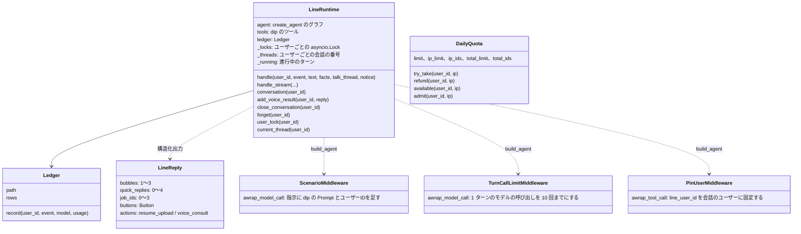

エージェントは `build_agent` が LangChain の `create_agent` で作ります。

- middleware は外側から `ScenarioMiddleware`、`TurnCallLimitMiddleware`、`AnthropicPromptCachingMiddleware`(OpenAI では何もしない)、`PinUserMiddleware` の順です
- `TurnCallLimitMiddleware` は、1 ターン(最後の本人の入力より後)のモデルの呼び出しを `MAX_MODEL_CALLS_PER_TURN`(10)回までにします。
  10 回目の指示には、ツールを呼ばずに返信するよう添え書き(`LAST_CALL_NOTE`)を足します。それでもツールを呼んだら、11 回目はモデルを呼ばずに
  決まった返信(`TURN_LIMIT_REPLY`。うまくまとめられなかったので短く聞き直してほしい)でターンを終えます。この返信は LLM を呼んでいないので、
  費用台帳と画面の `llm` の行には載せません(`additional_kwargs` の `turn_limit`)
- `ScenarioMiddleware` は、指示を `PLATFORM_PROMPT` + 入口の dip の Prompt + 窓口 + ユーザーIDにします。入口とユーザーIDは会話の state(`entry`、`line_user_id`)から読みます。
  窓口(`channel_note`)は state の `channel`(`web` / `line`)と `channel_features`(LINE で LIFF 画面で使えるもの)から作り、
  LINE で使えないもの(履歴書の読み込み、音声相談、レジュメ・アーケード)は勧めず、`actions` も付けないよう書きます。
  LIFF の設定があれば、レジュメ・アーケードは要約の `arcade_url` をボタンにでき、AI と保存も LINE の本人で使えると書きます。
  `channel` と `channel_features` は、ターンのたびに `turn.accept` → `LineRuntime.handle_stream` が入力と一緒に state に書きます
  (Web と評価は既定の `web`。LINE の webhook と LIFF 画面からのターンは `line` と `line_channel.liff_features()`)。
  本番のトーク画面(`/api/event`、`/api/event/stream`)は `line_channel.web_features()` を渡し、LiveKit の設定が無ければ
  窓口を `WEB_NO_VOICE_NOTE`(音声相談を勧めない)にします。Web の features が空(評価、テスト)なら 3 つとも使える扱いです
  窓口はシナリオの後に置くので、どの窓口でもシナリオまでの指示は同じです
- 返信は `ProviderStrategy(LineReply)` の構造化出力です
- `build_model` は `config.PROVIDER` で `ChatOpenAI`(Responses API、`reasoning.effort`)か `ChatAnthropic`(`thinking: adaptive`)を作ります

### 1.2 dip_mcp

| モジュール | 役割 | 主な名前 |
|---|---|---|
| `server.py` | dip の MCP サーバー(FastMCP、名前は `baitoru-mcp`)。ツールは引数の説明を持ち、中身は `logic` を呼ぶだけ(3.3) | `mcp`、`state`、`baitoru_assistant`、`faq` |
| `logic.py` | 業務ロジック。LLM を使わない | 下の表 |
| `profile.py` | プロフィール画面の中身と、知らせ(アカウント連携の知らせ `link_changed` も) | `delete_arcade_draft`、`edit_arcade_draft`、`link_changed`、`view`、`edit_item`、`edit_summary`、`set_track`、`undo_switch`、`switch_status`、`delete_resume`、`delete_voice_draft`、`unsave_job`、`forget_all`、`stored`、`pending_changes`、`take_changes`、`notice` |
| `data.py` | 求人の形、dip の状態の読み書き、時計。個人情報の判定は `resume_draft.pii`(1.8) | `BaitoJob`、`Pay`、`State`、`load_jobs`、`load_users`、`now`、`uses_sim_clock`、`SIM_NOW`、`PII_FIELDS`、`pay_text`、`annual_pay_mid` |
| `embedding.py` | 求人の意味検索 | `job_text`、`job_hash`、`embed_query`、`similarities`、`MODEL`、`DIMENSIONS` |
| `events.py` | 行動の元データ(会員とイベントのログ)の読み書き。追記だけ。読むのは要約のバッチだけ(5.8) | `EventStore`、`KINDS`、`load_scenario_events`、`iso`、`EVENTS_PATH` |
| `summarize.py` | 要約のバッチ(`python -m dip_mcp.summarize`)。元データから状況の要約を全員分作り直す(5.8) | `run`、`fold`、`build_summary`、`empty_summary`、`for_agent`、`head`、`SummaryStore`、`SUMMARY_MAX_CHARS`、`AGENT_APPLICATIONS`、`AGENT_SAVES`、`SUMMARIES_PATH` |
| `behavior.py` | dip のツールが本人の行動を読み書きするところ。要約に、会話の中で書いた分を重ねて読む。書くときは元データに追記する。LINE のユーザーIDから `dip_id` を引く 1 か所(連携の表を読む。5.8、ADR-0006、ADR-0007)。会話の中で書いた分は、今の会員の分だけ重ねる(4.12) | `view`、`record`、`overlay`、`dip_id`、`_mine`、`stores`、`WRITES` |
| `arcade.py` | レジュメ・アーケードの遊びの記録(1 人 1 ゲームにつき最新の 1 件)と AI の回数、ゲームで作った下書き、要約に載せる要点(4.10 の終わり)。LLM を使わない | `start_play`、`play`、`use_ai`、`save_draft`、`edit_draft`、`delete_draft`、`drafts`、`draft`、`document_kind`、`summary`、`game_url`、`draft_url`、`is_line_user`、`liff_configured`、`PLAY_TTL`、`SUMMARIES_MAX`、`DOCUMENT_BY_TRACK` |
| `retention.py` | 期間で消す掃除の dip の状態の側(4.6、5.1)。最後の利用を書き、180 日を過ぎた人の行を丸ごと外す。会話とメモリの片付けは `line_runtime.purge` | `touch`、`mark_forgotten`、`sweep`、`still_expired`、`remove_expired`、`clock`、`USER_TTL`、`FORGOTTEN_ROOMS_TTL` |
| `accounts.py` | dip の会員のログイン、nonce、bot が出した linkToken、連携の表(4.12、5.9)。LLM を使わない | `Accounts`、`of`、`hash_password`、`check_password`、`fixture_dip_id`、`MAX_FAILURES`、`LOCK`、`NONCE_TTL`、`ACCOUNTS_PATH` |
| `prompts/` | dip の Prompt。`baitoru_assistant.md`(どの入口でも同じ骨格)と `entries.json`(入口ごと) | - |
| `playbooks/` | playbook。`{parttime,fulltime,undecided}_{chat,voice}.md` と区分に共通の `common_{chat,voice}.md` | - |

`logic.py` は見出しのコメントで次のように分かれています(R14)。

| 見出し | 主な関数と定数 |
|---|---|
| (先頭)dip の要約、応募、フォーム | `liff_url`、`preferences`(本人の傾向)、`stated_preferences`、`conversation_summary`、`recent_applications`、`form_exit`、`HISTORY_DAYS` |
| 推薦 | `JOB_TYPES`、`FULLTIME_JOB_TYPES`、`AREAS`、`AREA_GROUPS`、`ATTRIBUTE_ARGS`、`FULLTIME_STYLE_ARGS`、`recommend`、`relax`、`match_breakdown`、`job_card`、`_keyword_filter`、`_reasons`、`SIM_FLOOR`、`SIM_RELATIVE`、`SIM_TOP`、`SIM_WEIGHT`、`SIM_PEAK` |
| 相談(FAQ / 求人) | `answer_material`、`application_status`、`MIN_OVERLAP` |
| 手続き(フォームの続き) | `resume_form`、`submit_application`、`save_job`、`saved_jobs` |
| トークを開いた | `talk_entry`、`record_talk_open` |
| 本人が話した希望と、本人について | `PREFERENCE_KEYS`、`FULLTIME_PREFERENCE_KEYS`、`PREFERENCE_VALUE_MAX`、`save_preferences`。個人情報らしい値かは `resume_draft.pii.personal_value`(1.8) |
| 雇用区分 | `TRACKS`、`search_track`、`track_history`、`set_search_track` |
| 相談の playbook | `PLAYBOOK_FILES`、`CHANNELS`、`CONVERSATION_RULES`、`VOICE_CONVERSATION_RULES`、`counseling_playbook` |
| 音声相談の結果 | `record_voice_result`、`voice_results_since`、`voice_result`、`record_voice_room`、`voice_room_forgotten` |
| アップロードした履歴書 | `save_resume_upload`、`resume_upload`、`uploaded_resume` |
| 会話の段階の結果の記録 | `OUTCOMES`、`REFUSAL_WORDS`、`CONSULTATION_SUMMARY_MAX`、`record_outcome`、`consultation_summary` |
| プッシュ | `PUSH_TRIGGERS`、`PUSH_INTERVAL_DAYS`、`push_trigger` |

dip の関数はどれも、1 つ目の引数に `State` を受け取ります。MCP サーバーと Web サーバーと評価は、それぞれ自分の `State()` を作り、
同じファイルを読み書きします(5.1、6 章)。

### 1.3 resume_intake

| モジュール | 役割 | 主な名前 |
|---|---|---|
| `extract.py` | 履歴書のファイルから Resume Draft を作る。OpenAI の Responses API の構造化出力。テキストのある PDF はローカルでテキストを取り出す(pypdf)。形と `scrub_pii` は `resume_draft`(1.8) | `EXTRACT_SYSTEM`、`media_type`、`pdf_text`、`content_part`、`extract_bytes`、`extract_draft`、`finalize`、`Usage` |
| `config.py` | モデル、上限、出力先 | `MODEL`(既定 `gpt-6-sol`)、`MAX_UPLOAD_BYTES`(10MB)、`OUT_DIR` |
| `cli.py`、`run_samples.py` | 運営者が手で回す読み取りと、サンプルの正解との比較(実 API) | - |
| `samples/` | 架空の履歴書 5 つと正解 4 つ(05 は JIS 風の表と顔写真の PDF) | - |

`client` を引数で受け取るので、テストは `responses.parse` を持つスタブを渡します。Web サーバーは `server.resume_client` で
`AsyncOpenAI` を作ります。

### 1.4 voice_resume

音声ワーカーのパッケージです。音声は「文字起こし → 文章の LLM → 読み上げ」に分けています(旧リポジトリの task 31 で、
OpenAI Realtime の構成から作り直しました)。

```
ブラウザ(マイク) ──WebRTC──▶ LiveKit Cloud(部屋) ──▶ 音声ワーカー(voice_resume/agent.py)
                                                        ├ STT: Deepgram nova-3(ja)+ 用語の keyterm
                                                        ├ LLM: OpenAI gpt-6-sol(reasoning_effort=none)
                                                        ├ TTS: Cartesia sonic-3.5(日本語のボイス、速さ 0.9)
                                                        ├ ターンの判定: Silero VAD + 多言語の turn detector
                                                        ├ dip: dip_mcp を相談ごとに stdio の子プロセスで起動
                                                        └ 終わり: 下書きを作り、POST /api/voice/result でトークへ結果を返す
                                                           (data/voice-resume/ に書くのは開発のときだけ)
```

| モジュール | 役割 | 主な名前 |
|---|---|---|
| `agent.py` | LiveKit のワーカーの入口。`python -m voice_resume.agent dev`。起動の前に内部の鍵を確かめる | `main`、`check_settings`、`prewarm`、`entrypoint`、`participant_user_id`、`prepare_advisor` |
| `advisor.py` | 音声アドバイザー(LiveKit の `Agent`)。ツール(3.4)と、トークへの結果の返送 | `ResumeAdvisor`、`TalkForgotten`、`_post_json`、`post_failure`、`_remove_files` |
| `dip.py` | dip のクライアント。音声で使う 7 つのツールだけを公開する | `DipMCP`、`ANON_USER_ID` |
| `prompts.py` | 区分によらない音声の決まり、dip の要約から足す指示、挨拶の指示、下書きの指示 | `advisor_instructions`、`stated_preferences_note`、`consultation_summary_note`、`uploaded_resume_note`、`greeting_instructions`、`DRAFTER_SYSTEM`、`CAREER_DRAFTER_SYSTEM`、`drafter_system`、`document_kind_for`、`document_name` |
| `jobs.py` | 希望から `recommend_jobs` の引数を作る。dip の一覧の写し(R13) | `JOB_TYPES`、`FULLTIME_JOB_TYPES`、`TRACKS`、`AREAS`、`build_recommend_args`、`split_relaxed`、`on_track`、`spoken_job_line`、`relax_option_line` |
| `drafter.py` | 文字起こしから下書きを作る。形と `scrub_pii` は `resume_draft`(1.8) | `build_draft`、`finalize` |
| `outputs.py` | 相談の終わりに下書きと求人の提案を作る。4 つのファイルを書くのは `WRITE_FILES` のときだけ(5.4) | `write_outputs`、`history_transcript` |
| `render.py` | 下書きの Markdown。書類の種類で見出しと並びを変える(5.5) | `to_markdown` |
| `livekit_token.py` | 部屋の接続トークンの発行。Web サーバーが使う | `configured`、`issue_token`、`TOKEN_TTL`(5 分) |
| `stt.py` | STT の作り分け | `create_stt` |
| `flow.py`、`stt_eval.py` | 文字起こしから会話の流れを確かめるチェッカーと、STT の聞き取りの台本(テストと評価で使う) | `verify_flow`、`count_experience_probes`、`find_leading_questions`、`score_transcripts` |
| `wages.py` | 平均時給の参考データ(`data/wage_reference.json`) | `load_reference`、`answer_from_reference` |
| `config.py` | 設定(7.1)と `.env` の読み込み | `WRITE_FILES`、`OUT_DIR`、`TALK_URL`、`dip_server_command`、`load_env` |
| `results/` | 画面の証跡(PNG) | - |

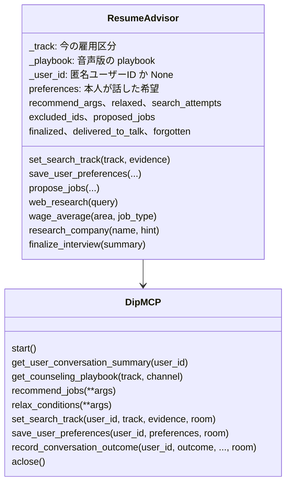

- `ResumeAdvisor` の dip のツールの `line_user_id` は、LLM の引数ではなく `_user_id` から付けます(`_with_user`、`DipMCP` の各メソッド)。
  LLM が別のユーザーを指す道はありません
- `_user_id` が None(metadata の無い参加者)のときは、dip を読むだけで書きません。`relax_conditions` には固定の `ANON_USER_ID` を渡します
- `DipMCP.record_conversation_outcome` は `propose` と `consult` 以外を `ValueError` で断ります
- `ResumeAdvisor` は dip に書くとき(雇用区分、希望、会話の段階の結果)、この通話の部屋の名前(`_room_name`)を `room` に付けます(4.6)

### 1.5 evals

| モジュール | 役割 |
|---|---|
| `run.py` | 評価のハーネス。模擬ユーザーとエージェントを会話させて採点する(4.7)。`--rejudge` で保存した会話をジャッジだけで判定し直す |
| `scenarios.json`、`scenarios.py` | シナリオの一覧(15 件)と、始める前の準備(`prepare`、`upload_resume`、`load_resume`)。開発者画面と共通 |
| `checks.py` | コードの判定。形式(`turn_violations`、`FORMAT_RULES`)、事実性(`fact_violations`)、希望の保存(`preference_violations`)、聞き直し、相談、雇用区分(`track_expectations`)、アップロード、`conversation_checks` |
| `judge.py` | LLM ジャッジ。相談の深さの 4 項目、トーン、設計への合い方(`design_fit`)、ひとこと(`comment`)。`samples` 回(既定 2)判定してまとめる |
| `meter.py` | Anthropic と OpenAI の SDK の呼び出しをクラスごと包んで、トークンと費用を数える(評価だけで使う) |
| `budget.py`、`budget.jsonl` | 予算台帳。`LIMIT_USD = 4.0` で止まる |
| `personas/` | ペルソナの架空の履歴書(読み取り結果の形) |
| `search_eval.py`、`search_eval_set.json` | 意味検索の評価セットと、上位 3 件の再現率 |
| `jobtype_repro.py`、`semantic_repro.py`、`wait_repro.py` | 個別の問題を実 API で再現するスクリプト |
| `probe.py` | 「電話はしたくない」と音声でコールセンターを外す流れを、チャットと音声で数ターンずつ実 API で確かめる小さな計測。予算台帳と $4 の停止は `run.py` と同じ |
| `baseline/` | 比較の基準にした評価の結果 |

### 1.6 evalkit

`aggregate.py` は評価の結果ファイル(5.6)を集計して比べる、標準ライブラリだけの道具です。`summary`(95% 区間つきの集計)と
`diff`(前後の比較)があります。`evals/run.py` は自分の Markdown のレポートに `summary_md` を使います。使い方は
[evalkit/README.md](../../evalkit/README.md) にあります。

### 1.7 scripts

| スクリプト | 役割 |
|---|---|
| `gen_jobs.py`、`gen_job_faq.py` | 架空の求人と求人ごとの FAQ を LLM で作る |
| `gen_job_vectors.py` | 求人のベクトル(`fixtures/job_vectors.json`)を作り直す。求人を変えたら回す |
| `gen_dip_events.py` | dip の行動の元データ(`data/dip_events.db`)を、乱数の種を固定して作る。LLM は使わない(5.8) |
| `voice/e2e_audio_session.py` | 音声の E2E(10 章) |
| `voice/live_room_smoke.py` | LiveKit の部屋の実経路の確かめ |
| `voice/eval_stt.py`、`voice/eval_hearing.py`、`voice/tool_call_probe.py` | STT の比較、ヒアリングの深さ、ツールを同じターンで呼ぶかの計測(実 API) |
| `voice/update_wage_reference.py` | 平均時給の参考データを web 検索で作り直す(年 1 回くらい、1 回 $0.05 前後) |
| `line_rich_menu.py` | LINE のリッチメニューの画像(Pillow)と本文を作り、LINE に登録する。人が回す(4.11 の終わり) |

### 1.8 resume_draft

Resume Draft の契約です。読み取り(`resume_intake`)、下書き(`voice_resume`)、dip の保存(`dip_mcp`)が同じものを使います。
`dip_mcp` にも `voice_resume` にも依存しません。

| モジュール | 役割 | 主な名前 |
|---|---|---|
| `schema.py` | Resume Draft の形と envelope(5.5) | `ResumeDraft`(と 5 つの部品の型)、`envelope`、`document_kind_of`、`FORMAT_VERSION`(`1.0`)、`FORMAT_VERSION_WITH_KIND`(`1.1`)、`PERSONAL_KEYS`、`DOCUMENT_KINDS`、`DEFAULT_DOCUMENT_KIND`、`JST` |
| `pii.py` | 電話、メール、住所、郵便番号の決まり。どれも照合の前に `fold_pii` で全角をそろえる | `PII_VALUE`、`fold_pii`、`has_pii`、`redact_pii`(探す)、`ADDRESS_LIKE`、`address_spans`(住所)、`personal_value`、`redact_personal`(電話、メール、住所)、`SCRUB_PATTERNS`、`scrub_pii`(消す) |

- `has_pii` と `redact_pii` は電話とメールを探します。トークの発言、希望、相談の記録の照合に使います
- `ADDRESS_LIKE` は住所らしい所(番地、丁目、`1-2-3` の形、市区町村名の直後の `3-5` の形)です。年収や日付の幅(`400-500万円`、`3-6か月`、`2026-09-30`)は数えません。
  `address_spans` は、当たった所を区切り(空白、句読点、括弧)までの語に広げた範囲です
- `personal_value` は、値に電話、メール、住所らしい所があるかです。dip の希望の保存(`_preference_error`)、まとめを直す(`profile.edit_summary`)、
  フォームの続き(`resume_form`)が、本人の値を受け取るかをこれで決めます。`redact_personal` は同じ 3 つを伏せます。
  相談の理由とまとめ(`record_outcome`)と、雇用区分の根拠(`set_search_track`)に使います
- `scrub_pii` は Resume Draft の文字列から、電話、メール、郵便番号を消します。`PII_VALUE` より広く取ります
  (区切りが空白 1 つの電話番号、郵便番号も消す)。`SCRUB_PATTERNS` を順に当てるのを、元の文字列と `fold_pii` でそろえた文字の両方で行い、
  どちらかで消えた位置を元の文字列から消します(`fold_pii` は 1 文字を 1 文字に写すので位置は同じ)。元の文字列でも照合するのは、
  全角の「０１」が電話番号の始まりに見えて、すぐ後ろの半角の電話番号を途中までしか取れなくなるのを防ぐためです

### 1.9 resume_arcade

レジュメ・アーケードのゲームの AI と、書類の写し(HLD の 4.11)。LLM を使う独立のパッケージで、`line_runtime.llm` を使います。
`dip_mcp` はこれを import しません。

| モジュール | 役割 | 主な名前 |
|---|---|---|
| `stages.py` | 段の一覧(`STAGES`)。段ごとに入力の形、出力の形、指示の文、事実の確かめ、反応かまとめか(`kind`)、モデル(`tier`)を持つ。`prepare` で形を確かめて電話とメールを伏せ、`run` で 1 回呼ぶ | `STAGES`、`stage`、`prepare`、`run`、`summary_chars`、`model_for`、`QUICK_MODEL`、`Outcome` |
| `prompts.py` | 指示の文。元はゲームの画面の中の prompt の関数。本人のデータは `<<<` と `>>>` の中に JSON で入れる | `case_opening`、`case_reaction`、`case_lab`、`case_verdict`、`harvest_turn`、`harvest_final` |
| `schemas.py` | 段ごとの入力と出力の pydantic。長すぎる文字列は切る(答え 600 字、行 120 字、引用 40 字)。リストの数が多すぎれば形の違いとして扱う | `ANSWER_MAX`、`LINE_MAX`、`QUOTE_MAX`、`LINES_PER_JOB`、`JOBS_MAX`、`SUMMARY_MAX` |
| `draft.py` | 書類の Markdown(`arcade-ja.js` の `resumeMarkdown` の形)を Resume Draft に写す。空欄のある行ごとに `unconfirmed` を 1 つ | `parse_markdown`、`to_envelope`、`unconfirmed`、`SOURCE`、`MARKDOWN_MAX` |

段の一覧です。反応は 1 回の遊びで 50 回まで、まとめは 2 回(数えるのは `dip_mcp.arcade.use_ai`)。

| ゲーム | 段 | 種類 | モデル | 確かめる元(sources) |
|---|---|---|---|---|
| `the-case-of-you` | `opening`(証人の質問) | 反応 | 安いモデル | 事件ファイル、職場、すでにある行 |
| `the-case-of-you` | `reaction`(反応、聞き返すか、書類の行) | 反応 | 安いモデル | 本人の答え(行の数字と引用は答えだけ) |
| `the-case-of-you` | `lab`(証拠のまとめ) | まとめ(最後のまとめの 1 回を残す) | 安いモデル | 送られた行。知らない id は落とす |
| `the-case-of-you` | `verdict`(評決と職務経歴書) | まとめ | `LINE_SIM_MODEL` | 送られた行と見出し |
| `harvest-of-work` | `turn`(水やりの質問と判定) | 反応 | 安いモデル | 思い出と答え |
| `harvest-of-work` | `final`(収穫祭の書類と暦) | まとめ | `LINE_SIM_MODEL` | 送られた行と見出し |

安いモデルは OpenAI なら `gpt-6-luna`、Anthropic なら `claude-haiku-4-5` で、`AICA_ARCADE_QUICK_MODEL` で替えられます。
事実の確かめは、数字を `resume_lines.check_numbers` で、引用を `quote_in` で見ます。強み・弱みの診断と評決の独白にもかけます。
次の一手(`leads`、`next_season`)は提案なのでかけません。比べる元は本人が書いた欄だけです(事件ファイルの欄、職場の勤務先・役職・期間、
行の文・引用・数字、答え)。行の番号(`e5`、`j1`)と強みのキーは入れません(入れると、AI が足した「5人」の 5 が `e5` に見つかるため)。
自己PR(`self_pr`)は、書類が履歴書なら書かせ、職務経歴書なら空にさせ、未定なら本人が後で選べるように書かせます(`prompts.self_pr_rule`)。

### 1.10 resume_lines

書類の行の決まり。ほかのパッケージに依存しません(`dip_mcp` と `resume_arcade` の両方が使う)。

| 名前 | 中身 |
|---|---|
| `find_metric`、`has_metric`、`is_dateish` | `arcade-ja.js` の `findMetric` の写し。範囲、単位つきの数、漢数字(三割、半分)、順位の順に探す。4 桁の年と暦の日付は数えない |
| `is_vague` | あいまいさ(日本語の字数と、数字が要るか) |
| `PLACEHOLDER`、`PLACEHOLDER_YEN`、`PLACEHOLDER_COUNT`、`PLACEHOLDER_WHEN`、`PLACEHOLDER_RE`、`placeholder_count` | 数字の空欄 |
| `check_numbers(text, sources)` | text の数字のうち sources に無いものを空欄にする。(置き換えた文, 数)。比べる前に NFKC、空白を除く(数字と数字の間の空白は 1 つ残す)、桁の区切りを外す。sources は 1 欄ずつそろえて区切りをはさんでつなぐ(隣の欄の数字がくっついて、年数「5」+「10人」が「510人」にならないように)。漢数字は書いたままの形で比べる(三割を 30% と言い換えたら空欄)。空欄の種類は単位で選ぶ(%・割・倍は `[+X% …]`、円は `[X円 …]`、年と日付は `[時期 …]`、ほかは `[N件 …]`) |
| `quote_in(quote, sources)` | 引用が sources のどれか 1 欄にそのままあるか(同じそろえ方。2 つの欄にまたがる引用は認めない) |

`arcade-ja.js` の `plainEnding`(です・ます調を言い切りに)は、まだ写していません(使うのはトークの「1 行追加」から。PRD の A)。

## 2. プロセス

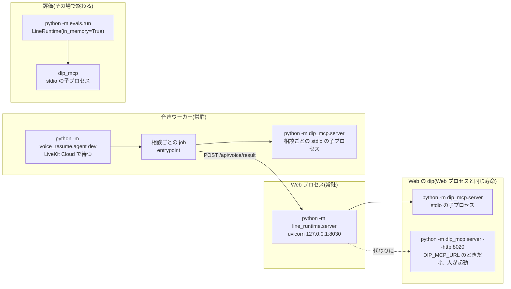

- Web プロセスは `lifespan` で `.env` を読み、起動してよいかを確かめます。LINE か LIFF の設定があるのに `AICA_ID_KEY` が無い、短いときは
  `line_channel.check_id_key` で、音声相談の設定(`LIVEKIT_*`)があるのに `AICA_INTERNAL_KEY` が無い、短いときは
  `line_channel.check_internal_key` で、起動を止めます。次に `DailyQuota` と LINE の `SeenEvents` を作り、`LineRuntime` に入ります。`LineRuntime.__aenter__` は
  dip と MCP のセッションを 1 本だけ張り(`dip_connection`)、ツールを読み、イベントの入口(`A`、`visit`、`revisit`、`D`)ごとに dip の
  Prompt を読んでから、エージェントを作ります。dip の Prompt を変えたら Web プロセスを起動し直します
- dip の子プロセスは親の環境変数をすべて受け取ります(`env=dict(os.environ)`、R15)
- `LineRuntime.__aexit__` は、進行中のターン(`_running`)が終わるのを待ってから MCP のセッションを閉じます
- 音声ワーカーは LiveKit Agents の CLI で動きます。CLI に渡す前に `check_settings` で、Web プロセスと同じ
  `line_channel.check_internal_key` を呼びます。鍵が無い、短いときは、何が足りないかと鍵の作り方を出して終わります(終了コード 1)。
  モデルを取るだけの `download-files` では確かめません。`prewarm` で Silero VAD を読み、相談(LiveKit の job)ごとに `entrypoint` を呼びます。
  `entrypoint` は `DipMCP.start` で dip の子プロセスを起動し、終わりの callback で閉じます。dip に繋がらなくても相談は続けます
- 評価は Web サーバーを通らず、自分のプロセスで `LineRuntime(in_memory=True)` を使います。会話は SQLite の `:memory:`、
  dip の状態は `DIP_STATE_PATH` に設定した一時ファイル、費用台帳はメモリだけです
- その場で終わるプロセス: `python -m line_runtime.ledger`(費用台帳の集計)、`python -m evals.budget`(予算台帳)、
  `python -m resume_intake.cli`、`python3 evalkit/aggregate.py`

## 3. 口

### 3.1 Web サーバーの HTTP の口

本人の確かめの列の意味です。

- Cookie: `_owner`。Cookie `aica_uid` が無いか形が違えば 401
- 本人: `_require_own`。本文の `user_id` が Cookie の匿名ユーザーIDか、そのシナリオユーザー(`scenarios.json` にあるものだけ)でなければ 403
- 画面: `_page_user`。Cookie の匿名ユーザーIDに、URL の `scenario_user` を付ける
- LIFF: `_liff_page_user`。署名つきの Cookie `aica_liff` の LINE のユーザーID(`l-…`)。`aica_uid` は見ない。無い、不正、期限切れなら、
  GET は LIFF SDK の殻(`_liff_shell`)、POST は 401。LIFF の設定が無ければ 404(4.11)
- 書き込みの枠: `_admit`(`DailyQuota.admit`)。この IP か全体で、その日に使える匿名ユーザーIDの数を超えたら 429
- 内部の鍵: `_require_internal`。`Authorization: Bearer <AICA_INTERNAL_KEY>` でなければ 401(鍵の前後の空白は、照合でも送るときでも除く)。音声相談の設定(`LIVEKIT_*`)があるのに
  鍵が無い、または短い(前後の空白を除いて 32 文字未満)ときは、Web サーバーも音声ワーカーも起動で止まります(`line_channel.check_internal_key`、
  `InternalKeyError`)。鍵が無いまま動くと、相談は最後まで進むのに、ワーカーが送る結果が 401 で断られ、まとめと下書きが届かないためです。
  音声相談の設定が無ければ、鍵は要りません。ワーカーは、送った結果が断られたらエラーのログを 1 行出します(例外の型と HTTP の状態だけ。
  `advisor.post_failure`)
- LINE の署名: `line_channel.verify_signature`。`X-Line-Signature` が、チャネルシークレットで本文そのままの HMAC-SHA256 を取った値の
  base64 でなければ 400

| メソッドとパス | 関数 | 本人の確かめ | ターン | 書くもの |
|---|---|---|---|---|
| `GET /healthz` | `healthz` | - | - | -(ヘルスチェック。Cookie も発行しない) |
| `GET /`、`GET /dev` | `index`、`dev` | Cookie を発行するか、同じ ID で書き直す(`_issue`) | - | Cookie(180 日) |
| `GET /static/{name}` | `shared_static` | - | - | -(`talk-core.js`、`talk-core.css` だけ) |
| `GET /legal/{name}` | `legal_page` | -(Cookie を発行も要求もしない) | - | -(`terms` は利用規約、`privacy` はプライバシーポリシー。原文は `docs/legal/`。ほかの名前は 404) |
| `GET /static/arcade/{name}` | `arcade_static` | - | - | -(`arcade-ja.js`、`arcade-ai.js` だけ。`ARCADE_STATIC`) |
| `GET /liff/arcade` | `liff_arcade` | -(Cookie を発行も要求もしない) | - | -(ハブ) |
| `GET /liff/arcade/{game}` | `liff_arcade_game` | -(同上) | - | -(ゲーム。`ARCADE_GAMES` に無い名前は 404) |
| `GET /liff/arcade/draft` | `liff_arcade_draft` | 画面 | - | -(ゲームで作った下書き。`rid` が無ければ 404。`{game}` より先に登録する) |
| `POST /liff/arcade/draft` | `liff_arcade_draft_edit` | 画面 + 書き込みの枠 | - | 本人が直した下書き(`profile.edit_arcade_draft`。`scrub_pii`、2 万字まで)、知らせ |
| `POST /api/arcade/start` | `arcade_start` | 画面 + 書き込みの枠 | AI を使えるときだけ 1 | 遊びの記録(前の記録を置き換える)、始めた数、`quota.json` の AI つきの遊びの回数。Cookie が無ければ番号なし(`play: null`)の 200。AI を使えないとき(`AICA_ARCADE_AI=0`、API キーが無い、1 日の回数、ターン数の上限)は `ai: false` の番号 |
| `POST /api/arcade/ai` | `arcade_ai` | 画面 | - | 遊びの記録の回数、費用台帳(`arcade:<game>:<段>`)、置き換えた数。だめなとき(番号、期限、回数、形、4,000 字、LLM の失敗)は LLM を呼ばずに `{ok: false, offline: true, reason}` の 200 |
| `POST /api/arcade/save` | `arcade_save` | 画面 | - | ゲームの下書き(そのゲームの前の下書きを置き換える)、保存した数と空欄の数、会話にエージェントの返信を足す。番号が無い・ほかの人の番号は 403、未定で書類の種類が無ければ 400 |
| `DELETE /api/profile/arcade/{id}` | `profile_arcade_delete` | Cookie + 書き込みの枠 | - | ゲームの下書きを消す、知らせ。無ければ 404 |
| `GET /api/me` | `me` | Cookie | - | - |
| `POST /api/talk/open` | `talk_open` | Cookie | - | 挨拶が保存されているのに記録が無ければ `record_talk_open` で補う |
| `GET /api/talk/history` | `talk_history` | Cookie | - | - |
| `POST /api/talk/track/undo` | `talk_track_undo` | 本人 + 書き込みの枠 | - | 雇用区分の取り消し、知らせ。直前の切り替えでなければ 409 |
| `GET /api/saved` | `saved` | Cookie | - | - |
| `GET /api/scenarios` | `scenarios` | - | - | - |
| `POST /api/scenarios/{id}/start` | `start_scenario` | Cookie + 書き込みの枠 | - | シナリオユーザーの dip の状態を初期に戻す(`evals.scenarios.prepare`) |
| `POST /api/event` | `event` | 本人 | 1 | 会話、dip の状態(ツール)、費用台帳。`ValueError` は 400 |
| `POST /api/event/stream` | `event_stream` | 本人 | 1 | 同上。途中経過は NDJSON(3.2) |
| `POST /api/dip` | `dip_view` | 本人 | - | -(開発者画面の「dip から見た状態」) |
| `GET /api/profile` | `profile_get` | Cookie | - | - |
| `GET /api/profile/export` | `profile_export` | Cookie | - | -(「データを書き出す」。本人の保存内容を JSON のファイルで返す。下の注) |
| `PUT`、`DELETE /api/profile/items/{key}` | `profile_edit`、`profile_delete` | Cookie + 書き込みの枠 | - | 本人が話した希望か相談のまとめ、知らせ。個人情報らしい値、長すぎる値、空の値、知らない項目は 400(`_checked`)。保存していない項目を消しても 200 |
| `PUT`、`DELETE /api/profile/track` | `profile_track`、`profile_track_delete` | Cookie + 書き込みの枠 | - | 雇用区分、知らせ |
| `DELETE /api/profile/resume` | `profile_resume_delete` | Cookie + 書き込みの枠 | - | 会話を閉じてから読み取り結果を消す(4.6) |
| `DELETE /api/profile/voice/{id}` | `profile_voice_delete` | Cookie + 書き込みの枠 | - | 下書きを空にし、`data/voice-resume/` に書き出したファイルがあれば消す。無ければ 404 |
| `DELETE /api/profile/saved/{job_id}` | `profile_unsave` | Cookie + 書き込みの枠 | - | 保存の取り消し、知らせ |
| `POST /api/profile/forget` | `profile_forget` | Cookie | - | 「すべて消す」(4.6) |
| `POST /api/voice/start` | `voice_start` | 本人 | 1 | 部屋の記録(`record_voice_room`、終わっていない部屋の `ActiveVoiceRooms`)。LiveKit の設定が無ければターンを使わずに 503、その人(シナリオユーザーも匿名IDにまとめる)に終わっていない部屋があればターンを使わずに 409、上限なら 429 |
| `POST /api/voice/wait` | `voice_wait` | 本人 | - | -(最長 `VOICE_WAIT_MAX` 30 秒、既定 25 秒) |
| `POST /api/voice/result` | `voice_result_in` | 内部の鍵 | - | 音声相談の結果、会話にエージェントの返信を足す。部屋はまだ終わったとみなさない。「すべて消す」の前の部屋なら 410。下書きが `DRAFT_MAX`(2 万字)を超えたら 422 |
| `POST /api/internal/purge` | `internal_purge` | 内部の鍵 | - | 期間で消す掃除を今すぐ走らせ、消した数を返す(4.6)。CLI `python -m line_runtime.purge` が呼ぶ |
| `POST /api/voice/session` | `voice_session` | 内部の鍵 | - | ワーカーのジョブの始まり(`joined`)と終わり(`ended`)。終わっていない部屋の記録(メモリだけ。`line_runtime/voice_rooms.py`)。`joined` でその人に別の部屋があれば `allowed: false` を返し、ワーカーはそのジョブを止める |
| `POST /api/resume/upload` | `resume_upload` | 本人 | 1 | 読み取り結果、費用台帳。形式が違えば 400、10MB を超えたら 413、会話が替わっていれば 409、上限なら 429、API の失敗は 502 |
| `GET /liff/resume` | `liff_resume` | 画面 | - | -(読み取り結果。`rid` が最新でなければ 404) |
| `GET /liff/voice/draft` | `liff_voice_draft` | 画面 | - | -(下書き) |
| `GET`、`POST /liff/apply` | `liff_form`、`liff_submit` | 画面 | - | 応募の確定(`submit_application`)。欄には架空の値(`DEMO_FORM_VALUES`)を最初から入れる。入力値は読まず、保存しない |
| `POST /api/liff/session` | `liff_session` | LIFF の ID トークン(LINE の検証) | - | Cookie `aica_liff`。確かめられなければ 401 で Cookie を消す。JSON でなければ 415。LIFF の設定が無ければ 404 |
| `GET /liff/line` | `liff_line_entry` | LIFF | - | -(LIFF アプリのエンドポイント URL。`liff.state` があれば殻) |
| `GET /liff/line/resume`、`GET /liff/line/voice/draft` | `liff_line_resume`、`liff_line_voice_draft` | LIFF | - | -(`/liff/resume`、`/liff/voice/draft` と同じ中身。`scenario_user` は無い) |
| `GET`、`POST /liff/line/apply` | `liff_line_form`、`liff_line_submit` | LIFF | - | 応募の確定(`/liff/apply` と同じ) |
| `GET /liff/line/mic-check` | `liff_line_mic_check` | -(本人を決めない) | - | -(マイクの確認。LIFF の設定が無ければ 404) |
| `POST /api/liff/mic-check` | `liff_mic_check_log` | -(本人を決めない) | - | ログに 1 行(`line_runtime.mic_check`)。決まった項目の外は 422、JSON でなければ 415 か 422、1 日 500 行を超えたら 429。LIFF の設定が無ければ 404 |
| `POST /line/webhook` | `line_webhook` | LINE の署名 | イベントごとに 1(アカウント連携は 0) | 4.11、4.12。設定が無ければ 404。受けた webhook のイベントの ID(`data/line_events.json`)、会話、dip の状態、費用台帳、連携の表 |
| `GET`、`POST /dip/login` | `dip_login_page`、`dip_login` | dip の会員のログイン(Cookie は見ない) | - | 4.12。ログインの失敗の数、nonce。できたら LINE の accountLink の画面へ 303。ID かパスワードがちがえば 401、ロック中は 429、linkToken の形が違えば 400 |
| `GET /api/dev/link` | `dev_link` | Cookie | - | -(開発者画面の「アカウント連携」。匿名ユーザーIDと `dip_id`) |
| `POST /api/dev/link/start` | `dev_link_start` | Cookie + 書き込みの枠 | - | 偽物の LINE の linkToken、bot が出した linkToken の記録。連携済みなら 409 |
| `POST /api/dev/link/unlink` | `dev_link_unlink` | Cookie | - | 連携の表から外す |
| `GET /fake-line/dialog/bot/accountLink` | `fake_line_account_link` | Cookie(開いた人が linkToken のユーザーか) | - | 4.12。偽物の LINE の accountLink の画面。知らない linkToken は 404 |

- Cookie `aica_uid` は HttpOnly、SameSite=Lax です。`AICA_SECURE_COOKIE=1`(コンテナの image の既定)のときは Secure も付けます。匿名ユーザーIDを発行するのは画面を開いたとき(`_issue`)だけで、API は発行しません
- Cookie の期限(`ANON_COOKIE_MAX_AGE`)は 180 日です。`_issue` は Cookie があって形が正しいときも、同じ ID で書き直して期限を延ばします。
  期限は最後に画面を開いた日から数えるので、毎日使う人が 181 日目に ID を失いません。API は書き直しません
- `GET /api/profile/export`(「データを書き出す」。[個人情報の設計メモ](../design/privacy.md) の 3.7)は `Content-Disposition: attachment` の
  `aica-data-<日本時間の日付>.json` を、`Cache-Control: no-store` で返します。範囲は「すべて消す」と同じで、本人と同じ Cookie のシナリオユーザーです。
  中身は `profile`(`GET /api/profile` と同じ)、`stored`(`profile.stored`。`state.json` の行そのままと、連携の `dip_id`)、
  `conversations`(`LineRuntime.conversations_of`。会話ごとに `history` の形)、`costs`(`Ledger.rows_of`。費用台帳の行)です。
  本人とシナリオユーザーの `user_lock` の中で読みます(`_own_users`。「すべて消す」と同じ順)。見るだけなので、最後の利用に数えず、状態にいない人の行も作りません。LINE の人の書き出しは「データを見る」の返事です(4.11)
- ブラウザから本文で受け取るユーザーIDは、どれも `_require_own` を通します。URL には載せません(`logic.liff_url`)。
  ブラウザの履歴、アクセスログ、Referer に残るためです
- dip の状態にユーザーが書かれるのは、Cookie を持つ本人が話したときと、開発者画面でシナリオを始めたときだけです。
  Cookie の無い `POST /api/talk/open` は 401 で、何も書きません
- ターンを数えるのは `DailyQuota.try_take` を呼ぶ 4 つの口です(`turn.run`、音声相談の開始、履歴書のアップロード、AI つきのゲームの開始)。上限のときは LLM を呼びません(ゲームは AI なしで始める)
- IP は `_client_ip` が決めます。`AICA_TRUST_PROXY=1` のときだけ `X-Forwarded-For` の最後の値を使います

### 3.2 NDJSON の行(`POST /api/event/stream`)

1 行 1 件の JSON で、`kind` が種類です。`POST /api/event` は同じ処理で `reply` の中身だけを返します。

| `kind` | いつ | 中身 |
|---|---|---|
| `start` | 最初に 1 回 | `event`、`entry`、`event_kind`、`model` |
| `gate` | プッシュのとき | `push_trigger` の結果(`allowed`、`reason` か `trigger` と `facts`) |
| `thread` | 本番のトーク画面(`thread` を送ったとき)で、LLM を呼ぶ前 | このターンの会話の番号 |
| `llm` | LLM の呼び出しごと | `ms`、`input_tokens`、`output_tokens`、`cache_read`、`cache_write`、`tool_calls` |
| `tool_start` | ツールの実行の前 | `calls`(名前と引数) |
| `tools` | ツールの実行の後 | `ms`、`calls`(名前、引数、`runtime._summary` の 1 行) |
| `reply` | 最後 | `render` の結果 + `search_track`。プッシュを送らないときは `sent: false` と `reason`、上限のときは `limited: true` |
| `stale` | 別のタブで会話が替わっていた | 今の会話の番号 |
| `error` | 途中で例外 | `型名: 文`(応答を返し始めた後なので HTTP のエラーにできない) |

`render` の結果(返信)は `entry`、`track_switch`、`bubbles`、`quick_replies`、`cards`、`unknown_job_ids`、`buttons`、`actions`、
`tools` です。`track_switch` には Web サーバーが今の状態(`profile.switch_status` の `undoable`、`undone`、`past`、`gone`)を足します。

### 3.3 dip のツール(MCP)と業務ロジック

エージェントは `load_mcp_tools` で全部のツールを読みます。音声アドバイザーは `DipMCP` の 7 つだけを使います。

| ツール | 中身 | 書くもの(dip の状態のキー) | 音声 |
|---|---|---|---|
| `get_user_conversation_summary` | `logic.conversation_summary` | - | 使う |
| `get_user_recent_applications` | `logic.recent_applications` | - | - |
| `get_user_form_exit` | `logic.form_exit` | - | - |
| `recommend_jobs` | `logic.recommend` | - | 使う |
| `relax_conditions` | `logic.relax` | - | 使う |
| `answer_job_question` | `logic.answer_material` | - | - |
| `get_application_status` | `logic.application_status` | - | - |
| `resume_application_form` | `logic.resume_form` | 元データの `form_fill`、`dip_writes` | - |
| `save_job` | `logic.save_job` | 元データの `save`、`dip_writes` | - |
| `save_user_preferences` | `logic.save_preferences` | `preferences` | 使う |
| `set_search_track` | `logic.set_search_track` | `track_history` | 使う |
| `get_counseling_playbook` | `logic.counseling_playbook` | - | 使う |
| `record_conversation_outcome` | `logic.record_outcome` | `outcomes` | 使う |

- 本人の行動を読むツールは、`behavior.view`(要約に、会話の中で書いた分を重ねたもの)だけを読みます。行動の元データは読みません(5.8)。
  `get_user_conversation_summary`(連携している人)と `get_application_status` は、要約を作った時刻 `as_of` を返します
- Prompt `baitoru_assistant(entry)` は `prompts/baitoru_assistant.md` に、`entries.json` の入口の文(無い入口は `A`)を足して返します
- Resource `baitoru://faq` は `fixtures/faq.json` をそのまま返します
- 一覧に無い職種、エリア、属性の値は、0 件で返さずに `error` と使える値の一覧を返します(`_job_type_error`、`_area_error`、`_filters_error`)。
  エージェントが指定し直せるようにするためです
- 保存のツールは、受け付けなかった項目と理由を返します(`save_preferences` は `rejected` と `note`、`resume_form` は `rejected_pii` と `note`)
- `record_outcome` は、`wait` の理由に `REFUSAL_WORDS` の断りの言葉が無ければ記録しません。相談のまとめが 200 字を超えても記録しません。
  理由とまとめからは電話、メール、住所らしい所を消します(`redact_personal`)
- `set_search_track` は根拠の発言が空なら記録しません。根拠からは電話、メール、住所らしい所を消し(`redact_personal`)、200 字で切ります
- `resume_form` は、`PII_FIELDS` の項目と、値に電話、メール、住所らしい所を含む項目(`personal_value`)を `rejected_pii` に入れ、
  「入力済み」にしません(`form_fill` に書かない)。残りは LIFF 画面で入れてもらいます
- `save_user_preferences`、`set_search_track`、`record_conversation_outcome` は、音声ワーカーだけが渡す `room`(音声相談の部屋)を
  受け取ります。その部屋が `forgotten_voice_rooms` にあれば、何も書かずに `error`(`FORGOTTEN_ROOM_ERROR`)を返します(4.6)。
  トークのエージェントには `room` を見せません(`runtime.chat_tools` がツールの引数から外す)

Web サーバーと評価がツールを通さずに直接呼ぶ dip の関数は、`push_trigger`、`talk_entry`、`record_talk_open`、`search_track`、
`saved_jobs`、`form_exit`、`submit_application`、`save_resume_upload`、`resume_upload`、`record_voice_result`、`voice_results_since`、
`voice_result`、`voice_result_count`、`record_voice_room`、`voice_room_forgotten`、`liff_url`、`_md`、
`conversation_summary`(開発者画面)、`save_preferences` と `set_search_track`(シナリオの準備の `evals.scenarios.prepare`)と、
`profile` の関数です。Web サーバーと評価が dip の関数を直接呼ぶのは、HLD の 1.1 で認めた形です(R1、ADR-0003)。
守る境界はエージェントの側だけです。エージェントは dip のツールと、イベントの入力に添えた事実を通してだけ dip の事実を得ます(HLD の 1.1)。

### 3.4 音声アドバイザーのツールと、画面とのやりとり

`ResumeAdvisor` の `@function_tool` です。説明の文は LLM への指示を兼ねます。

| ツール | 中身 |
|---|---|
| `set_search_track(track, evidence)` | dip に記録し(ユーザーが分かるとき)、今の区分で使わない希望を外し、音声版の playbook を読み直して `update_instructions` で指示を入れ替える |
| `save_user_preferences(...)` | 今の区分で使う項目だけを `_DIP_PREF_KEYS` の範囲で dip に保存する(`on_track`) |
| `propose_jobs(...)` | 希望から `build_recommend_args` で引数を作り、dip の `recommend_jobs` を呼ぶ。`search_only` でなければ希望を保存する。`relax` で外した条件は `relaxed` に分ける。`exclude_ids` は相談の終わりまで足していく。0 件なら `relax_conditions` で外す候補を返す(`_zero_hit_reply`) |
| `web_research(query)`、`research_company(name, hint)` | OpenAI の Responses API の `web_search` で調べ、出典のリンクを消して話し言葉で返す。1 回の相談で `MAX_WEB_SEARCHES` 回まで(7.1。`wage_average` の web の分と合わせて数える) |
| `wage_average(area, job_type)` | 職種の指定が無く、全国か東京都なら参考データから答える。それ以外は web で調べる |
| `finalize_interview(summary)` | 4.4 の後半。2 回目は保存も送信もしない |

画面とは LiveKit のデータチャネル(topic `voice-resume`)でやりとりします。

| 向き | `type` | 中身 |
|---|---|---|
| ワーカー → 画面 | `status` | 「何をしているか」の表示(`label`)と、その終わり(`done`) |
| ワーカー → 画面 | `jobs` | 検索の結果(`jobs`、`total`) |
| ワーカー → 画面 | `track` | 切り替えた雇用区分 |
| ワーカー → 画面 | `draft` | 下書き(`document_kind`、`markdown`、`files`) |
| 画面 → ワーカー | `end` | 「面談を終える」。ワーカーは `finalize_interview` を呼ぶよう指示して返信を作らせる。返信は相談ごとに 1 回だけで、2 回目からと時間切れの締めの後の `end` には返信しない(`agent.SessionGuard`)。その返信で下書きを保存できなかったら、時間切れのときに保存させる |

## 4. 主な流れ

### 4.1 トークの 1 ターン(`LineRuntime.handle_stream`)

HLD の 4.1 の、LineRuntime の中です。

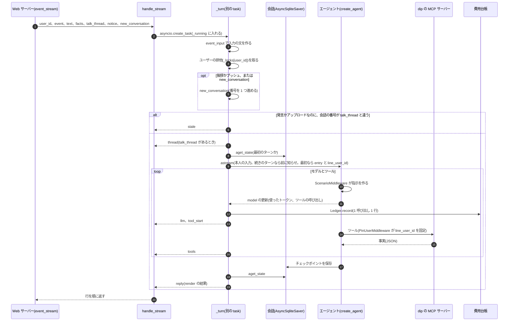

- 入力の文は `event_input` が作ります。挨拶とプッシュは `[イベント: ...]` で始まる文です。アップロードは `facts` の確認の吹き出しを入れます
- `new_conversation` は、発言でも新しい会話を始める指定です。LINE の発言で、最後のやりとりから間が空いたときだけ真です(4.11)。
  新しい会話の最初のターンなので、`entry`(A)と `line_user_id` を書き、知らせは置きません
- 知らせ(`notice`)は、続きのターンの本人の入力の直前に `HumanMessage(additional_kwargs={"profile_notice": True})` で置きます。
  新しい会話を始めるターンでは使いません(最初に dip の要約を読むので)
- 受け取り手が切れても `_turn` は最後まで進みます(`handle_stream` は `queue` を読むだけ)。ツールの結果が無い会話を保存しないためです
- `render` は、会話の中のツールの結果と音声相談の結果から `CARD_KEYS` を持つものを拾い、モデルの `job_ids` のうち拾えたものだけをカードにします。
  ボタンは `/liff/` で始まる URL だけを通します。切り替えの表示(`track_switch`)は、そのターンの `set_search_track` の結果の `recorded` から作ります

Web サーバーの `event` と `event_stream` は、`_require_own` の後に `turn.accept`(イベントの名前と、空の発言・長すぎる発言(`MAX_TEXT_CHARS`、5000 字)の確かめ、アップロードの事実
(`upload_facts`))を呼び、`turn.run` でターンを進めます。`run` は、プッシュなら上限に空きがあるかと `push_trigger` → `stale_thread` →
`try_take` → `profile_notice` → LineRuntime の順に進み、行を順に出します。返信が返ったら `record_open` が、渡した知らせを消し
(`profile.take_changes`)、本番のトーク画面(`thread` あり)の挨拶なら開いた記録を残し、読み取れなかったアップロードの事実を捨てます。
LineRuntime が stale を返したら、使ったターンを `refund` で返します。`event` は `turn.reply_of` で最後の返信だけを返し、
`event_stream` は行をそのまま NDJSON にします(最初に `start` を足します)。

`run` は、LineRuntime を回し始めてから終わるまでの例外を包みます。LineRuntime の `ValueError` は `BadTurn`(`ValueError` の子)に、
ほか(`reply` と `stale` の行の副作用の `ValueError` も)は `TurnFailed` に包みます。`event` は `BadTurn` を 400 にし、`TurnFailed` は 500 のままです。
`event_stream` は 2 つを `error` の行にし、文は包む前の例外の名前と文にします(`_error_text`)。その前の受け付け(`push_trigger` など)の
例外は包まないので、`event` は 500、`event_stream` は `start` の行の後に応答が途中で切れます。

### 4.2 トークを開く

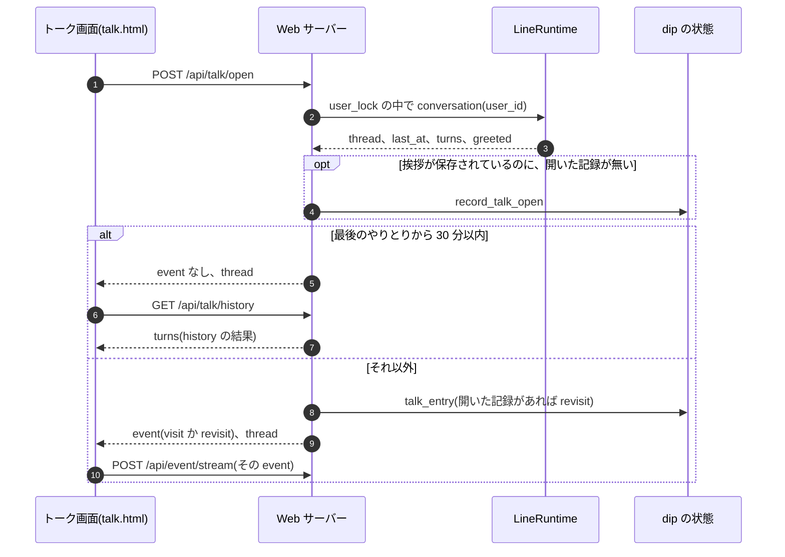

- 会話の番号は、最初に使うとき `_current` がチェックポイントの最大の番号から復元します。再起動しても古い会話に戻りません
- `LineRuntime.conversation` の `last_at` は、返信のある会話の最後のチェックポイントの時刻です。返信の無い会話は続けません
- 続けるかは `server.talk_continues` が決めます(`last_at` が None でなく、`clock()` との差が `TALK_RESUME_WINDOW`(30 分)以内)。
  LINE のテキストのメッセージも同じ関数で決めます(4.11)
- `history` は 1 ターン 1 件で、本人の発言(イベントなら None)と返信(`render` と同じ形)を返します。アップロードと音声相談の
  ターンは、会話に添えた `upload`、`voice` から描き直します。画面の URL は記録から取らず、`liff_url` で組み立て直します

### 4.3 履歴書のアップロード

HLD の 4.2 の詳しい手順です。

1. `resume_upload` は拡張子(`media_type`)、空、大きさ(`MAX_UPLOAD_BYTES`)、会話の番号を確かめてから `try_take` します
2. `extract_bytes` がファイルを Responses API の content part にして読み取り、出力に `scrub_pii` をかけます(下の表)。
   PDF の解析は CPU を使うので、`asyncio.to_thread` でイベントループの外で行います。
   使ったトークンは `Ledger.record(user_id, "resume_upload", ...)` で費用台帳に書きます
3. 読み取れた項目が無ければ(`unconfirmed` を除いて空)、dip に保存せず、`app.state.unread_uploads` に事実を置きます
4. 読み取れたら `logic.save_resume_upload` が、`personal` を空にし、もう一度 `scrub_pii` をかけ、`resume_upload_seq` から番号を振って
   最新の 1 件として保存します。`profile.resume_uploaded` が、まだ渡していない「履歴書を消した」知らせを落とします
5. 画面は確認の吹き出しを出し、`/api/event/stream` に `resume_upload` を送ります。`turn.upload_facts` は dip の読み取り結果か
   `unread_uploads` から事実を作ります(画面からは受け取りません)
6. 入力の文(`event_input`)は、画面に出した確認をくり返さずに読み取り結果を見て続けるよう指示します。エージェントは dip の要約
   (`get_user_conversation_summary`)を呼び直して `uploaded_resume` を見て、次の 1 問を返します

`content_part` が送る形です([privacy.md](../design/privacy.md) の 3.2 の案 B)。

| ファイル | 送るもの | 決め方 |
|---|---|---|
| テキストのある PDF | `input_text`。`PDF_TEXT_HEADER` と、ページごとのテキスト(pypdf の `layout` で取り出し、行末の空白と続く空行を詰める) | `pdf_text` が文字列を返したとき |
| それ以外の PDF | `input_file`(`filename` は `resume.pdf`) | `pdf_text` が None のとき |
| JPEG、PNG | `input_image` | 拡張子 |

`pdf_text` は、次のどれかがあれば None を返し、ファイルをそのまま送ります。テキストだけでは書いた中身が欠けるか、
手元の解析に手間がかかりすぎるためです。迷うときは、ファイルをそのまま送る側(前の送り方)に倒します。

- 読めない PDF(壊れている、開くのにパスワードが要る)。編集の制限だけのパスワードなら、テキストを取り出せるのでテキストだけを送ります
- 大きすぎる PDF。`MAX_PDF_PAGES`(10)より多いページ、`MAX_PDF_TEXT_CHARS`(取り出したテキストで 4 万字)、
  `MAX_PDF_CONTENT_BYTES`(1MB)を超える描画の命令です。作り込んだ PDF で、Web サーバーの CPU とメモリを使わせないためです。
  描画の命令は、テキストを取り出す前に `_scan` が次の 2 つで確かめます
  - 展開: pypdf の展開の上限(`apply_configuration` で、この呼び出しの間だけ)を 1 本 1MB に下げ、展開しながら止めます。
    ページと、そこから届く Form XObject(入れ子も、呼ばれていないものも)の展開した大きさの合計も 1MB までです
  - 解析: pypdf は Form を呼ぶたびに解析し直すので、Form の中身を呼んだ回数だけ足した大きさ(`_expanded`)も 1MB までです。
    呼んだ回数は、テキストを取り出すときと同じ pypdf の字句の解析(`ContentStream` の `Do` の命令、`_do_calls`)で数えます。
    正規表現で数えると、名前と `Do` の間にコメント(`%…` と改行)をはさんだ PDF をすり抜けるためです。同じ Form は 1 回だけ解析します。
    `MAX_FORM_DEPTH`(8)より深い入れ子と、自分を呼ぶ Form も、ファイルを送ります
  - 測った結果: 手元の Mac で、50MB に展開される命令(ファイルは約 50KB)と、10MB に展開される Form は 0.1 秒以内に None を返し、
    Python が確保するメモリは数 MB です。196KB の Form をコメントをはさんで 300 回呼ぶ PDF は、約 0.1 秒で None を返します
    (正規表現で数えていたときは、テキストを返すまで約 42 秒)。上限に近い正しい PDF(線を引く命令で 950KB)は、
    取り出しまでして約 1.5 秒かかります(tracemalloc でメモリを測りながらだと約 13 秒)。
    アップロードは読み取りの前に会話数を 1 つ使うので、くり返しはその上限で抑えます
- リンク以外の注釈。閲覧アプリで書き込んだ文字(FreeText)、フォームの入力欄(Widget)、貼った画像(Stamp)、手書き(Ink)、図形など
- ページの面積(CropBox)の `MAX_PAGE_IMAGE_SHARE`(1 割)以上を覆う画像。OCR の文字を重ねたスキャンで手書きを OCR の文字に
  置き換えないため、職歴の表などを画像で貼った PDF でその中身を落とさないためです。顔写真の欄(30×40mm)は A4 の 2% ほどです。
  ページの画像と BI … EI の画像は面積を数え、Form XObject の中に画像があるページは面積を数えずにファイルを送ります
- 空白を除いて `MIN_PAGE_CHARS`(50 字)に満たないページ。スキャンしたページ、スキャンアプリの透かしだけのページ、
  文字を図形にした PDF です。「以上」だけの最後のページがあっても、ファイルを送ります
- 読めない字(結合文字、私用領域、制御文字、置き換え文字)が `MAX_BAD_CHAR_SHARE`(1 割)以上のページ。ToUnicode の壊れたフォントの PDF です
- ToUnicode の無い Type0 のフォント(`/Encoding` が `/Identity-H`、`/Identity-V`、埋め込みの CMap)。pypdf はグリフの番号を
  そのまま字にするので、ASCII や別の漢字が出て、読めない字の割合では見分けられません。ページと Form XObject のフォントを見ます。
  `UniJIS-UCS2-H` のような Unicode に引ける CMap(サンプルの 01)は、テキストだけを送ります
- `layout` で取り出せない字があるページ。pypdf の `layout` は Form XObject の中のテキストを取り出しません。
  面積を測るときの取り出し(`layout` ではない)の字が、`layout` の字に全部あるかを比べます

`PDF_TEXT_HEADER` は、表の「年」「月」の列の数字を「2020年4月」の形で書くよう添えます。テキストでは列の見出しと数字が離れ、
`period` が「2017  4」になったためです(10 章の「履歴書の読み取り」)。

### 4.4 音声相談(音声ワーカーの中)

HLD の 4.3 の、音声ワーカーの中です。

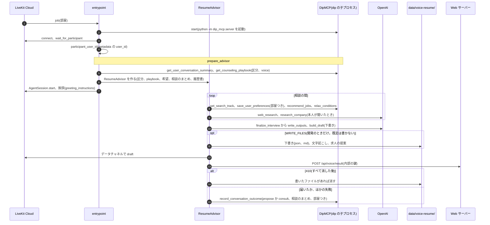

- 会話の段階の結果はコードが決めます。求人を提案できたら `propose`、できなければ `consult` です(`ResumeAdvisor._record_outcome`)
- 下書きの書類は今の区分で決まります(`prompts.document_kind_for`)。正社員なら職務経歴書、それ以外は履歴書です
- `_deliver_to_talk` が送るのは `user_id`、`jobs`(dip のカードの形)、`draft_markdown`、`document_kind`、`files`、`preferences`
  (今の区分で使う、dip に保存できる項目だけ)、`room` です
- Web サーバー(`voice_result_in`)は `logic.record_voice_result` で求人を dip の求人データから作り直し、`voice_reply` の返信を
  `LineRuntime.add_voice_result` で今の会話に足し、待っているシート(`voice_ready` の `Condition`)に知らせます
- トークに届かなかったとき(410 以外)は、警告のログだけで、会話の段階の結果は記録します(R20)。ただし、通話の途中で
  「すべて消す」をした部屋なら、dip が記録を断ります(4.6)。既定ではファイルに書き出さないので、下書きはどこにも残りません。
  締めの返答も「保存した」とは言わず、残せなかったことを伝えます(`finalize_interview`)

### 4.5 音声アドバイザーの決まり

相談の進め方(何を明らかにするか、掘り下げ方、選択肢の作り方、保存先)は、チャットと同じく dip の playbook の音声版にあります
(`dip_mcp/playbooks/{区分}_voice.md` と `common_voice.md`)。`prompts.advisor_instructions` は、区分によらない音声の決まりに、
今の区分の playbook を足して指示にします。playbook が読めないときは `FALLBACK_PLAYBOOK` で続けます。

区分によらない決まり:

- 雇用区分: dip の要約の `search_track` の playbook で始めます。未定なら最初に 1 問で確かめます。明示と強い合図なら
  `set_search_track` で切り替えます。履歴書の内容や前に話した希望だけでは切り替えません
- 今の区分で使わない条件(正社員の相談での時給、時間帯、週の日数、アルバイト・パートの相談での希望年収、働き方、時期)は、
  検索にも保存にも入れません(`jobs.on_track`、`PARTTIME_ONLY_KEYS`、`FULLTIME_ONLY_KEYS`)
- 本人が話した希望と本人のことは、その場で本人の言葉のまま保存します。検索のために外した条件と、推測した職種は保存しません
- 0 件のときは `relax_conditions` で「どの条件を外すと何件になるか」を調べ、どれを外すかを本人に 1 回で選んでもらいます
- 出さない求人(電話が中心の求人、すでに出した求人)は `exclude_ids` で外し、相談の終わりまで覚えます。外して探し直して 0 件なら、
  前の提案を残します(本人が聞いた求人はトークに届く。2026-10-04 のユーザーの決定)
- dip の要約に前に話した希望、相談のまとめ、アップロードした履歴書があれば、指示に足して確認形で使います(`stated_preferences_note`、
  `consultation_summary_note`、`uploaded_resume_note`)。履歴書の要点は大事な順に `RESUME_NOTE_MAX_CHARS`(600 字)に収まる行だけを入れ、
  行の途中では切りません。氏名と連絡先は dip の要約に無いので、指示にも入りません
- アルバイト・パートの相談は全体 3〜5 分、6〜8 問、1 つのテーマの掘り下げは 1 回までです(`parttime_voice.md`)。
  正社員は全体 5 分前後で、成果の数字は職歴 1 件につき 1 回だけ聞きます(`fulltime_voice.md`)

誠実さの決まり(`prompts.py` の先頭と下書きの指示):

- 声色、話し方、性格、感情、思考の傾向を推し量りません
- 本人が言ったことと、会話で確かめた事実だけを書きます。あいまいな点は下書きに入れず、`unconfirmed` に分けます
- 「本人の希望」(`preferences`)と「検索に使った条件」(`recommend_args`、`relaxed`、`search_attempts`)を分けて記録します
- 氏名、住所、電話番号、メール、生年月日は聞かず、保存しません(下書きの `personal` は常に空、`resume_draft.pii.scrub_pii`)
- 下書きは本人が確認して直してから使うものです。画面と Markdown にそう書きます

音声が途切れる、割り込まれる問題への手当て(`agent.entrypoint` と `config`):

- スピーカーの音をマイクが拾って割り込みになるのが主な原因です。ブラウザでエコーキャンセルを有効にし(`talk-core.js`)、
  ワーカーは 0.8 秒より短い音では割り込まず(`MIN_INTERRUPTION_DURATION`)、誤った割り込みなら話を続けます(`resume_false_interruption`)
- 考え中の「えーと」で打ち切らないよう、多言語の turn detector と `MIN_ENDPOINTING_DELAY`(0.8 秒)、`MAX_ENDPOINTING_DELAY`(6 秒)で待ちます
- それでも切れるときはイヤホンを使います

### 4.6 消す

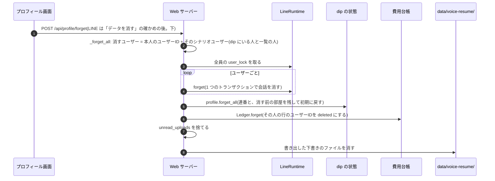

- 会話を消してから dip の状態を消します。途中で失敗しても、もう一度押せばやり直せます
- `forget_all` は `resume_upload_seq`、`voice_result_seq` を残します。古いリンクの番号が、消した後の新しい結果を開かないためです。
  消す前に発行した部屋は `forgotten_voice_rooms` に移し、後から届いた結果を 410 で断ります。持ち越す値は、1 人の行を初期に戻すのと
  同じロックの中で書き戻します(`State.reset_user` の `keep`)
- 音声相談の途中で消したとき(`docs/design/privacy.md` の 3.8 の案 A):
  - 消した後も通話は続きます。ワーカーの dip への書き込み(`set_search_track`、`save_user_preferences`、`record_conversation_outcome`)には
    部屋の名前が付き、dip はその部屋が `forgotten_voice_rooms` にあれば何も書かずに断ります。判定は書き込みと同じ `state.update` の中
    (状態のファイルのロックの中)で行うので、「すべて消す」と書き込みが同時に来ても、間に合わない時間がありません(`logic._room_forgotten`)
  - 断られたら、アドバイザーは保存できなかったとだけ扱い、会話は続けます(今の保存の失敗と同じ。区分は切り替えません)
  - 相談の終わりにワーカーが結果を送って 410 を受けたときは、会話の段階の結果と相談のまとめを記録せず、書き出したファイルがあれば
    消します(`ResumeAdvisor._deliver_to_talk`、`finalize_interview`)。410 以外の理由で届かなかったとき(内部の鍵の設定違いなど)は、
    ファイルは開発で書き出したときだけ残ります(8 章、R20)。会話の段階の結果は、そのときも dip が部屋を見て断ります
  - トークのツールは部屋を渡さないので、今までどおり書けます。消した後に始めた部屋の書き込みも通ります
- 履歴書を消す(`profile_resume_delete`)ときは、`close_conversation` で空の会話 n+1 を書いてから、それまでの会話をすべて消し、
  そのあと読み取り結果を消します。古い会話を開いたタブの発言は stale になります
- 閉じた会話は描き直せず、次の会話の文脈にも入りません。次にトーク画面を開くと、30 分以内でも新しい会話(再訪の挨拶)から始まります。
  消すこと自体は LLM を呼ばず、ターンも数えません
- ターン数の上限の数は消しません。消すと上限を逃れられるためです
- 費用台帳は、その人(`quota.person`。シナリオユーザーも)の行のユーザーIDを `deleted`(`FOLDED`)に置き換えます(`Ledger.forget`)。
  金額、トークン数、時刻、イベント、モデルは残すので、費用の合計は変わりません。進行中のターンが書いた行も外せるよう、`user_lock` の中で行います。
  ゲームの AI(`arcade_ai`)と履歴書の読み取り(`_read_resume`)は `user_lock` の外で台帳に書くので、消す前に始めた呼び出しが消した後に終わると、
  その行はユーザーIDつきで残ります(90 日で日ごとの合計になる)
  外した行も、90 日を過ぎたら掃除が日ごとの合計にまとめます(5.3)

LINE の「データを消す」([個人情報の設計メモ](../design/privacy.md) の 3.7):

- LINE のユーザーはプロフィール画面を開けないので、トークで「データを消す」(`FORGET_DATA_TEXT`)と送ります。`_line_data` は消す範囲の文
  (`FORGET_ASK_TEXT`)と、クイックリプライ「すべて消す」「やめる」を返します。どちらも postback で、押した文(`displayText`)がトークに出ます
- 「すべて消す」の postback のデータは `aica-forget=<番号>` です。番号は `secrets.token_urlsafe(16)` で、`app.state.line_forget_asks` に
  ユーザーごとに 1 つ、期限(10 分、`FORGET_CONFIRM_SECONDS`)と一緒にメモリで覚えます。番号が合い、期限の内なら `_forget_all(l-…)` で、
  Web と同じ処理で消します。会話、dip の状態(連番と消す前の部屋は持ち越す)、連携の表、`unread_uploads`、音声の下書きのファイルです
- 確かめは 1 回だけ使えます。「やめる」は覚えた番号を捨てて `FORGET_CANCELLED_TEXT` を返します。番号が合わない(前の確かめ、
  ほかの人の確かめ)、期限切れ、再起動の後の確かめは `FORGET_EXPIRED_TEXT` を返し、消しません。番号が合わないときは、今の確かめを
  残します。期限の切れた確かめは、次に見る、消すの決まった文か確かめの postback を受けたときに、どのユーザーの分も捨てます。「すべて消す」と文で書いて送っても、ふつうの発言として
  ターンに流れます(postback のデータは本人が文で送れないため)
- LINE のアプリのトークの画面に残るやりとりは aica から消せないので、消した後の文(`FORGOT_TEXT`)でそう伝えます
- 友だち解除(`unfollow`)では消しません(4.11)

期間で消す掃除(`line_runtime.purge.purge`)の流れです。期間の数と理由は [docs/design/privacy.md](../design/privacy.md) の 3.3 です。

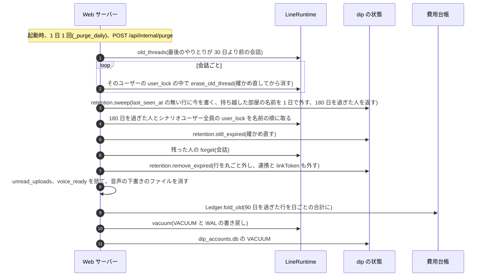

- 期間は人ごとです。`last_seen_at` はシナリオユーザーの行にも書き、その人(匿名ユーザーIDか LINE のユーザーID)の行のいちばん新しい時刻で数えます
- 180 日で消すときは `forget_all` を使いません。`forget_all` は連番と消した部屋を同じユーザーIDの行に書き戻すので、行がいつまでも残るためです
- 「すべて消す」で持ち越した行は、`forget_all` が消した時刻を `last_seen_at` と `forgotten_at` に書きます。部屋の名前は `forgotten_at` から
  1 日で外し、行は `last_seen_at` から 180 日で外します。1 日は、相談の長さの上限(`VOICE_RESUME_MAX_SESSION_MINUTES`、既定 10 分)に十分な余裕です
- `last_seen_at` の無い行(この仕組みの前からある行など)は、最初に見つけた掃除の時刻から数えます。fixtures のユーザーそのもの(評価用、例 `sim-new`)は対象にしません
- 境目はどれも「過ぎたら」です。ちょうど 30 日、180 日、90 日、1 日のものは残します
- 会話を消しても会話の番号のキャッシュ(`_threads`)は戻しません。消した会話が今の会話なら、次にトークを開くと返信の無い会話として新しい会話から始まります
- 180 日を過ぎた人は、全員まとめて 1 回で消します(`state.json` を人ごとに読み書きしない)。ファイルの読み書きはスレッドで行い
  (`asyncio.to_thread`)、その間もほかの要求とヘルスチェックに答えます。180 日を過ぎた人が一度に多くても、Web プロセスが止まらないためです
- ログは件数だけです(`purge.log`。privacy.md の 3.4 の決まり)。掃除が失敗しても Web プロセスは止めず、次の回にやり直します

### 4.7 求人の推薦(`logic.recommend`)

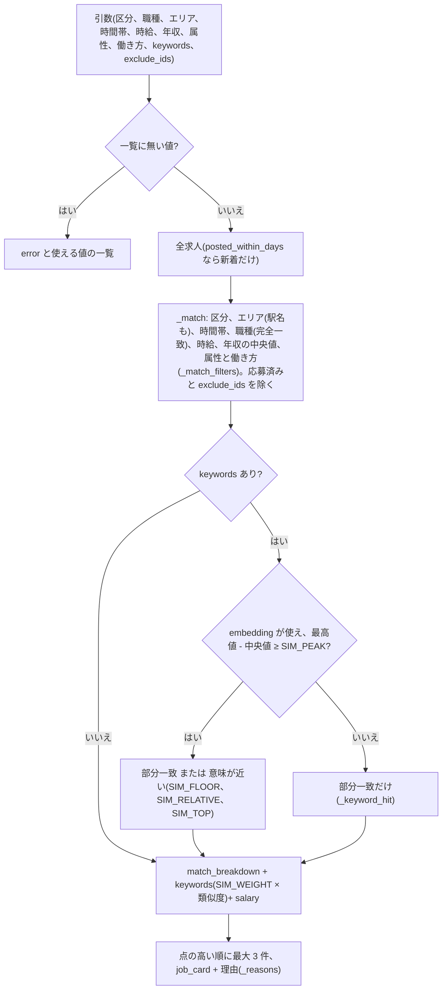

- 本人の傾向(`preferences`)は dip ID と連携したユーザーだけです。90 日以内の応募と、30 日以内の閲覧と保存から数えます
- 両方の区分の求人が残ったら(`mixed`)、時間帯の傾向は点にしません
- `keywords` で 0 件になり、意味検索は使えたが求人を分けられなかったときは、引数で探し直すための `keywords_note` を返します
- `relax` は条件を 1 つずつ外した件数を数え、増えるものを多い順に 3 つ返します。雇用区分と `exclude_ids` は外す候補にしません

keywords と属性の使い分けです。どの言葉をどの引数にするかは dip の Prompt(`baitoru_assistant.md`)にあります。

- 意味検索は、言い換え(「コーヒーが好き」「子どもに勉強を教えたい」)を部分一致の取りこぼしから救うためのものです。文章は作りません
- embedding では分けられない言い換えと否定(「体を動かしたい」「人と話すのが苦手」「立ち仕事は避けたい」「接客はしたくない」)は、
  求人の属性で絞ります。人と話す量 `talk_level` と体を使う量 `physical_level`(どちらも 1〜3)を、`max_talk_level`、
  `min_physical_level` などの引数で指定します。避けたいことは keywords に入れません
- 正社員の「在宅」「土日祝休み」「残業少なめ」は、`remote`、`weekends_holidays`、`max_overtime_hours` で絞ります。この項目は正社員の求人だけが持つので、指定するとアルバイト・パートの求人は出ません(`_match_filters`)
- 求人の情報に無い希望(「人間関係が良い」「宇宙飛行士になりたい」)は、全求人の類似度の最高値が中央値から抜けません(`SIM_PEAK`)。
  そのときは部分一致だけにします。当たらなければ 0 件で、`relax` が keywords を外す案を出します
- 希望年収の下限 `min_annual_salary` は、求人の年収の幅の中央値(月給は 12 か月分)と比べます。指定したときは給与の高さを並びに加味します

モデル、次元、求人の文面、選び方の値(`SIM_*`)は、正解つきの検索評価セット(`evals/search_eval_set.json`、43 本。うち 5 本は
無関係な問い合わせの負例)の上位 3 件の再現率で選びました(task 105 の 0.753 から task 111 で 0.869)。
`python -m evals.search_eval eval` が、記録した問い合わせのベクトル(`fixtures/search_query_vectors.json`)でオフラインで測ります
(2026-10-12 に API キー無しで 0.869 を確かめた)。

既知の限界:

- 属性の値(103 件)は、求人の文面から人が付けた判断です。職種の中の違い(深夜で客の少ないコンビニなど)は、文面に書いてあるときだけ反映しています
- `SIM_PEAK`(0.12)は、評価セットの無関係な問い合わせ(最大 0.113)と keywords で探す問い合わせ(最小 0.133)の間に置いた値で、余裕は小さいです
- API が使えないときの部分一致は、keywords の語がそのまま求人の文面か、働き方と休日の言葉(「在宅勤務」「土日祝休み」など)に
  含まれるときだけ当たります(「在宅で」は当たらない)

### 4.8 評価の 1 シナリオ(`evals.run.run_scenario`)

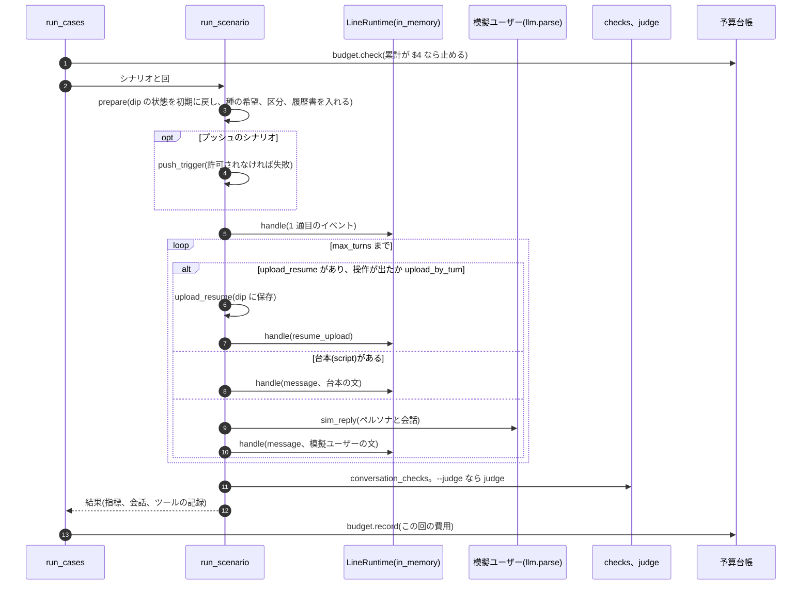

- 費用は `evals/meter.py` の `Meter` が、このプロセスの SDK の呼び出し(エージェント、模擬ユーザー、ジャッジ)を数えたものです
- 結果は 1 回ごとに `evals/results/sim-<時刻>.json` と `.md` に上書きします。止めても、払った分の結果は残ります
- 窓口は既定で Web のトーク画面です。`--channel line --features …` で、毎ターンの `handle` に LINE の窓口と LIFF 画面で使えるものを渡します
  (エージェントのシステムプロンプトの「窓口」が変わる)。結果の `channel` と `features` は `recheck` が判定に使います
- 台帳と止める額は既定で PRD の `evals/budget.jsonl` と $4 です。PRD とは別の予算のカードは `--ledger` と `--limit-usd` で自分の台帳を使います
  (会話の改善 (2/3) は `evals/budget-task220.jsonl`)
- `--rejudge` は保存した会話を、ジャッジだけで判定し直します(`rejudge`)。`recheck` はコードの判定を保存した材料でやり直します

コードの判定(`evals/checks.py`)が見るものです。シナリオごとの狙いは [line-sim-scenarios.md](../design/line-sim-scenarios.md) にあります。

| 判定 | 中身 |
|---|---|
| 形式 | 1 ターン 1 問。選択肢は最大 4 つで逃げ道を含む。吹き出しの字数。求人は最大 3 件で理由つき。初回は質問で終える。最後の返信を選択肢なしで終えない(「もう送らないで」の直後は「承知しました」で終えてよい)。値は雇用区分ごとの `FORMAT_RULES` で、そのターンの返信を書いたときの区分で判定する(`CONVERSATION_RULES` と同じ値: アルバイト・パートと未定は 1 問、80 字、3 ターン。正社員は 1 問、120 字、6 ターン) |
| 会話の進め方 | ツールが返していない求人を出さない。個人情報をトーク経由でツールに渡さない。「今はいい」「送らないで」の後に質問や求人を続けない。「求人を見せて」のターンで求人を探す。この会話で保存した項目を聞き直さない。断られていないのに wait を記録しない |
| 再訪 | 希望ありは、1 通目で前の希望に触れ、以後その項目を聞き直さない。行動履歴のみは、1 通目で最近の行動に触れ、触れるのは会話を通して 1 回だけ。1 通目に求人カード、求人名、件数を並べず、職種も 1 つだけ |
| 挨拶の入口(`greeting_entry_violations`、結果の `greeting_offers`) | 初回訪問は、窓口で使える入口(`available_entries`。Web は 3 つ、LINE は `--features`)が 1 通目に全部ある。選択肢に「求人」と「相談」がある(`expect_menu`)。再訪は、1 通目の入口が 1 つまでで、シナリオの `expect_greeting_offer`(`resume_upload`、`voice_consult`、`arcade`、下書きの続き `blanks`)があればそれを勧める(期待の入口がその窓口で使えなければ問わない)。どちらも窓口で使えないものを出したら違反。ゲームの入口は `/liff/arcade…` のボタン(下書きの画面 `/liff/arcade/draft` は数えない)、下書きの続きは「空欄」を含む選択肢 |
| プッシュ | 本番と同じく `push_trigger` を通してから始める |
| 事実性(`fact_violations`、指標 `fabrications`) | 返信の金額、日付、徒歩分数、件数、求人名が、この会話で dip から来た情報(ツールの結果、プッシュの根拠の事実、dip の Prompt)か本人の発言にあるか。数字は同じ単位の値とだけ照合する(徒歩の分数は `walk_min`、件数は `total` など。ID や日付の中の数字は根拠にしない)。dip の Prompt の例文の日付は根拠にしない。その場で作った架空の求人名は文字列では見分けにくいので、求人名で捕まえるのは実在の求人の出し間違い。保存した希望が本人の発言に無いのも違反(本人が決めていない条件を記録しない) |
| 相談(`consult_mode` のシナリオ) | 初回の選択肢に「まず相談する」がある。相談の入口で playbook を読み、求人を出さずに 1 問から始める。本人が切り上げる前に相談を締めない。相談で聞いた項目を保存する。目的を確かめる前に求人を出さない(本人が自分から「求人を見せて」と言ったときを除く)。本人の発言にも履歴書にも無い職種を選択肢に 2 つ以上並べない |
| playbook(`playbook_violations`、`dont_know_violations`) | 区分が変わったターンで新しい区分の playbook を読み直したか。「分からない」の直後の返信で、選択肢か候補を示す文に職種を 2 つ以上並べていないか |
| 雇用区分(`track_expectations`、指標 `track_ok`) | シナリオの `expect_tracks`(期待する区分と、期限のターン `turn` か期限を決める本人の発言 `on_said`)と、実際に区分が変わった `set_search_track` を突き合わせる。ok、missing、wrong_track、late、unexpected を分ける。模擬ユーザーが期待の発言をしなかった回(no_trigger)はエージェントの判定に数えない。区分つきの再訪(`expect_track_in_greeting`)は、挨拶の 1 問に記録された区分を入れ、区分を聞き直さない |
| アップロード | `upload_resume` のシナリオは、エージェントが履歴書の操作を出したら(出なければ `upload_by_turn` のターンで)アップロードする。1 通目(挨拶)の入口の案内では上げない(ペルソナは挨拶の選択肢を選ばずに書き始める)。その後は質問 1 つで、画面の確認をくり返さず、履歴書だけで区分を切り替えない。履歴書と音声の提案(`actions`)が出たターンも記録する(`action_offers`) |

指標です。

- KPI: 期限までに会話の段階に入った割合(指標名は前の結果と比べるため `branch_within_3` のまま。相談のシナリオは規則を緩めているので測らない)、
  会話の段階の結果を記録した割合、期待どおりの出口の割合(相談から始まるペルソナは、シナリオの `expect_offer_by` のターンまでに
  求人を見るかを聞いた、または探した割合。`jobs_offer_turn`)
- 費用と効率(エージェントの呼び出しだけ): `cost_usd`、`llm_calls`、`cache_hit_rate`(入力のうちプロンプトキャッシュから読めた割合。
  読めた分は 0.1 倍の料金)
- LLM ジャッジ(`--judge` のときだけ): 相談の深さの 4 項目(`depth_purpose` 目的を聞いたか、`depth_dig` 目的かやりたいことを 1 回以上
  掘り下げたか、`depth_options` 選択肢が本人の履歴書と発言から作られているか(雇用区分の問いと、0 件の後の条件の緩め方の選択肢は対象にしない)、`depth_reasons` 提案理由が本人の話とつながっているか)を、
  満たした、満たさない、該当なしと、会話ログから引用した根拠の発言で出します。引用が会話ログに本当にあるか(`quoted`)はコードで確かめます。
  ほかにトーン(`tone`)と設計の狙いとの一致(`design_fit`、1〜5)です
- 深さの 4 項目は、相談とペルソナのシナリオ(`measure_depth`)でだけ数えます。ほかは None です
- 目的を聞いたかの「満たした」は、根拠がアシスタントの発言で、本人の発言の直後にあり、その発言と内容語(漢字、カタカナ、
  またはひらがな混じりの語幹の 2 文字)を 1 つ以上共有するときだけ数えます(`purpose_evidence`)。区分の切り替えの一言の語
  (区分、仕事、考え)は内容語に数えません。目的かどうかの中身はジャッジが見て、この判定は根拠が無関係な発言でないかだけを見ます
- ジャッジの点は 1 回ごとに揺れるので、1 つの会話を `--judge-samples` 回(既定 2)判定してまとめます。tone と design_fit は平均、
  深さはどの回も満たしたときだけ満たしたとします。判定の方法を変えたら、基準も `--rejudge` してから比べます

回し方の決まりです。

- 既定は各シナリオ 1 回です。変更の前後を比べるときは `--repeat 2` などで繰り返します。1 回だけだと、ばらつきと区別がつきません
- `--only T-side-job,B-exit` でシナリオを絞ります。知らない ID は費用を使う前にエラーです
- 実行エラーになった回は失敗に数えず、件数を別に出します
- 比べるときは `evalkit/aggregate.py diff` を使い、差がノイズ幅(95%)を超えた指標だけを改善か悪化とします。2 回ずつでは、ばらつきの判断は弱いです
- 結果の `detail` には、ターンごとの生の返信(`turn_log`。dip のツールの args と result を含む)、本人の発言、アップロードを残します。
  `evals/checks.py` を直したあとは `evals.run.recheck(detail)` で、実 API を使わずにコードの判定をやり直せます
- `--rejudge 結果.json` は、結果を `evals/results/<元の名前>-rejudge-<日時>.{json,md}` に別に書き、md に元の判定との差
  (深さの 4 項目と design_fit)を出します。費用はジャッジの分だけ予算台帳に載り、$4 の停止も同じです

予算台帳(PRD の実 API の予算 $5):

- 予算台帳は、別の worktree のタスクへ累計を引き継ぐため git に入れます。`.gitattributes` で `merge=union` にしてあるので、
  別のブランチで足した行はマージで両方残ります
- シナリオを始める前に累計が $4 に達していたら止まります(終了コード 2)。続けるかは人が決めます。累計と実行ごとの内訳は `python -m evals.budget` で見ます
- dip の子プロセスが呼ぶ embedding は計測の外です(1 回 1k トークン未満で、1 円にも届かない)
- Ctrl-C で止めても、その回に払った分は台帳に載り(`interrupted: true`)、結果の json に `stopped: "interrupted"` を書きます。
  `probe.py` は止めた回も `{"id": ..., "interrupted": true}` で `results` に残し、md に「中断」と出します(台帳と結果の回数がそろう)。
  SIGKILL(`kill -9`)とプロセスの異常終了は防げません。そのときは払った分(OpenAI の使用量の画面などで確かめる)を
  `{"at": "...", "run": "sim-...", "cost_usd": 0.05, "note": "kill したので手で足した"}` の形で手で 1 行足します

基準(`evals/baseline/`):

- 2026-09-29 の計測です。全 15 シナリオ × 2 回の予定が途中で止まり、26 回、$1.2628 でした。2 回目の T-side-job、T-student-first、
  T-blank-parent、T-switch-to-fulltime の 4 本が欠けています
- この結果は `detail` を保存し始める前のもので、`recheck` で判定し直せません
- 2026-09-30 にジャッジの指示を直したあと(「考えます」のあとの 1 問、自分から話した目的)、基準の会話を判定し直した結果も入っています
- 完了時の計測(H、2026-10-04)は `sim-20261004-113109.*` です。全 15 シナリオ × 2 回の予定が 1 周目の 15 回で止まり、$1.0948 でした。
  `probe.py` の結果 `probe-20261004-*.*` も入っています
- 2026-10-25 の LINE の窓口の計測(`sim-20261025-*.*`)も入っています。`sim-20261025-230120` は全 16 シナリオの見直し(jyoka/tasks#221)、
  `sim-20261025-234138`・`-234745`・`-234919` は、お礼つきの「考えます」で締める決まりにした後の 7 シナリオです
  ([シナリオごとの会話設計](../design/line-sim-scenarios.md)の 13 章)

### 4.9 相談の進め方(チャット)

エージェントの相談は、別のエージェントやグラフではありません。dip の Prompt(`baitoru_assistant.md` の「相談」)の入口と、
雇用区分ごとの playbook(`dip_mcp/playbooks/`、ADR-0001)で動きます。playbook は `get_counseling_playbook(track, channel)` で配ります。
音声アドバイザーの決まりは 4.5 です。

- 入口は、初回の挨拶の選択肢「まず相談する」、会話中の迷いのサイン(「何から始めれば」「自分に合うのが分からない」)、
  本人が自分の状況や事情を話して探し始めたときです。条件だけを言ったときは相談に入りません
- 入ったターンで今の区分の playbook を読みます。区分が変わったターン(切り替え、取り消し)では、新しい区分で読み直します
- playbook には「明らかにすること」と「掘り下げ方」だけを書き、次に何を聞くか(順番)は決めません

| playbook | 中身 |
|---|---|
| `fulltime_chat.md`(正社員) | 目的と転職の理由、強み(履歴書と会話から本人の言葉で)、やりたいことと避けたいこと、条件(年収、勤務地、働き方、時期)、不安。条件に `time_band` は使わない。経歴の答えは `experience` に保存する |
| `parttime_chat.md`(アルバイト・パート) | 目的、生活の制約(時間帯、曜日、エリア)、興味と得意、経験、不安 |
| `undecided_chat.md`(未定) | まず区分を 1 問で確かめる(雇用区分の合図の決まり) |
| `common_chat.md`(区分に共通) | 目的とやりたいことは最低 1 回掘り下げる。選択肢は履歴書と本人の発言から作り、一般論の例を使わない。「分からない」には職種を並べず、掘り下げに戻る。目的とやりたいことを掘り下げ、探す条件が揃ったら、次の返信で求人を見るかを聞く(目安は 5、6 問。調整の 2 回目で 3 本が評価の 8 ターンの上限までに提案に届かなかったため) |

- playbook と dip の Prompt の例文は、評価のペルソナの発言と経歴に重ならない例にします(`tests/test_playbook.py` が確かめる)
- 会話の決まり(`CONVERSATION_RULES`)は、アルバイト・パートと未定が v1 のまま(吹き出し 80 字、本人の 3 回目の返信までに会話の段階に入る)です。
  正社員は経歴や本人の言葉を受け止めてから聞くので、吹き出し 120 字、6 回目の返信までに緩めます。相談の途中は、どの区分もこの期限を当てません
- 話した内容は `save_user_preferences` で本人の言葉のまま保存し、そのまま求人の提案の条件にします。言い直しは要りません
- 「今はいい」なら提案なしで終えます。途中で「求人を見せて」と言えば、その時点までの内容ですぐ提案に切り替えます

選択肢の決まりです。

- エージェントの返信はリッチメニューに頼らず、触れません(LINE のリッチメニューは 4.11 の終わり)。「求人を探す / 応募履歴を確認 / 使い方」はメニューではなく、トークの選択肢
  (クイックリプライ)として出します。挨拶だけのときと、意図が分からないときの最初の 1 問です。初回訪問の挨拶は「求人を探す / まず相談する / 今はいい」で、
  音声相談、履歴書の読み込み、ゲームの入口のボタンを添えます(dip の Prompt の「挨拶で3つの入口を案内する」。[設計メモの 12 章](../design/line-sim-scenarios.md#12-挨拶から-3-つの入口へ案内する2026-10-25会話の改善-23))
- 返信は必ず選択肢で終えます(締めくくりの返信にも「求人を探す / 応募履歴を確認 / 使い方」)。LINE のクイックリプライは、ボタンを押すか
  新しいメッセージが届くまで消えないので、次に開いた人が書くしかない状態を減らせます。トークを開き直したときに表示が残るかは
  LINE のドキュメントに記載が無く、実機で確かめていません

### 4.10 画面

トーク画面(`talk.html`)と開発者画面(`dev.html`)は、トークの部品(`talk-core.js`、`talk-core.css`)を共通に使います。
部品は、吹き出し、求人カード、返信の描画、NDJSON の読み取り、待ちの表示、「+」メニュー、履歴書、音声相談のシートです。

トーク画面(`/`。求職者が使う、スマホ前提の 1 画面):

- ユーザーIDは匿名ユーザーIDそのものです。fixtures のシナリオユーザーは使わず、空の状態から始まります。状態を初期に戻す操作はありません
- 開いたときの流れは 4.2 です。会話が stale になったら、古いタブに「別の画面で新しい会話が始まりました」と出して、最新の会話を描き直します
- 下のナビは 3 つです。トーク、保存した求人(`GET /api/saved` の求人をカードで一覧)、プロフィールです
- ヘッダーに今の雇用区分(「正社員で相談中」など)を出します
- 履歴書と音声相談は、会話の中から入ります(ヘッダーの常設ボタンは無い)。エージェントが経歴を聞く場面で、返信の `actions` として
  [ファイルを選ぶ] [話して伝える(音声・約5分)] を出します。`quick_replies` の「文字で話す」「今はいい」と並び、押しても発言は送りません。
  いつ出すかは dip の Prompt の「履歴書・音声の提案」です
- 自分から使う人は、入力欄の左の「+」から「履歴書・職務経歴書を送る」「音声で相談する」に入れます(LINE と同じ置き場)
- 書類の呼び方は雇用区分にそろえます。アルバイト・パートは履歴書、正社員は職務経歴書です。未定のあいだは「+」メニューと音声アドバイザーが「履歴書など」と言います
- 開発者画面の dip の状態、構成図、処理の流れ、シナリオの一覧は出しません。ターン数の上限とユーザーの分離は、トーク画面にも効きます

プロフィール(中身は `dip_mcp/profile.py`、口は 3.1、消す流れは 4.6):

- aica が覚えていること(雇用区分と切り替えの記録、目的、希望、経歴、相談のまとめ、読み取り結果、下書き、保存した求人、応募した求人)を、
  本人が見て、直して、消せます。空の項目は「まだありません」です
- 読み取り結果と下書きの「見る」リンクは `/liff/resume?rid=…`、`/liff/voice/draft?rid=…` です。ユーザーIDを載せません
- 知らせは「[お知らせ: 本人が画面で…]」の形です。トークの切り替えの表示のボタンでの取り消しだけなら「本人がトークの表示のボタンで…」です。
  扱いの決まりは dip の Prompt にあります
- 履歴書を消すときは、会話で保存した内容(経験など)は残ると確認の文言で伝えます。消すものが無ければ会話を閉じません
- 雇用区分の「記録ごと消す」は、切り替えの記録をすべて消して未定に戻します(確認つき)。直前の切り替えを戻す「取り消し」とは別です

切り替えの表示:

- 区分が切り替わったターンは、返信の前に「正社員の相談に切り替えました [アルバイトで探す]」のような表示を出します。元は dip の記録(`track_switch`)です
- ボタンは `POST /api/talk/track/undo`(本文は `{"user_id": ..., "id": 切り替えの記録の id}`)です。根拠を「(トークの切り替えの表示のボタンで、本人が取り消した)」として取り消しを記録します。
  LLM もターンも使いません。後に別の切り替えがある、取り消し済み、記録ごと消したときは 409 です
- 次の本人のターンの前に知らせを渡し、エージェントは dip の要約を読み直して、戻した区分で続けます
- 再読み込みしても、表示の状態(取り消せる、取り消した)は dip の記録から描き直します

履歴書のアップロード(4.3 の画面の側):

- 本人の側にファイルの吹き出し「履歴書(PDF)」を出し、エージェントの側は「入力中」にします
- 確認の吹き出しは要点だけです。職歴、スキル、資格を最大 3 件ずつ、吹き出しは 80 字以内です(`resume_confirm.py`)。全文は「読み取り結果を見る」(`GET /liff/resume`)で見せます
- 後で別の履歴書をアップロードしたら、古いリンクは新しい結果を開かずに、置き換わったことを伝えます
- 定型文を本人の発言として送ることはしません。再読み込みで描き直すときも、ファイルの吹き出し、確認、次の 1 問の順です

音声相談のシート(4.4 の画面の側):

- トークの上に重ねるシートで話し、タブはまたぎません。マイクの許可、「接続中」「聞いています」「あなたが話しています」「考えています」
  「アドバイザーが話しています」の状態と、「面談を終える」があります
- 相談が終わるとシートが閉じ、同じトークにエージェントの返信として「音声で話した内容のまとめ」、求人カード、「履歴書の下書きを見る」
  (正社員の相談なら「職務経歴書の下書きを見る」)が続きます。システム通知のラベルは出しません。会話に入るので、再読み込みしても残ります
- まとめは、本人が話した希望(dip に保存したのと同じ項目。個人情報らしい値は捨てる)からコードで作ります(`voice_reply.py`、吹き出しは 80 字以内)
- 次のトークの会話では、エージェントがそれを dip の要約から読んで、確認形で 1 回だけ触れます。聞き直しません
- 通話中に × を押すと確認を出します。結果が届く前に閉じたら、次の発言とアップロードの前に履歴を読み直して結果を描きます。
  閉じてから 2 分を過ぎたら読み直しをやめます。後で届いた結果は、開き直せば出ます
- 「面談を終える」から 2 分たっても届かなければ、× で閉じてよいと案内します
- 画面の証跡は `voice_resume/results/talk-voice-sheet-20260929-*.png` です。LiveKit のライブラリを代役にして、結果の受け取りから
  トークへの描画までを通したもので、実際の音声は使っていません

利用規約とプライバシーポリシー(task 207。原文と版の決まりは [docs/legal/README.md](../legal/README.md)):

- 原文は `docs/legal/terms.md` と `docs/legal/privacy-policy.md` だけです。`GET /legal/terms`、`GET /legal/privacy` は、`legal.page` が原文を HTML にして出します。
  原文どうしのリンクは画面の URL に、http(s) のリンクは別のタブに、ほかの相対パスは文字にします。原文の mtime が変わったら描き直します
- Docker の image には `docs/` のうち `docs/legal/` だけを入れます(`.dockerignore`)
- 開ける所: トーク画面のヘッダーの下の 1 行(テスト用の公開で、求人は架空のデモだという文と、2 つのリンク)、LIFF 画面の下(`_page` の `legal_links`。
  殻、読み取り結果、下書き、応募フォーム、履歴書の読み込み、マイクの確認)、LINE の音声相談の画面の下、アーケードのハブの下。
  どれも別のタブで開き、開いている画面を離れません。dip のログインと偽物の LINE の画面は aica ではない役なので置きません
- 版は `legal.TERMS_VERSION`、`legal.PRIVACY_VERSION`(今はどちらも 1.0)で、原文の「版」の行と同じです。同意の記録(個人情報の task 8/12)はこの値を残し、
  版が上がったら同意を取り直します
- 応募フォームの続き(`/liff/apply`、`/liff/line/apply`)は体験の画面です。架空の求人であることと「本物の情報は入れないでください」を出し、
  欄には `DEMO_FORM_VALUES` の架空の値(氏名は「山田 太郎」など。無い項目は「架空の値」)を入れておきます。送ると「応募の体験を終えました」と出します

開発者画面(`/dev`。評価と説明のため。3 列。合言葉などの制限は無い):

- 左: シナリオを選ぶ(1 通目の出どころ、つまり挨拶(初回訪問、再訪)と dip のプッシュでまとめた一覧)、dip から見た状態
  (状況、応募、保存、「本人の希望」、「会話の結果」)、やり直す(このシナリオを最初から)
- 中央: トーク。求人カードは Flex Message 風で、アルバイト・パートは時給と勤務時間、正社員は年収か月給の幅と働き方と休日、
  ほかに駅、おすすめの理由、「詳しく見る」「保存」を出します。LIFF のボタンを押すと応募フォームの LIFF 画面(モック)が開き、送信すると応募済みになります
- 右: 構成図と、このターンの処理の流れ(HLD の 4.1)です。構成図の動いている部分を光らせます
- 音声相談の結果は、左の「本人の希望」「会話の結果」(画面の見出し)にも出ます

レジュメ・アーケード(`/liff/arcade`。決めたことは [PRD](../prd/resume-arcade.md)):

- ファイルは `line_runtime/static/arcade/` にあります。元は claude.ai の Artifact(doctype、html、head、body が無い形)で、
  aica では普通の HTML(`<!doctype html>`、`lang="ja"`、charset、viewport)にしました。`window.claude` は使いません
- 残りの 6 本は簡易分析だけで動き、「オフライン：AIを使わない簡易分析」と出します。ダウンロードのボタンは外し、「Markdownでコピー」を残しました
- ハブ(`resume-arcade.html`)は、`GAMES` のうち `shipped` の 2 本(`the-case-of-you`、`harvest-of-work`)だけを `/liff/arcade/<slug>` のリンクで出します。
  サーバーの `ARCADE_SHIPPED` と同じ 2 本です。残りの 6 本は開発者画面の左の「レジュメ・アーケード」からだけ開けます
- 共通部品 `arcade-ja.js` は DOM を使わず、ブラウザでは `window.ArcadeJa`、node では `require()` で読みます。中身は
  `clean`(NFKC)、`findMetric`(範囲、単位つきの数、漢数字、順位。年と日付は数えない。`bareNumbers: false` で単位の無い数を数えない)、
  `isVague`(日本語は字数、英語は語の数。数字が要るかは `metric` で選ぶ)、`sentences`(「。」で分ける)、`trimTo`、
  `plainEnding` と `plainLine`(です・ます調を言い切りに)、数字の空欄(`PLACEHOLDER` など)、`resumeMarkdown`(職務経歴書の Markdown)です。
  ゲームの中身(証人、台詞、強みの分け方)はゲームの側に残します。あなたという事件と仕事の収穫だけが使い、残りの 6 本は自分の写しを持ったままです
- 氏名と連絡先の欄はありません。`resumeMarkdown` は、いつも `# [氏名]` と `[メール] · [電話] · [居住地] · [リンク]` で始めます
- あなたという事件: ライバル(弱み)は「任意」です。進み具合はライバル以外の証人で数え、各職場で書類の行が 2 行になったら、
  「次にやること」と「次の証人」のボタンは「事件を閉じる」を案内します(`nextWitness`)
- 仕事の収穫: 案内の部品を足しました。「次にやること」(`nextAction`。ボタンで歩いて、その場所の話を始める)、進み具合(`farmStats`。
  具体的な答えが 1 つある思い出を書類の 1 行と数え、目安は各職場 2 行)、「聞かれていること」(`PLAIN_ASK`)、答えを書いている間のチェックと
  1 行の見本(`answerChecks`、`previewLine`)、いつでも開ける「下書き」です
- 答えと進み具合は、そのブラウザの localStorage にだけ残ります(あなたという事件は `theCaseOfYou.v1.*`。仕事の収穫は見本の人物では残さない)
- LINE のアプリ(task 219): `window.AICA_LIFF` があれば、`arcade-ai.js` は `/api/liff/arcade/…` を呼び、保存の本文に `liff.getIDToken()` を足します
  (`liff.init` は 1 回だけ)。401 なら、ID トークンで `POST /api/liff/session` を 1 回だけ呼び直してから送り直します。
  仕事の収穫の「トークに戻る」は、LINE のアプリでは `liff.closeWindow()` にします
- AI(task 188): 2 本は `arcade-ai.js` の `ArcadeAI(game)` で API を呼びます。自分の事件(畑)を新しく始めたときだけ `start()` で
  遊びの番号をもらい、進み具合と一緒に `S.play`(`{id, ai, documentKind, track}`)として残します。続きを開いたときは呼び直しません。
  `aiOn()` は、本人の遊び(見本の人物ではない)で `S.play.ai` のときだけ真です。`call(play, stage, data)` が投げる `code` は
  `not_granted`(この遊びでは AI を使えない。`S.play.ai` を偽にする)、`rate_limited`(回数)、`error`(その段だけ簡易分析)、`cancelled` です。
  流れの途中の文字は受け取らず、待つ間はいつもの「考えている」表示を出します。指示の文は画面に置きません(`resume_arcade/prompts.py`)
- まとめで送るのは書類の行です。あなたという事件は証拠のカード(`lineData`)、仕事の収穫は作物ごとの `bulletFor` の行と引用と数字です。
  合計が 4,000 字を超えるときは、行の多い職場から後の行を外します(`verdictData`、`finalData`)
- 書類の画面に「プロフィールに保存」を出します(番号があるときだけ)。雇用区分が未定なら書類の種類を選ぶ欄を出します。保存したら
  「下書きを見る」と、このブラウザの答えを消すかを聞きます。`resumeMarkdown` は自己PR(`selfPr`)があれば `## 自己PR` を出します
- 書類の種類(`docKind()`)が履歴書のときだけ、書類に自己PR を入れます。AI の自己PR が無ければ(簡易分析、AI の失敗)、
  `selfPrOffline` が本人の行を 2 つまで引いた、です・ます調の簡易の自己PR を作ります(行が無ければ見える空欄)。未定の本人が種類を
  選び直すと、`withSelfPr` が書類の `## 自己PR` の節を足し外しします(本人が直した書類も、その節だけを変えます)
- 履歴書の読み取り結果があれば、あなたという事件は `start()` が返す職歴を職場の初期値にします

### 4.11 LINE のトーク(`POST /line/webhook`)

LINE 公式アカウント(Messaging API)は 2 つ目のチャネルです(HLD の 4.8)。口は `server.line_webhook`、部品は
`line_runtime/line_channel.py` です。LINE の SDK は使わず、HTTP はすでに入っている `httpx` で呼びます。

受け付け(`line_webhook`。応答の前):

1. `LINE_CHANNEL_SECRET` と `LINE_CHANNEL_ACCESS_TOKEN` の両方が無ければ 404(`line_channel.configured`)。リクエストのたびに環境変数を読みます
2. 本文をそのまま読み、`X-Line-Signature` を確かめます。合わなければ 400 で、本文の JSON も読みません
3. `events` のうち、答えるもの(`_line_kind`)だけを残します。1 対 1 のトーク(`source.type == "user"`)の、
   空白だけでないテキストのメッセージ(`message`、`message.type == "text"`)と友だち追加(`follow`)と、アカウント連携の結果
   (`accountLink`。4.12)と、「データを消す」の確かめの postback(`forget_postback` が読めるデータだけ。4.6)です。テキストが `LINK_TEXT`
   (「アカウント連携」)か `UNLINK_TEXT`(「連携解除」)なら `link` と `unlink`、`VIEW_DATA_TEXT`(「データを見る」)か `FORGET_DATA_TEXT`
   (「データを消す」)なら `view_data` と `forget_data` です(前後の空白は見ない)。友だち解除(`unfollow`)には答えません(下)。
   `mode` が `standby`(ほかのチャネルが応答を受け持っている間)のイベントには答えません
4. `webhookEventId` を `SeenEvents.first_time` に渡し、受けたことがあれば捨てます。処理の前に覚えるので、処理の途中に届いた再送も捨てます。
   ID は `data/line_events.json` に直近 2,000 件を置き、再起動しても覚えています(`deliveryContext.isRedelivery` の値は見ません。同じ ID かどうかだけで決めます)。
   ファイルは一時ファイルから置き換えます。壊れていたら警告のログを出し、空から始めます(Web サーバーの起動は止めません)
5. 残ったイベントを `BackgroundTasks` に渡し、すぐ 200 を返します。LLM が遅くても、LINE が待ちきれずに再送しないためです

処理(`_line_handle`。応答の後):

- イベントを LINE の userId ごとに分け、人どうしは並べて、1 人のイベントは届いた順に進めます。別々の webhook で届いた同じ人の
  イベントも、LINE のユーザーごとの `asyncio.Lock`(`app.state.line_locks`)で届いた順に 1 つずつ進めます。入力中の表示を待つ間に、
  後の発言が先にターンへ入らないためです
- `LineApi.loading` で「入力中」の表示(60 秒。返信を送ると消える)を出してから、ターンを進めます
- ユーザーIDは `line_user(userId)` = `"l-" + HMAC-SHA256(AICA_ID_KEY, userId)` の先頭 16 桁です([ADR-0008](../adr/0008-keyed-line-user-id.md))。
  鍵は aica 専用の `AICA_ID_KEY`(32 バイト以上)で、鍵を知らなければ userId から `l-…` を作れません。チャネルシークレットは鍵に
  使いません(作り直すと全員の ID が変わるため)。LINE の設定があるのに鍵が無い、短いときは、`lifespan` の `check_id_key` で起動を
  止めます。鍵を変えると全員の ID が変わり、それまでのデータとつながりません。LINE の userId は宛先にだけ使い、会話、dip の状態、費用台帳、ログには渡しません
- 1 件ごとに返すメッセージは `_line_messages` が決めます。`account_link`、`link`、`unlink` は 4.12、`view_data`、`forget_data`、
  `forget_confirm`、`forget_cancel` は `_line_data`(下と 4.6)で、どれも LLM を使わず、ターン数も数えません
- ターンは Web と同じ `turn.accept` と `turn.reply_of` です(`_line_turn`)。`TurnDeps.ip` は None で、IP ごとの上限は見ません
  - テキスト: イベント `message`、`thread` は None(stale の照合はしない)。`user_lock` の中で `rt.conversation` を読み、
    `talk_continues`(Web のトーク画面を開いたときと同じ関数と `TALK_RESUME_WINDOW`。4.2)が真なら今の会話に続けます。
    偽なら(最後のやりとりから 30 分を超えた、返信のある会話がまだ無い)、`turn.accept` に `new_conversation=True` を渡し、
    本人の発言から新しい会話を始めます。入口は A で、挨拶は挟みません(理由は HLD の 4.8)。最初に dip の要約を読むので、
    保存した希望と相談のまとめは新しい会話にも渡ります。プロフィールの変更の知らせ(`profile_notice`)は渡さず、返ったら渡し終えた扱いです
  - 友だち追加: イベントは `logic.talk_entry`(開いた記録が無ければ `visit`、あれば `revisit`)。挨拶が返り、上限の案内でなければ
    `logic.record_talk_open` で記録します(ブロックを解いてもう一度友だち追加すると再訪)
  - ターンの途中の失敗(`BadTurn`、`TurnFailed`、ほかの例外)と、LINE のメッセージにする途中の失敗は `FAILED_TEXT` を返します
- 返信は `to_messages` で LINE のメッセージにし、`LineApi.send` で返信トークで返します。push で返すのは、届いていないと分かったとき
  だけです。返信トークを断られた(期限切れなど、HTTP のエラー)ときと、つながらなかったときです。送った後に応答が来なかった
  (届いたかもしれない)ときは、2 回届かないように送り直しません
- push も LINE に断られたら(メッセージの形が違うなど)、`FAILED_TEXT` だけを push します

返信の形(`to_messages`。`render` の結果と、上限の案内 `limit_reply` を同じに扱う):

| `render` の項目 | LINE のメッセージ |
|---|---|
| `bubbles` | 1 つずつテキスト |
| `actions` | LINE で使えるもの(`liff_features`)なら、LIFF 画面への URI のボタン(`LIFF_ACTIONS`: `resume_upload` → `https://liff.line.me/<LIFF ID>/resume/upload`、`voice_consult` → `…/voice`)を、`buttons` のボタンの後ろに足す。使えなければ `ACTION_NOTES` の文をテキストで足す(LIFF の設定が無いときの守り) |
| `cards` | Flex Message の carousel(1 枚 1 求人)。中身は Web の求人カードと同じ項目で、ボタンは Web と同じ文を本人の発言として送る(「詳しく見る」「保存」) |
| `buttons` | `/liff/` で始まるものだけ、URI のボタン。LIFF の設定があり、`LIFF_PAGES`(`/liff/line` の下にもある画面)かレジュメ・アーケード(`/liff/arcade…`)なら LIFF URL(`liff_url_of`。`https://liff.line.me/<LIFF ID>/` + `/liff/` より後)、ほかは `AICA_PUBLIC_URL` + パス。どちらにもできなければ出さない(警告のログ)。レジュメ・アーケードは LIFF URL にできなければ出さない(公開 URL では本人にならない) |
| `quick_replies` | 最後のメッセージのクイックリプライ(ラベルは 20 字で切る) |

- 1 回に送るのは 5 つまで(`MAX_MESSAGES`)です。超えるときは、Flex を残し、テキストを後ろから 1 つにまとめます(空行で区切る)
- 空か空白だけの吹き出し、クイックリプライ、ボタンのラベルは除きます。LINE は空の文言を断り、そのメッセージ全体が届かなくなるからです。
  `AICA_PUBLIC_URL` が `https://` か `http://` で始まらなければ、リンクは出しません。送るものが何も残らなければ `FAILED_TEXT` を送ります
- `track_switch`(雇用区分の切り替えの表示)、`unknown_job_ids`、`tools` は LINE には出しません
- LIFF の設定が無いときの LIFF 画面は Cookie の匿名ユーザーIDで本人を決めるので、LINE のユーザーが開いても本人の画面になりません(HLD の 4.8)

本人が見る、消す(`_line_data`。[個人情報の設計メモ](../design/privacy.md) の 3.7):

- 「データを見る」: `user_lock` の中で、プロフィール画面と同じ `_profile_view(l-…)` と、会話があるか(`current_thread` が 1 以上)を読み、
  `data_view_messages` でテキストにします。区分けは、雇用区分(切り替えの記録と根拠の発言つき)、目的、希望、経歴、相談のまとめ、
  履歴書の読み取り結果(トークの確認と同じ要点)、音声相談の下書き、ゲームで作った下書き、保存した求人、応募した求人、dip の会員との連携、会話です。
  値の無い項目は出さず、無い区分けは「なし」です。1 つ 5,000 字(UTF-16 の単位で数える)まで、5 つまでのテキストに詰めます。
  収まらなければ、どの区分けも落とさずに、区分けごとの行の数を 20、10、5、3 と減らし、残りは「ほか N 件」と書きます(1 行も UTF-16 の単位で 200 まで。絵文字は割らずに切ります)。
  LINE の userId と `l-…` は出しません。
  見るだけでは dip の状態にユーザーを作りません。この返事を、LINE の人の書き出し(開示)とします
- 「データを消す」: 4.6 の終わり
- 友だち解除(`unfollow`。ブロック): 受けても何もしません(`_line_kind` が None)。データは消さず、もう一度友だち追加すると再訪として
  前の続きから使えます。間違えて押すこともあるからです。使われなくなったユーザーは、期間で消す掃除(設計メモの 3.3。
  まだ入っていない)に任せます

LIFF 画面を LINE の本人で開く(`/liff/line/…`、task 203。流れは HLD の 4.8):

- 設定は `LINE_LIFF_ID` と `LINE_LIFF_CHANNEL_ID` の両方です(`liff_configured`。リクエストのたびに環境変数を読む。チャネル ID は前の名前の
  `LINE_LOGIN_CHANNEL_ID` も読み、両方が違えば新しい名前を使って警告のログを出す。`login_channel_id`)。片方だけなら使わず、
  起動のときに警告のログを出します。両方あるのに `AICA_ID_KEY` が無い、短いときは `check_id_key` で起動を止めます
- 殻(`_liff_shell`)は LIFF SDK(`https://static.line-scdn.net/liff/edge/2/sdk.js`)を読み、`liff.init({ liffId, withLoginOnExternalBrowser: true })`
  の後、`liff.getIDToken()` を `POST /api/liff/session` に送って、通れば同じ URL を読み直します。URL に `liff.state` があるときは、
  `liff.init` が本来の画面へ送るので何もしません。ログインしていなければ `liff.login`。読み直しても殻に戻ったとき(Cookie が付かない)は、
  10 秒以内の 2 回目で止めます(`sessionStorage`。`liff.login` から戻ってもログインしていないときも同じ)。`liff.state` があるのに 10 秒で送られなければ止めます。どの失敗も「LINE で本人を確かめられませんでした」と出して止まります
- `LineLogin.verify`: `POST https://api.line.me/oauth2/v2.1/verify` に `id_token` と `client_id`(`login_channel_id()`)をフォームで送ります。
  200 でも、`iss` が `https://access.line.me`、`aud` がチャネル ID、`exp` が今より後、`sub` が `U` + 32 桁 hex でなければ None です。
  断られた(400)、つながらない(10 秒で打ち切り)ときも None です。トークンが 4,096 字を超えたら LINE に送りません。トークンと `sub` はログに出しません
- 本人は `line_user(sub)` で、webhook のトークと同じ関数です。Cookie `aica_liff` の値は `l-….<期限の UNIX 秒>.<HMAC-SHA256>` で、
  鍵は `HMAC-SHA256(AICA_ID_KEY, "aica-liff-session")` です(`liff_session`、`liff_session_user`)。値の期限は 1 時間(`LIFF_SESSION_SECONDS`)で、
  Cookie は `Max-Age` の無い、ブラウザを閉じたら消えるものです。HttpOnly、Secure、SameSite=Lax です。LIFF のエンドポイント URL は https だけなので Secure にしています
- `POST /api/liff/session` は `Content-Type: application/json` でなければ 415 です(本文の無い型や `text/plain` は、ほかのサイトから事前の確認なしに送れるため)
- 中身は Web の画面と同じ関数(`_resume_page`、`_voice_draft_page`、`_apply_form_page`、`_apply_submit`)が作ります

LINE のトークから LIFF 画面で使う操作(task 204。流れは HLD の 4.8):

| ルート | 中身 |
|---|---|
| `GET /liff/line/voice` | 音声相談の画面(`_liff_voice_page`)。`talk-core.js` の `createTalk` を、`voiceApi`(`/api/liff/voice/…`、`extra` で `liff.getIDToken()` を足す)と `onVoiceClosed` つきで使う |
| `GET /liff/line/resume/upload` | 履歴書の読み込みの画面(`_liff_upload_page`)。ファイルと `user_id` と `liff.getIDToken()` をフォームで送る |
| `GET /liff/line/arcade`、`/liff/line/arcade/{game}` | Web と同じハブとゲームの HTML(`liff_arcade`、`liff_arcade_game`)。ハブのリンクは場所を見て `/liff/line/arcade/…` にする。AI と保存につながった 2 本(`ARCADE_SHIPPED`)は、`</head>` の前に LIFF SDK と `window.AICA_LIFF = {liffId}` を入れて返す(task 219) |
| `GET /liff/line/arcade/draft`、`POST /liff/line/arcade/draft` | ゲームで作った下書きの画面と、直した書類の保存(`_arcade_draft_page`、`_arcade_draft_edit`。Web と同じ。フォームの送り先は `/liff/line/arcade/draft`)。本人が無ければ GET は殻、POST は 401。`{game}` より先に登録する |
| `POST /api/liff/arcade/start`、`/ai` | Web の `/api/arcade/start`、`/ai` と同じ(`_arcade_start`、`_arcade_ai`)。本人は Cookie `aica_liff`(無ければ 401)。`scenario_user` は見ない。会話数は IP を数えない(`_arcade_start(user, game, None)`) |
| `POST /api/liff/arcade/save` | 本文は Web の `/api/arcade/save` に `id_token` を足したもの。`_arcade_save`(Web と同じ決まり。403、400 なら LINE に確かめに行かない)→ 今の会話に返信を足す → Messaging API の設定があれば ID トークンを確かめ、`line_user(sub)` が本人なら宛先にする。宛先があり、その日の知らせが 3 通(`ARCADE_DAILY_PUSHES`。`quota.json` の `arcade_line_push`)に達していなければ、応答の後に `_line_push` で同じ返信(`arcade_reply`)を 1 回 push(`line`)。宛先が無くても、上限でも保存はする。`view_url` は `/liff/line/arcade/draft?rid=…` |
| `POST /api/liff/voice/start` | `{user_id, id_token}`。`_liff_api_user`(Cookie `aica_liff` が無ければ 401、本文のユーザーが違えば 403)→ LiveKit の設定(無ければ 503)→ `_liff_sub`(ID トークンを確かめ、`line_user(sub)` が本人でなければ 401)→ `_voice_token`(Web と同じ。会話数 1、IP は数えない)。部屋 → `(sub, 時刻)` を `app.state.line_voice_rooms` に覚える(1 時間より古いものは、始めるときと結果が届くときに捨てる。`_forget_old_voice_rooms`) |
| `POST /api/liff/voice/wait` | Web の `/api/voice/wait` と同じ(`_voice_wait`)。返信のボタンの URL は `/liff/line/…` にする(`_liff_reply`) |
| `POST /api/liff/resume/upload` | フォームの `user_id`、`id_token`、`file`。本人と `sub` を確かめてから `_read_resume`(Web の `/api/resume/upload` と同じ。会話数 1)。応答の後に `_line_upload_turn` |

- `POST /api/voice/result` は、結果を記録してから部屋を `line_voice_rooms` から取り出し(`_line_voice_to`。同じ部屋の 2 回目は push しない)、`line_user(sub)` が結果のユーザーで、
  Messaging API の設定があれば、応答の後に `_line_push` で同じ返信(`voice_reply`)を push します(`out["line"]`)
- `_line_upload_turn` は、その人の `line_locks` の中で、入力中の表示 → `_line_turn(uid, "upload")`(`resume_upload` のターン。LINE の窓口)→
  読み取りの確認と「読み取り結果を見る」のボタンの後に続きの返信をつないで(`_joined`)、1 回の push で送ります。ターンが失敗したら、確認と `FAILED_TEXT` を送ります
- LINE の userId(`sub`)は `line_voice_rooms` と、応答の後の処理の引数にだけあり、保存もログもしません

リッチメニュー(`scripts/line_rich_menu.py`、task 220。手順は README の「LINE のリッチメニュー」):

- 人が回すスクリプトです。Web サーバーは何もしません(新しいイベントも口も無い)。`.env` は Web サーバーと同じものを読みます(`config.load_env`)
- ボタン(`items`): 音声相談(`liff_features` に `voice_consult` があるときだけ)、履歴書の読み込み、ゲーム、求人を探す。前の 3 つは URI のアクションで、
  トークのボタンと同じ LIFF URL(`liff_page_url(LIFF_ACTIONS[…][1])`、ゲームは `ARCADE_PATH` から作る `…/arcade`)。「求人を探す」は message のアクションで、
  押すとその文が本人の発言として webhook に届きます(ふつうのテキストのターン)。LIFF の設定が無ければ `RichMenuError` で止まり、何も作りません
- 本文(`menu_body`): 2500x843、`selected: true`(トークを開くとメニューが開いている)、名前 `aica-menu`、バーの文言「メニュー」。領域は横に等分します
- 画像(`render_image`): Pillow で PNG を描きます(緑の丸の絵、大きな文言、小さな文言。文言の大きさはどの列も同じ)。1MB を超えたら止めます。
  日本語のフォントは `FONT_CANDIDATES`(ヒラギノ、Noto Sans CJK)か `--font`
- 登録(`register`): `POST /v2/bot/richmenu/validate` → `GET /v2/bot/user/all/richmenu`(今の既定) → `POST /v2/bot/richmenu` →
  `POST https://api-data.line.me/v2/bot/richmenu/{id}/content` → `POST /v2/bot/user/all/richmenu/{id}`(既定)。`--replace` は既定にした後で、
  `GET /v2/bot/richmenu/list` から名前が `aica-menu` の前のもの(作ったばかりのものを除く)だけを `DELETE` します。途中で失敗しても前のメニューが出たままです。
  別のメニューが既定だったら、既定でなくなったことを出します(消さない)。LINE が断ったら、その本文の先頭 300 字を出して止まり、既定にはしません。トークンは出しません
- `--dry-run` は `data/richmenu/` に `richmenu.png` と `richmenu.json` を書くだけで、LINE を呼びません。テスト(`tests/test_rich_menu.py`)は
  `httpx.MockTransport` の偽物の LINE を使います

LIFF の中でマイクを試す画面(`/liff/line/mic-check`、task 205。手順は README の「LINE の中でマイクが使えるかを確かめる」):

- 音声相談を LINE から使えるかを決める前に、LIFF の画面の中でマイクと WebRTC が使えるかを人が実機で確かめるための画面です。
  本人のデータを読み書きしないので、本人を決めません(Cookie を発行も要求もしない)。LINE では `https://liff.line.me/<LIFF ID>/mic-check` で開きます
- 画面の部品は `static/mic-check.js` です。`liff.init({ liffId })`(外のブラウザでもログインを求めない)の後、`liff.getOS()`、`liff.isInClient()`、
  `liff.getLineVersion()`、`liff.getVersion()`、`liff.getContext().viewType` を出します。「マイクを試す」で
  `getUserMedia({ audio })` を呼び、許可されたら 5 秒、`AnalyserNode` で音の大きさの最大(0 から 1)を測ります。断られたら `NotAllowedError`、
  ほかの失敗はエラーの名前(`DOMException` の `name`、LIFF のエラーの `code`)を出します。`AudioContext` は押した操作の中で(`await` の前に)作り、
  その状態(`audio_state`)も記録します。`liff.init` と `AudioContext.resume()` は 5 秒まで待ち、止まっても結果を送ります(`liff.init` が止まったら `liff_error` は `Timeout`。後から通ったら、画面の結果は消さずに `Timeout` を「遅れて終わった」に替え、LIFF の環境と外のブラウザのボタンを出し直す。サーバーの記録は押したときの 1 回のまま)
- WebRTC は `RTCPeerConnection`(ICE のサーバーなし)にマイクの音を足して offer を作り、手元の ICE の候補を 3 秒まで数えます。どこにもつなぎません。
  LiveKit は音声相談と同じ `livekit-client` を読み、`isBrowserSupported()` を見ます。LiveKit の部屋にはつなぎません
- 結果は `POST /api/liff/mic-check` に 1 回だけ送り、サーバーは `line_runtime.mic_check` のログに `LIFF のマイクの確認: {…}` の 1 行を書きます。
  受ける項目は `MicCheckIn` に決めた分だけ(`extra="forbid"`)で、声や文字起こしを載せる項目はありません。本人と IP は書きません。
  Web サーバーはログの設定をしないので、このロガーだけ INFO を標準エラーに出す handler を持ちます
- LINE のアプリの中(`isInClient()`)で `liff.init` が通ったときだけ、「外のブラウザで同じ確認を開く」(`liff.openWindow({ url, external: true })`)を出します

### 4.12 LINE のアカウント連携

HLD の 4.10 の中身です。決定は [ADR-0007](../adr/0007-line-account-link-table.md) にあります。LINE の Messaging API の
アカウント連携の流れ(linkToken、サービスのログイン、nonce、accountLink の webhook)と同じ順に進めます。

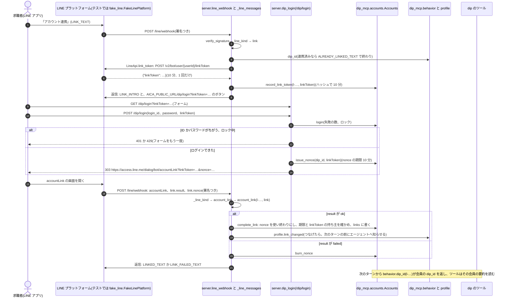

**dip のログイン(`Accounts.login`)**

- パスワードは `pbkdf2_sha256$回数$塩$ハッシュ`(PBKDF2-SHA256、塩 16 バイト、20 万回)で持ちます。fixtures の会員のログインは
  `fixtures/dip_accounts.json` にあり、`data/dip_accounts.db` を初めて作るときに入れます
- まちがえた数はログインID ごとに `login_failures` に数えます。会員にいない ID も同じに数えます。`MAX_FAILURES`(5 回)に達したら
  `locked_until` を `LOCK`(15 分)後にします。ロックの間は、正しいパスワードでも `locked` です。ロックが明けたら数え直し、
  ログインできたら行を消します。最後の失敗から `LOCK` 過ぎた行は、次のログインのときに消します
- 同時に送られたログインでも上限を超えないように、ハッシュの計算の前に、トランザクションの中で失敗 1 回分を数えておきます。
  まちがえた数と計算中の数で `MAX_FAILURES` に達していたら、計算せずに `locked` です。計算の後は、トランザクションの中で
  ロックを確かめ直します。計算の間にほかの失敗でロックされていたら、正しいパスワードでも `locked` で、ロックも消しません
- 無いログインID は `bad` で、同じだけハッシュの計算をします(ID があるかを、答えの文、ロック、時間で知られないため)
- ハッシュの計算(1 回 20 ミリ秒ほど)はトランザクションの外でします。`dip_login` は `asyncio.to_thread` で呼び、ほかの要求を止めません

**nonce と linkToken(`Accounts.issue_nonce`、`record_link_token`、`complete_link`)**

- nonce は `secrets.token_urlsafe(32)`(43 字、256 ビット)です。表には sha256 のハッシュだけを、会員ID、linkToken のハッシュ、期限と一緒に置きます
- bot は、LINE からもらった linkToken を、だれ(aica のユーザーID)に出したかと一緒に 10 分覚えます(ハッシュ)
- `complete_link(user_id, nonce)` は `BEGIN IMMEDIATE` の 1 つのトランザクションで、次の順に確かめます。nonce が無い(`unknown`)、
  使い終わり(`used`)なら連携しません。それ以外は、ここで使い終わりにしてから、期限切れ(`expired`)、nonce の linkToken を bot が
  `user_id` に出していない(`other_token`)を確かめます。通ったら linkToken の記録を消し、`links` に書きます
- `link.result` が ok でない accountLink では、`burn_nonce` で nonce を使い終わりにします
- 偽物の LINE(`FakeLinePlatform.open_account_link`)は、知らない linkToken には webhook を送らず(None)、使い終わり、期限切れ、
  開いた人が linkToken のユーザーでないときは `result: failed` のイベントを作ります

**解除と、連携の表を直接書くところ**

- 「連携解除」(`UNLINK_TEXT`)と開発者画面の「連携を解除」は `server._unlink`(`Accounts.unlink`)です。`links` から外すだけで、
  `dip_writes` は消しません。連携していなければ `NOT_LINKED_TEXT` です
- `behavior.record` は `dip_writes` の 1 件に、書いたときの会員(`dip_id`。未連携なら None)を入れます。`behavior.view` が重ねるのは、
  今の会員の分と未連携の間に書いた分だけです(`_mine`。`dip_id` を持たない古い記録は今の会員の分とみなす)。解除した後は前の会員の
  行動が重ならず、同じ会員につなぎ直すとまた重なります。ツールが書いている途中に解除されても、その 1 件は未連携の人に重なりません
- つないだ(`account_link`)・解除した(`_unlink`)ことは `profile.link_changed` で知らせ(`profile_changes`)に残し、次の本人の
  ターンの前にエージェントへ渡します(`profile.notice`。要約を読み直すよう書く)
- `State.reset_user(uid, template)` は `set_link(uid, fixture_dip_id(template or uid))` を呼びます。シナリオの写しは写し元と同じ会員、
  fixtures に無い人は連携を外します(「すべて消す」もこれを通ります)。`State.reset` は `reset_links` で、`links`、`link_tokens`、
  `nonces` を消してシナリオの連携を入れ直します

**Web の匿名ユーザー(開発者画面の「アカウント連携(偽物の LINE)」)**

1. 「連携を始める」: `POST /api/dev/link/start`。`app.state.fake_line` が linkToken を出し、`record_link_token` で匿名ユーザーIDに出したと覚えます。
   画面は返った `/dip/login?linkToken=…` を新しいタブで開きます
2. ログインできると、`dip_login` は linkToken が偽物の LINE のもの(`FakeLinePlatform.knows`)なので、`https://access.line.me/…` ではなく
   `/fake-line/dialog/bot/accountLink?…` に送ります
3. `fake_line_account_link` は、開いた Cookie の匿名ユーザーIDで `open_account_link` を呼び、できた accountLink のイベントの `link` を
   `account_link` に渡します(LINE の webhook の署名を確かめた後と同じ処理)。結果の文を画面に出します

## 5. 手元のファイルと保存するデータ

| ファイル | 書く者 | 読む者 | 形式 |
|---|---|---|---|
| `.env` | 人 | `line_runtime.config.load_env`、`voice_resume.config.load_env` | `KEY=VALUE`。今の環境変数を上書きしない |
| `data/state.json`(`DIP_STATE_PATH`) | `State._write`(Web プロセス、dip の子プロセス、評価) | `State._read` | JSON(5.1) |
| `data/state.lock` | `State._lock` | 同 | `fcntl.flock` の印 |
| `data/line_checkpoints.db` | `AsyncSqliteSaver`、`LineRuntime._erase`、`erase_old_thread`、`vacuum` | LineRuntime | SQLite(5.2) |
| `data/costs.jsonl` | `Ledger.record`(追記)、`Ledger.fold_old`(書き直し) | `python -m line_runtime.ledger` | JSON Lines(5.3) |
| `data/quota.json` | `DailyQuota._save` | `DailyQuota.__init__` | JSON(5.3) |
| `data/line_events.json` | `line_channel.SeenEvents.first_time` | `SeenEvents.__init__` | 受けた webhook のイベントの ID の JSON の配列(直近 2,000 件、4.11) |
| `data/voice-resume/`(`VOICE_RESUME_OUT_DIR`) | `outputs.write_outputs`(`VOICE_RESUME_WRITE_FILES=1` のときだけ。既定は書かない) | Web サーバー(消すだけ)、人 | 5.4 |
| `data/resume_intake/` | `resume_intake.cli`、`run_samples` | 人 | 読み取り結果の JSON と比較の Markdown |
| `evals/results/` | `evals.run` | `evalkit`、人 | 5.6。git に入れない |
| `evals/budget.jsonl` | `budget.record`(追記) | `budget.check`、`python -m evals.budget` | JSON Lines(5.6)。git に入れる |
| `data/dip_events.db` | `scripts/gen_dip_events.py`、`EventStore.append`(追記だけ。`behavior.record`)、`behavior.stores`(最初の準備) | 要約のバッチ | SQLite(5.8)。場所は `State` と同じディレクトリ |
| `data/dip_summaries.db` | 要約のバッチ(`SummaryStore.replace_all`) | `SummaryStore.get`(`behavior.view`) | SQLite(5.8)。場所は `State` と同じディレクトリ |
| `data/dip_events.lock` | `behavior.stores` | 同 | `fcntl.flock` の印(最初の準備を 1 つのプロセスだけが行う) |
| `data/dip_accounts.db` | `dip_mcp.accounts.Accounts`(Web プロセス、`State.reset` と `reset_user`) | `Accounts.dip_id`(`behavior.dip_id`。dip の子プロセスも) | SQLite(5.9)。場所は `State` と同じディレクトリ |
| `fixtures/*.json` | 人、`scripts/gen_*.py` | dip、評価 | 5.7 |
| `voice_resume/data/wage_reference.json` | `scripts/voice/update_wage_reference.py` | `wages.load_reference` | `WageReference` |

`data/` の場所は `LINE_SIM_DATA_DIR` で変えられます(LineRuntime と `resume_intake`)。dip の状態は `DIP_STATE_PATH`、音声の出力は
`VOICE_RESUME_OUT_DIR` で別に決まります。

### 5.1 dip の状態(`data/state.json`)

`{"users": {ユーザーID: ユーザー}}` の 1 つの JSON です。ファイルが無ければ `fixtures/users.json`(`dip_id` を除く)を初期の状態にします。
知らないユーザーは `_new_user`(新規)として読み、書くときに作ります。dip と連携しているかは連携の表(5.9)で決まり、ここには持ちません。

| キー | 中身 | 書く関数 |
|---|---|---|
| `line_user_id`、`label` | ユーザーID、開発者画面の説明 | fixtures、`_new_user` |
| `dip_writes` | 会話の側から dip に書いた行動のイベント `{seq, at, kind, job_id, data, dip_id}`(元データに追記したものと同じ。連携していない人は `seq` と `dip_id` が None。`dip_id` は書いたときの会員)。今の会員の分で要約に入ったものは次に書くときに落とす(5.8、4.12) | `behavior.record`(`save_job`、`resume_form`、`submit_application`、`push_trigger`、`profile.unsave_job`) |
| `outcomes` | `{at, outcome, reason, confidence, summary?}` | `record_outcome` |
| `preferences` | `{項目: {value, at}}`(本人が話した希望。`PREFERENCE_KEYS` の 16 項目) | `save_preferences`、`profile.edit_item` |
| `track_history` | `{id, at, from, track, evidence, undo}`(`id` は乱数) | `set_search_track` |
| `talk_opens` | 挨拶が返った時刻(直近 20 件) | `record_talk_open` |
| `resume_upload`、`resume_upload_seq` | 最新の読み取り結果(5.5 の envelope に `id`、`uploaded_at`、`file` を足した形)と次の番号 | `save_resume_upload` |
| `voice_results`、`voice_result_seq` | `{id, at, cards, draft_markdown, files, preferences, room, document_kind}` と次の番号 | `record_voice_result` |
| `voice_rooms`、`forgotten_voice_rooms` | 発行した部屋と、「すべて消す」の前の部屋(それぞれ直近 20) | `record_voice_room`、`forget_all` |
| `profile_changes` | 知らせ `{at, action, what, value?, undone?}`(最大 20) | `profile._note`、`take_changes` |
| `arcade_plays` | ゲームごとの遊びの記録 `{id, game, started_at, ai, reactions, summaries_left}`(最新の 1 件。`id` は乱数。答えは持たない) | `arcade.start_play`、`arcade.use_ai` |
| `arcade_drafts`、`arcade_draft_seq` | ゲームごとの最新の下書き(5.5 の envelope に `id`、`game`、`at`、`markdown`、`edited_at?` を足した形)と次の番号(「すべて消す」の後も持ち越す) | `arcade.save_draft`、`arcade.edit_draft`、`arcade.delete_draft` |
| `arcade_metrics` | 指標のための数 `{started, saved, blanks, replaced}`(答えの中身は持たない) | `arcade.start_play`、`arcade.save_draft`、`arcade.record_replaced` |
| `last_seen_at` | 最後の利用の時刻(実際の時刻、UTC。秒まで)。ターン(プッシュを除く)、プロフィールの書き換え、雇用区分の取り消し、シナリオの開始、音声相談の開始と結果、履歴書のアップロード、ゲームの開始と保存で書く。fixtures のユーザーそのものには書かない | `retention.touch`、`retention.sweep`(無い行)、`forget_all`(消した時刻) |
| `forgotten_at` | 「すべて消す」の時刻(`forgotten_voice_rooms` を持ち越したときだけ)。1 日で部屋の名前と一緒に外れる | `forget_all`、`retention.sweep` |

時刻は `data.now(line_user_id)` の値です(HLD の 4.7、R4、ADR-0004)。`last_seen_at` と `forgotten_at` だけは、シナリオユーザーも
実際の時刻です(期間で消す掃除が実際の時刻で数えるため。`retention.clock`)。

期間: 最後の利用から 180 日(`retention.USER_TTL`)を過ぎた人は、掃除がシナリオユーザーの行ごと外します(4.6)。

- 評価のユーザー(fixtures のユーザーそのもの)、シナリオユーザー(`:` の後ろが fixtures のユーザー)、ユーザーの無い呼び出しは
  `SIM_NOW`(既定 `2026-09-23T12:00:00+09:00`)です。見分けるのは `data.uses_sim_clock` です
- ほかのユーザー(本番の匿名ユーザーIDと LINE のユーザーID `l-…`)は実際の時刻(日本時間)です
- 期間の判定(90 日、30 日、7 日、3 日)は `logic._days_ago(ts, at)` で、`at` にそのユーザーの `now` を渡します
- 新着の絞り込み(`recommend` の `posted_within_days`)だけは、誰でも `now(None)`(`SIM_NOW`)から数えます。
  掲載開始の日付(`fixtures/listings.json` の `posted_at`)が `SIM_NOW` から見て書いてあるからです
- 2026-10-12 の実装(jyoka/tasks#175)の前に本番のユーザーについて書いた時刻は、`SIM_NOW` のまま残っています。書き換えません

### 5.2 会話(`data/line_checkpoints.db`)

- LangGraph の `AsyncSqliteSaver` の表(`checkpoints`、`writes`)です。会話の番号は `thread_id = "<ユーザーID>:<番号>"` です
- 1 人の会話を探す条件は `runtime._threads_of` です。範囲の比較で主キーの索引を使い、番号が数字だけの行に絞ります
  (ユーザー `u` の会話に、ユーザー `u:x` の会話を含めない)
- state は `messages`、`structured_response`(`LineReply`)、`entry`(入口)、`line_user_id` です。`entry` と `line_user_id` は
  会話の最初のターンだけで書きます
- 本人側のメッセージの `additional_kwargs` に、画面に描き直す材料を添えます。`upload`(ファイルの種類、確認の吹き出し、`upload_id`、`empty`)、
  `voice`(音声相談の返信そのもの)、`arcade`(ゲームの下書きの知らせの返信そのもの)、`profile_notice`(知らせ。画面には出さない)です
- `LineReply` は msgpack で直列化します(`_SERDE` の `allowed_msgpack_modules`)
- 期間: 会話(`thread_id`)ごとに、最後のやりとり(最新のチェックポイントの `ts`)から 30 日(`purge.CONVERSATION_TTL`)を過ぎたら、
  掃除が `checkpoints` と `writes` の行を消します。その後に VACUUM し、WAL も本体に書き戻して空にします(`PRAGMA wal_checkpoint(TRUNCATE)`)。
  `AsyncSqliteSaver` は WAL で書くので、VACUUM だけでは消した行が WAL のファイルに残るためです

### 5.3 費用台帳とターン数

費用台帳(`data/costs.jsonl`)の 1 行です。`cost_usd` は `ledger.cost_usd` が `PRICES` から計算します。

```json
{"at": "2026-10-11T03:00:00+00:00", "user_id": "w-0123456789abcdef", "event": "message", "model": "gpt-6-sol",
 "input_tokens": 12000, "output_tokens": 300, "cache_read": 9000, "cache_write": 0, "cost_usd": 0.0108}
```

- `input_tokens` はキャッシュの読み書きを含む合計です。料金はキャッシュの書き込みが 1.25 倍、読み込みが 0.1 倍です
- `event` は会話のイベントの名前か `resume_upload`(履歴書の読み取り)、`arcade:<game>:<段>`(ゲームの AI。例 `arcade:the-case-of-you:verdict`)です
- 集計(`summarize`)は日本時間の日付と人(`quota.person`。シナリオユーザーは匿名ユーザーIDにまとめる)ごとで、表には合計の行が付きます。
  `--by-user-id` はシナリオユーザーをまとめずに分けます
- 期間: ユーザーIDを持つのは 90 日(`ledger.ID_TTL`)です。過ぎた行は、掃除が日本時間の日ごとの合計の 1 行に置き換えます(`Ledger.fold_old`)。
  合計の行は `{"at": その日の最後の行の時刻, "user_id": "deleted", "event": "daily_total", "model": "", "calls": まとめた行の数, …}` で、
  トークン数と `cost_usd` は足したものです。集計は `calls` を回数として数えるので、日ごとの合計の金額と回数は変わりません。
  前にまとめた日の行も、同じ日なら 1 行にまとめ直します。ファイルは `Ledger._lock` の中で一時ファイルに書いてから置き換えます
- 「すべて消す」: その人の行の `user_id` を `deleted` に置き換えます(`Ledger.forget`。ほかの値はそのまま)。90 日を過ぎた行が、どれもこの
  外した行でも、掃除は日ごとの合計にまとめます(`event` が `daily_total` でない行があれば、まとめる)。`fold_old` が返す数は、まだユーザーIDが
  あった行だけです
- 「データを書き出す」は、その人の行を `Ledger.rows_of` で読みます(ユーザーIDを外した行は、もうその人の行として見分けられないので入らない)

ターン数(`data/quota.json`)は `{"day": "2026-10-11", "counts": {人: ターン数}, "ips": {IP の鍵: {人: ターン数}}, "extra": {数えるもの: {人: 回数}}}` です。
`extra` はターンとは別の 1 日の回数で、AI つきで始めたゲームの回数(`arcade_ai_play`)と、LINE のトークに送ったゲームの保存の知らせの数(`arcade_line_push`。1 日 3 通まで。task 219)です(`take_daily`)。
日本時間の日付が変わると数え直します。IP の鍵は `ip_key` が作ります(IPv6 は /64、IPv4 射影は IPv4)。

| 上限 | 環境変数 | 既定 |
|---|---|---|
| 匿名ユーザーIDごとのターン | `LINE_SIM_DAILY_TURN_LIMIT` | 50 |
| IP ごとのターン | `AICA_DAILY_TURN_LIMIT_PER_IP` | 150 |
| IP ごとの匿名ユーザーIDの数 | `AICA_DAILY_NEW_IDS_PER_IP` | 20 |
| 全体のターン | `AICA_DAILY_TURN_LIMIT_TOTAL` | 1000 |
| 全体の匿名ユーザーIDの数 | `AICA_DAILY_NEW_IDS_TOTAL` | 300 |
| 人ごとの AI つきのゲームの遊び | `AICA_ARCADE_DAILY_AI_PLAYS` | 3 |
| 1 回の遊びのゲームの中の反応 | `AICA_ARCADE_REACTIONS_PER_PLAY` | 50(まとめは別に 2 回) |

0 以下は上限なしです。`try_take` は匿名ユーザーID → IP → 全体の順に確かめ、どれかで止めたら、どれにも数えません。

ターンは LLM を呼ぶ 1 往復です。本人の発言、挨拶、プッシュ、履歴書のアップロード、音声相談の開始、AI つきのゲームの開始を、それぞれ 1 つ数えます。
既定値は公開前の目安で、使われ方を見て変えてよい値です。

- 匿名ユーザーIDごと(50): 1 人あたりの 1 日の費用の上限です。数える単位は人で、シナリオユーザーはシナリオを替えても同じ枠を使います
- IP ごとのターン(150): 家族や同じ回線の数人分(1 人 50 ターン × 3 人)です
- IP ごとの匿名ユーザーIDの数(20): Cookie を作り直して匿名ユーザーIDごとの上限を迂回する道を閉じます。一度その IP から使われた
  匿名ユーザーIDは、その日は続けて使えます。新しい匿名ユーザーIDだけが数に空きを要ります
- 全体のターン(1000): 本番のモデルで 1 ターン約 $0.05 なので、1 日約 $50 が天井です
- 全体の匿名ユーザーIDの数(300): IP をいくつ持っていても、dip の状態にユーザーが増え続けないようにします。1000 ターンを 1 人 3 ターン強で
  分けられる人数を目安にしました。その日に一度使われた匿名ユーザーIDは続けて使え、その日に初めて使う匿名ユーザーIDだけが数に空きを要ります
- 匿名ユーザーIDの数の上限は、会話のほか、シナリオの開始とプロフィールの書き換えにも効きます(`_admit`、超えると 429)
- IPv6 は /64 を 1 つの IP として数えます。家庭の回線でも /64 以上をもらえるので、送信元のアドレスを替えて迂回できないようにするためです。
  IPv4 と IPv4 射影アドレス(`::ffff:1.2.3.4`)は 1 アドレスずつで、射影アドレスは元の IPv4 と同じ IP です
- IP は既定で接続元の IP です。`X-Forwarded-For` は本人が書き換えられるので見ません。Render や cloudflared のトンネルのようにプロキシの後ろに置くときは
  `AICA_TRUST_PROXY=1` にし(Render なら Environment に設定)、プロキシが付けた最後の値だけを使います。付けないと全員がプロキシの IP として数えられ、IP の上限ですぐ止まります
- 上限を超えたら LLM を呼ばず、「本日のご利用回数の上限に達した、明日また使える」という案内を返します(返信に `limited: true`)。
  IP の上限は「この回線からの」、全体の上限は「本日はたくさんのご利用があり」と、どの上限か分かる文にします(`limit_reply`)
- プッシュは、上限に空きが無ければ dip に聞く前に送らないと決めます。履歴書のアップロードと音声相談の開始は 429 です。空の発言は数える前に 400 で断ります
- 当日の数は `data/quota.json` にあるので、再起動しても消えません。IP の数は当日の分だけです
- 対象は Web の API だけです。評価(`evals.run`)は `LineRuntime` を直接使うので、上限はかかりません

1 ターンの費用は、次の 2 つで縛ります(task 199)。どちらも 1 日のターンの上限の「1 ターン約 $0.05」が崩れないようにするためです。

- 発言の長さ: `turn.MAX_TEXT_CHARS`(5000 字)を超える発言は、ターンを数える前に 400 で断ります(LINE の webhook も同じ `turn.accept` を通り、
  何も返しません)。LINE のテキストメッセージの上限と同じ値です。Web のトーク画面の入力欄も `maxlength` で同じ長さにしています
- モデルの呼び出し: 1 ターン 10 回まで(`TurnCallLimitMiddleware`、1.1)。評価の記録では、1 ターンのツールの呼び出しは多くて 5 回でした。
  これは評価にもかかります
- 残る課題: 会話の記録は刈り込まず、毎回すべて送り直します。会話が長く続くと 1 回の入力が大きくなります(会話は 30 分空くと替わり、
  1 人 1 日 50 ターンまで)。費用台帳を使った 1 日の費用の上限もありません

### 5.4 音声相談の出力(`data/voice-resume/`)

本番では書き出しません(既定)。書き出すのは、開発で `VOICE_RESUME_WRITE_FILES=1` にしたときだけです(`config.WRITE_FILES`)。
理由: 同じ下書きは dip の状態の `voice_results` に入ります。文字起こしは下書きを作った後に使いません([privacy.md](../design/privacy.md) の 3.3)。

- 既定では、`outputs.write_outputs` は下書きの envelope、Markdown、求人の提案を作って返すだけです。置き場のディレクトリも作りません
- 既定の結果の `files` は空です。トークへ送る `files` も、dip の状態の `voice_results` の `files` も空になります
- 下書きの Markdown は、トークが受け取った結果として dip の状態に入ります(`logic.record_voice_result`)

書き出すときは、相談ごとに日本時間の時刻(`YYYYmmdd-HHMMSS`)を付けて 4 つのファイルを書きます。

| ファイル | 中身 |
|---|---|
| `resume-draft-<時刻>.json` | 下書きの envelope(5.5、format_version 1.1) |
| `resume-draft-<時刻>.md` | 下書きの Markdown(`render.to_markdown`) |
| `transcript-<時刻>.json` | 文字起こし `[{role, text}]` |
| `job-proposal-<時刻>.json` | `preferences`(本人の希望)、`recommend_args`(最後の検索の条件)、`relaxed`(外した条件)、`search_attempts`(検索の経緯)、`proposed_job_ids`、`jobs` |

書き出したときは、ファイルの絶対パスが結果の `files` に入り、dip の状態の `voice_results` にも残ります。Web サーバーはそのパスで消します(R9)。

### 5.5 Resume Draft

履歴書と職務経歴書の共通の形です。読み取り結果(`resume_intake`)と下書き(`voice_resume`)が同じ形を使います。
この節が正で、形のコードは `resume_draft/schema.py` の 1 か所です(1.8)。読み取り、下書き、dip の保存(`save_resume_upload`)が
同じものを使います。形を変えるときは、この節と `resume_draft/schema.py` を直し、`tests/test_resume_draft.py` の固定値
(`tests/fixtures/resume_draft_schema.json`)を作り直します。

説明の文(LLM に送るスキーマの一部)は読み取りと下書きで共通です。「書いてあるまま」と「本人が言ったまま」の違いは、
それぞれの指示(`resume_intake.extract.EXTRACT_SYSTEM` と `voice_resume/prompts.py` の下書きの指示)に書きます。

決まり:

- `personal`(氏名、ふりがな、生年月日、住所、電話、メール)は常に空で出力し、保存します。値は本人が書くものです
- `resume` の中身は、書いてあったこと(読み取り結果)か、本人が言ったこと(下書き)だけです。性格や感情の推定の項目は持ちません
- あいまいなこと(期間、正式名称など)は推測で埋めず、`unconfirmed` に入れます
- 職歴(`work_history`)とは別に、職歴が少ない人のための `other_experience`(部活、委員会、家事、育児、ボランティア、趣味など)を持ちます
- 分からない文字列は空文字、無いリストは空の配列です。null は使いません
- `created_at` はオフセット付きの ISO 8601 で、日本時間(`+09:00`)です
- `self_pr` は `job_summary` の言い換えにしません。材料が無ければ空文字にして、確かめたい点を `unconfirmed` に挙げます
- 文字列から電話、メール、郵便番号を `scrub_pii`(`resume_draft/pii.py` の 1 か所)で消します。全角の数字、長音記号やマイナスの
  ハイフン、全角の `＠` と `．` は、`fold_pii` でそろえてから照合します。読み取りの直後と、dip に保存するときの 2 回かけます

形(format_version 1.0):

```json
{
  "format_version": "1.0",
  "source": "upload",
  "created_at": "2026-09-25T12:34:56+09:00",
  "personal": {
    "name": "", "name_kana": "", "birth_date": "", "address": "", "phone": "", "email": ""
  },
  "resume": {
    "job_summary": "職務要約(事実のみ)",
    "self_pr": "自己PR(事実のみ)",
    "education": [
      { "period": "2018年4月〜2021年3月", "school": "○○高校", "status": "卒業" }
    ],
    "work_history": [
      {
        "period": "2024年6月〜2026年1月",
        "organization": "コンビニ",
        "employment_type": "アルバイト",
        "role": "レジ・品出し担当",
        "duties": ["レジ", "品出し"],
        "achievements": ["お菓子の発注を任され、廃棄を減らした(本人談)"]
      }
    ],
    "other_experience": [
      { "kind": "部活動", "title": "吹奏楽部", "description": "3年間継続。パートリーダー" }
    ],
    "skills": ["接客"],
    "certifications": [ { "name": "普通自動車運転免許", "acquired": "" } ],
    "preferences": {
      "desired_work": ["カフェのホール"],
      "conditions": ["平日夕方と土日"],
      "notes": ["家から近い店がよい"]
    },
    "unconfirmed": ["勤務先の正式名称"]
  }
}
```

- `source` は作ったところです。読み取り結果は `upload`(`resume_intake.extract.finalize`)、下書きは `voice-interview`(`voice_resume.drafter.finalize`)、
  ゲームで作った下書きは `arcade`(`resume_arcade.draft.to_envelope`。1.1 で `document_kind` を書く)です
- 読み取り結果は 1.0 のまま出します。アップロードしたファイルがどちらの書類かは決めません
- dip に保存した読み取り結果は、envelope に `id`、`uploaded_at`、`file`(「履歴書(PDF)」のような種類だけ)を足した形です(`save_resume_upload`)

format_version 1.1 は、envelope に任意の項目 `document_kind` を足しただけです。`resume` の中身は 1.0 と同じです。

```json
{
  "format_version": "1.1",
  "document_kind": "職務経歴書",
  "source": "voice-interview",
  "created_at": "2026-10-03T12:34:56+09:00",
  "personal": { "name": "", "name_kana": "", "birth_date": "", "address": "", "phone": "", "email": "" },
  "resume": {
    "job_summary": "法人営業を6年経験し、うち2年はチームリーダーとして5人のチームをまとめた。…",
    "work_history": [
      {
        "period": "2020年4月〜現在",
        "organization": "みほん商事",
        "employment_type": "正社員",
        "role": "法人営業・チームリーダー",
        "duties": ["法人顧客への提案営業"],
        "achievements": ["5人のチームで、担当売上を2年で1.3倍にした(本人談)"]
      }
    ],
    "...": "ほかの項目は 1.0 と同じ"
  }
}
```

- `document_kind` は `履歴書` か `職務経歴書` です。無いときは `履歴書` として読みます(`resume_draft.schema.document_kind_of`)。
  1.0 の下書きはすべて履歴書でした
- 下書きは常に 1.1 で `document_kind` を書きます。相談の終わりの雇用区分が正社員なら職務経歴書、アルバイト・パートと未定なら履歴書です
- 職務経歴書の書き方は `prompts.CAREER_DRAFTER_SYSTEM` にあります。`job_summary` は経歴の全体(業界、年数、役割、主な成果)を
  3〜4 文で、`work_history` は新しい順で、`achievements` に本人が言った数字を書きます。本人が言っていない数字は作らず、
  `unconfirmed` に挙げます。`education` は会話に出たときだけ書きます

下書きの Markdown(`render.to_markdown`)の見出しは書類の種類で変わります。トークのボタンと `GET /liff/voice/draft` の題も同じ書類名です。

| 書類 | 並び |
|---|---|
| 履歴書(`# 履歴書(下書き)`) | 基本情報(本人が書く)→ 職務要約 → 学歴 → 職歴・経験 → その他の経験 → できること・得意なこと → 資格・免許 → 自己PR → 本人の希望 → 確認したい点 |
| 職務経歴書(`# 職務経歴書(下書き)`) | 氏名(本人が書く)→ 職務要約 → 職務経歴(職歴ごとに業務内容と成果)→ 活かせる経験・知識・技術 → 資格・免許 → 自己PR → その他の経験 → 本人の希望 → 確認したい点。学歴は出さない |

読み取り結果は Markdown にせず、`GET /liff/resume` が HTML にします(`server._resume_html`)。

ゲームで作った下書き(`source: arcade`)は、ゲームの書類の Markdown をそのまま `markdown` に持ち、`resume` はそこから写します
(`resume_arcade.draft.parse_markdown`)。見出し(`**…**`)は Resume Draft に項目が無いので Markdown にだけ残ります。
書類の種類は雇用区分で決めます(正社員は職務経歴書、アルバイト・パートは履歴書、未定は本人が選ぶ。`arcade.document_kind`)。

### 5.6 評価の結果と予算台帳

評価の結果ファイル(`evals/results/sim-<時刻>.json`)は evalkit の形です。

```json
{"harness": "line-sim", "config": {"provider": "openai", "model": "gpt-6-sol", "sim_model": "gpt-6-luna", "...": "..."},
 "directions": {"violations": "down", "track_ok": "up", "...": "..."},
 "runs": [{"case": "B-exit", "rep": 0, "status": "ok", "metrics": {"violations": 0, "...": "..."}, "detail": {"...": "..."}},
          {"case": "pii", "rep": 0, "status": "error", "error": "TimeoutError: ..."}],
 "spent_usd": 0.62, "ledger_total_usd": 1.9, "stopped": null}
```

- 指標と向きは `evals/run.py` の `DIRECTIONS` です。`branch_within_3`(会話の段階に 3 ターン以内に入ったか)のような名前は、
  前の結果と比べるために残しています(R5)
- 予算台帳(`evals/budget.jsonl`)の 1 行は `{at, run, cost_usd, case, rep, interrupted?}` です。`search_eval.py record` も 1 行足します

### 5.7 fixtures

| ファイル | 中身 |
|---|---|
| `jobs.json`、`anchor_jobs.json`、`fulltime_jobs.json` | 求人(`BaitoJob`)。アルバイト・パートと正社員が同じ形(ADR-0002) |
| `job_vectors.json` | 求人のベクトル(`{model, dimensions, jobs: {job_id: {hash, v}}}`)。`hash` は `embedding.job_hash` で、求人を変えたのにベクトルが古い求人は意味検索に使わない |
| `search_query_vectors.json` | 検索評価セットの問い合わせのベクトル(評価をオフラインで回すため) |
| `listings.json` | 掲載の開始と終了の日付 |
| `faq.json`、`job_faq.json` | 全体の FAQ と、求人ごとの Q&A |
| `users.json` | 開発者画面と評価のシナリオユーザーの初期状態(5 人。中身は [line-sim-scenarios.md](../design/line-sim-scenarios.md) の 3 章)。`dip_id` と説明だけで、行動は `dip_events.json` にある。`dip_id` は連携の表の種(5.9) |
| `dip_accounts.json` | dip の会員 4 人のログイン(ログインID とパスワードのハッシュ)。試すためのパスワードは README の「アカウント連携を試す」 |
| `dip_events.json` | シナリオのユーザーのうち dip ID のある 4 人の、行動の元データ(会員とイベント。5.8) |

求人は 103 件で、アルバイト・パートが 63 件(`jobs.json` 60 件、`anchor_jobs.json` 3 件)、正社員が 40 件(`fulltime_jobs.json`)です。
`jobs.json` は `python -m scripts.gen_jobs` で作り直せます。`fulltime_jobs.json` は手書きです。求人を変えたら `python -m scripts.gen_job_vectors` を回します。

### 5.8 dip の行動の元データと状況の要約

HLD の 4.9 の中身です。決定は [ADR-0005](../adr/0005-separate-event-log-and-member-summary.md) にあります。

1. 生成器とシナリオのユーザー(`fixtures/dip_events.json`)が、行動の元データ(`data/dip_events.db`)に会員とイベントを書く(追記だけ)
2. 要約のバッチ(`python -m dip_mcp.summarize`)が、元データから全員分の状況の要約を作り直し、`data/dip_summaries.db` を置き換える(1 人 1 行)
3. dip のツールが要約を読む。会話の中で書いたことは元データに追記し、次のバッチまでは本人の分だけ要約に重ねて読む(`dip_mcp/behavior.py`、
   [ADR-0006](../adr/0006-tools-read-summary-and-overlay-own-writes.md))

**行動の元データ(`data/dip_events.db`、`dip_mcp/events.py`)**

| 表 | 列 | 決まり |
|---|---|---|
| `members` | `dip_id`(主キー)、`registered_at` | dip の会員。LINE のユーザーIDは持たない(連携は dip の状態の `dip_id`。引くのは `behavior.dip_id`) |
| `events` | `seq`(番号、増えるだけ)、`dip_id`、`at`、`kind`、`job_id`、`data`(JSON) | 追記だけ。UPDATE と DELETE はトリガーで止まる。`at` は日本時間の ISO 8601(秒まで) |

| `kind` | 意味 | `job_id` | `data` |
|---|---|---|---|
| `visit` | サイトへの訪問 | なし | なし |
| `view` | 求人の閲覧 | あり | なし |
| `save`、`unsave` | 求人の保存と、その取り消し | あり | なし |
| `form_exit` | 応募フォームの離脱 | あり | `completed`、`remaining`(項目名だけ。入力した値は持たない) |
| `form_fill` | 離脱した応募フォームの残りの項目に、トークで答えた(`resume_application_form`) | あり | `fields`(答えた項目名だけ。値は持たない) |
| `apply` | 応募 | あり | `status`(応募したときの選考の状態) |
| `status` | 選考の状態の変化 | あり | `status` |
| `inquiry` | 本人から求人への問い合わせ | あり | `topic` |
| `contact` | dip から本人への接触(プッシュの記録) | なし | `channel`、`message` |

**生成器(`python -m scripts.gen_dip_events`)**

- `--members`(既定 1000)× `--months`(既定 6、1 か月 = 30 日)の会員とイベントを、`--end`(既定 `SIM_NOW`)までの期間で作ります。
  `--seed`(既定 0)が同じなら同じデータです。人ごとの乱数は種と人の番号から作るので、人数を変えても同じ番号の人は同じ行動です
- 求人は `data.load_jobs`(fixtures の 103 件)です。人ごとに、見る雇用区分、好きな職種・エリア・勤務の時間帯、サイトを開く時刻の山、
  週の訪問の回数、1 回の閲覧の数、保存・応募・離脱・問い合わせのしやすさを決めます。半分の人は応募しません
- 既定でシナリオの 4 人(`fixtures/dip_events.json`)も入れます(`--no-scenarios` で外す)。会員の番号は `D100000` から(シナリオは `D1001` など)
- イベントは追記だけなので、ファイルがあれば止まります。作り直すときは `--replace` でファイルごと消します
- 1,000 人 × 6 か月で、イベントは約 13 万件、手元の Mac で約 1.2 秒です

**要約のバッチ(`python -m dip_mcp.summarize`)**

- 始めたときのイベントの最後の番号を `through_seq` にし、番号が `through_seq` 以下で時刻が `--as-of`(既定 `SIM_NOW`)以下のイベントから、
  全会員の要約を作ります。イベントの無い会員も 1 行作ります
- `SummaryStore.replace_all` が 1 つのトランザクションで全員分を置き換えます。読む側は前の版か次の版のどちらかを見ます
- 1,000 人(イベント約 13 万件)で約 0.5 秒です
- `--as-of` と生成器の `--end` は、タイムゾーンつきの時刻だけを受けます。タイムゾーンが無いと、何も書かずに引数のエラーにします。
  マシンの現地時刻として読むと、TZ によって要約に入るイベントが変わるためです(`events.aware_time`。`run` も同じ時刻を `ValueError` にします)

要約の 1 行(`summaries` の表。列は `dip_id`、`as_of`、`through_seq`、`summary`(JSON))の中身です。期間は `as_of` から暦日で数えます。

| キー | 中身 | 今の dip のツールのどこに当たるか |
|---|---|---|
| `as_of`、`through_seq` | どの時刻までの、何番までのイベントで作ったか | - |
| `last_visit`、`visits_30d` | 直近の訪問の日時、30 日の訪問の回数 | (今のツールは使わない) |
| `recent_views` | 90 日の閲覧の新しい順 5 件 `{job_id, at}` | - |
| `views_30d` | 30 日の閲覧の数と職種ごとの数 `{count, by_job_type}` | `conversation_summary` の `recent_views` |
| `applications` | 90 日の応募の全件(新しい順) `{job_id, applied_at, status, status_at}` | `recent_applications`、`application_status`、`last_application`、プロフィールの応募の履歴 |
| `applied_job_ids` | 応募した求人(期間なし)の全件(新しい順) | `recommend` で応募済みを外す |
| `saves`、`saves_30d`、`saves_total` | 保存している求人の全件(新しい順) `{job_id, at}`、30 日の保存の数、保存している求人の数 | `saved_jobs`、`saves_30d`、`save_job` の `saves_total` |
| `form_exit` | 7 日以内の最後の離脱 `{job_id, exited_at, completed, remaining}`。後で応募した求人の離脱は消える | `form_exit`、`push_trigger` |
| `last_contact` | 最後の接触 `{at, channel, message}` | `last_contact`、`push_trigger` の間隔 |
| `tendency` | 職種・エリア・時間帯の傾向(`logic.preferences` と同じ数え方。90 日の応募、30 日の閲覧と保存) | `tendency`、`recommend` の並び |

- 件数: 応募と保存と応募済みの求人は全件です。画面(保存した求人、プロフィールの応募の履歴)と、ツールの中の絞り込み
  (応募済みの求人を推薦から外す、`application_status` に `job_id` を渡したときの選考状況)は全件を使います。閲覧の一覧だけは 5 件で切ります
- エージェントに渡す一覧: `for_agent(summary)` が、要約のうちエージェントに渡しうる分です。応募は新しい順に `AGENT_APPLICATIONS`(5)件、
  保存は `AGENT_SAVES`(10)件で切り(`head`)、渡さない件数を `applications_more`、`saves_more` に置きます。`applied_job_ids` は入れません。
  ツールの戻り値の一覧も同じ件数で切ります(下の表)
- 長さの上限: 選考の状態と接触の文は 30 字、フォームの項目名は 12 字で 8 つまでに切ります。`for_agent` の JSON は
  `SUMMARY_MAX_CHARS`(3,500 字)を超えません。超えたらバッチは止まります(上限の決め方の誤りなので)。1 行そのものには上限を置かず、
  応募と保存の数だけ長くなります(応募 500 件・保存 300 件の会員で約 9 万字、エージェントに渡しうる分は約 1,600 字)。
  生成した 1,000 人では、1 行が最大 3,617 字・平均 983 字、エージェントに渡しうる分が最大 2,124 字・平均 945 字です
- 求人名などは持たず、求人IDだけです。求人の中身は読む側が `load_jobs` で引きます
- 問い合わせ(`inquiry`)は今のツールが使わないので、要約に入りません

**ツールが読む、書く(`dip_mcp/behavior.py`)**

- 読む: `view(state, line_user_id)` が、要約(`SummaryStore.get`)に、その人の `dip_writes` のうち要約にまだ入っていないものを
  重ねて返します(`overlay`)。形は要約と同じです。入ったかどうかは、`seq` が `through_seq` 以下で、時刻が `as_of` 以下かで決めます
  (要約のバッチが取り込む条件と同じ)。要約の行が無い人(連携していない人、バッチの後に会員になった人)は `empty_summary`(`as_of` は None)に重ねます
- 重ねる中身: `save` は `saves` の先頭に足し、`saves_30d` と `saves_total` を 1 増やします(保存済みなら何もしない)。`unsave` は外して数を減らします。
  `saves_30d` は、この会話で重ねた保存なら足した分を引き、要約から来た保存なら要約と同じく `as_of` から数えて 30 日以内のときだけ引きます。
  `form_fill` は離脱の `remaining` から `completed` へ項目を移します。`apply` は `applications` と `applied_job_ids` の先頭に足し、
  その求人の離脱を消します。`contact` は `last_contact` を置き換えます。`tendency`、`views_30d`、`visits_30d` は変えません
- 書く: `record(state, line_user_id, kind, job_id, **data)` は、`dip_id` があれば `EventStore.append` で元データに追記し、同じイベントを
  `dip_writes` に足します。`dip_id` が無ければ元データには書かず、`dip_writes` にだけ残します(`seq` は None)。
  `dip_id` が元データの会員に無い(追記が外部キーの `IntegrityError` になる)ときも同じです
- `dip_id(state, line_user_id)` が、LINE のユーザーIDから `dip_id` を引く 1 か所です。連携の表(5.9)を読みます。`logic`、`profile`、`server` は `dip_id` の欄を直接読みません
- `stores(state)` は `State` と同じディレクトリの元データと要約を返します。要約のファイルが無ければ、`dip_events.lock` を取って、
  元データ(無ければシナリオのユーザーの分を入れて作る)から `SIM_NOW` で要約のバッチを 1 回回します。
  要約は `dip_summaries.db.building` に作ってから `os.replace` で置き換えます。`stores` はロックを取らずにファイルがあるかだけを見るので、作りかけの空の要約を別のプロセスに読ませないためです
- 読む側の期間の判定: `conversation_summary`、`recent_applications`、`form_exit`、`push_trigger` は、要約の一覧をそのユーザーの
  `now` でもう一度絞ります(90 日、7 日、3 日)。30 日の閲覧と保存の数は、`as_of` から数えたものをそのまま使います

| ツールの結果 | 要約のどこから |
|---|---|
| `conversation_summary` | `as_of`、`applications`(`last_application`)、`form_exit`、`views_30d`(`recent_views`)、`saves_30d`、`tendency`、`last_contact` |
| `recent_applications`、`application_status` | `applications`(90 日の全件から新しい順に 5 件。それより多ければ、渡さない件数を `recent_applications` は最後の 1 件 `{more, note}`、`application_status` は `more` と `note` で返す。`application_status` は `as_of` も。`job_id` を渡すと全件からその求人の分) |
| `form_exit`、`resume_form` | `form_exit`(最後の 1 件) |
| `recommend`、`relax` | `applied_job_ids`(外す求人)、`tendency`(並び)、`applications`(理由の「〜月に応募した〜と同系統」) |
| `save_job`、`saved_jobs`、`profile.view`、`profile.unsave_job` | `saves`、`saves_total`、`applications`(画面なので全件。`unsave_job` は `saves` にある求人だけ取り消しを書く) |
| `push_trigger` | `last_contact`(間隔)、`form_exit`(話しかける根拠) |

### 5.9 ログインと連携の表(`data/dip_accounts.db`)

`dip_mcp/accounts.py` が持つ SQLite です(4.12)。ファイルが無ければ、表を作り、1 回だけ(`meta` の `seeded`)fixtures の会員のログインと、
シナリオのユーザーの連携を入れます。時刻は UTC の ISO 8601 です。

| 表 | 列 | 中身 |
|---|---|---|
| `logins` | `dip_id`(主キー)、`login_id`(一意)、`password_hash` | dip の会員のログイン |
| `login_failures` | `login_id`(主キー)、`failures`、`last_failed_at`、`locked_until` | ログインID ごとの、続けてまちがえた数とロック(会員にいない ID も) |
| `nonces` | `nonce_hash`(主キー)、`dip_id`、`link_token_hash`、`expires_at`、`used_at` | dip が作った nonce。期限から 10 分過ぎたものは、次に作るときに消す |
| `link_tokens` | `link_token_hash`(主キー)、`user_id`、`expires_at` | bot が LINE からもらって本人に出した linkToken。期限の過ぎたものは次に覚えるときに消す |
| `links` | `user_id`(主キー)、`dip_id`、`linked_at` | 連携の表。`user_id` は aica のユーザーID(`l-…`、`w-…`、シナリオユーザー)。LINE の userId は持たない |
| `meta` | `key`、`value` | 種を入れたか(`seeded`) |

`links` と `link_tokens` の行は、最後の利用から 180 日を過ぎた人の分を掃除が外し(`Accounts.forget_users`)、その後に VACUUM します(`Accounts.vacuum`、4.6)。

## 6. 並行と排他

- **ユーザーの排他**: `LineRuntime._locks[user_id]`(`asyncio.Lock`)。1 人のターンは 1 つずつ進みます。Web サーバーは、会話を読む、
  dip の状態を初期に戻す、取り消す、消すときも `user_lock` を取ります(進行中のターンと交差させない)。「すべて消す」は全員分を取ります
- **dip の状態**: `State` は毎回ファイルを読み、`update` は `fcntl.flock`(`state.lock`)の中で読む、変える、書くを行います。書くときは
  プロセスごとの一時ファイルから置き換えます(`State._write`)。メモリには持ちません。読むだけの `user` もロックを取ります
- **会話**: `AsyncSqliteSaver` の 1 つの接続です。`_erase` は saver の `lock` を取り、1 つのトランザクションで消します
- **ターン数**: `DailyQuota._lock`(`threading.Lock`)の中で数えて書きます。ファイルは一時ファイルを使わずに書き直します(R18)
- **費用台帳**: `Ledger._lock` の中で 1 行を追記します。期間で消す掃除の書き直し(`fold_old`)も同じロックの中です
- **期間で消す掃除**: `app.state.purge_lock`(`asyncio.Lock`)で 1 つずつ走ります。会話は、そのユーザーの `user_lock` の中で消します。
  180 日を過ぎた人は、その人たちとシナリオユーザーの `user_lock` を名前の順にまとめて取ってから消します(「すべて消す」と同じ順なので、互いに待ち合っても止まりません)。
  ロックを取った後と、dip の状態から外す読み書きの中で、もう一度期限を確かめます(対象を決めた後に使われた人を消さない)
- **dip の行動の元データと要約**: 最初の準備(要約が無いときのシナリオの元データとバッチ)は `dip_events.lock` の `fcntl.flock` の中で 1 回だけ行います。
  要約は別の名前のファイルに作ってから置き換えるので、ロックを取らずに読む側は、準備が終わるまで要約が無いと見てロックを待ちます。
  追記は SQLite の 1 つのトランザクションです。`behavior.record` は元データに追記してから `State.update` で `dip_writes` に足します
  (準備は `state.lock` を取らず、`State.update` の中では `stores` を呼ばないので、2 つのロックは入れ子になりません)
- **ログインと連携の表**: `Accounts` の書く処理は、どれも `BEGIN IMMEDIATE` のトランザクションです。nonce を使い終わりにして `links` に
  書くまでが 1 つなので、同じ nonce を 2 つのプロセスが同時に使っても、連携するのは 1 回だけです。表を作って種を入れるのは、プロセスごとに
  ファイル 1 つにつき 1 回で、種を入れたかを同じトランザクションの中で確かめます
- **LINE の再送**: `SeenEvents._lock`(`threading.Lock`)の中で、受けたかを確かめて覚え、ファイルに書きます
- **音声相談の待ち合わせ**: ユーザーごとの `asyncio.Condition`(`app.state.voice_ready`)。結果が届いたら `notify_all` します
- **プロセスのメモリにあるもの**: `_locks`、`_threads`、`_running`、`voice_ready`、`unread_uploads`、`Ledger.rows`。Web プロセスは
  1 つだけの前提です(HLD 7 章、R12)
- dip の状態の読み書きは同期の呼び出しで、Web サーバーの非同期の処理の中からも呼びます(R8)

## 7. 外部の呼び出しと費用

| 呼び出し | 呼ぶところ | API とモデル | いつ | 台帳 |
|---|---|---|---|---|
| エージェント | `LineRuntime._turn` | OpenAI Responses `gpt-6-sol`(既定)か Anthropic `claude-opus-5` | ターンごとに 1 回以上(ツールを呼ぶたび) | 費用台帳 |
| 履歴書の読み取り | `resume_intake.extract._extract` | OpenAI Responses `gpt-6-sol`(`RESUME_INTAKE_MODEL`)。テキストのある PDF はテキストだけ(4.3) | アップロードごとに 1 回 | 費用台帳 |
| 意味検索の問い合わせ | `dip_mcp.embedding._api_embed`(dip の子プロセス) | OpenAI Embeddings `text-embedding-3-large`、1024 次元、1 回 5 秒で打ち切り、1 回だけ再試行 | `recommend_jobs` の keywords ごとに 1 回(同じ文はプロセスの中で 512 件まで覚える) | なし(R19) |
| 求人のベクトル | `scripts/gen_job_vectors.py` | 同上 | 人が回す | なし |
| 音声の文字起こし | `voice_resume.stt.create_stt` | Deepgram `nova-3`(ストリーミング) | 相談の間ずっと | なし(R6) |
| 音声アドバイザー | `voice_resume.agent.entrypoint` | OpenAI `gpt-6-sol`(`reasoning_effort=none`) | 本人の発話ごと | なし(R6) |
| 読み上げ | 同上 | Cartesia `sonic-3.5` | アドバイザーの発話ごと | なし(R6) |
| 下書き | `voice_resume.drafter.build_draft` | OpenAI Responses `gpt-6-sol` | 相談の終わりに 1 回 | なし(R6) |
| 調べもの | `ResumeAdvisor._search` | OpenAI Responses `gpt-6-sol` + `web_search`(`search_context_size=low`) | 本人が聞いたとき | なし(R6) |
| 部屋 | ブラウザ、ワーカー | LiveKit Cloud | 相談ごと | なし |
| LiveKit のブラウザ用ライブラリ | `talk-core.js` | jsDelivr の `livekit-client@2` | シートを開いたとき | -(R11) |
| LINE の入力中の表示、返信、push | `server._line_user_events`(`line_channel.LineApi`) | LINE Messaging API(`api.line.me`)。1 回 10 秒で打ち切り | LINE のイベントごと。push は返信トークで返せなかったときだけ | なし。push は LINE 公式アカウントの月のメッセージ数に数えられる |
| 模擬ユーザー、ジャッジ | `evals.run.sim_reply`、`evals.judge` | `gpt-6-luna`(既定)か `claude-haiku-4-5` | 評価のときだけ | 予算台帳 |

外のサービスに残る量を減らす設定です([privacy.md](../design/privacy.md) の 3.2)。どれも呼ぶところで固定し、環境変数では変えません。

| サービス | 設定 | 呼ぶところ | 効き目 |
|---|---|---|---|
| OpenAI Responses | `store=False` | エージェント(`agent.build_model`)、履歴書の読み取り、下書き、調べもの、平均時給の更新(`voice_resume.wages.fetch_reference`)、模擬ユーザーとジャッジ、レジュメ・アーケードの AI の段(`line_runtime.llm`) | 応答を OpenAI に残さない。前の応答を ID で参照できなくなる |
| OpenAI Responses(エージェント) | `include=["reasoning.encrypted_content"]` | `agent.build_model` | 残さない応答の reasoning を、暗号化した中身で受け取る。langchain-openai が次の呼び出しで送り返す(中身の無い reasoning と、メッセージの ID は送らない)。会話の記録にも暗号化したまま残る |
| OpenAI Chat Completions(音声アドバイザー) | `store=False` | `voice_resume.agent.entrypoint` | 既定も残さないが、明示する |
| Deepgram | `mip_opt_out=True` | `voice_resume.stt.create_stt` | 声を改善プログラム(Model Improvement Program)に使わせない。先方は処理の間だけ持つ |
| LiveKit Cloud | `AgentSession.start(record=False)` | `voice_resume.agent.entrypoint` | 録音、文字起こし、ログを Agent Observability に送らない。指定しないとプロジェクトの設定に従う |

エージェントが `store=False` で 2 ターン以上の会話を続けられることは、`tests/test_openai_store.py` が偽の OpenAI で確かめます。
偽の OpenAI は、`previous_response_id`、ID だけのメッセージ、中身の無い reasoning、reasoning を伴わないツールの呼び出しを断ります。
最後の決まりは本物の API で確かめていない推測です([privacy.md](../design/privacy.md) の 3.2)。
OpenAI の Zero Data Retention は申し込んでいません(人が決める)。

料金表は `line_runtime/ledger.py` の `PRICES` が正で、評価の計測(`evals/meter.py`)も同じ表を使います(1M トークンあたり、`gpt-6-sol` は入力 $2、出力 $10、`gpt-6-luna` は $0.1、$0.5)。
web 検索は 1 回 $0.01 で数えます。`resume_intake/config.py` にも同じ単価が別にあります(R13)。

### 7.1 音声の部品の設定

どれも `voice_resume/config.py` が環境変数から読みます。

| 設定 | 環境変数 | 既定 |
|---|---|---|
| STT の提供元とモデル | `VOICE_RESUME_STT_PROVIDER`、`VOICE_RESUME_STT_MODEL` | `deepgram`、`nova-3`(`openai` なら `gpt-4o-transcribe` など) |
| STT の用語 | `VOICE_RESUME_STT_KEYTERMS`(カンマ区切り) | 時給、下限、シフト、品出し、ホール、キッチン、求人、履歴書 |
| 会話の LLM | `VOICE_RESUME_LLM_MODEL`、`VOICE_RESUME_LLM_REASONING_EFFORT` | `gpt-6-sol`、`none`(ツールを使うとき必要) |
| 下書き、調べもの | `VOICE_RESUME_DRAFT_MODEL`、`VOICE_RESUME_RESEARCH_MODEL` | `gpt-6-sol` |
| 読み上げ | `VOICE_RESUME_TTS_MODEL`、`VOICE_RESUME_TTS_VOICE`、`VOICE_RESUME_TTS_SPEED` | `sonic-3.5`、日本語のボイス、0.9 |
| ターンの判定 | `VOICE_RESUME_MIN_ENDPOINTING_DELAY`、`VOICE_RESUME_MAX_ENDPOINTING_DELAY` | 0.8 秒、6 秒 |
| 割り込み | `VOICE_RESUME_MIN_INTERRUPTION_DURATION`、`VOICE_RESUME_FALSE_INTERRUPTION_TIMEOUT` | 0.8 秒、1.5 秒 |
| 結果を返す先 | `VOICE_RESUME_TALK_URL` | `http://127.0.0.1:8030` |
| ファイルの書き出し | `VOICE_RESUME_WRITE_FILES` | 書かない。`1` のときだけ書く(開発用。5.4) |
| 出力先 | `VOICE_RESUME_OUT_DIR` | `data/voice-resume/` |
| 1 回の相談の長さ | `VOICE_RESUME_MAX_SESSION_MINUTES` | 10 分。時間が来たら、途中の締めの返答を待ち、下書きを保存していないか締めの返答をまだ作っていなければ時間切れの締めの返答を作る(どちらも最大 90 秒待つ)。そのあとセッションを閉じて部屋を消し、ジョブを終える(`agent.SessionGuard`。ジョブの終わりにトークへ `ended` を知らせる) |
| 1 回の相談の web の調べもの | `VOICE_RESUME_MAX_WEB_SEARCHES` | 5 回(`web_research`、`wage_average`、`research_company` の合計) |
| 同時に受ける相談の数 | `VOICE_RESUME_MAX_JOBS` | 4(`load_fnc` が動いているジョブの数 × 単位を返し、`load_threshold` = `VOICE_RESUME_MAX_JOBS` × 単位で満員を報告する。単位は `VOICE_RESUME_MAX_JOBS` 以上の最小の 2 の累乗の逆数(4 なら 1/4、6 なら 1/8)。1 / `VOICE_RESUME_MAX_JOBS` だと、6 などのとき足し算の丸めで 1 件多く受ける。温めておくプロセスも 4 つにする(`num_idle_processes`。ジョブが 0 個の間、livekit-agents は起動前の依頼 1 件の負荷を `load_threshold` / `num_idle_processes` と見積もるので、`dev` の既定の 0 のままだと、最初のジョブが起動するまでの数秒に来た 2 件目を断る)。`dev` でも同じ。LiveKit Cloud の上でワーカーを動かすときは、livekit-agents が `load_fnc` と `load_threshold` を既定に戻すので効かない) |
| 相談 1 つのメモリの上限 | `VOICE_RESUME_JOB_MEMORY_LIMIT_MB` | 2000 MB(超えたらそのジョブを止める。0 で上限なし) |

STT は聞き間違い(「時給の下限」が「地球の加減」になるなど)を比べて nova-3 と keyterm に決めました(旧リポジトリの task 37、
`scripts/voice/eval_stt.py`)。
本番の STT は Deepgram に固定します(`render.yaml` で `VOICE_RESUME_STT_PROVIDER=deepgram`)。`openai` は開発の比較用で、声そのものが OpenAI に届きます。
`openai` に替えるなら、プライバシーポリシーの OpenAI に送る情報に声を足し、音声相談の同意の文言も直します([privacy.md](../design/privacy.md) の 3.2)。

### 7.2 音声相談の費用の目安

1 回 5 分の相談で $0.2 前後と見積もっています。単価は 2026-09 時点の各社の公表価格で、このリポジトリでは測っていません(R6)。

| 部品 | 見積もり |
|---|---|
| STT(Deepgram nova-3、$0.0077/分) | 5 分で約 $0.04 |
| LLM(gpt-6-sol、往復 10 回、入力 3 万、出力 2 千トークンほど) | 約 $0.08 |
| 読み上げ(Cartesia、1,500〜2,500 字) | $0.06〜0.10 |
| 下書き(gpt-6-sol) | 約 $0.03 |
| 調べもの(1 回) | 約 $0.02、7〜10 秒 |
| LiveKit Cloud | 無料枠の中 |

Deepgram の改善プログラムから外れる(`mip_opt_out=true`)と割引がなくなる、と設計メモ([privacy.md](../design/privacy.md) の 2.2)にあります。
2026-10-25 に Deepgram の改善プログラムの文書と料金のページを見ましたが、外れたときの単価の違いは書かれていませんでした(不明)。
上の STT の見積もりは、料金のページで打ち消し線の付いた高いほうの単価($0.0077/分。手元の計測 `scripts/voice/e2e_audio_session.py` の「正価」と同じ)で数えているので、割引が無くても変わりません。

## 8. 失敗の扱い

| 失敗 | 扱い | 場所 |
|---|---|---|
| ターンの途中の例外(LLM、MCP) | JSON の口は `ValueError` だけ 400、ほかは 500。NDJSON は `error` の行。使ったターンは返さない | `turn.run`、`event`、`event_stream` |
| 画面との接続が切れた | ターンは最後まで進めて会話を保存する | `LineRuntime.handle_stream`、`_running` |
| 別のタブで会話が替わった | LLM を呼ばず stale。使ったターンは返す | `turn.stale_thread`、`LineRuntime._turn`、`DailyQuota.refund` |
| ターン数の上限 | LLM を呼ばずに案内の返信(`limit_reply`)か 429 | `DailyQuota.try_take` |
| プッシュを送れない | `sent: false` と理由。上限なら dip に聞く前に止める | `push_trigger`、`turn.run` |
| 意味検索が使えない(キーが無い、失敗、時間切れ) | 部分一致に戻る。失敗は覚えない | `embedding.embed_query`、`logic._keyword_filter` |
| 求人のベクトルが古い | その求人は部分一致だけで探す | `embedding.similarities` |
| エージェントが一覧に無い値を渡した | `error` と使える値を返し、指定し直させる | `logic._job_type_error` など |
| 構造化出力が無い | 「(返信を生成できませんでした)」 | `runtime.render` |
| モデルが dip の返していない求人を指した | カードにせず `unknown_job_ids` に出す | `runtime.render` |
| 履歴書を読み取れない(API の失敗) | 502。dip に何も書かない | `server.resume_upload` |
| 履歴書から何も読めない | 前の読み取り結果を残し、読めなかった前提で 1 問 | `server.resume_upload`、`event_input` |
| 消す途中で失敗 | 会話は 1 つのトランザクション。もう一度押せばやり直せる順で消す | `LineRuntime._erase`、`profile_forget`、`profile_resume_delete` |
| dip の MCP に繋がらない(音声) | 相談は始まる。`propose_jobs` は「提案できない」と LLM に伝え、会話を締めさせる | `voice_resume.agent.entrypoint`、`ResumeAdvisor.propose_jobs` |
| dip の要約か playbook が読めない(音声) | 確認なし、`FALLBACK_PLAYBOOK` で始める | `prepare_advisor`、`advisor_instructions` |
| 求人の検索の失敗(音声) | 警告のログを出し、LLM に伝えて会話を締めさせる | `ResumeAdvisor.propose_jobs` |
| 保存、記録、調べものの失敗(音声) | 警告のログを出し、LLM に伝えて会話を続ける | `ResumeAdvisor` の各ツール |
| 下書きの保存の失敗 | 決まった文で LLM に謝らせる(例外の文は LLM にも渡さない)。トークへは送らない | `finalize_interview` |
| 結果をトークに届けられない(410) | dip に記録せず、書いたファイルを消す | `ResumeAdvisor._deliver_to_talk` |
| 結果をトークに届けられない(ほか) | 警告のログだけ。会話の段階の結果は記録する(「すべて消す」の前の部屋なら dip が断る)。下書きは開発で書き出したときだけファイルに残る(R20) | 同上 |
| 画面へのデータチャネルの失敗 | 無視して音声を続ける | `ResumeAdvisor._publish` |
| LINE の署名が無い、違う | 400。エージェントを動かさず、何も書かない | `server.line_webhook` |
| LINE の同じイベントが再送された | 200 を返して捨てる | `line_channel.SeenEvents` |
| LINE のターンの途中の失敗 | `FAILED_TEXT` を返す。使ったターンは返さない。ログは例外の型名だけ | `server._line_turn`、`_line_user_events`、`_line_upload_turn` |
| LINE の返信トークで返せない(断られた、つながらない) | push で返す | `LineApi.send`、`LineApi._post` |
| LINE の返信の応答が来ない | 届いたかもしれないので push しない(警告のログ) | `LineApi.send` |
| LINE がメッセージの形を断った | `FAILED_TEXT` だけを push する。それも届かなければ警告のログだけ(本文とユーザーIDは出さない) | `LineApi.send` |
| `data/line_events.json` が壊れている | 警告のログを出し、空から始める | `SeenEvents.__init__` |
| 評価の 1 シナリオの失敗 | その回を `status: error` にして次へ。払った分は予算台帳に載せる | `evals.run.main` の `run_one`、`to_run`、`run_cases` |

### ログに値を出さない

ログに出してよいのは、ユーザーID、イベントや処理の種類、件数、値があるかないか、例外の型名だけです([設計メモ](../design/privacy.md)の 3.4)。
ログはホスティングの決まりで残り、本人が消せないからです。新しくログを足すときも、この決まりに従います。

- 本人の発言、希望、文字起こし、ファイル名は出しません。値は「あり / なし」や項目の数にします(例: 面談の開始の `前回の希望=あり(2 項目)`)
- 例外は `type(exc).__name__` だけを出し、例外の文も `logger.exception` のトレースバックも出しません。API のエラーの文に送った本文が、
  `ValidationError` の文にモデルの出力が入ることがあるからです。LLM に返すツールの結果にも、例外の文を入れません
- 本番では SDK のロガー(`livekit`、`openai`、`anthropic`、`httpx`、`httpcore`、`aiosqlite`、`langchain`、`langgraph`、`mcp` など。
  一覧は `log_policy.SDK_LOGGERS`)を WARNING にします(`log_policy.quiet_sdk_loggers`)。INFO や DEBUG で、送った本文や応答、
  会話の保存の中身を出しうるからです。Web プロセスは起動でいつも(`server.main`)、音声ワーカーは `start`(コンテナが使う)のときだけ
  (`voice_resume.agent.configure_logging`)にします。手元の `dev` は livekit-agents の既定のまま、SDK の INFO も出ます。
  livekit-agents の CLI は、レベルの無い自分とプラグインのロガーを起動のレベルにするので、もうある下のロガーにもレベルを付け、
  後から読み込むプラグイン(Deepgram の STT はジョブの中で読む)は登録のときに WARNING にします
- uvicorn のアクセスログ(IP、パス、クエリ)は残します。値は 10 分で切れる linkToken と番号だけです

## 9. 守る約束(テストで確かめているもの)

1. 求人カードは dip のツールが返した求人だけです(`tests/test_render.py`、`tests/test_handle.py::test_recommended_jobs_come_back_as_cards`)。
   音声の結果も dip の求人データで作り直します(`tests/test_voice.py::test_record_voice_result_rebuilds_cards_from_dip_jobs_only`)
2. dip のツールの `line_user_id` は会話のユーザーに固定されます(`tests/test_isolation.py::test_dip_tools_are_pinned_to_the_conversation_user`)
3. ブラウザの口は正しい Cookie が要り、他人のユーザーIDでは読めず話せません(`tests/test_isolation.py`、`tests/test_multiuser.py`、
   `tests/test_profile_page.py::test_another_users_profile_can_be_neither_read_nor_changed`)。本人のデータの URL にユーザーIDは載りません
   (`test_links_to_a_users_data_carry_no_user_id`)
4. `POST /api/voice/result` は内部の鍵が要り、ワーカーは鍵を付けて送ります(`test_server_to_server_route_needs_the_shared_key`、
   `test_the_voice_worker_sends_the_shared_key`)
5. ターン数の上限を超えたら LLM を呼ばず、どの数にも数えません。IP と全体の上限、IPv6 の /64、詐称した `X-Forwarded-For` も確かめます
   (`tests/test_quota.py`)。音声相談とアップロードも 1 ターンです(`test_voice_start_counts_against_the_daily_quota`、
   `tests/test_resume_upload.py::test_upload_counts_against_the_daily_quota`)
6. 会話の番号は再起動しても戻らず、消すのはそのユーザーの会話だけです(`tests/test_runtime_threads.py`)
7. 画面との接続が切れてもターンは最後まで進みます(`tests/test_handle.py::test_turn_finishes_even_if_the_client_stops_listening`)
8. 断っていない人を wait にしません(`tests/test_dip.py::test_wait_without_refusal_words_is_not_recorded`)。音声側からは記録できません
   (`DipMCP.record_conversation_outcome`、`tests/voice/test_dip_mcp.py::test_record_conversation_outcome_refuses_wait_client_side`)
9. 個人情報: 読み取り結果と下書きの `personal` は空です(`test_save_resume_upload_blanks_personal_and_scrubs_pii`、
   `tests/voice/test_drafter.py::test_finalize_envelope_has_blank_personal`)。希望には電話、メール、住所らしい値を保存しません
   (`tests/test_dip.py::test_preferences_reject_unknown_keys_and_pii`、`::test_preferences_accept_numbers_and_reject_addresses`)。
   フォーム(`logic.resume_form`)は、個人情報の項目名と、値の電話、メール、住所らしい所を断ります
   (`::test_resume_form_rejects_pii_in_values_of_other_fields`、`::test_resume_form_rejects_address_like_values`)。
   希望の保存、まとめを直す、フォーム、雇用区分の根拠は、同じ決まり(`resume_draft/pii.py`)で見分けます
   (`tests/test_isolation.py::test_one_address_rule_for_preferences_summary_form_and_track`)。
   全角の電話番号も `has_pii` で見つけます(`test_fullwidth_and_long_vowel_phone_numbers_are_caught`)。
   読み取りと下書きは、同じ LLM の出力から同じ形の Resume Draft を出し、全角で書いた電話、メール、郵便番号も消します。
   envelope の形(`format_version` を含む)と、LLM に送るスキーマは固定値と同じです(`tests/test_resume_draft.py`)。
   テキストのある PDF は、テキストだけを送り、画像とファイルを送りません。テキストだけでは中身が欠ける PDF は、ファイルをそのまま送ります
   (`tests/test_resume_upload.py::test_upload_of_text_pdf_sends_only_its_text`、
   `tests/test_resume_intake.py::test_pdf_without_usable_text_is_sent_as_file`、`::test_pdf_too_large_to_parse_is_sent_as_file`、
   `::test_crafted_pdf_is_rejected_cheaply`)
10. 音声の写し(職種、エリア、雇用区分、希望の項目)は dip と同じです(`tests/voice/test_jobs.py` の `*_match_line_sim`)
11. 会話の決まりの値は playbook、dip の Prompt、評価の形式の判定で同じです
    (`tests/test_playbook.py::test_conversation_rules_match_between_playbooks_prompt_and_eval_format_checks`)
12. 求人のベクトルは求人のデータと合っています(`tests/test_embedding.py::test_job_vectors_file_is_in_sync_with_the_job_data`)
13. 「すべて消す」と履歴書を消すことは、途中で失敗しても、もう一度押せばやり直せ、古いリンクが新しい結果を開きません
    (`tests/test_profile_page.py` の `test_forget_all_*`、`test_a_close_that_fails_midway_*`、`test_forget_all_keeps_the_link_numbers_*`)
14. 雇用区分の切り替えの表示は dip の記録から作り、返信の文からは推測しません
    (`tests/test_track_switch.py::test_the_switch_comes_from_the_dip_record_not_from_the_reply_text`)
15. 予算台帳が $4 に達したら評価は次のシナリオを始めず、止めても払った分を載せます(`tests/test_eval_harness.py`)
16. 音声の検索のために外した条件と推測した職種は、本人の希望として保存しません
    (`tests/voice/test_advisor.py::test_relaxed_or_guessed_search_conditions_are_not_saved_as_wishes`)
17. `POST /api/event` と `POST /api/event/stream` は、同じ入力に同じ判定(許可、プッシュの見送り、stale、ターン数の上限、400)を返し、
    違うのは書き出しの形と例外の扱いだけです(`tests/test_event_turn.py`)
18. 本番のユーザーの dip の記録と期間の判定は実際の時刻で、シナリオユーザーと評価のユーザーは `SIM_NOW` です(`tests/test_clock.py`)
19. LINE の webhook は、署名が合うときだけエージェントを動かし、同じイベントに 2 回答えず、返信は 1 回だけ届きます。LINE のユーザーは
    実際の時刻を使い、匿名ユーザーIDとシナリオユーザーと重ならず、LINE の userId はどのファイルにも残りません。設定が無ければ 404 です
    (`tests/test_line_webhook.py`)。LINE のテキストは、最後のやりとりから 29 分なら同じ会話、31 分なら新しい会話で、新しい会話にも
    保存した希望と相談のまとめが渡ります(`::test_text_continues_within_30_minutes_and_starts_a_new_conversation_after`、
    `::test_new_conversation_after_30_minutes_still_gets_saved_preferences_and_the_consultation_summary`)。
    「データを見る」は LLM を呼ばずに保存している中身を返し、「データを消す」は確かめの「すべて消す」を押したときだけ、Web の「すべて消す」と
    同じ状態にします。文で書いた「すべて消す」、やめた、期限切れ、ほかの人の、2 回目の確かめでは消さず、`unfollow` でも消しません
    (`tests/test_line_data.py`)
20. 行動の元データのイベントは追記だけです(`tests/test_dip_events.py::test_events_are_append_only`)。生成器は同じ種で同じデータを作ります
    (`::test_generator_makes_the_same_data_from_the_same_seed`)。バッチの後に足したイベントは次のバッチまで要約に入りません
    (`::test_events_added_after_a_batch_wait_for_the_next_batch`)。要約の 1 行は上限の字数を超えません
    (`::test_summary_stays_under_the_length_cap_for_a_heavy_member`)
21. dip のツールは行動の元データを読みません。元データを読む関数を、呼ばれたら落ちるものに差し替えても、どのツールも動きます
    (`tests/test_dip_summary_read.py::test_tools_never_read_the_raw_events`)。シナリオの 5 人で、行動を読むツールの結果は
    task 180 の時点(`tests/fixtures/dip_tools_main.json`)と同じで、違うのは `as_of` だけです(`::test_tools_return_the_same_as_main_except_as_of`)。
    保存した直後の会話で保存が読め、要約の行は次のバッチまで変わりません
    (`::test_a_saved_job_is_there_right_after_saving_while_the_summary_waits_for_the_batch`)

22. アカウント連携は、偽物の LINE で linkToken から accountLink の webhook まで通り、その後の dip のツールがその会員の要約を読みます
    (`tests/test_account_link.py::test_line_user_links_end_to_end_and_tools_then_read_the_members_summary`)。nonce の使い回し、期限切れ、
    `link.result` が failed、署名の無い webhook、別の linkToken との組み合わせは連携しません。ログインの失敗には上限があり、
    解除すると未連携の扱いに戻ります。シナリオのユーザーは最初から連携済みです(`tests/test_account_link.py`)
23. LINE のアプリの LIFF 画面は、偽物の LINE ログインが正しいと答えた ID トークンのときだけ、トークと同じ `l-…` の本人になります
    (`tests/test_liff.py::test_a_verified_id_token_makes_the_liff_page_the_same_user_as_the_talk`)。署名が合わない、期限切れ、
    別のチャネルの `aud` のトークンは本人にならず、同じブラウザの Cookie の匿名ユーザーにも切り替えません
    (`::test_a_rejected_id_token_is_nobody_and_never_falls_back_to_the_web_user`)。LINE が 200 で答えても、発行元、`aud`、期限、`sub` の形を
    もう一度見ます。LIFF の設定が無ければ `/liff/line/…` は 404 で、ほかは今までどおりです。殻の画面はブラウザで、偽物の LIFF SDK を使って
    動かします(`::test_the_liff_page_in_a_browser`)
24. 1 人が開ける音声相談の部屋は同時に 1 つまでで、2 つ目はターンを使わずに 409 です。ワーカーがジョブの終わりを知らせるか、
    だれも入らないまま接続トークンの期限(+1 分)が過ぎるか、入ってから 15 分(相談の長さの上限 10 分と、締めの返答を待つ時間に
    余裕を足したもの)が過ぎたら、次を開けます。結果が届いただけでは開けません。
    古い接続トークンで終わった部屋に入り直しても、その人に別の部屋があれば、ワーカーは相談を始めずにジョブを止めます。本人が抜けて
    セッションが閉じたら、ジョブも終えます。音声ワーカーは `dev` でも同時に `VOICE_RESUME_MAX_JOBS` 個までしか受けません
    (`tests/test_voice_concurrency.py`)。記録は Web プロセスのメモリだけで、再起動の前から続いているジョブは数えません
25. LIFF の中でマイクを試す画面は、偽物の LIFF SDK と偽物の `getUserMedia` で、許可、拒否(`NotAllowedError`)、エラー(`NotFoundError`)、
    `getUserMedia` が無いときを動かし、結果とエラーの名前が画面に出て、サーバーには結果の 1 回だけを送ります
    (`tests/test_liff.py::test_the_mic_check_page_in_a_browser`)。ログの受け口は決まった項目の外(声、文字起こし、ユーザーID)を 422 で断り、
    ログには結果の 1 行だけが残ります(`::test_the_mic_check_log_keeps_one_result_line_and_nothing_else`)
26. 音声相談の途中で「すべて消す」をしたら、その通話のその後の雇用区分と希望は dip が断り、状態に残りません。会話は続きます
    (`tests/test_voice_track.py::test_writes_after_forget_all_in_the_same_call_are_refused`)。会話の段階の結果も断り、部屋を付けない
    トークの書き込みと、消した後に始めた部屋の書き込みは通ります(`::test_dip_refuses_every_write_of_a_forgotten_room`)。
    「すべて消す」が行を戻した直後に届いた書き込みも断ります(`::test_a_write_that_lands_while_forget_all_is_running_is_refused`)。
    トークのエージェントには部屋の引数を見せません(`::test_the_chat_ai_does_not_see_the_room_argument`)

25. 期間を過ぎたものは掃除が消し、ちょうどのものは残します。会話は最後のやりとりから 30 日で消え、VACUUM の後はファイルにも WAL にも
    ユーザーIDが残りません(`tests/test_retention.py::test_conversation_is_kept_until_30_days_after_the_last_exchange_and_then_erased_and_vacuumed`)。
    最後の利用から 180 日を過ぎた人は、シナリオユーザーの行、連携、会話、音声のファイル、費用台帳のユーザーIDごと消え、`state.json` に
    行が残りません(`::test_user_unused_for_180_days_is_removed_whole_with_scenario_users_links_files_and_ledger_ids`)。「すべて消す」で
    持ち越した部屋の名前は 1 日、行は 180 日で外れます(`::test_rows_kept_on_forget_lose_the_rooms_after_1_day_and_the_row_after_180_days`)。
    費用台帳は 90 日を過ぎた行が日ごとの合計になり、合計は変わりません(`::test_ledger_rows_older_than_90_days_become_one_daily_total_without_user_ids`)。
    掃除は起動時と定期に走り、進行中のターンを待ち、CLI は内部の鍵で内部の口を呼ぶだけです。Cookie は画面を開くたびに同じ ID で 180 日に
    書き直します(`::test_cookie_lasts_180_days_and_every_open_rewrites_the_same_id`)
27. ログに値を出しません。架空の目印の値(住所と電話番号)を、本人の発言、前に話した希望、文字起こし、API のエラーの文に入れて、
    音声相談の開始、各ツールの失敗、下書きの失敗、LINE のターンとイベントの失敗、LIFF で読み込んだ履歴書の続きのターンの失敗を
    動かしても、ログにその値は出ず、例外の型名だけが出ます。下書きの失敗のツールの結果にも例外の文は入りません。本番の音声ワーカー
    (`start`)と Web プロセスでは、SDK のロガーと、後から登録した livekit-agents のプラグインのロガーが INFO を出しません
    (`tests/test_log_privacy.py`)
28. 音声相談は、既定では文字起こし、下書き、求人の提案をファイルに書き出さず、下書きは dip の状態に入ってトークに届きます
    (`tests/voice/test_outputs.py::test_by_default_nothing_is_written_but_the_draft_is_returned`、`tests/test_voice_track.py` の `_draft`)。
    書き出すのは `VOICE_RESUME_WRITE_FILES=1` のときだけです(`tests/voice/test_outputs.py::test_writing_files_is_off_unless_the_setting_is_1`)

29. 利用規約とプライバシーポリシーの原文に【】が無く、原文の「版」は `line_runtime.legal` の版の定数と同じです
    (`tests/test_legal.py::test_the_originals_have_no_blanks_and_carry_the_version_constants`)。トーク画面と LIFF 画面から開け、
    ブラウザでリンクを押すと別のタブで開きます(`::test_the_talk_screen_and_liff_screens_link_to_the_terms_and_policy`、
    `::test_the_talk_screen_opens_the_terms_and_policy_in_a_browser`)。応募フォームの体験は欄に架空の値が入り、送った値はどのファイルにも残りません
    (`::test_the_apply_form_is_a_demo_with_made_up_values_that_are_not_kept`)

30. プロフィールの「データを書き出す」は、本人と同じ Cookie のシナリオユーザーの、プロフィール、`state.json` の行、連携、会話、費用台帳の行を
    1 つの JSON のファイルで返し、他人の分は入りません。見るだけで状態のファイルを変えません
    (`tests/test_profile_export.py::test_export_is_one_json_file_of_everything_saved_for_this_browser_and_nothing_of_others`)。
    Cookie が無ければ 401 で、話す前の人のユーザーは作りません(`::test_export_needs_the_browser_cookie_and_creates_no_user`)。
    画面のボタンでファイルを受け取れます(`::test_export_button_on_the_profile_screen_downloads_the_file`)。
    「すべて消す」の後の費用台帳には本人とシナリオユーザーのユーザーIDが残らず、行の数、トークン数、金額は変わりません。外した行も、90 日を過ぎたら
    掃除が日ごとの合計にまとめます(`::test_forget_all_takes_the_user_ids_off_the_ledger_and_keeps_the_totals`、
    `::test_rows_forgotten_before_90_days_are_still_folded_into_daily_totals`)。LINE の「データを消す」も同じです
    (`tests/test_line_data.py::test_forget_data_asks_first_and_then_erases_the_same_as_the_web_forget_all`)

## 10. テストと評価の仕組み

### pytest(実 API を呼ばない)

```bash
./.venv/bin/python -m pytest -q          # tests/ と tests/voice/
python3 -m unittest discover -s evalkit  # evalkit
./.venv/bin/ruff check .                 # lint(ruff.toml)
```

- LLM は偽物にします。決められた順にツールを呼んで返事をする台本のモデル(`tests/test_handle.py` など)、呼ばれた回数を数えるモデル
  (`tests/test_quota.py`)、`responses.parse` を持つスタブ(履歴書の読み取り、下書き)です
- dip の MCP サーバーは本物を stdio で起動します。dip の状態は `DIP_STATE_PATH` で一時ファイルにします
- Web サーバーは FastAPI の `TestClient` で、`lifespan` ごと動かします。時刻は `server.clock` を、日付は `DailyQuota` の `clock` を差し替えます
- `browser` fixture を使うテストは、Playwright の Chromium で画面を押します。この fixture(`tests/test_talk_actions.py`)は
  `pytest.importorskip` で、playwright が入っていなければ飛ばします
- 音声は、台本(文字起こし)からアドバイザーのツールを呼びます。dip は本物の MCP、トークは本物の HTTP サーバーで、区分の切り替えは
  LiveKit の `AgentSession` の中でも確かめます(`tests/test_voice_track.py`)。LiveKit Cloud、STT、TTS は使いません
- LINE の API は `server.line_api` を差し替え、`httpx.MockTransport` の偽物の LINE API で受けます(`tests/test_line_webhook.py` の `FakeLine`)
- 意味検索は `embedding._api_embed` を差し替えるか、`fixtures/search_query_vectors.json` の保存済みのベクトルを使います
- レジュメ・アーケードの共通部品 `arcade-ja.js` は、node の標準のテスト(`tests/js/arcade-ja.test.js`、何もインストールしない)で確かめます。
  pytest の `tests/test_arcade.py` がこれを呼び、node が無ければ飛ばします。直接回すときは `node --test tests/js/arcade-ja.test.js` です。
  同じファイルが、2 本のゲームを見本の人物で 390px の幅で最後まで遊ぶ画面のテスト(Playwright)も持ちます

### 評価(実 API を使う、費用がかかる)

```bash
./.venv/bin/python -m evals.run [--only B-exit,T-side-job] [--judge] [--repeat 2] [--max-turns 8]
./.venv/bin/python -m evals.run --rejudge evals/baseline/sim-20260929-100418.json
python3 evalkit/aggregate.py diff evals/results/sim-A.json evals/results/sim-B.json
./.venv/bin/python -m evals.search_eval eval     # 意味検索の再現率(保存済みのベクトルでオフライン)
```

- 採点はコード(`evals/checks.py`)が中心です。LLM ジャッジは `--judge` のときだけです
- 比べるときは evalkit の `diff` を使い、ノイズ幅を超えた差だけを改善か悪化とします
- 1 会話のエージェントのターンは `--max-turns`(既定 8)までです。シナリオの `max_turns` が小さければ、そちらを使います

### 履歴書の読み取り(実 API を使う、費用がかかる)

```bash
./.venv/bin/python -m resume_intake.cli resume_intake/samples/01_clean.pdf   # 結果は data/resume_intake/ にも保存
./.venv/bin/python -m resume_intake.run_samples                               # サンプルを読み取り、正解(samples/expected/)と比べる
./.venv/bin/python -m resume_intake.run_samples --compare                     # PDF はテキストだけと、ファイルのまま(前の送り方)の両方で読んで並べる
./.venv/bin/python resume_intake/samples/make_samples.py                      # サンプルを作り直す(reportlab と pillow が要る。API は使わない)
```

- サンプルは架空の人物だけです。本物の履歴書はリポジトリに入れません
- `--compare` の費用は、2026-10-25 の 1 回で $0.07(6 回の呼び出し)でした。そのときの結果です(`gpt-6-sol`。完全一致の項目の数 / 9)

  | サンプル | テキストだけ | ファイルのまま | 入力のトークン(テキスト / ファイル) |
  |---|---|---|---|
  | 01_clean.pdf | 7 | 5 | 3093 / 3078 |
  | 05_table_photo.pdf | 6 | 8 | 2990 / 4997 |

  - 01 の差は、ファイルのままだと職務要約と自己PR に改行が残ったことだけです
  - 05 は、テキストだけだと表の年月が「2017  4」になりました。`PDF_TEXT_HEADER` に年と月を付ける指示を足しました。
    足した後の読み取りは、まだ実 API で確かめていません
  - 両方に共通の不一致(職務の分け方、希望の文末)は、正解の書き方とモデルの写し方の違いで、送り方の差ではありません
- pytest では `tests/test_resume_intake.py`(読み取り)と `tests/test_resume_upload.py`(アップロード、保存、同じユーザーの会話からの参照)が、
  OpenAI をスタブにして確かめます

### 音声の E2E(実 API を使う、費用がかかる)

```bash
./.venv/bin/python scripts/voice/e2e_audio_session.py   # マイク無しで 1 会話(TTS で本人役を合成)
./.venv/bin/python scripts/voice/live_room_smoke.py     # ワーカーを起動してから。LiveKit の部屋の実経路
```

- `e2e_audio_session.py` は本人役の発話を `gpt-4o-mini-tts` で合成し、Deepgram、アドバイザー(gpt-6-sol + dip の MCP)、Cartesia を
  本番と同じ部品で通します。LiveKit の転送とターンの判定は通らないので、ブラウザで確かめます
- 成果物(文字起こし、下書き、求人の提案、費用)は `voice_resume/results/` に残ります
