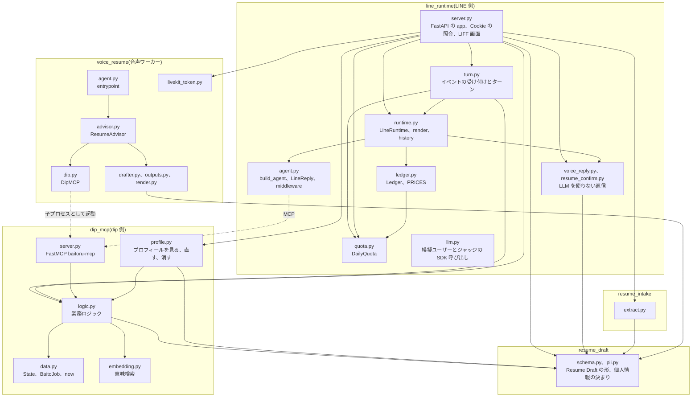
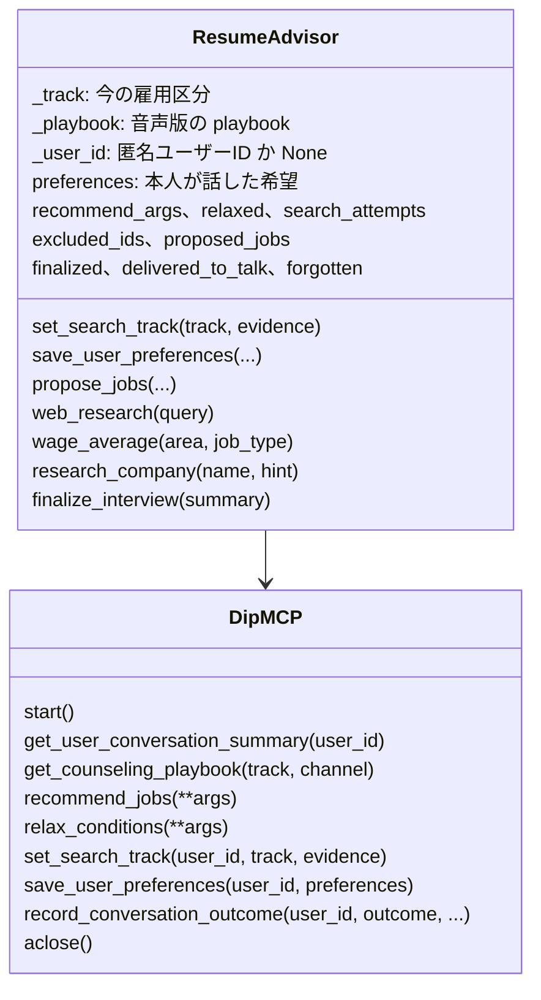
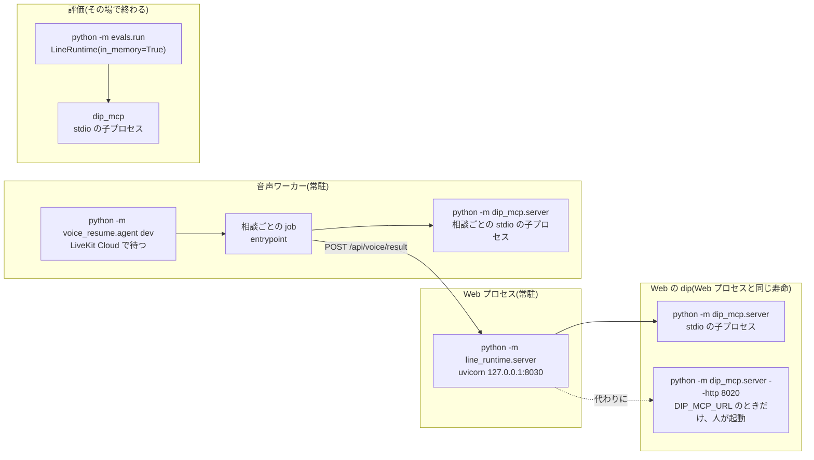
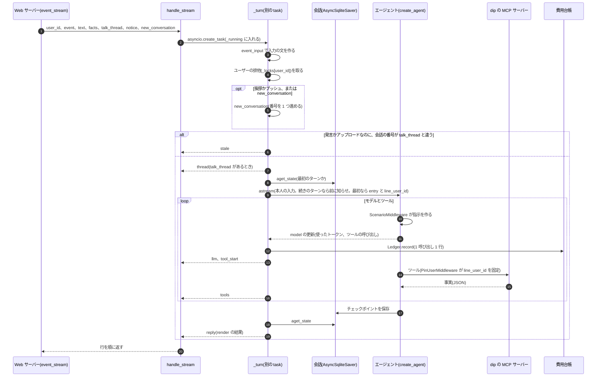
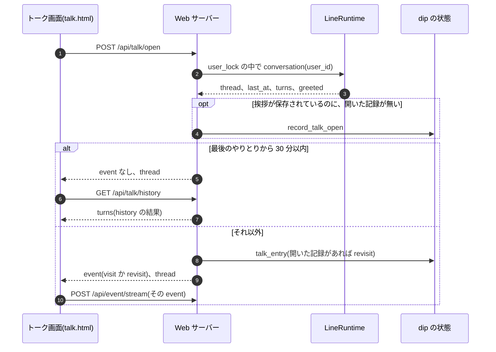
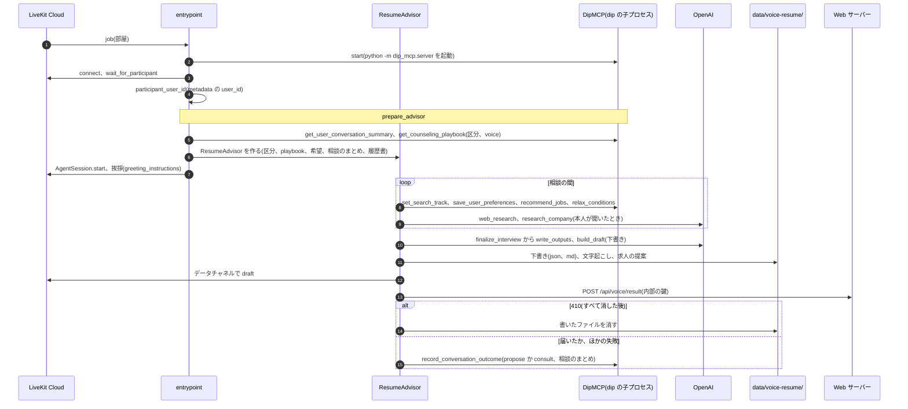
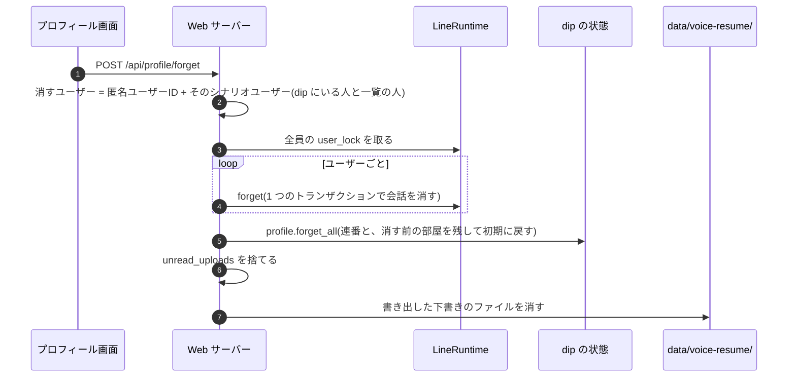
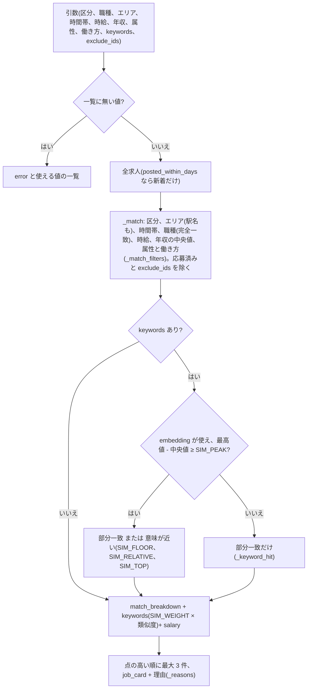
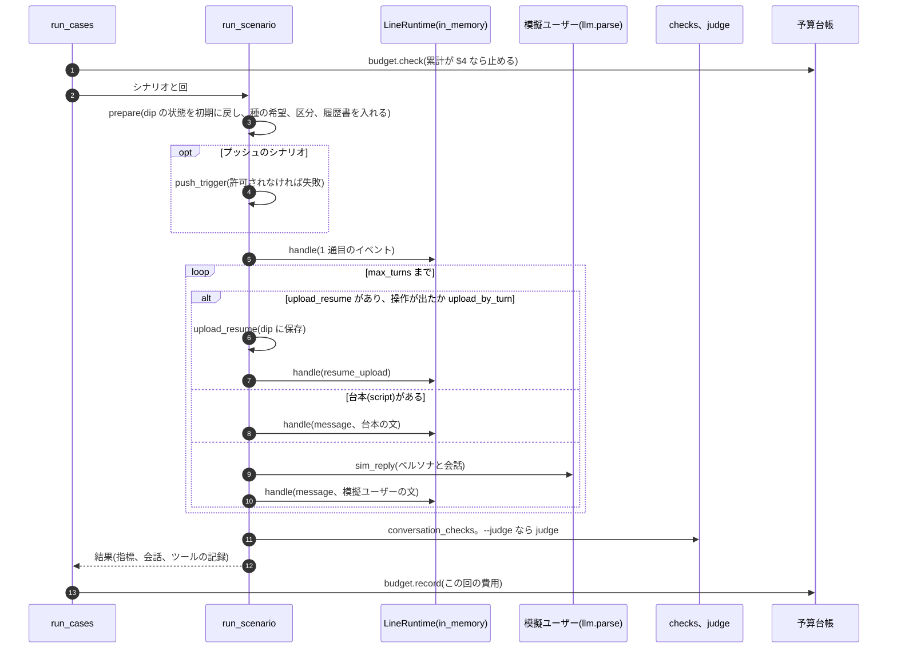
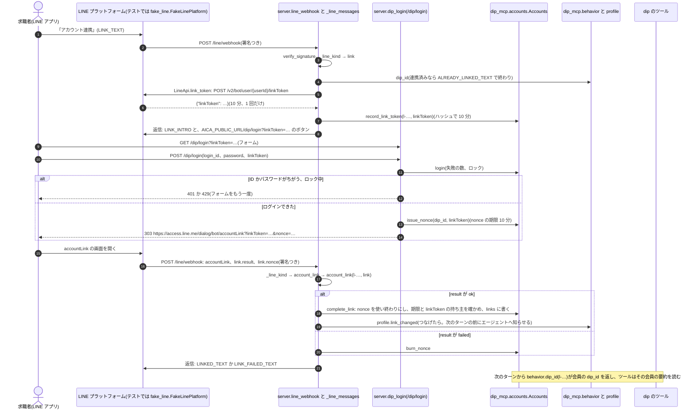

# LLD: aica の詳細設計

[hld.md](hld.md) の部品の中身です。パッケージとモジュール、プロセス、HTTP の口と dip のツール、主な流れ、
保存するデータの形、外部の呼び出し、失敗の扱い、テストで守っている約束を書きます。

- 2026-10-11 の main(`7c73893`)のコードから書き起こしました。コードと食い違ったら、コードが正です
- 語は HLD の 10 章「用語」に従います。コードの名前(`line_user_id`、`ScenarioMiddleware` など)は、そのコードを指すときだけ使います
- 関数名はモジュールの名前と一緒に書きます。行番号は変わるので書きません(`grep -n "def <名前>" <ファイル>` で探します)
- 書く中で見つけた設計の問題は [review-2026-10.md](review-2026-10.md) にまとめました(R17 から後は、この文書を書く中で足したもの)
- 4.7 と 4.8 の後半、4.9、4.10、5.3 の後半、5.7 の件数、10 章の履歴書の読み取りは、README を書き直したとき(jyoka/tasks#167)に README から移しました
- LINE のチャネル(4.11)は jyoka/tasks#177 で足しました
- dip のツールが行動を要約から読むところ(5.8 の後半、`behavior.py`)は task 181 で足しました
- LINE のアカウント連携(4.12、5.9、`accounts.py`、`fake_line.py`)は task 182 で足しました

## 1. パッケージの構成



パッケージの間の依存は HLD の 3.2 にあります。ここでは各パッケージの中を書きます。

### 1.1 line_runtime

| モジュール | 役割 | 主な名前 |
|---|---|---|
| `server.py` | Web サーバー。FastAPI の `app` と `lifespan`、Cookie と本人の確かめ、イベントの結果の HTTP と NDJSON への書き出し、プロフィール、音声相談、履歴書のアップロード、LIFF 画面、LINE の webhook | `_issue`、`_owner`、`_require_own`、`_page_user`、`_require_internal`、`_client_ip`、`_admit`、`_deps`、`event`、`event_stream`、`_error_text`、`_remove_voice_files`、`line_webhook`、`line_api`、`_line_kind`、`_line_handle`、`_line_user_events`、`_line_messages`、`_line_link_start`、`account_link`、`_line_turn`、`_unlink`、`dip_login_page`、`dip_login`、`dev_link_start`、`dev_link_unlink`、`fake_line_account_link` |
| `line_channel.py` | LINE のチャネル(4.11)。署名、LINE のユーザーID、再送の見分け、返信を LINE のメッセージにする、Messaging API の呼び出し、アカウント連携の文とボタン(4.12)。FastAPI に依存しない | `verify_signature`、`line_user`、`id_key`、`check_id_key`、`IdKeyError`、`LINE_ID`、`SeenEvents`、`to_messages`、`LineApi`(`link_token` を含む)、`configured`、`public_url`、`ACTION_NOTES`、`FAILED_TEXT`、`link_command`、`link_messages`、`account_link_url`、`LINK_TEXT`、`UNLINK_TEXT` |
| `fake_line.py` | 偽物の LINE のアカウント連携のところ(4.12)。linkToken の発行、accountLink の画面、webhook のイベントと署名。テストと開発者画面で使う | `FakeLinePlatform`、`account_link_event`、`signed_webhook`、`LINK_TOKEN_TTL` |
| `turn.py` | イベントの受け付けとターンの決まり。`event` と `event_stream` が共通に使う。FastAPI に依存しない | `accept`、`run`、`reply_of`、`BadTurn`、`TurnFailed`、`TurnDeps`、`Turn`、`stale_thread`、`profile_notice`、`record_open`、`track_status`、`upload_facts`、`LIMIT_REASON` |
| `runtime.py` | LineRuntime。1 ターンを進め、会話を保存し、返信を描く | `EVENTS`、`event_input`、`voice_event`、`dip_connection`、`LineRuntime`、`render`、`history`、`track_switch`、`_cards_in`、`CARD_KEYS` |
| `agent.py` | エージェント。LINE の共通ルール(`PLATFORM_PROMPT`)と返信の形 | `LineReply`、`Button`、`LineState`、`ScenarioMiddleware`、`PinUserMiddleware`、`build_model`、`build_agent` |
| `quota.py` | ターン数の上限 | `DailyQuota`、`ip_key`、`person`、`today`、`limit_reply` |
| `ledger.py` | 費用台帳と料金表。`python -m line_runtime.ledger` で集計する | `PRICES`、`cost_usd`、`Ledger`、`summarize` |
| `voice_reply.py` | 音声相談の結果をトークに続ける返信(LLM を使わない) | `voice_reply`、`summary_bubble`、`voice_history_reply`、`draft_button` |
| `resume_confirm.py` | 履歴書をアップロードした直後の確認の吹き出し(LLM を使わない) | `resume_bubbles`、`skill_heading`、`RESUME_LABEL` |
| `llm.py` | 模擬ユーザーとジャッジが SDK を直接呼ぶところの、プロバイダの違いの吸収 | `client`、`parse`、`text` |
| `config.py` | 設定と `.env` の読み込み | `PROVIDER`、`MODEL`、`EFFORT`、`DIP_MCP_URL`、`DATA_DIR`、`load_env` |
| `static/` | 画面。`talk.html`(トーク画面)、`dev.html`(開発者画面)、共通部品 `talk-core.js`、`talk-core.css` | - |


エージェントは `build_agent` が LangChain の `create_agent` で作ります。

- middleware は外側から `ScenarioMiddleware`、`AnthropicPromptCachingMiddleware`(OpenAI では何もしない)、`PinUserMiddleware` の順です
- `ScenarioMiddleware` は、指示を `PLATFORM_PROMPT` + 入口の dip の Prompt + ユーザーIDにします。入口とユーザーIDは会話の state(`entry`、`line_user_id`)から読みます
- 返信は `ProviderStrategy(LineReply)` の構造化出力です
- `build_model` は `config.PROVIDER` で `ChatOpenAI`(Responses API、`reasoning.effort`)か `ChatAnthropic`(`thinking: adaptive`)を作ります

### 1.2 dip_mcp

| モジュール | 役割 | 主な名前 |
|---|---|---|
| `server.py` | dip の MCP サーバー(FastMCP、名前は `baitoru-mcp`)。ツールは引数の説明を持ち、中身は `logic` を呼ぶだけ(3.3) | `mcp`、`state`、`baitoru_assistant`、`faq` |
| `logic.py` | 業務ロジック。LLM を使わない | 下の表 |
| `profile.py` | プロフィール画面の中身と、知らせ(アカウント連携の知らせ `link_changed` も) | `link_changed`、`view`、`edit_item`、`edit_summary`、`set_track`、`undo_switch`、`switch_status`、`delete_resume`、`delete_voice_draft`、`unsave_job`、`forget_all`、`pending_changes`、`take_changes`、`notice` |
| `data.py` | 求人の形、dip の状態の読み書き、時計。個人情報の判定は `resume_draft.pii`(1.8) | `BaitoJob`、`Pay`、`State`、`load_jobs`、`load_users`、`now`、`uses_sim_clock`、`SIM_NOW`、`PII_FIELDS`、`pay_text`、`annual_pay_mid` |
| `embedding.py` | 求人の意味検索 | `job_text`、`job_hash`、`embed_query`、`similarities`、`MODEL`、`DIMENSIONS` |
| `events.py` | 行動の元データ(会員とイベントのログ)の読み書き。追記だけ。読むのは要約のバッチだけ(5.8) | `EventStore`、`KINDS`、`load_scenario_events`、`iso`、`EVENTS_PATH` |
| `summarize.py` | 要約のバッチ(`python -m dip_mcp.summarize`)。元データから状況の要約を全員分作り直す(5.8) | `run`、`fold`、`build_summary`、`empty_summary`、`for_agent`、`head`、`SummaryStore`、`SUMMARY_MAX_CHARS`、`AGENT_APPLICATIONS`、`AGENT_SAVES`、`SUMMARIES_PATH` |
| `behavior.py` | dip のツールが本人の行動を読み書きするところ。要約に、会話の中で書いた分を重ねて読む。書くときは元データに追記する。LINE のユーザーIDから `dip_id` を引く 1 か所(連携の表を読む。5.8、ADR-0006、ADR-0007)。会話の中で書いた分は、今の会員の分だけ重ねる(4.12) | `view`、`record`、`overlay`、`dip_id`、`_mine`、`stores`、`WRITES` |
| `accounts.py` | dip の会員のログイン、nonce、bot が出した linkToken、連携の表(4.12、5.9)。LLM を使わない | `Accounts`、`of`、`hash_password`、`check_password`、`fixture_dip_id`、`MAX_FAILURES`、`LOCK`、`NONCE_TTL`、`ACCOUNTS_PATH` |
| `prompts/` | dip の Prompt。`baitoru_assistant.md`(どの入口でも同じ骨格)と `entries.json`(入口ごと) | - |
| `playbooks/` | playbook。`{parttime,fulltime,undecided}_{chat,voice}.md` と区分に共通の `common_{chat,voice}.md` | - |

`logic.py` は見出しのコメントで次のように分かれています(R14)。

| 見出し | 主な関数と定数 |
|---|---|
| (先頭)dip の要約、応募、フォーム | `liff_url`、`preferences`(本人の傾向)、`stated_preferences`、`conversation_summary`、`recent_applications`、`form_exit`、`HISTORY_DAYS` |
| 推薦 | `JOB_TYPES`、`FULLTIME_JOB_TYPES`、`AREAS`、`AREA_GROUPS`、`ATTRIBUTE_ARGS`、`FULLTIME_STYLE_ARGS`、`recommend`、`relax`、`match_breakdown`、`job_card`、`_keyword_filter`、`_reasons`、`SIM_FLOOR`、`SIM_RELATIVE`、`SIM_TOP`、`SIM_WEIGHT`、`SIM_PEAK` |
| 相談(FAQ / 求人) | `answer_material`、`application_status`、`MIN_OVERLAP` |
| 手続き(フォームの続き) | `resume_form`、`submit_application`、`save_job`、`saved_jobs` |
| トークを開いた | `talk_entry`、`record_talk_open` |
| 本人が話した希望と、本人について | `PREFERENCE_KEYS`、`FULLTIME_PREFERENCE_KEYS`、`PREFERENCE_VALUE_MAX`、`ADDRESS_LIKE`、`address_spans`、`save_preferences` |
| 雇用区分 | `TRACKS`、`search_track`、`track_history`、`set_search_track` |
| 相談の playbook | `PLAYBOOK_FILES`、`CHANNELS`、`CONVERSATION_RULES`、`VOICE_CONVERSATION_RULES`、`counseling_playbook` |
| 音声相談の結果 | `record_voice_result`、`voice_results_since`、`voice_result`、`record_voice_room`、`voice_room_forgotten` |
| アップロードした履歴書 | `save_resume_upload`、`resume_upload`、`uploaded_resume` |
| 会話の段階の結果の記録 | `OUTCOMES`、`REFUSAL_WORDS`、`CONSULTATION_SUMMARY_MAX`、`record_outcome`、`consultation_summary` |
| プッシュ | `PUSH_TRIGGERS`、`PUSH_INTERVAL_DAYS`、`push_trigger` |

dip の関数はどれも、1 つ目の引数に `State` を受け取ります。MCP サーバーと Web サーバーと評価は、それぞれ自分の `State()` を作り、
同じファイルを読み書きします(5.1、6 章)。

### 1.3 resume_intake

| モジュール | 役割 | 主な名前 |
|---|---|---|
| `extract.py` | 履歴書のファイルから Resume Draft を作る。OpenAI の Responses API の構造化出力。形と `scrub_pii` は `resume_draft`(1.8) | `EXTRACT_SYSTEM`、`media_type`、`content_part`、`extract_bytes`、`extract_draft`、`finalize`、`Usage` |
| `config.py` | モデル、上限、出力先 | `MODEL`(既定 `gpt-6-sol`)、`MAX_UPLOAD_BYTES`(10MB)、`OUT_DIR` |
| `cli.py`、`run_samples.py` | 運営者が手で回す読み取りと、サンプルの正解との比較(実 API) | - |
| `samples/` | 架空の履歴書 4 つと正解 3 つ | - |

`client` を引数で受け取るので、テストは `responses.parse` を持つスタブを渡します。Web サーバーは `server.resume_client` で
`AsyncOpenAI` を作ります。

### 1.4 voice_resume

音声ワーカーのパッケージです。音声は「文字起こし → 文章の LLM → 読み上げ」に分けています(旧リポジトリの task 31 で、
OpenAI Realtime の構成から作り直しました)。

```
ブラウザ(マイク) ──WebRTC──▶ LiveKit Cloud(部屋) ──▶ 音声ワーカー(voice_resume/agent.py)
                                                        ├ STT: Deepgram nova-3(ja)+ 用語の keyterm
                                                        ├ LLM: OpenAI gpt-6-sol(reasoning_effort=none)
                                                        ├ TTS: Cartesia sonic-3.5(日本語のボイス、速さ 0.9)
                                                        ├ ターンの判定: Silero VAD + 多言語の turn detector
                                                        ├ dip: dip_mcp を相談ごとに stdio の子プロセスで起動
                                                        └ 終わり: 下書きなどを data/voice-resume/ に書き、
                                                           POST /api/voice/result でトークへ結果を返す
```

| モジュール | 役割 | 主な名前 |
|---|---|---|
| `agent.py` | LiveKit のワーカーの入口。`python -m voice_resume.agent dev` | `prewarm`、`entrypoint`、`participant_user_id`、`prepare_advisor` |
| `advisor.py` | 音声アドバイザー(LiveKit の `Agent`)。ツール(3.4)と、トークへの結果の返送 | `ResumeAdvisor`、`TalkForgotten`、`_post_json`、`_remove_files` |
| `dip.py` | dip のクライアント。音声で使う 7 つのツールだけを公開する | `DipMCP`、`ANON_USER_ID` |
| `prompts.py` | 区分によらない音声の決まり、dip の要約から足す指示、挨拶の指示、下書きの指示 | `advisor_instructions`、`stated_preferences_note`、`consultation_summary_note`、`uploaded_resume_note`、`greeting_instructions`、`DRAFTER_SYSTEM`、`CAREER_DRAFTER_SYSTEM`、`drafter_system`、`document_kind_for`、`document_name` |
| `jobs.py` | 希望から `recommend_jobs` の引数を作る。dip の一覧の写し(R13) | `JOB_TYPES`、`FULLTIME_JOB_TYPES`、`TRACKS`、`AREAS`、`build_recommend_args`、`split_relaxed`、`on_track`、`spoken_job_line`、`relax_option_line` |
| `drafter.py` | 文字起こしから下書きを作る。形と `scrub_pii` は `resume_draft`(1.8) | `build_draft`、`finalize` |
| `outputs.py` | 相談の終わりに 4 つのファイルを書く(5.4) | `write_outputs`、`history_transcript` |
| `render.py` | 下書きの Markdown。書類の種類で見出しと並びを変える(5.5) | `to_markdown` |
| `livekit_token.py` | 部屋の接続トークンの発行。Web サーバーが使う | `configured`、`issue_token`、`TOKEN_TTL`(5 分) |
| `stt.py` | STT の作り分け | `create_stt` |
| `flow.py`、`stt_eval.py` | 文字起こしから会話の流れを確かめるチェッカーと、STT の聞き取りの台本(テストと評価で使う) | `verify_flow`、`count_experience_probes`、`find_leading_questions`、`score_transcripts` |
| `wages.py` | 平均時給の参考データ(`data/wage_reference.json`) | `load_reference`、`answer_from_reference` |
| `config.py` | 設定(7.1)と `.env` の読み込み | `OUT_DIR`、`TALK_URL`、`dip_server_command`、`load_env` |
| `results/` | 画面の証跡(PNG) | - |



- `ResumeAdvisor` の dip のツールの `line_user_id` は、LLM の引数ではなく `_user_id` から付けます(`_with_user`、`DipMCP` の各メソッド)。
  LLM が別のユーザーを指す道はありません
- `_user_id` が None(metadata の無い参加者)のときは、dip を読むだけで書きません。`relax_conditions` には固定の `ANON_USER_ID` を渡します
- `DipMCP.record_conversation_outcome` は `propose` と `consult` 以外を `ValueError` で断ります

### 1.5 evals

| モジュール | 役割 |
|---|---|
| `run.py` | 評価のハーネス。模擬ユーザーとエージェントを会話させて採点する(4.7)。`--rejudge` で保存した会話をジャッジだけで判定し直す |
| `scenarios.json`、`scenarios.py` | シナリオの一覧(15 件)と、始める前の準備(`prepare`、`upload_resume`、`load_resume`)。開発者画面と共通 |
| `checks.py` | コードの判定。形式(`turn_violations`、`FORMAT_RULES`)、事実性(`fact_violations`)、希望の保存(`preference_violations`)、聞き直し、相談、雇用区分(`track_expectations`)、アップロード、`conversation_checks` |
| `judge.py` | LLM ジャッジ。相談の深さの 4 項目、トーン、設計への合い方(`design_fit`)、ひとこと(`comment`)。`samples` 回(既定 2)判定してまとめる |
| `meter.py` | Anthropic と OpenAI の SDK の呼び出しをクラスごと包んで、トークンと費用を数える(評価だけで使う) |
| `budget.py`、`budget.jsonl` | 予算台帳。`LIMIT_USD = 4.0` で止まる |
| `personas/` | ペルソナの架空の履歴書(読み取り結果の形) |
| `search_eval.py`、`search_eval_set.json` | 意味検索の評価セットと、上位 3 件の再現率 |
| `jobtype_repro.py`、`semantic_repro.py`、`wait_repro.py` | 個別の問題を実 API で再現するスクリプト |
| `probe.py` | 「電話はしたくない」と音声でコールセンターを外す流れを、チャットと音声で数ターンずつ実 API で確かめる小さな計測。予算台帳と $4 の停止は `run.py` と同じ |
| `baseline/` | 比較の基準にした評価の結果 |

### 1.6 evalkit

`aggregate.py` は評価の結果ファイル(5.6)を集計して比べる、標準ライブラリだけの道具です。`summary`(95% 区間つきの集計)と
`diff`(前後の比較)があります。`evals/run.py` は自分の Markdown のレポートに `summary_md` を使います。使い方は
[evalkit/README.md](../../evalkit/README.md) にあります。

### 1.7 scripts

| スクリプト | 役割 |
|---|---|
| `gen_jobs.py`、`gen_job_faq.py` | 架空の求人と求人ごとの FAQ を LLM で作る |
| `gen_job_vectors.py` | 求人のベクトル(`fixtures/job_vectors.json`)を作り直す。求人を変えたら回す |
| `gen_dip_events.py` | dip の行動の元データ(`data/dip_events.db`)を、乱数の種を固定して作る。LLM は使わない(5.8) |
| `voice/e2e_audio_session.py` | 音声の E2E(10 章) |
| `voice/live_room_smoke.py` | LiveKit の部屋の実経路の確かめ |
| `voice/eval_stt.py`、`voice/eval_hearing.py`、`voice/tool_call_probe.py` | STT の比較、ヒアリングの深さ、ツールを同じターンで呼ぶかの計測(実 API) |
| `voice/update_wage_reference.py` | 平均時給の参考データを web 検索で作り直す(年 1 回くらい、1 回 $0.05 前後) |

### 1.8 resume_draft

Resume Draft の契約です。読み取り(`resume_intake`)、下書き(`voice_resume`)、dip の保存(`dip_mcp`)が同じものを使います。
`dip_mcp` にも `voice_resume` にも依存しません。

| モジュール | 役割 | 主な名前 |
|---|---|---|
| `schema.py` | Resume Draft の形と envelope(5.5) | `ResumeDraft`(と 5 つの部品の型)、`envelope`、`document_kind_of`、`FORMAT_VERSION`(`1.0`)、`FORMAT_VERSION_WITH_KIND`(`1.1`)、`PERSONAL_KEYS`、`DOCUMENT_KINDS`、`DEFAULT_DOCUMENT_KIND`、`JST` |
| `pii.py` | 電話、メール、郵便番号の決まり。どれも照合の前に `fold_pii` で全角をそろえる | `PII_VALUE`、`fold_pii`、`has_pii`、`redact_pii`(探す)、`SCRUB_PATTERNS`、`scrub_pii`(消す) |

- `has_pii` と `redact_pii` は電話とメールを探します。トークの発言、希望、相談の記録の照合に使います
- `scrub_pii` は Resume Draft の文字列から、電話、メール、郵便番号を消します。`PII_VALUE` より広く取ります
  (区切りが空白 1 つの電話番号、郵便番号も消す)。`SCRUB_PATTERNS` を順に当てるのを、元の文字列と `fold_pii` でそろえた文字の両方で行い、
  どちらかで消えた位置を元の文字列から消します(`fold_pii` は 1 文字を 1 文字に写すので位置は同じ)。元の文字列でも照合するのは、
  全角の「０１」が電話番号の始まりに見えて、すぐ後ろの半角の電話番号を途中までしか取れなくなるのを防ぐためです

## 2. プロセス



- Web プロセスは `lifespan` で `.env` を読み、`DailyQuota` と LINE の `SeenEvents` を作り、`LineRuntime` に入ります。`LineRuntime.__aenter__` は
  dip と MCP のセッションを 1 本だけ張り(`dip_connection`)、ツールを読み、イベントの入口(`A`、`visit`、`revisit`、`D`)ごとに dip の
  Prompt を読んでから、エージェントを作ります。dip の Prompt を変えたら Web プロセスを起動し直します
- dip の子プロセスは親の環境変数をすべて受け取ります(`env=dict(os.environ)`、R15)
- `LineRuntime.__aexit__` は、進行中のターン(`_running`)が終わるのを待ってから MCP のセッションを閉じます
- 音声ワーカーは LiveKit Agents の CLI で動きます。`prewarm` で Silero VAD を読み、相談(LiveKit の job)ごとに `entrypoint` を呼びます。
  `entrypoint` は `DipMCP.start` で dip の子プロセスを起動し、終わりの callback で閉じます。dip に繋がらなくても相談は続けます
- 評価は Web サーバーを通らず、自分のプロセスで `LineRuntime(in_memory=True)` を使います。会話は SQLite の `:memory:`、
  dip の状態は `DIP_STATE_PATH` に設定した一時ファイル、費用台帳はメモリだけです
- その場で終わるプロセス: `python -m line_runtime.ledger`(費用台帳の集計)、`python -m evals.budget`(予算台帳)、
  `python -m resume_intake.cli`、`python3 evalkit/aggregate.py`

## 3. 口

### 3.1 Web サーバーの HTTP の口

本人の確かめの列の意味です。

- Cookie: `_owner`。Cookie `aica_uid` が無いか形が違えば 401
- 本人: `_require_own`。本文の `user_id` が Cookie の匿名ユーザーIDか、そのシナリオユーザー(`scenarios.json` にあるものだけ)でなければ 403
- 画面: `_page_user`。Cookie の匿名ユーザーIDに、URL の `scenario_user` を付ける
- 書き込みの枠: `_admit`(`DailyQuota.admit`)。この IP か全体で、その日に使える匿名ユーザーIDの数を超えたら 429
- 内部の鍵: `_require_internal`。`Authorization: Bearer <AICA_INTERNAL_KEY>` でなければ 401
- LINE の署名: `line_channel.verify_signature`。`X-Line-Signature` が、チャネルシークレットで本文そのままの HMAC-SHA256 を取った値の
  base64 でなければ 400

| メソッドとパス | 関数 | 本人の確かめ | ターン | 書くもの |
|---|---|---|---|---|
| `GET /`、`GET /dev` | `index`、`dev` | Cookie を発行する(`_issue`) | - | Cookie |
| `GET /static/{name}` | `shared_static` | - | - | -(`talk-core.js`、`talk-core.css` だけ) |
| `GET /api/me` | `me` | Cookie | - | - |
| `POST /api/talk/open` | `talk_open` | Cookie | - | 挨拶が保存されているのに記録が無ければ `record_talk_open` で補う |
| `GET /api/talk/history` | `talk_history` | Cookie | - | - |
| `POST /api/talk/track/undo` | `talk_track_undo` | 本人 + 書き込みの枠 | - | 雇用区分の取り消し、知らせ。直前の切り替えでなければ 409 |
| `GET /api/saved` | `saved` | Cookie | - | - |
| `GET /api/scenarios` | `scenarios` | - | - | - |
| `POST /api/scenarios/{id}/start` | `start_scenario` | Cookie + 書き込みの枠 | - | シナリオユーザーの dip の状態を初期に戻す(`evals.scenarios.prepare`) |
| `POST /api/event` | `event` | 本人 | 1 | 会話、dip の状態(ツール)、費用台帳。`ValueError` は 400 |
| `POST /api/event/stream` | `event_stream` | 本人 | 1 | 同上。途中経過は NDJSON(3.2) |
| `POST /api/dip` | `dip_view` | 本人 | - | -(開発者画面の「dip から見た状態」) |
| `GET /api/profile` | `profile_get` | Cookie | - | - |
| `PUT`、`DELETE /api/profile/items/{key}` | `profile_edit`、`profile_delete` | Cookie + 書き込みの枠 | - | 本人が話した希望か相談のまとめ、知らせ。個人情報らしい値、長すぎる値、空の値、知らない項目は 400(`_checked`)。保存していない項目を消しても 200 |
| `PUT`、`DELETE /api/profile/track` | `profile_track`、`profile_track_delete` | Cookie + 書き込みの枠 | - | 雇用区分、知らせ |
| `DELETE /api/profile/resume` | `profile_resume_delete` | Cookie + 書き込みの枠 | - | 会話を閉じてから読み取り結果を消す(4.6) |
| `DELETE /api/profile/voice/{id}` | `profile_voice_delete` | Cookie + 書き込みの枠 | - | 下書きを空にし、`data/voice-resume/` のファイルを消す。無ければ 404 |
| `DELETE /api/profile/saved/{job_id}` | `profile_unsave` | Cookie + 書き込みの枠 | - | 保存の取り消し、知らせ |
| `POST /api/profile/forget` | `profile_forget` | Cookie | - | 「すべて消す」(4.6) |
| `POST /api/voice/start` | `voice_start` | 本人 | 1 | 部屋の記録(`record_voice_room`)。LiveKit の設定が無ければターンを使わずに 503、上限なら 429 |
| `POST /api/voice/wait` | `voice_wait` | 本人 | - | -(最長 `VOICE_WAIT_MAX` 30 秒、既定 25 秒) |
| `POST /api/voice/result` | `voice_result_in` | 内部の鍵 | - | 音声相談の結果、会話にエージェントの返信を足す。「すべて消す」の前の部屋なら 410。下書きが `DRAFT_MAX`(2 万字)を超えたら 422 |
| `POST /api/resume/upload` | `resume_upload` | 本人 | 1 | 読み取り結果、費用台帳。形式が違えば 400、10MB を超えたら 413、会話が替わっていれば 409、上限なら 429、API の失敗は 502 |
| `GET /liff/resume` | `liff_resume` | 画面 | - | -(読み取り結果。`rid` が最新でなければ 404) |
| `GET /liff/voice/draft` | `liff_voice_draft` | 画面 | - | -(下書き) |
| `GET`、`POST /liff/apply` | `liff_form`、`liff_submit` | 画面 | - | 応募の確定(`submit_application`)。入力値は保存しない |
| `POST /line/webhook` | `line_webhook` | LINE の署名 | イベントごとに 1(アカウント連携は 0) | 4.11、4.12。設定が無ければ 404。受けた webhook のイベントの ID(`data/line_events.json`)、会話、dip の状態、費用台帳、連携の表 |
| `GET`、`POST /dip/login` | `dip_login_page`、`dip_login` | dip の会員のログイン(Cookie は見ない) | - | 4.12。ログインの失敗の数、nonce。できたら LINE の accountLink の画面へ 303。ID かパスワードがちがえば 401、ロック中は 429、linkToken の形が違えば 400 |
| `GET /api/dev/link` | `dev_link` | Cookie | - | -(開発者画面の「アカウント連携」。匿名ユーザーIDと `dip_id`) |
| `POST /api/dev/link/start` | `dev_link_start` | Cookie + 書き込みの枠 | - | 偽物の LINE の linkToken、bot が出した linkToken の記録。連携済みなら 409 |
| `POST /api/dev/link/unlink` | `dev_link_unlink` | Cookie | - | 連携の表から外す |
| `GET /fake-line/dialog/bot/accountLink` | `fake_line_account_link` | Cookie(開いた人が linkToken のユーザーか) | - | 4.12。偽物の LINE の accountLink の画面。知らない linkToken は 404 |

- Cookie `aica_uid` は HttpOnly、SameSite=Lax です。匿名ユーザーIDを発行するのは画面を開いたとき(`_issue`)だけで、API は発行しません
- ブラウザから本文で受け取るユーザーIDは、どれも `_require_own` を通します。URL には載せません(`logic.liff_url`)。
  ブラウザの履歴、アクセスログ、Referer に残るためです
- dip の状態にユーザーが書かれるのは、Cookie を持つ本人が話したときと、開発者画面でシナリオを始めたときだけです。
  Cookie の無い `POST /api/talk/open` は 401 で、何も書きません
- ターンを数えるのは `DailyQuota.try_take` を呼ぶ 3 つの口です(`turn.run`、音声相談の開始、履歴書のアップロード)。上限のときは LLM を呼びません
- IP は `_client_ip` が決めます。`AICA_TRUST_PROXY=1` のときだけ `X-Forwarded-For` の最後の値を使います

### 3.2 NDJSON の行(`POST /api/event/stream`)

1 行 1 件の JSON で、`kind` が種類です。`POST /api/event` は同じ処理で `reply` の中身だけを返します。

| `kind` | いつ | 中身 |
|---|---|---|
| `start` | 最初に 1 回 | `event`、`entry`、`event_kind`、`model` |
| `gate` | プッシュのとき | `push_trigger` の結果(`allowed`、`reason` か `trigger` と `facts`) |
| `thread` | 本番のトーク画面(`thread` を送ったとき)で、LLM を呼ぶ前 | このターンの会話の番号 |
| `llm` | LLM の呼び出しごと | `ms`、`input_tokens`、`output_tokens`、`cache_read`、`cache_write`、`tool_calls` |
| `tool_start` | ツールの実行の前 | `calls`(名前と引数) |
| `tools` | ツールの実行の後 | `ms`、`calls`(名前、引数、`runtime._summary` の 1 行) |
| `reply` | 最後 | `render` の結果 + `search_track`。プッシュを送らないときは `sent: false` と `reason`、上限のときは `limited: true` |
| `stale` | 別のタブで会話が替わっていた | 今の会話の番号 |
| `error` | 途中で例外 | `型名: 文`(応答を返し始めた後なので HTTP のエラーにできない) |

`render` の結果(返信)は `entry`、`track_switch`、`bubbles`、`quick_replies`、`cards`、`unknown_job_ids`、`buttons`、`actions`、
`tools` です。`track_switch` には Web サーバーが今の状態(`profile.switch_status` の `undoable`、`undone`、`past`、`gone`)を足します。

### 3.3 dip のツール(MCP)と業務ロジック

エージェントは `load_mcp_tools` で全部のツールを読みます。音声アドバイザーは `DipMCP` の 7 つだけを使います。

| ツール | 中身 | 書くもの(dip の状態のキー) | 音声 |
|---|---|---|---|
| `get_user_conversation_summary` | `logic.conversation_summary` | - | 使う |
| `get_user_recent_applications` | `logic.recent_applications` | - | - |
| `get_user_form_exit` | `logic.form_exit` | - | - |
| `recommend_jobs` | `logic.recommend` | - | 使う |
| `relax_conditions` | `logic.relax` | - | 使う |
| `answer_job_question` | `logic.answer_material` | - | - |
| `get_application_status` | `logic.application_status` | - | - |
| `resume_application_form` | `logic.resume_form` | 元データの `form_fill`、`dip_writes` | - |
| `save_job` | `logic.save_job` | 元データの `save`、`dip_writes` | - |
| `save_user_preferences` | `logic.save_preferences` | `preferences` | 使う |
| `set_search_track` | `logic.set_search_track` | `track_history` | 使う |
| `get_counseling_playbook` | `logic.counseling_playbook` | - | 使う |
| `record_conversation_outcome` | `logic.record_outcome` | `outcomes` | 使う |

- 本人の行動を読むツールは、`behavior.view`(要約に、会話の中で書いた分を重ねたもの)だけを読みます。行動の元データは読みません(5.8)。
  `get_user_conversation_summary`(連携している人)と `get_application_status` は、要約を作った時刻 `as_of` を返します
- Prompt `baitoru_assistant(entry)` は `prompts/baitoru_assistant.md` に、`entries.json` の入口の文(無い入口は `A`)を足して返します
- Resource `baitoru://faq` は `fixtures/faq.json` をそのまま返します
- 一覧に無い職種、エリア、属性の値は、0 件で返さずに `error` と使える値の一覧を返します(`_job_type_error`、`_area_error`、`_filters_error`)。
  エージェントが指定し直せるようにするためです
- 保存のツールは、受け付けなかった項目と理由を返します(`save_preferences` は `rejected` と `note`、`resume_form` は `rejected_pii` と `note`)
- `record_outcome` は、`wait` の理由に `REFUSAL_WORDS` の断りの言葉が無ければ記録しません。相談のまとめが 200 字を超えても記録しません。
  理由とまとめからは電話、メール、住所らしい所を消します(`redact_pii`、`address_spans`)
- `set_search_track` は根拠の発言が空なら記録しません。根拠からは電話とメールを消し、200 字で切ります

Web サーバーと評価がツールを通さずに直接呼ぶ dip の関数は、`push_trigger`、`talk_entry`、`record_talk_open`、`search_track`、
`saved_jobs`、`form_exit`、`submit_application`、`save_resume_upload`、`resume_upload`、`record_voice_result`、`voice_results_since`、
`voice_result`、`voice_result_count`、`record_voice_room`、`voice_room_forgotten`、`liff_url`、`_md`、
`conversation_summary`(開発者画面)、`save_preferences` と `set_search_track`(シナリオの準備の `evals.scenarios.prepare`)と、
`profile` の関数です。Web サーバーと評価が dip の関数を直接呼ぶのは、HLD の 1.1 で認めた形です(R1、ADR-0003)。
守る境界はエージェントの側だけです。エージェントは dip のツールと、イベントの入力に添えた事実を通してだけ dip の事実を得ます(HLD の 1.1)。

### 3.4 音声アドバイザーのツールと、画面とのやりとり

`ResumeAdvisor` の `@function_tool` です。説明の文は LLM への指示を兼ねます。

| ツール | 中身 |
|---|---|
| `set_search_track(track, evidence)` | dip に記録し(ユーザーが分かるとき)、今の区分で使わない希望を外し、音声版の playbook を読み直して `update_instructions` で指示を入れ替える |
| `save_user_preferences(...)` | 今の区分で使う項目だけを `_DIP_PREF_KEYS` の範囲で dip に保存する(`on_track`) |
| `propose_jobs(...)` | 希望から `build_recommend_args` で引数を作り、dip の `recommend_jobs` を呼ぶ。`search_only` でなければ希望を保存する。`relax` で外した条件は `relaxed` に分ける。`exclude_ids` は相談の終わりまで足していく。0 件なら `relax_conditions` で外す候補を返す(`_zero_hit_reply`) |
| `web_research(query)`、`research_company(name, hint)` | OpenAI の Responses API の `web_search` で調べ、出典のリンクを消して話し言葉で返す。1 回の相談で `MAX_WEB_SEARCHES` 回まで(7.1。`wage_average` の web の分と合わせて数える) |
| `wage_average(area, job_type)` | 職種の指定が無く、全国か東京都なら参考データから答える。それ以外は web で調べる |
| `finalize_interview(summary)` | 4.4 の後半。2 回目は保存も送信もしない |

画面とは LiveKit のデータチャネル(topic `voice-resume`)でやりとりします。

| 向き | `type` | 中身 |
|---|---|---|
| ワーカー → 画面 | `status` | 「何をしているか」の表示(`label`)と、その終わり(`done`) |
| ワーカー → 画面 | `jobs` | 検索の結果(`jobs`、`total`) |
| ワーカー → 画面 | `track` | 切り替えた雇用区分 |
| ワーカー → 画面 | `draft` | 下書き(`document_kind`、`markdown`、`files`) |
| 画面 → ワーカー | `end` | 「面談を終える」。ワーカーは `finalize_interview` を呼ぶよう指示して返信を作らせる。返信は相談ごとに 1 回だけで、2 回目からと時間切れの締めの後の `end` には返信しない(`agent.SessionGuard`)。その返信で下書きを保存できなかったら、時間切れのときに保存させる |

## 4. 主な流れ

### 4.1 トークの 1 ターン(`LineRuntime.handle_stream`)

HLD の 4.1 の、LineRuntime の中です。



- 入力の文は `event_input` が作ります。挨拶とプッシュは `[イベント: ...]` で始まる文です。アップロードは `facts` の確認の吹き出しを入れます
- `new_conversation` は、発言でも新しい会話を始める指定です。LINE の発言で、最後のやりとりから間が空いたときだけ真です(4.11)。
  新しい会話の最初のターンなので、`entry`(A)と `line_user_id` を書き、知らせは置きません
- 知らせ(`notice`)は、続きのターンの本人の入力の直前に `HumanMessage(additional_kwargs={"profile_notice": True})` で置きます。
  新しい会話を始めるターンでは使いません(最初に dip の要約を読むので)
- 受け取り手が切れても `_turn` は最後まで進みます(`handle_stream` は `queue` を読むだけ)。ツールの結果が無い会話を保存しないためです
- `render` は、会話の中のツールの結果と音声相談の結果から `CARD_KEYS` を持つものを拾い、モデルの `job_ids` のうち拾えたものだけをカードにします。
  ボタンは `/liff/` で始まる URL だけを通します。切り替えの表示(`track_switch`)は、そのターンの `set_search_track` の結果の `recorded` から作ります

Web サーバーの `event` と `event_stream` は、`_require_own` の後に `turn.accept`(イベントの名前と空の発言の確かめ、アップロードの事実
(`upload_facts`))を呼び、`turn.run` でターンを進めます。`run` は、プッシュなら上限に空きがあるかと `push_trigger` → `stale_thread` →
`try_take` → `profile_notice` → LineRuntime の順に進み、行を順に出します。返信が返ったら `record_open` が、渡した知らせを消し
(`profile.take_changes`)、本番のトーク画面(`thread` あり)の挨拶なら開いた記録を残し、読み取れなかったアップロードの事実を捨てます。
LineRuntime が stale を返したら、使ったターンを `refund` で返します。`event` は `turn.reply_of` で最後の返信だけを返し、
`event_stream` は行をそのまま NDJSON にします(最初に `start` を足します)。

`run` は、LineRuntime を回し始めてから終わるまでの例外を包みます。LineRuntime の `ValueError` は `BadTurn`(`ValueError` の子)に、
ほか(`reply` と `stale` の行の副作用の `ValueError` も)は `TurnFailed` に包みます。`event` は `BadTurn` を 400 にし、`TurnFailed` は 500 のままです。
`event_stream` は 2 つを `error` の行にし、文は包む前の例外の名前と文にします(`_error_text`)。その前の受け付け(`push_trigger` など)の
例外は包まないので、`event` は 500、`event_stream` は `start` の行の後に応答が途中で切れます。

### 4.2 トークを開く



- 会話の番号は、最初に使うとき `_current` がチェックポイントの最大の番号から復元します。再起動しても古い会話に戻りません
- `LineRuntime.conversation` の `last_at` は、返信のある会話の最後のチェックポイントの時刻です。返信の無い会話は続けません
- 続けるかは `server.talk_continues` が決めます(`last_at` が None でなく、`clock()` との差が `TALK_RESUME_WINDOW`(30 分)以内)。
  LINE のテキストのメッセージも同じ関数で決めます(4.11)
- `history` は 1 ターン 1 件で、本人の発言(イベントなら None)と返信(`render` と同じ形)を返します。アップロードと音声相談の
  ターンは、会話に添えた `upload`、`voice` から描き直します。画面の URL は記録から取らず、`liff_url` で組み立て直します

### 4.3 履歴書のアップロード

HLD の 4.2 の詳しい手順です。

1. `resume_upload` は拡張子(`media_type`)、空、大きさ(`MAX_UPLOAD_BYTES`)、会話の番号を確かめてから `try_take` します
2. `extract_bytes` がファイルを Responses API の `input_file`(PDF)か `input_image` にして読み取り、出力に `scrub_pii` をかけます。
   使ったトークンは `Ledger.record(user_id, "resume_upload", ...)` で費用台帳に書きます
3. 読み取れた項目が無ければ(`unconfirmed` を除いて空)、dip に保存せず、`app.state.unread_uploads` に事実を置きます
4. 読み取れたら `logic.save_resume_upload` が、`personal` を空にし、もう一度 `scrub_pii` をかけ、`resume_upload_seq` から番号を振って
   最新の 1 件として保存します。`profile.resume_uploaded` が、まだ渡していない「履歴書を消した」知らせを落とします
5. 画面は確認の吹き出しを出し、`/api/event/stream` に `resume_upload` を送ります。`turn.upload_facts` は dip の読み取り結果か
   `unread_uploads` から事実を作ります(画面からは受け取りません)
6. 入力の文(`event_input`)は、画面に出した確認をくり返さずに読み取り結果を見て続けるよう指示します。エージェントは dip の要約
   (`get_user_conversation_summary`)を呼び直して `uploaded_resume` を見て、次の 1 問を返します

### 4.4 音声相談(音声ワーカーの中)

HLD の 4.3 の、音声ワーカーの中です。



- 会話の段階の結果はコードが決めます。求人を提案できたら `propose`、できなければ `consult` です(`ResumeAdvisor._record_outcome`)
- 下書きの書類は今の区分で決まります(`prompts.document_kind_for`)。正社員なら職務経歴書、それ以外は履歴書です
- `_deliver_to_talk` が送るのは `user_id`、`jobs`(dip のカードの形)、`draft_markdown`、`document_kind`、`files`、`preferences`
  (今の区分で使う、dip に保存できる項目だけ)、`room` です
- Web サーバー(`voice_result_in`)は `logic.record_voice_result` で求人を dip の求人データから作り直し、`voice_reply` の返信を
  `LineRuntime.add_voice_result` で今の会話に足し、待っているシート(`voice_ready` の `Condition`)に知らせます
- トークに届かなかったとき(410 以外)は、警告のログだけで、会話の段階の結果は記録します(R20)

### 4.5 音声アドバイザーの決まり

相談の進め方(何を明らかにするか、掘り下げ方、選択肢の作り方、保存先)は、チャットと同じく dip の playbook の音声版にあります
(`dip_mcp/playbooks/{区分}_voice.md` と `common_voice.md`)。`prompts.advisor_instructions` は、区分によらない音声の決まりに、
今の区分の playbook を足して指示にします。playbook が読めないときは `FALLBACK_PLAYBOOK` で続けます。

区分によらない決まり:

- 雇用区分: dip の要約の `search_track` の playbook で始めます。未定なら最初に 1 問で確かめます。明示と強い合図なら
  `set_search_track` で切り替えます。履歴書の内容や前に話した希望だけでは切り替えません
- 今の区分で使わない条件(正社員の相談での時給、時間帯、週の日数、アルバイト・パートの相談での希望年収、働き方、時期)は、
  検索にも保存にも入れません(`jobs.on_track`、`PARTTIME_ONLY_KEYS`、`FULLTIME_ONLY_KEYS`)
- 本人が話した希望と本人のことは、その場で本人の言葉のまま保存します。検索のために外した条件と、推測した職種は保存しません
- 0 件のときは `relax_conditions` で「どの条件を外すと何件になるか」を調べ、どれを外すかを本人に 1 回で選んでもらいます
- 出さない求人(電話が中心の求人、すでに出した求人)は `exclude_ids` で外し、相談の終わりまで覚えます。外して探し直して 0 件なら、
  前の提案を残します(本人が聞いた求人はトークに届く。2026-10-04 のユーザーの決定)
- dip の要約に前に話した希望、相談のまとめ、アップロードした履歴書があれば、指示に足して確認形で使います(`stated_preferences_note`、
  `consultation_summary_note`、`uploaded_resume_note`)。履歴書の要点は大事な順に `RESUME_NOTE_MAX_CHARS`(600 字)に収まる行だけを入れ、
  行の途中では切りません。氏名と連絡先は dip の要約に無いので、指示にも入りません
- アルバイト・パートの相談は全体 3〜5 分、6〜8 問、1 つのテーマの掘り下げは 1 回までです(`parttime_voice.md`)。
  正社員は全体 5 分前後で、成果の数字は職歴 1 件につき 1 回だけ聞きます(`fulltime_voice.md`)

誠実さの決まり(`prompts.py` の先頭と下書きの指示):

- 声色、話し方、性格、感情、思考の傾向を推し量りません
- 本人が言ったことと、会話で確かめた事実だけを書きます。あいまいな点は下書きに入れず、`unconfirmed` に分けます
- 「本人の希望」(`preferences`)と「検索に使った条件」(`recommend_args`、`relaxed`、`search_attempts`)を分けて記録します
- 氏名、住所、電話番号、メール、生年月日は聞かず、保存しません(下書きの `personal` は常に空、`resume_draft.pii.scrub_pii`)
- 下書きは本人が確認して直してから使うものです。画面と Markdown にそう書きます

音声が途切れる、割り込まれる問題への手当て(`agent.entrypoint` と `config`):

- スピーカーの音をマイクが拾って割り込みになるのが主な原因です。ブラウザでエコーキャンセルを有効にし(`talk-core.js`)、
  ワーカーは 0.8 秒より短い音では割り込まず(`MIN_INTERRUPTION_DURATION`)、誤った割り込みなら話を続けます(`resume_false_interruption`)
- 考え中の「えーと」で打ち切らないよう、多言語の turn detector と `MIN_ENDPOINTING_DELAY`(0.8 秒)、`MAX_ENDPOINTING_DELAY`(6 秒)で待ちます
- それでも切れるときはイヤホンを使います

### 4.6 消す



- 会話を消してから dip の状態を消します。途中で失敗しても、もう一度押せばやり直せます
- `forget_all` は `resume_upload_seq`、`voice_result_seq` を残します。古いリンクの番号が、消した後の新しい結果を開かないためです。
  消す前に発行した部屋は `forgotten_voice_rooms` に移し、後から届いた結果を 410 で断ります
- 音声相談の途中で消したときに止まるのは、相談の終わりの処理だけです。ワーカーが結果を送って 410 を受けたときは、
  会話の段階の結果と相談のまとめを記録せず、書き出したファイルも消します(`ResumeAdvisor._deliver_to_talk`、`finalize_interview`)。
  410 以外の理由で届かなかったとき(内部の鍵の設定違いなど)は、記録もファイルも残ります(8 章、R20)。また、消した後も通話が続く間に
  `set_search_track` と `save_user_preferences` で保存した雇用区分と本人が話した希望は、dip の状態に残ります。
  `DipMCP` と dip のツールは消した部屋を見ず、消した部屋を見るのは `server.voice_result_in`(`logic.voice_room_forgotten`)だけだからです(R7)
- 履歴書を消す(`profile_resume_delete`)ときは、`close_conversation` で空の会話 n+1 を書いてから、それまでの会話をすべて消し、
  そのあと読み取り結果を消します。古い会話を開いたタブの発言は stale になります
- 閉じた会話は描き直せず、次の会話の文脈にも入りません。次にトーク画面を開くと、30 分以内でも新しい会話(再訪の挨拶)から始まります。
  消すこと自体は LLM を呼ばず、ターンも数えません
- ターン数の上限の数と費用台帳は消しません

### 4.7 求人の推薦(`logic.recommend`)



- 本人の傾向(`preferences`)は dip ID と連携したユーザーだけです。90 日以内の応募と、30 日以内の閲覧と保存から数えます
- 両方の区分の求人が残ったら(`mixed`)、時間帯の傾向は点にしません
- `keywords` で 0 件になり、意味検索は使えたが求人を分けられなかったときは、引数で探し直すための `keywords_note` を返します
- `relax` は条件を 1 つずつ外した件数を数え、増えるものを多い順に 3 つ返します。雇用区分と `exclude_ids` は外す候補にしません

keywords と属性の使い分けです。どの言葉をどの引数にするかは dip の Prompt(`baitoru_assistant.md`)にあります。

- 意味検索は、言い換え(「コーヒーが好き」「子どもに勉強を教えたい」)を部分一致の取りこぼしから救うためのものです。文章は作りません
- embedding では分けられない言い換えと否定(「体を動かしたい」「人と話すのが苦手」「立ち仕事は避けたい」「接客はしたくない」)は、
  求人の属性で絞ります。人と話す量 `talk_level` と体を使う量 `physical_level`(どちらも 1〜3)を、`max_talk_level`、
  `min_physical_level` などの引数で指定します。避けたいことは keywords に入れません
- 正社員の「在宅」「土日祝休み」「残業少なめ」は、`remote`、`weekends_holidays`、`max_overtime_hours` で絞ります。この項目は正社員の求人だけが持つので、指定するとアルバイト・パートの求人は出ません(`_match_filters`)
- 求人の情報に無い希望(「人間関係が良い」「宇宙飛行士になりたい」)は、全求人の類似度の最高値が中央値から抜けません(`SIM_PEAK`)。
  そのときは部分一致だけにします。当たらなければ 0 件で、`relax` が keywords を外す案を出します
- 希望年収の下限 `min_annual_salary` は、求人の年収の幅の中央値(月給は 12 か月分)と比べます。指定したときは給与の高さを並びに加味します

モデル、次元、求人の文面、選び方の値(`SIM_*`)は、正解つきの検索評価セット(`evals/search_eval_set.json`、43 本。うち 5 本は
無関係な問い合わせの負例)の上位 3 件の再現率で選びました(task 105 の 0.753 から task 111 で 0.869)。
`python -m evals.search_eval eval` が、記録した問い合わせのベクトル(`fixtures/search_query_vectors.json`)でオフラインで測ります
(2026-10-12 に API キー無しで 0.869 を確かめた)。

既知の限界:

- 属性の値(103 件)は、求人の文面から人が付けた判断です。職種の中の違い(深夜で客の少ないコンビニなど)は、文面に書いてあるときだけ反映しています
- `SIM_PEAK`(0.12)は、評価セットの無関係な問い合わせ(最大 0.113)と keywords で探す問い合わせ(最小 0.133)の間に置いた値で、余裕は小さいです
- API が使えないときの部分一致は、keywords の語がそのまま求人の文面か、働き方と休日の言葉(「在宅勤務」「土日祝休み」など)に
  含まれるときだけ当たります(「在宅で」は当たらない)

### 4.8 評価の 1 シナリオ(`evals.run.run_scenario`)



- 費用は `evals/meter.py` の `Meter` が、このプロセスの SDK の呼び出し(エージェント、模擬ユーザー、ジャッジ)を数えたものです
- 結果は 1 回ごとに `evals/results/sim-<時刻>.json` と `.md` に上書きします。止めても、払った分の結果は残ります
- `--rejudge` は保存した会話を、ジャッジだけで判定し直します(`rejudge`)。`recheck` はコードの判定を保存した材料でやり直します

コードの判定(`evals/checks.py`)が見るものです。シナリオごとの狙いは [line-sim-scenarios.md](../design/line-sim-scenarios.md) にあります。

| 判定 | 中身 |
|---|---|
| 形式 | 1 ターン 1 問。選択肢は最大 4 つで逃げ道を含む。吹き出しの字数。求人は最大 3 件で理由つき。初回は質問で終える。最後の返信を選択肢なしで終えない(「もう送らないで」の直後は「承知しました」で終えてよい)。値は雇用区分ごとの `FORMAT_RULES` で、そのターンの返信を書いたときの区分で判定する(`CONVERSATION_RULES` と同じ値: アルバイト・パートと未定は 1 問、80 字、3 ターン。正社員は 1 問、120 字、6 ターン) |
| 会話の進め方 | ツールが返していない求人を出さない。個人情報をトーク経由でツールに渡さない。「今はいい」「送らないで」の後に質問や求人を続けない。「求人を見せて」のターンで求人を探す。この会話で保存した項目を聞き直さない。断られていないのに wait を記録しない |
| 再訪 | 希望ありは、1 通目で前の希望に触れ、以後その項目を聞き直さない。行動履歴のみは、1 通目で最近の行動に触れ、触れるのは会話を通して 1 回だけ。1 通目に求人カード、求人名、件数を並べず、職種も 1 つだけ |
| プッシュ | 本番と同じく `push_trigger` を通してから始める |
| 事実性(`fact_violations`、指標 `fabrications`) | 返信の金額、日付、徒歩分数、件数、求人名が、この会話で dip から来た情報(ツールの結果、プッシュの根拠の事実、dip の Prompt)か本人の発言にあるか。数字は同じ単位の値とだけ照合する(徒歩の分数は `walk_min`、件数は `total` など。ID や日付の中の数字は根拠にしない)。dip の Prompt の例文の日付は根拠にしない。その場で作った架空の求人名は文字列では見分けにくいので、求人名で捕まえるのは実在の求人の出し間違い。保存した希望が本人の発言に無いのも違反(本人が決めていない条件を記録しない) |
| 相談(`consult_mode` のシナリオ) | 初回の選択肢に「まず相談する」がある。相談の入口で playbook を読み、求人を出さずに 1 問から始める。本人が切り上げる前に相談を締めない。相談で聞いた項目を保存する。目的を確かめる前に求人を出さない(本人が自分から「求人を見せて」と言ったときを除く)。本人の発言にも履歴書にも無い職種を選択肢に 2 つ以上並べない |
| playbook(`playbook_violations`、`dont_know_violations`) | 区分が変わったターンで新しい区分の playbook を読み直したか。「分からない」の直後の返信で、選択肢か候補を示す文に職種を 2 つ以上並べていないか |
| 雇用区分(`track_expectations`、指標 `track_ok`) | シナリオの `expect_tracks`(期待する区分と、期限のターン `turn` か期限を決める本人の発言 `on_said`)と、実際に区分が変わった `set_search_track` を突き合わせる。ok、missing、wrong_track、late、unexpected を分ける。模擬ユーザーが期待の発言をしなかった回(no_trigger)はエージェントの判定に数えない。区分つきの再訪(`expect_track_in_greeting`)は、挨拶の 1 問に記録された区分を入れ、区分を聞き直さない |
| アップロード | `upload_resume` のシナリオは、エージェントが履歴書の操作を出したら(出なければ `upload_by_turn` のターンで)アップロードする。その後は質問 1 つで、画面の確認をくり返さず、履歴書だけで区分を切り替えない。履歴書と音声の提案(`actions`)が出たターンも記録する(`action_offers`) |

指標です。

- KPI: 期限までに会話の段階に入った割合(指標名は前の結果と比べるため `branch_within_3` のまま。相談のシナリオは規則を緩めているので測らない)、
  会話の段階の結果を記録した割合、期待どおりの出口の割合(相談から始まるペルソナは、シナリオの `expect_offer_by` のターンまでに
  求人を見るかを聞いた、または探した割合。`jobs_offer_turn`)
- 費用と効率(エージェントの呼び出しだけ): `cost_usd`、`llm_calls`、`cache_hit_rate`(入力のうちプロンプトキャッシュから読めた割合。
  読めた分は 0.1 倍の料金)
- LLM ジャッジ(`--judge` のときだけ): 相談の深さの 4 項目(`depth_purpose` 目的を聞いたか、`depth_dig` 目的かやりたいことを 1 回以上
  掘り下げたか、`depth_options` 選択肢が本人の履歴書と発言から作られているか(雇用区分の問いと、0 件の後の条件の緩め方の選択肢は対象にしない)、`depth_reasons` 提案理由が本人の話とつながっているか)を、
  満たした、満たさない、該当なしと、会話ログから引用した根拠の発言で出します。引用が会話ログに本当にあるか(`quoted`)はコードで確かめます。
  ほかにトーン(`tone`)と設計の狙いとの一致(`design_fit`、1〜5)です
- 深さの 4 項目は、相談とペルソナのシナリオ(`measure_depth`)でだけ数えます。ほかは None です
- 目的を聞いたかの「満たした」は、根拠がアシスタントの発言で、本人の発言の直後にあり、その発言と内容語(漢字、カタカナ、
  またはひらがな混じりの語幹の 2 文字)を 1 つ以上共有するときだけ数えます(`purpose_evidence`)。区分の切り替えの一言の語
  (区分、仕事、考え)は内容語に数えません。目的かどうかの中身はジャッジが見て、この判定は根拠が無関係な発言でないかだけを見ます
- ジャッジの点は 1 回ごとに揺れるので、1 つの会話を `--judge-samples` 回(既定 2)判定してまとめます。tone と design_fit は平均、
  深さはどの回も満たしたときだけ満たしたとします。判定の方法を変えたら、基準も `--rejudge` してから比べます

回し方の決まりです。

- 既定は各シナリオ 1 回です。変更の前後を比べるときは `--repeat 2` などで繰り返します。1 回だけだと、ばらつきと区別がつきません
- `--only T-side-job,B-exit` でシナリオを絞ります。知らない ID は費用を使う前にエラーです
- 実行エラーになった回は失敗に数えず、件数を別に出します
- 比べるときは `evalkit/aggregate.py diff` を使い、差がノイズ幅(95%)を超えた指標だけを改善か悪化とします。2 回ずつでは、ばらつきの判断は弱いです
- 結果の `detail` には、ターンごとの生の返信(`turn_log`。dip のツールの args と result を含む)、本人の発言、アップロードを残します。
  `evals/checks.py` を直したあとは `evals.run.recheck(detail)` で、実 API を使わずにコードの判定をやり直せます
- `--rejudge 結果.json` は、結果を `evals/results/<元の名前>-rejudge-<日時>.{json,md}` に別に書き、md に元の判定との差
  (深さの 4 項目と design_fit)を出します。費用はジャッジの分だけ予算台帳に載り、$4 の停止も同じです

予算台帳(PRD の実 API の予算 $5):

- 予算台帳は、別の worktree のタスクへ累計を引き継ぐため git に入れます。`.gitattributes` で `merge=union` にしてあるので、
  別のブランチで足した行はマージで両方残ります
- シナリオを始める前に累計が $4 に達していたら止まります(終了コード 2)。続けるかは人が決めます。累計と実行ごとの内訳は `python -m evals.budget` で見ます
- dip の子プロセスが呼ぶ embedding は計測の外です(1 回 1k トークン未満で、1 円にも届かない)
- Ctrl-C で止めても、その回に払った分は台帳に載り(`interrupted: true`)、結果の json に `stopped: "interrupted"` を書きます。
  `probe.py` は止めた回も `{"id": ..., "interrupted": true}` で `results` に残し、md に「中断」と出します(台帳と結果の回数がそろう)。
  SIGKILL(`kill -9`)とプロセスの異常終了は防げません。そのときは払った分(OpenAI の使用量の画面などで確かめる)を
  `{"at": "...", "run": "sim-...", "cost_usd": 0.05, "note": "kill したので手で足した"}` の形で手で 1 行足します

基準(`evals/baseline/`):

- 2026-09-29 の計測です。全 15 シナリオ × 2 回の予定が途中で止まり、26 回、$1.2628 でした。2 回目の T-side-job、T-student-first、
  T-blank-parent、T-switch-to-fulltime の 4 本が欠けています
- この結果は `detail` を保存し始める前のもので、`recheck` で判定し直せません
- 2026-09-30 にジャッジの指示を直したあと(「考えます」のあとの 1 問、自分から話した目的)、基準の会話を判定し直した結果も入っています
- 完了時の計測(H、2026-10-04)は `sim-20261004-113109.*` です。全 15 シナリオ × 2 回の予定が 1 周目の 15 回で止まり、$1.0948 でした。
  `probe.py` の結果 `probe-20261004-*.*` も入っています

### 4.9 相談の進め方(チャット)

エージェントの相談は、別のエージェントやグラフではありません。dip の Prompt(`baitoru_assistant.md` の「相談」)の入口と、
雇用区分ごとの playbook(`dip_mcp/playbooks/`、ADR-0001)で動きます。playbook は `get_counseling_playbook(track, channel)` で配ります。
音声アドバイザーの決まりは 4.5 です。

- 入口は、初回の挨拶の選択肢「まず相談する」、会話中の迷いのサイン(「何から始めれば」「自分に合うのが分からない」)、
  本人が自分の状況や事情を話して探し始めたときです。条件だけを言ったときは相談に入りません
- 入ったターンで今の区分の playbook を読みます。区分が変わったターン(切り替え、取り消し)では、新しい区分で読み直します
- playbook には「明らかにすること」と「掘り下げ方」だけを書き、次に何を聞くか(順番)は決めません

| playbook | 中身 |
|---|---|
| `fulltime_chat.md`(正社員) | 目的と転職の理由、強み(履歴書と会話から本人の言葉で)、やりたいことと避けたいこと、条件(年収、勤務地、働き方、時期)、不安。条件に `time_band` は使わない。経歴の答えは `experience` に保存する |
| `parttime_chat.md`(アルバイト・パート) | 目的、生活の制約(時間帯、曜日、エリア)、興味と得意、経験、不安 |
| `undecided_chat.md`(未定) | まず区分を 1 問で確かめる(雇用区分の合図の決まり) |
| `common_chat.md`(区分に共通) | 目的とやりたいことは最低 1 回掘り下げる。選択肢は履歴書と本人の発言から作り、一般論の例を使わない。「分からない」には職種を並べず、掘り下げに戻る。目的とやりたいことを掘り下げ、探す条件が揃ったら、次の返信で求人を見るかを聞く(目安は 5、6 問。調整の 2 回目で 3 本が評価の 8 ターンの上限までに提案に届かなかったため) |

- playbook と dip の Prompt の例文は、評価のペルソナの発言と経歴に重ならない例にします(`tests/test_playbook.py` が確かめる)
- 会話の決まり(`CONVERSATION_RULES`)は、アルバイト・パートと未定が v1 のまま(吹き出し 80 字、本人の 3 回目の返信までに会話の段階に入る)です。
  正社員は経歴や本人の言葉を受け止めてから聞くので、吹き出し 120 字、6 回目の返信までに緩めます。相談の途中は、どの区分もこの期限を当てません
- 話した内容は `save_user_preferences` で本人の言葉のまま保存し、そのまま求人の提案の条件にします。言い直しは要りません
- 「今はいい」なら提案なしで終えます。途中で「求人を見せて」と言えば、その時点までの内容ですぐ提案に切り替えます

選択肢の決まりです。

- リッチメニューは既存の運用のまま触らない前提です。「求人を探す / 応募履歴を確認 / 使い方」はメニューではなく、トークの選択肢
  (クイックリプライ)として出します。挨拶だけのときと、意図が分からないときの最初の 1 問です。初回訪問の挨拶では「使い方」の代わりに「まず相談する」を出します
- 返信は必ず選択肢で終えます(締めくくりの返信にも「求人を探す / 応募履歴を確認 / 使い方」)。LINE のクイックリプライは、ボタンを押すか
  新しいメッセージが届くまで消えないので、次に開いた人が書くしかない状態を減らせます。トークを開き直したときに表示が残るかは
  LINE のドキュメントに記載が無く、実機で確かめていません

### 4.10 画面

トーク画面(`talk.html`)と開発者画面(`dev.html`)は、トークの部品(`talk-core.js`、`talk-core.css`)を共通に使います。
部品は、吹き出し、求人カード、返信の描画、NDJSON の読み取り、待ちの表示、「+」メニュー、履歴書、音声相談のシートです。

トーク画面(`/`。求職者が使う、スマホ前提の 1 画面):

- ユーザーIDは匿名ユーザーIDそのものです。fixtures のシナリオユーザーは使わず、空の状態から始まります。状態を初期に戻す操作はありません
- 開いたときの流れは 4.2 です。会話が stale になったら、古いタブに「別の画面で新しい会話が始まりました」と出して、最新の会話を描き直します
- 下のナビは 3 つです。トーク、保存した求人(`GET /api/saved` の求人をカードで一覧)、プロフィールです
- ヘッダーに今の雇用区分(「正社員で相談中」など)を出します
- 履歴書と音声相談は、会話の中から入ります(ヘッダーの常設ボタンは無い)。エージェントが経歴を聞く場面で、返信の `actions` として
  [ファイルを選ぶ] [話して伝える(音声・約5分)] を出します。`quick_replies` の「文字で話す」「今はいい」と並び、押しても発言は送りません。
  いつ出すかは dip の Prompt の「履歴書・音声の提案」です
- 自分から使う人は、入力欄の左の「+」から「履歴書・職務経歴書を送る」「音声で相談する」に入れます(LINE と同じ置き場)
- 書類の呼び方は雇用区分にそろえます。アルバイト・パートは履歴書、正社員は職務経歴書です。未定のあいだは「+」メニューと音声アドバイザーが「履歴書など」と言います
- 開発者画面の dip の状態、構成図、処理の流れ、シナリオの一覧は出しません。ターン数の上限とユーザーの分離は、トーク画面にも効きます

プロフィール(中身は `dip_mcp/profile.py`、口は 3.1、消す流れは 4.6):

- aica が覚えていること(雇用区分と切り替えの記録、目的、希望、経歴、相談のまとめ、読み取り結果、下書き、保存した求人、応募した求人)を、
  本人が見て、直して、消せます。空の項目は「まだありません」です
- 読み取り結果と下書きの「見る」リンクは `/liff/resume?rid=…`、`/liff/voice/draft?rid=…` です。ユーザーIDを載せません
- 知らせは「[お知らせ: 本人が画面で…]」の形です。トークの切り替えの表示のボタンでの取り消しだけなら「本人がトークの表示のボタンで…」です。
  扱いの決まりは dip の Prompt にあります
- 履歴書を消すときは、会話で保存した内容(経験など)は残ると確認の文言で伝えます。消すものが無ければ会話を閉じません
- 雇用区分の「記録ごと消す」は、切り替えの記録をすべて消して未定に戻します(確認つき)。直前の切り替えを戻す「取り消し」とは別です

切り替えの表示:

- 区分が切り替わったターンは、返信の前に「正社員の相談に切り替えました [アルバイトで探す]」のような表示を出します。元は dip の記録(`track_switch`)です
- ボタンは `POST /api/talk/track/undo`(本文は `{"user_id": ..., "id": 切り替えの記録の id}`)です。根拠を「(トークの切り替えの表示のボタンで、本人が取り消した)」として取り消しを記録します。
  LLM もターンも使いません。後に別の切り替えがある、取り消し済み、記録ごと消したときは 409 です
- 次の本人のターンの前に知らせを渡し、エージェントは dip の要約を読み直して、戻した区分で続けます
- 再読み込みしても、表示の状態(取り消せる、取り消した)は dip の記録から描き直します

履歴書のアップロード(4.3 の画面の側):

- 本人の側にファイルの吹き出し「履歴書(PDF)」を出し、エージェントの側は「入力中」にします
- 確認の吹き出しは要点だけです。職歴、スキル、資格を最大 3 件ずつ、吹き出しは 80 字以内です(`resume_confirm.py`)。全文は「読み取り結果を見る」(`GET /liff/resume`)で見せます
- 後で別の履歴書をアップロードしたら、古いリンクは新しい結果を開かずに、置き換わったことを伝えます
- 定型文を本人の発言として送ることはしません。再読み込みで描き直すときも、ファイルの吹き出し、確認、次の 1 問の順です

音声相談のシート(4.4 の画面の側):

- トークの上に重ねるシートで話し、タブはまたぎません。マイクの許可、「接続中」「聞いています」「あなたが話しています」「考えています」
  「アドバイザーが話しています」の状態と、「面談を終える」があります
- 相談が終わるとシートが閉じ、同じトークにエージェントの返信として「音声で話した内容のまとめ」、求人カード、「履歴書の下書きを見る」
  (正社員の相談なら「職務経歴書の下書きを見る」)が続きます。システム通知のラベルは出しません。会話に入るので、再読み込みしても残ります
- まとめは、本人が話した希望(dip に保存したのと同じ項目。個人情報らしい値は捨てる)からコードで作ります(`voice_reply.py`、吹き出しは 80 字以内)
- 次のトークの会話では、エージェントがそれを dip の要約から読んで、確認形で 1 回だけ触れます。聞き直しません
- 通話中に × を押すと確認を出します。結果が届く前に閉じたら、次の発言とアップロードの前に履歴を読み直して結果を描きます。
  閉じてから 2 分を過ぎたら読み直しをやめます。後で届いた結果は、開き直せば出ます
- 「面談を終える」から 2 分たっても届かなければ、× で閉じてよいと案内します
- 画面の証跡は `voice_resume/results/talk-voice-sheet-20260929-*.png` です。LiveKit のライブラリを代役にして、結果の受け取りから
  トークへの描画までを通したもので、実際の音声は使っていません

開発者画面(`/dev`。評価と説明のため。3 列。合言葉などの制限は無い):

- 左: シナリオを選ぶ(1 通目の出どころ、つまり挨拶(初回訪問、再訪)と dip のプッシュでまとめた一覧)、dip から見た状態
  (状況、応募、保存、「本人の希望」、「会話の結果」)、やり直す(このシナリオを最初から)
- 中央: トーク。求人カードは Flex Message 風で、アルバイト・パートは時給と勤務時間、正社員は年収か月給の幅と働き方と休日、
  ほかに駅、おすすめの理由、「詳しく見る」「保存」を出します。LIFF のボタンを押すと応募フォームの LIFF 画面(モック)が開き、送信すると応募済みになります
- 右: 構成図と、このターンの処理の流れ(HLD の 4.1)です。構成図の動いている部分を光らせます
- 音声相談の結果は、左の「本人の希望」「会話の結果」(画面の見出し)にも出ます

### 4.11 LINE のトーク(`POST /line/webhook`)

LINE 公式アカウント(Messaging API)は 2 つ目のチャネルです(HLD の 4.8)。口は `server.line_webhook`、部品は
`line_runtime/line_channel.py` です。LINE の SDK は使わず、HTTP はすでに入っている `httpx` で呼びます。

受け付け(`line_webhook`。応答の前):

1. `LINE_CHANNEL_SECRET` と `LINE_CHANNEL_ACCESS_TOKEN` の両方が無ければ 404(`line_channel.configured`)。リクエストのたびに環境変数を読みます
2. 本文をそのまま読み、`X-Line-Signature` を確かめます。合わなければ 400 で、本文の JSON も読みません
3. `events` のうち、答えるもの(`_line_kind`)だけを残します。1 対 1 のトーク(`source.type == "user"`)の、
   空白だけでないテキストのメッセージ(`message`、`message.type == "text"`)と友だち追加(`follow`)と、アカウント連携の結果
   (`accountLink`。4.12)です。テキストが `LINK_TEXT`(「アカウント連携」)か `UNLINK_TEXT`(「連携解除」)なら、`link` と `unlink` です。
   `mode` が `standby`(ほかのチャネルが応答を受け持っている間)のイベントには答えません
4. `webhookEventId` を `SeenEvents.first_time` に渡し、受けたことがあれば捨てます。処理の前に覚えるので、処理の途中に届いた再送も捨てます。
   ID は `data/line_events.json` に直近 2,000 件を置き、再起動しても覚えています(`deliveryContext.isRedelivery` の値は見ません。同じ ID かどうかだけで決めます)。
   ファイルは一時ファイルから置き換えます。壊れていたら警告のログを出し、空から始めます(Web サーバーの起動は止めません)
5. 残ったイベントを `BackgroundTasks` に渡し、すぐ 200 を返します。LLM が遅くても、LINE が待ちきれずに再送しないためです

処理(`_line_handle`。応答の後):

- イベントを LINE の userId ごとに分け、人どうしは並べて、1 人のイベントは届いた順に進めます。別々の webhook で届いた同じ人の
  イベントも、LINE のユーザーごとの `asyncio.Lock`(`app.state.line_locks`)で届いた順に 1 つずつ進めます。入力中の表示を待つ間に、
  後の発言が先にターンへ入らないためです
- `LineApi.loading` で「入力中」の表示(60 秒。返信を送ると消える)を出してから、ターンを進めます
- ユーザーIDは `line_user(userId)` = `"l-" + HMAC-SHA256(AICA_ID_KEY, userId)` の先頭 16 桁です([ADR-0008](../adr/0008-keyed-line-user-id.md))。
  鍵は aica 専用の `AICA_ID_KEY`(32 バイト以上)で、鍵を知らなければ userId から `l-…` を作れません。チャネルシークレットは鍵に
  使いません(作り直すと全員の ID が変わるため)。LINE の設定があるのに鍵が無い、短いときは、`lifespan` の `check_id_key` で起動を
  止めます。鍵を変えると全員の ID が変わり、それまでのデータとつながりません。LINE の userId は宛先にだけ使い、会話、dip の状態、費用台帳、ログには渡しません
- 1 件ごとに返すメッセージは `_line_messages` が決めます。`account_link`、`link`、`unlink` は 4.12 で、LLM を使いません
- ターンは Web と同じ `turn.accept` と `turn.reply_of` です(`_line_turn`)。`TurnDeps.ip` は None で、IP ごとの上限は見ません
  - テキスト: イベント `message`、`thread` は None(stale の照合はしない)。`user_lock` の中で `rt.conversation` を読み、
    `talk_continues`(Web のトーク画面を開いたときと同じ関数と `TALK_RESUME_WINDOW`。4.2)が真なら今の会話に続けます。
    偽なら(最後のやりとりから 30 分を超えた、返信のある会話がまだ無い)、`turn.accept` に `new_conversation=True` を渡し、
    本人の発言から新しい会話を始めます。入口は A で、挨拶は挟みません(理由は HLD の 4.8)。最初に dip の要約を読むので、
    保存した希望と相談のまとめは新しい会話にも渡ります。プロフィールの変更の知らせ(`profile_notice`)は渡さず、返ったら渡し終えた扱いです
  - 友だち追加: イベントは `logic.talk_entry`(開いた記録が無ければ `visit`、あれば `revisit`)。挨拶が返り、上限の案内でなければ
    `logic.record_talk_open` で記録します(ブロックを解いてもう一度友だち追加すると再訪)
  - ターンの途中の失敗(`BadTurn`、`TurnFailed`、ほかの例外)と、LINE のメッセージにする途中の失敗は `FAILED_TEXT` を返します
- 返信は `to_messages` で LINE のメッセージにし、`LineApi.send` で返信トークで返します。push で返すのは、届いていないと分かったとき
  だけです。返信トークを断られた(期限切れなど、HTTP のエラー)ときと、つながらなかったときです。送った後に応答が来なかった
  (届いたかもしれない)ときは、2 回届かないように送り直しません
- push も LINE に断られたら(メッセージの形が違うなど)、`FAILED_TEXT` だけを push します

返信の形(`to_messages`。`render` の結果と、上限の案内 `limit_reply` を同じに扱う):

| `render` の項目 | LINE のメッセージ |
|---|---|
| `bubbles` | 1 つずつテキスト |
| `actions` | `ACTION_NOTES` の文をテキストで足す。LINE ではファイルを選べず、音声相談もできないので、文で書くよう案内する |
| `cards` | Flex Message の carousel(1 枚 1 求人)。中身は Web の求人カードと同じ項目で、ボタンは Web と同じ文を本人の発言として送る(「詳しく見る」「保存」) |
| `buttons` | `/liff/` で始まるものだけ、`AICA_PUBLIC_URL` + パスへの URI のボタン。`AICA_PUBLIC_URL` が無ければ出さない(警告のログ) |
| `quick_replies` | 最後のメッセージのクイックリプライ(ラベルは 20 字で切る) |

- 1 回に送るのは 5 つまで(`MAX_MESSAGES`)です。超えるときは、Flex を残し、テキストを後ろから 1 つにまとめます(空行で区切る)
- 空か空白だけの吹き出し、クイックリプライ、ボタンのラベルは除きます。LINE は空の文言を断り、そのメッセージ全体が届かなくなるからです。
  `AICA_PUBLIC_URL` が `https://` か `http://` で始まらなければ、リンクは出しません。送るものが何も残らなければ `FAILED_TEXT` を送ります
- `track_switch`(雇用区分の切り替えの表示)、`unknown_job_ids`、`tools` は LINE には出しません
- LIFF 画面は Cookie の匿名ユーザーIDで本人を決めるので、LINE のユーザーが開いても本人の画面になりません(HLD の 4.8)

### 4.12 LINE のアカウント連携

HLD の 4.10 の中身です。決定は [ADR-0007](../adr/0007-line-account-link-table.md) にあります。LINE の Messaging API の
アカウント連携の流れ(linkToken、サービスのログイン、nonce、accountLink の webhook)と同じ順に進めます。



**dip のログイン(`Accounts.login`)**

- パスワードは `pbkdf2_sha256$回数$塩$ハッシュ`(PBKDF2-SHA256、塩 16 バイト、20 万回)で持ちます。fixtures の会員のログインは
  `fixtures/dip_accounts.json` にあり、`data/dip_accounts.db` を初めて作るときに入れます
- まちがえた数はログインID ごとに `login_failures` に数えます。会員にいない ID も同じに数えます。`MAX_FAILURES`(5 回)に達したら
  `locked_until` を `LOCK`(15 分)後にします。ロックの間は、正しいパスワードでも `locked` です。ロックが明けたら数え直し、
  ログインできたら行を消します。最後の失敗から `LOCK` 過ぎた行は、次のログインのときに消します
- 同時に送られたログインでも上限を超えないように、ハッシュの計算の前に、トランザクションの中で失敗 1 回分を数えておきます。
  まちがえた数と計算中の数で `MAX_FAILURES` に達していたら、計算せずに `locked` です。計算の後は、トランザクションの中で
  ロックを確かめ直します。計算の間にほかの失敗でロックされていたら、正しいパスワードでも `locked` で、ロックも消しません
- 無いログインID は `bad` で、同じだけハッシュの計算をします(ID があるかを、答えの文、ロック、時間で知られないため)
- ハッシュの計算(1 回 20 ミリ秒ほど)はトランザクションの外でします。`dip_login` は `asyncio.to_thread` で呼び、ほかの要求を止めません

**nonce と linkToken(`Accounts.issue_nonce`、`record_link_token`、`complete_link`)**

- nonce は `secrets.token_urlsafe(32)`(43 字、256 ビット)です。表には sha256 のハッシュだけを、会員ID、linkToken のハッシュ、期限と一緒に置きます
- bot は、LINE からもらった linkToken を、だれ(aica のユーザーID)に出したかと一緒に 10 分覚えます(ハッシュ)
- `complete_link(user_id, nonce)` は `BEGIN IMMEDIATE` の 1 つのトランザクションで、次の順に確かめます。nonce が無い(`unknown`)、
  使い終わり(`used`)なら連携しません。それ以外は、ここで使い終わりにしてから、期限切れ(`expired`)、nonce の linkToken を bot が
  `user_id` に出していない(`other_token`)を確かめます。通ったら linkToken の記録を消し、`links` に書きます
- `link.result` が ok でない accountLink では、`burn_nonce` で nonce を使い終わりにします
- 偽物の LINE(`FakeLinePlatform.open_account_link`)は、知らない linkToken には webhook を送らず(None)、使い終わり、期限切れ、
  開いた人が linkToken のユーザーでないときは `result: failed` のイベントを作ります

**解除と、連携の表を直接書くところ**

- 「連携解除」(`UNLINK_TEXT`)と開発者画面の「連携を解除」は `server._unlink`(`Accounts.unlink`)です。`links` から外すだけで、
  `dip_writes` は消しません。連携していなければ `NOT_LINKED_TEXT` です
- `behavior.record` は `dip_writes` の 1 件に、書いたときの会員(`dip_id`。未連携なら None)を入れます。`behavior.view` が重ねるのは、
  今の会員の分と未連携の間に書いた分だけです(`_mine`。`dip_id` を持たない古い記録は今の会員の分とみなす)。解除した後は前の会員の
  行動が重ならず、同じ会員につなぎ直すとまた重なります。ツールが書いている途中に解除されても、その 1 件は未連携の人に重なりません
- つないだ(`account_link`)・解除した(`_unlink`)ことは `profile.link_changed` で知らせ(`profile_changes`)に残し、次の本人の
  ターンの前にエージェントへ渡します(`profile.notice`。要約を読み直すよう書く)
- `State.reset_user(uid, template)` は `set_link(uid, fixture_dip_id(template or uid))` を呼びます。シナリオの写しは写し元と同じ会員、
  fixtures に無い人は連携を外します(「すべて消す」もこれを通ります)。`State.reset` は `reset_links` で、`links`、`link_tokens`、
  `nonces` を消してシナリオの連携を入れ直します

**Web の匿名ユーザー(開発者画面の「アカウント連携(偽物の LINE)」)**

1. 「連携を始める」: `POST /api/dev/link/start`。`app.state.fake_line` が linkToken を出し、`record_link_token` で匿名ユーザーIDに出したと覚えます。
   画面は返った `/dip/login?linkToken=…` を新しいタブで開きます
2. ログインできると、`dip_login` は linkToken が偽物の LINE のもの(`FakeLinePlatform.knows`)なので、`https://access.line.me/…` ではなく
   `/fake-line/dialog/bot/accountLink?…` に送ります
3. `fake_line_account_link` は、開いた Cookie の匿名ユーザーIDで `open_account_link` を呼び、できた accountLink のイベントの `link` を
   `account_link` に渡します(LINE の webhook の署名を確かめた後と同じ処理)。結果の文を画面に出します

## 5. 手元のファイルと保存するデータ

| ファイル | 書く者 | 読む者 | 形式 |
|---|---|---|---|
| `.env` | 人 | `line_runtime.config.load_env`、`voice_resume.config.load_env` | `KEY=VALUE`。今の環境変数を上書きしない |
| `data/state.json`(`DIP_STATE_PATH`) | `State._write`(Web プロセス、dip の子プロセス、評価) | `State._read` | JSON(5.1) |
| `data/state.lock` | `State._lock` | 同 | `fcntl.flock` の印 |
| `data/line_checkpoints.db` | `AsyncSqliteSaver`、`LineRuntime._erase` | LineRuntime | SQLite(5.2) |
| `data/costs.jsonl` | `Ledger.record`(追記) | `python -m line_runtime.ledger` | JSON Lines(5.3) |
| `data/quota.json` | `DailyQuota._save` | `DailyQuota.__init__` | JSON(5.3) |
| `data/line_events.json` | `line_channel.SeenEvents.first_time` | `SeenEvents.__init__` | 受けた webhook のイベントの ID の JSON の配列(直近 2,000 件、4.11) |
| `data/voice-resume/`(`VOICE_RESUME_OUT_DIR`) | `outputs.write_outputs` | Web サーバー(消すだけ)、人 | 5.4 |
| `data/resume_intake/` | `resume_intake.cli`、`run_samples` | 人 | 読み取り結果の JSON と比較の Markdown |
| `evals/results/` | `evals.run` | `evalkit`、人 | 5.6。git に入れない |
| `evals/budget.jsonl` | `budget.record`(追記) | `budget.check`、`python -m evals.budget` | JSON Lines(5.6)。git に入れる |
| `data/dip_events.db` | `scripts/gen_dip_events.py`、`EventStore.append`(追記だけ。`behavior.record`)、`behavior.stores`(最初の準備) | 要約のバッチ | SQLite(5.8)。場所は `State` と同じディレクトリ |
| `data/dip_summaries.db` | 要約のバッチ(`SummaryStore.replace_all`) | `SummaryStore.get`(`behavior.view`) | SQLite(5.8)。場所は `State` と同じディレクトリ |
| `data/dip_events.lock` | `behavior.stores` | 同 | `fcntl.flock` の印(最初の準備を 1 つのプロセスだけが行う) |
| `data/dip_accounts.db` | `dip_mcp.accounts.Accounts`(Web プロセス、`State.reset` と `reset_user`) | `Accounts.dip_id`(`behavior.dip_id`。dip の子プロセスも) | SQLite(5.9)。場所は `State` と同じディレクトリ |
| `fixtures/*.json` | 人、`scripts/gen_*.py` | dip、評価 | 5.7 |
| `voice_resume/data/wage_reference.json` | `scripts/voice/update_wage_reference.py` | `wages.load_reference` | `WageReference` |

`data/` の場所は `LINE_SIM_DATA_DIR` で変えられます(LineRuntime と `resume_intake`)。dip の状態は `DIP_STATE_PATH`、音声の出力は
`VOICE_RESUME_OUT_DIR` で別に決まります。

### 5.1 dip の状態(`data/state.json`)

`{"users": {ユーザーID: ユーザー}}` の 1 つの JSON です。ファイルが無ければ `fixtures/users.json`(`dip_id` を除く)を初期の状態にします。
知らないユーザーは `_new_user`(新規)として読み、書くときに作ります。dip と連携しているかは連携の表(5.9)で決まり、ここには持ちません。

| キー | 中身 | 書く関数 |
|---|---|---|
| `line_user_id`、`label` | ユーザーID、開発者画面の説明 | fixtures、`_new_user` |
| `dip_writes` | 会話の側から dip に書いた行動のイベント `{seq, at, kind, job_id, data, dip_id}`(元データに追記したものと同じ。連携していない人は `seq` と `dip_id` が None。`dip_id` は書いたときの会員)。今の会員の分で要約に入ったものは次に書くときに落とす(5.8、4.12) | `behavior.record`(`save_job`、`resume_form`、`submit_application`、`push_trigger`、`profile.unsave_job`) |
| `outcomes` | `{at, outcome, reason, confidence, summary?}` | `record_outcome` |
| `preferences` | `{項目: {value, at}}`(本人が話した希望。`PREFERENCE_KEYS` の 16 項目) | `save_preferences`、`profile.edit_item` |
| `track_history` | `{id, at, from, track, evidence, undo}`(`id` は乱数) | `set_search_track` |
| `talk_opens` | 挨拶が返った時刻(直近 20 件) | `record_talk_open` |
| `resume_upload`、`resume_upload_seq` | 最新の読み取り結果(5.5 の envelope に `id`、`uploaded_at`、`file` を足した形)と次の番号 | `save_resume_upload` |
| `voice_results`、`voice_result_seq` | `{id, at, cards, draft_markdown, files, preferences, room, document_kind}` と次の番号 | `record_voice_result` |
| `voice_rooms`、`forgotten_voice_rooms` | 発行した部屋と、「すべて消す」の前の部屋(それぞれ直近 20) | `record_voice_room`、`forget_all` |
| `profile_changes` | 知らせ `{at, action, what, value?, undone?}`(最大 20) | `profile._note`、`take_changes` |

時刻は `data.now(line_user_id)` の値です(HLD の 4.7、R4、ADR-0004)。

- 評価のユーザー(fixtures のユーザーそのもの)、シナリオユーザー(`:` の後ろが fixtures のユーザー)、ユーザーの無い呼び出しは
  `SIM_NOW`(既定 `2026-09-23T12:00:00+09:00`)です。見分けるのは `data.uses_sim_clock` です
- ほかのユーザー(本番の匿名ユーザーIDと LINE のユーザーID `l-…`)は実際の時刻(日本時間)です
- 期間の判定(90 日、30 日、7 日、3 日)は `logic._days_ago(ts, at)` で、`at` にそのユーザーの `now` を渡します
- 新着の絞り込み(`recommend` の `posted_within_days`)だけは、誰でも `now(None)`(`SIM_NOW`)から数えます。
  掲載開始の日付(`fixtures/listings.json` の `posted_at`)が `SIM_NOW` から見て書いてあるからです
- 2026-10-12 の実装(jyoka/tasks#175)の前に本番のユーザーについて書いた時刻は、`SIM_NOW` のまま残っています。書き換えません

### 5.2 会話(`data/line_checkpoints.db`)

- LangGraph の `AsyncSqliteSaver` の表(`checkpoints`、`writes`)です。会話の番号は `thread_id = "<ユーザーID>:<番号>"` です
- 1 人の会話を探す条件は `runtime._threads_of` です。範囲の比較で主キーの索引を使い、番号が数字だけの行に絞ります
  (ユーザー `u` の会話に、ユーザー `u:x` の会話を含めない)
- state は `messages`、`structured_response`(`LineReply`)、`entry`(入口)、`line_user_id` です。`entry` と `line_user_id` は
  会話の最初のターンだけで書きます
- 本人側のメッセージの `additional_kwargs` に、画面に描き直す材料を添えます。`upload`(ファイルの種類、確認の吹き出し、`upload_id`、`empty`)、
  `voice`(音声相談の返信そのもの)、`profile_notice`(知らせ。画面には出さない)です
- `LineReply` は msgpack で直列化します(`_SERDE` の `allowed_msgpack_modules`)

### 5.3 費用台帳とターン数

費用台帳(`data/costs.jsonl`)の 1 行です。`cost_usd` は `ledger.cost_usd` が `PRICES` から計算します。

```json
{"at": "2026-10-11T03:00:00+00:00", "user_id": "w-0123456789abcdef", "event": "message", "model": "gpt-6-sol",
 "input_tokens": 12000, "output_tokens": 300, "cache_read": 9000, "cache_write": 0, "cost_usd": 0.0108}
```

- `input_tokens` はキャッシュの読み書きを含む合計です。料金はキャッシュの書き込みが 1.25 倍、読み込みが 0.1 倍です
- `event` は会話のイベントの名前か `resume_upload`(履歴書の読み取り)です
- 集計(`summarize`)は日本時間の日付と人(`quota.person`。シナリオユーザーは匿名ユーザーIDにまとめる)ごとで、表には合計の行が付きます。
  `--by-user-id` はシナリオユーザーをまとめずに分けます

ターン数(`data/quota.json`)は `{"day": "2026-10-11", "counts": {人: ターン数}, "ips": {IP の鍵: {人: ターン数}}}` です。
日本時間の日付が変わると数え直します。IP の鍵は `ip_key` が作ります(IPv6 は /64、IPv4 射影は IPv4)。

| 上限 | 環境変数 | 既定 |
|---|---|---|
| 匿名ユーザーIDごとのターン | `LINE_SIM_DAILY_TURN_LIMIT` | 50 |
| IP ごとのターン | `AICA_DAILY_TURN_LIMIT_PER_IP` | 150 |
| IP ごとの匿名ユーザーIDの数 | `AICA_DAILY_NEW_IDS_PER_IP` | 20 |
| 全体のターン | `AICA_DAILY_TURN_LIMIT_TOTAL` | 1000 |
| 全体の匿名ユーザーIDの数 | `AICA_DAILY_NEW_IDS_TOTAL` | 300 |

0 以下は上限なしです。`try_take` は匿名ユーザーID → IP → 全体の順に確かめ、どれかで止めたら、どれにも数えません。

ターンは LLM を呼ぶ 1 往復です。本人の発言、挨拶、プッシュ、履歴書のアップロード、音声相談の開始を、それぞれ 1 つ数えます。
既定値は公開前の目安で、使われ方を見て変えてよい値です。

- 匿名ユーザーIDごと(50): 1 人あたりの 1 日の費用の上限です。数える単位は人で、シナリオユーザーはシナリオを替えても同じ枠を使います
- IP ごとのターン(150): 家族や同じ回線の数人分(1 人 50 ターン × 3 人)です
- IP ごとの匿名ユーザーIDの数(20): Cookie を作り直して匿名ユーザーIDごとの上限を迂回する道を閉じます。一度その IP から使われた
  匿名ユーザーIDは、その日は続けて使えます。新しい匿名ユーザーIDだけが数に空きを要ります
- 全体のターン(1000): 本番のモデルで 1 ターン約 $0.05 なので、1 日約 $50 が天井です
- 全体の匿名ユーザーIDの数(300): IP をいくつ持っていても、dip の状態にユーザーが増え続けないようにします。1000 ターンを 1 人 3 ターン強で
  分けられる人数を目安にしました。その日に一度使われた匿名ユーザーIDは続けて使え、その日に初めて使う匿名ユーザーIDだけが数に空きを要ります
- 匿名ユーザーIDの数の上限は、会話のほか、シナリオの開始とプロフィールの書き換えにも効きます(`_admit`、超えると 429)
- IPv6 は /64 を 1 つの IP として数えます。家庭の回線でも /64 以上をもらえるので、送信元のアドレスを替えて迂回できないようにするためです。
  IPv4 と IPv4 射影アドレス(`::ffff:1.2.3.4`)は 1 アドレスずつで、射影アドレスは元の IPv4 と同じ IP です
- IP は既定で接続元の IP です。`X-Forwarded-For` は本人が書き換えられるので見ません。Render のようにプロキシの後ろに置くときは
  `AICA_TRUST_PROXY=1` にし(Render なら Environment に設定)、プロキシが付けた最後の値だけを使います。付けないと全員がプロキシの IP として数えられ、IP の上限ですぐ止まります
- 上限を超えたら LLM を呼ばず、「本日のご利用回数の上限に達した、明日また使える」という案内を返します(返信に `limited: true`)。
  IP の上限は「この回線からの」、全体の上限は「本日はたくさんのご利用があり」と、どの上限か分かる文にします(`limit_reply`)
- プッシュは、上限に空きが無ければ dip に聞く前に送らないと決めます。履歴書のアップロードと音声相談の開始は 429 です。空の発言は数える前に 400 で断ります
- 当日の数は `data/quota.json` にあるので、再起動しても消えません。IP の数は当日の分だけです
- 対象は Web の API だけです。評価(`evals.run`)は `LineRuntime` を直接使うので、上限はかかりません

### 5.4 音声相談の出力(`data/voice-resume/`)

`outputs.write_outputs` が、相談ごとに日本時間の時刻(`YYYYmmdd-HHMMSS`)を付けて 4 つのファイルを書きます。

| ファイル | 中身 |
|---|---|
| `resume-draft-<時刻>.json` | 下書きの envelope(5.5、format_version 1.1) |
| `resume-draft-<時刻>.md` | 下書きの Markdown(`render.to_markdown`) |
| `transcript-<時刻>.json` | 文字起こし `[{role, text}]` |
| `job-proposal-<時刻>.json` | `preferences`(本人の希望)、`recommend_args`(最後の検索の条件)、`relaxed`(外した条件)、`search_attempts`(検索の経緯)、`proposed_job_ids`、`jobs` |

ファイルの絶対パスは結果の `files` に入り、dip の状態の `voice_results` にも残ります。Web サーバーはそのパスで消します(R9)。

### 5.5 Resume Draft

履歴書と職務経歴書の共通の形です。読み取り結果(`resume_intake`)と下書き(`voice_resume`)が同じ形を使います。
この節が正で、形のコードは `resume_draft/schema.py` の 1 か所です(1.8)。読み取り、下書き、dip の保存(`save_resume_upload`)が
同じものを使います。形を変えるときは、この節と `resume_draft/schema.py` を直し、`tests/test_resume_draft.py` の固定値
(`tests/fixtures/resume_draft_schema.json`)を作り直します。

説明の文(LLM に送るスキーマの一部)は読み取りと下書きで共通です。「書いてあるまま」と「本人が言ったまま」の違いは、
それぞれの指示(`resume_intake.extract.EXTRACT_SYSTEM` と `voice_resume/prompts.py` の下書きの指示)に書きます。

決まり:

- `personal`(氏名、ふりがな、生年月日、住所、電話、メール)は常に空で出力し、保存します。値は本人が書くものです
- `resume` の中身は、書いてあったこと(読み取り結果)か、本人が言ったこと(下書き)だけです。性格や感情の推定の項目は持ちません
- あいまいなこと(期間、正式名称など)は推測で埋めず、`unconfirmed` に入れます
- 職歴(`work_history`)とは別に、職歴が少ない人のための `other_experience`(部活、委員会、家事、育児、ボランティア、趣味など)を持ちます
- 分からない文字列は空文字、無いリストは空の配列です。null は使いません
- `created_at` はオフセット付きの ISO 8601 で、日本時間(`+09:00`)です
- `self_pr` は `job_summary` の言い換えにしません。材料が無ければ空文字にして、確かめたい点を `unconfirmed` に挙げます
- 文字列から電話、メール、郵便番号を `scrub_pii`(`resume_draft/pii.py` の 1 か所)で消します。全角の数字、長音記号やマイナスの
  ハイフン、全角の `＠` と `．` は、`fold_pii` でそろえてから照合します。読み取りの直後と、dip に保存するときの 2 回かけます

形(format_version 1.0):

```json
{
  "format_version": "1.0",
  "source": "upload",
  "created_at": "2026-09-25T12:34:56+09:00",
  "personal": {
    "name": "", "name_kana": "", "birth_date": "", "address": "", "phone": "", "email": ""
  },
  "resume": {
    "job_summary": "職務要約(事実のみ)",
    "self_pr": "自己PR(事実のみ)",
    "education": [
      { "period": "2018年4月〜2021年3月", "school": "○○高校", "status": "卒業" }
    ],
    "work_history": [
      {
        "period": "2024年6月〜2026年1月",
        "organization": "コンビニ",
        "employment_type": "アルバイト",
        "role": "レジ・品出し担当",
        "duties": ["レジ", "品出し"],
        "achievements": ["お菓子の発注を任され、廃棄を減らした(本人談)"]
      }
    ],
    "other_experience": [
      { "kind": "部活動", "title": "吹奏楽部", "description": "3年間継続。パートリーダー" }
    ],
    "skills": ["接客"],
    "certifications": [ { "name": "普通自動車運転免許", "acquired": "" } ],
    "preferences": {
      "desired_work": ["カフェのホール"],
      "conditions": ["平日夕方と土日"],
      "notes": ["家から近い店がよい"]
    },
    "unconfirmed": ["勤務先の正式名称"]
  }
}
```

- `source` は作ったところです。読み取り結果は `upload`(`resume_intake.extract.finalize`)、下書きは `voice-interview`(`voice_resume.drafter.finalize`)です
- 読み取り結果は 1.0 のまま出します。アップロードしたファイルがどちらの書類かは決めません
- dip に保存した読み取り結果は、envelope に `id`、`uploaded_at`、`file`(「履歴書(PDF)」のような種類だけ)を足した形です(`save_resume_upload`)

format_version 1.1 は、envelope に任意の項目 `document_kind` を足しただけです。`resume` の中身は 1.0 と同じです。

```json
{
  "format_version": "1.1",
  "document_kind": "職務経歴書",
  "source": "voice-interview",
  "created_at": "2026-10-03T12:34:56+09:00",
  "personal": { "name": "", "name_kana": "", "birth_date": "", "address": "", "phone": "", "email": "" },
  "resume": {
    "job_summary": "法人営業を6年経験し、うち2年はチームリーダーとして5人のチームをまとめた。…",
    "work_history": [
      {
        "period": "2020年4月〜現在",
        "organization": "みほん商事",
        "employment_type": "正社員",
        "role": "法人営業・チームリーダー",
        "duties": ["法人顧客への提案営業"],
        "achievements": ["5人のチームで、担当売上を2年で1.3倍にした(本人談)"]
      }
    ],
    "...": "ほかの項目は 1.0 と同じ"
  }
}
```

- `document_kind` は `履歴書` か `職務経歴書` です。無いときは `履歴書` として読みます(`resume_draft.schema.document_kind_of`)。
  1.0 の下書きはすべて履歴書でした
- 下書きは常に 1.1 で `document_kind` を書きます。相談の終わりの雇用区分が正社員なら職務経歴書、アルバイト・パートと未定なら履歴書です
- 職務経歴書の書き方は `prompts.CAREER_DRAFTER_SYSTEM` にあります。`job_summary` は経歴の全体(業界、年数、役割、主な成果)を
  3〜4 文で、`work_history` は新しい順で、`achievements` に本人が言った数字を書きます。本人が言っていない数字は作らず、
  `unconfirmed` に挙げます。`education` は会話に出たときだけ書きます

下書きの Markdown(`render.to_markdown`)の見出しは書類の種類で変わります。トークのボタンと `GET /liff/voice/draft` の題も同じ書類名です。

| 書類 | 並び |
|---|---|
| 履歴書(`# 履歴書(下書き)`) | 基本情報(本人が書く)→ 職務要約 → 学歴 → 職歴・経験 → その他の経験 → できること・得意なこと → 資格・免許 → 自己PR → 本人の希望 → 確認したい点 |
| 職務経歴書(`# 職務経歴書(下書き)`) | 氏名(本人が書く)→ 職務要約 → 職務経歴(職歴ごとに業務内容と成果)→ 活かせる経験・知識・技術 → 資格・免許 → 自己PR → その他の経験 → 本人の希望 → 確認したい点。学歴は出さない |

読み取り結果は Markdown にせず、`GET /liff/resume` が HTML にします(`server._resume_html`)。

### 5.6 評価の結果と予算台帳

評価の結果ファイル(`evals/results/sim-<時刻>.json`)は evalkit の形です。

```json
{"harness": "line-sim", "config": {"provider": "openai", "model": "gpt-6-sol", "sim_model": "gpt-6-luna", "...": "..."},
 "directions": {"violations": "down", "track_ok": "up", "...": "..."},
 "runs": [{"case": "B-exit", "rep": 0, "status": "ok", "metrics": {"violations": 0, "...": "..."}, "detail": {"...": "..."}},
          {"case": "pii", "rep": 0, "status": "error", "error": "TimeoutError: ..."}],
 "spent_usd": 0.62, "ledger_total_usd": 1.9, "stopped": null}
```

- 指標と向きは `evals/run.py` の `DIRECTIONS` です。`branch_within_3`(会話の段階に 3 ターン以内に入ったか)のような名前は、
  前の結果と比べるために残しています(R5)
- 予算台帳(`evals/budget.jsonl`)の 1 行は `{at, run, cost_usd, case, rep, interrupted?}` です。`search_eval.py record` も 1 行足します

### 5.7 fixtures

| ファイル | 中身 |
|---|---|
| `jobs.json`、`anchor_jobs.json`、`fulltime_jobs.json` | 求人(`BaitoJob`)。アルバイト・パートと正社員が同じ形(ADR-0002) |
| `job_vectors.json` | 求人のベクトル(`{model, dimensions, jobs: {job_id: {hash, v}}}`)。`hash` は `embedding.job_hash` で、求人を変えたのにベクトルが古い求人は意味検索に使わない |
| `search_query_vectors.json` | 検索評価セットの問い合わせのベクトル(評価をオフラインで回すため) |
| `listings.json` | 掲載の開始と終了の日付 |
| `faq.json`、`job_faq.json` | 全体の FAQ と、求人ごとの Q&A |
| `users.json` | 開発者画面と評価のシナリオユーザーの初期状態(5 人。中身は [line-sim-scenarios.md](../design/line-sim-scenarios.md) の 3 章)。`dip_id` と説明だけで、行動は `dip_events.json` にある。`dip_id` は連携の表の種(5.9) |
| `dip_accounts.json` | dip の会員 4 人のログイン(ログインID とパスワードのハッシュ)。試すためのパスワードは README の「アカウント連携を試す」 |
| `dip_events.json` | シナリオのユーザーのうち dip ID のある 4 人の、行動の元データ(会員とイベント。5.8) |

求人は 103 件で、アルバイト・パートが 63 件(`jobs.json` 60 件、`anchor_jobs.json` 3 件)、正社員が 40 件(`fulltime_jobs.json`)です。
`jobs.json` は `python -m scripts.gen_jobs` で作り直せます。`fulltime_jobs.json` は手書きです。求人を変えたら `python -m scripts.gen_job_vectors` を回します。

### 5.8 dip の行動の元データと状況の要約

HLD の 4.9 の中身です。決定は [ADR-0005](../adr/0005-separate-event-log-and-member-summary.md) にあります。

1. 生成器とシナリオのユーザー(`fixtures/dip_events.json`)が、行動の元データ(`data/dip_events.db`)に会員とイベントを書く(追記だけ)
2. 要約のバッチ(`python -m dip_mcp.summarize`)が、元データから全員分の状況の要約を作り直し、`data/dip_summaries.db` を置き換える(1 人 1 行)
3. dip のツールが要約を読む。会話の中で書いたことは元データに追記し、次のバッチまでは本人の分だけ要約に重ねて読む(`dip_mcp/behavior.py`、
   [ADR-0006](../adr/0006-tools-read-summary-and-overlay-own-writes.md))

**行動の元データ(`data/dip_events.db`、`dip_mcp/events.py`)**

| 表 | 列 | 決まり |
|---|---|---|
| `members` | `dip_id`(主キー)、`registered_at` | dip の会員。LINE のユーザーIDは持たない(連携は dip の状態の `dip_id`。引くのは `behavior.dip_id`) |
| `events` | `seq`(番号、増えるだけ)、`dip_id`、`at`、`kind`、`job_id`、`data`(JSON) | 追記だけ。UPDATE と DELETE はトリガーで止まる。`at` は日本時間の ISO 8601(秒まで) |

| `kind` | 意味 | `job_id` | `data` |
|---|---|---|---|
| `visit` | サイトへの訪問 | なし | なし |
| `view` | 求人の閲覧 | あり | なし |
| `save`、`unsave` | 求人の保存と、その取り消し | あり | なし |
| `form_exit` | 応募フォームの離脱 | あり | `completed`、`remaining`(項目名だけ。入力した値は持たない) |
| `form_fill` | 離脱した応募フォームの残りの項目に、トークで答えた(`resume_application_form`) | あり | `fields`(答えた項目名だけ。値は持たない) |
| `apply` | 応募 | あり | `status`(応募したときの選考の状態) |
| `status` | 選考の状態の変化 | あり | `status` |
| `inquiry` | 本人から求人への問い合わせ | あり | `topic` |
| `contact` | dip から本人への接触(プッシュの記録) | なし | `channel`、`message` |

**生成器(`python -m scripts.gen_dip_events`)**

- `--members`(既定 1000)× `--months`(既定 6、1 か月 = 30 日)の会員とイベントを、`--end`(既定 `SIM_NOW`)までの期間で作ります。
  `--seed`(既定 0)が同じなら同じデータです。人ごとの乱数は種と人の番号から作るので、人数を変えても同じ番号の人は同じ行動です
- 求人は `data.load_jobs`(fixtures の 103 件)です。人ごとに、見る雇用区分、好きな職種・エリア・勤務の時間帯、サイトを開く時刻の山、
  週の訪問の回数、1 回の閲覧の数、保存・応募・離脱・問い合わせのしやすさを決めます。半分の人は応募しません
- 既定でシナリオの 4 人(`fixtures/dip_events.json`)も入れます(`--no-scenarios` で外す)。会員の番号は `D100000` から(シナリオは `D1001` など)
- イベントは追記だけなので、ファイルがあれば止まります。作り直すときは `--replace` でファイルごと消します
- 1,000 人 × 6 か月で、イベントは約 13 万件、手元の Mac で約 1.2 秒です

**要約のバッチ(`python -m dip_mcp.summarize`)**

- 始めたときのイベントの最後の番号を `through_seq` にし、番号が `through_seq` 以下で時刻が `--as-of`(既定 `SIM_NOW`)以下のイベントから、
  全会員の要約を作ります。イベントの無い会員も 1 行作ります
- `SummaryStore.replace_all` が 1 つのトランザクションで全員分を置き換えます。読む側は前の版か次の版のどちらかを見ます
- 1,000 人(イベント約 13 万件)で約 0.5 秒です
- `--as-of` と生成器の `--end` は、タイムゾーンつきの時刻だけを受けます。タイムゾーンが無いと、何も書かずに引数のエラーにします。
  マシンの現地時刻として読むと、TZ によって要約に入るイベントが変わるためです(`events.aware_time`。`run` も同じ時刻を `ValueError` にします)

要約の 1 行(`summaries` の表。列は `dip_id`、`as_of`、`through_seq`、`summary`(JSON))の中身です。期間は `as_of` から暦日で数えます。

| キー | 中身 | 今の dip のツールのどこに当たるか |
|---|---|---|
| `as_of`、`through_seq` | どの時刻までの、何番までのイベントで作ったか | - |
| `last_visit`、`visits_30d` | 直近の訪問の日時、30 日の訪問の回数 | (今のツールは使わない) |
| `recent_views` | 90 日の閲覧の新しい順 5 件 `{job_id, at}` | - |
| `views_30d` | 30 日の閲覧の数と職種ごとの数 `{count, by_job_type}` | `conversation_summary` の `recent_views` |
| `applications` | 90 日の応募の全件(新しい順) `{job_id, applied_at, status, status_at}` | `recent_applications`、`application_status`、`last_application`、プロフィールの応募の履歴 |
| `applied_job_ids` | 応募した求人(期間なし)の全件(新しい順) | `recommend` で応募済みを外す |
| `saves`、`saves_30d`、`saves_total` | 保存している求人の全件(新しい順) `{job_id, at}`、30 日の保存の数、保存している求人の数 | `saved_jobs`、`saves_30d`、`save_job` の `saves_total` |
| `form_exit` | 7 日以内の最後の離脱 `{job_id, exited_at, completed, remaining}`。後で応募した求人の離脱は消える | `form_exit`、`push_trigger` |
| `last_contact` | 最後の接触 `{at, channel, message}` | `last_contact`、`push_trigger` の間隔 |
| `tendency` | 職種・エリア・時間帯の傾向(`logic.preferences` と同じ数え方。90 日の応募、30 日の閲覧と保存) | `tendency`、`recommend` の並び |

- 件数: 応募と保存と応募済みの求人は全件です。画面(保存した求人、プロフィールの応募の履歴)と、ツールの中の絞り込み
  (応募済みの求人を推薦から外す、`application_status` に `job_id` を渡したときの選考状況)は全件を使います。閲覧の一覧だけは 5 件で切ります
- エージェントに渡す一覧: `for_agent(summary)` が、要約のうちエージェントに渡しうる分です。応募は新しい順に `AGENT_APPLICATIONS`(5)件、
  保存は `AGENT_SAVES`(10)件で切り(`head`)、渡さない件数を `applications_more`、`saves_more` に置きます。`applied_job_ids` は入れません。
  ツールの戻り値の一覧も同じ件数で切ります(下の表)
- 長さの上限: 選考の状態と接触の文は 30 字、フォームの項目名は 12 字で 8 つまでに切ります。`for_agent` の JSON は
  `SUMMARY_MAX_CHARS`(3,500 字)を超えません。超えたらバッチは止まります(上限の決め方の誤りなので)。1 行そのものには上限を置かず、
  応募と保存の数だけ長くなります(応募 500 件・保存 300 件の会員で約 9 万字、エージェントに渡しうる分は約 1,600 字)。
  生成した 1,000 人では、1 行が最大 3,617 字・平均 983 字、エージェントに渡しうる分が最大 2,124 字・平均 945 字です
- 求人名などは持たず、求人IDだけです。求人の中身は読む側が `load_jobs` で引きます
- 問い合わせ(`inquiry`)は今のツールが使わないので、要約に入りません

**ツールが読む、書く(`dip_mcp/behavior.py`)**

- 読む: `view(state, line_user_id)` が、要約(`SummaryStore.get`)に、その人の `dip_writes` のうち要約にまだ入っていないものを
  重ねて返します(`overlay`)。形は要約と同じです。入ったかどうかは、`seq` が `through_seq` 以下で、時刻が `as_of` 以下かで決めます
  (要約のバッチが取り込む条件と同じ)。要約の行が無い人(連携していない人、バッチの後に会員になった人)は `empty_summary`(`as_of` は None)に重ねます
- 重ねる中身: `save` は `saves` の先頭に足し、`saves_30d` と `saves_total` を 1 増やします(保存済みなら何もしない)。`unsave` は外して数を減らします。
  `saves_30d` は、この会話で重ねた保存なら足した分を引き、要約から来た保存なら要約と同じく `as_of` から数えて 30 日以内のときだけ引きます。
  `form_fill` は離脱の `remaining` から `completed` へ項目を移します。`apply` は `applications` と `applied_job_ids` の先頭に足し、
  その求人の離脱を消します。`contact` は `last_contact` を置き換えます。`tendency`、`views_30d`、`visits_30d` は変えません
- 書く: `record(state, line_user_id, kind, job_id, **data)` は、`dip_id` があれば `EventStore.append` で元データに追記し、同じイベントを
  `dip_writes` に足します。`dip_id` が無ければ元データには書かず、`dip_writes` にだけ残します(`seq` は None)。
  `dip_id` が元データの会員に無い(追記が外部キーの `IntegrityError` になる)ときも同じです
- `dip_id(state, line_user_id)` が、LINE のユーザーIDから `dip_id` を引く 1 か所です。連携の表(5.9)を読みます。`logic`、`profile`、`server` は `dip_id` の欄を直接読みません
- `stores(state)` は `State` と同じディレクトリの元データと要約を返します。要約のファイルが無ければ、`dip_events.lock` を取って、
  元データ(無ければシナリオのユーザーの分を入れて作る)から `SIM_NOW` で要約のバッチを 1 回回します。
  要約は `dip_summaries.db.building` に作ってから `os.replace` で置き換えます。`stores` はロックを取らずにファイルがあるかだけを見るので、作りかけの空の要約を別のプロセスに読ませないためです
- 読む側の期間の判定: `conversation_summary`、`recent_applications`、`form_exit`、`push_trigger` は、要約の一覧をそのユーザーの
  `now` でもう一度絞ります(90 日、7 日、3 日)。30 日の閲覧と保存の数は、`as_of` から数えたものをそのまま使います

| ツールの結果 | 要約のどこから |
|---|---|
| `conversation_summary` | `as_of`、`applications`(`last_application`)、`form_exit`、`views_30d`(`recent_views`)、`saves_30d`、`tendency`、`last_contact` |
| `recent_applications`、`application_status` | `applications`(90 日の全件から新しい順に 5 件。それより多ければ、渡さない件数を `recent_applications` は最後の 1 件 `{more, note}`、`application_status` は `more` と `note` で返す。`application_status` は `as_of` も。`job_id` を渡すと全件からその求人の分) |
| `form_exit`、`resume_form` | `form_exit`(最後の 1 件) |
| `recommend`、`relax` | `applied_job_ids`(外す求人)、`tendency`(並び)、`applications`(理由の「〜月に応募した〜と同系統」) |
| `save_job`、`saved_jobs`、`profile.view`、`profile.unsave_job` | `saves`、`saves_total`、`applications`(画面なので全件。`unsave_job` は `saves` にある求人だけ取り消しを書く) |
| `push_trigger` | `last_contact`(間隔)、`form_exit`(話しかける根拠) |

### 5.9 ログインと連携の表(`data/dip_accounts.db`)

`dip_mcp/accounts.py` が持つ SQLite です(4.12)。ファイルが無ければ、表を作り、1 回だけ(`meta` の `seeded`)fixtures の会員のログインと、
シナリオのユーザーの連携を入れます。時刻は UTC の ISO 8601 です。

| 表 | 列 | 中身 |
|---|---|---|
| `logins` | `dip_id`(主キー)、`login_id`(一意)、`password_hash` | dip の会員のログイン |
| `login_failures` | `login_id`(主キー)、`failures`、`last_failed_at`、`locked_until` | ログインID ごとの、続けてまちがえた数とロック(会員にいない ID も) |
| `nonces` | `nonce_hash`(主キー)、`dip_id`、`link_token_hash`、`expires_at`、`used_at` | dip が作った nonce。期限から 10 分過ぎたものは、次に作るときに消す |
| `link_tokens` | `link_token_hash`(主キー)、`user_id`、`expires_at` | bot が LINE からもらって本人に出した linkToken。期限の過ぎたものは次に覚えるときに消す |
| `links` | `user_id`(主キー)、`dip_id`、`linked_at` | 連携の表。`user_id` は aica のユーザーID(`l-…`、`w-…`、シナリオユーザー)。LINE の userId は持たない |
| `meta` | `key`、`value` | 種を入れたか(`seeded`) |

## 6. 並行と排他

- **ユーザーの排他**: `LineRuntime._locks[user_id]`(`asyncio.Lock`)。1 人のターンは 1 つずつ進みます。Web サーバーは、会話を読む、
  dip の状態を初期に戻す、取り消す、消すときも `user_lock` を取ります(進行中のターンと交差させない)。「すべて消す」は全員分を取ります
- **dip の状態**: `State` は毎回ファイルを読み、`update` は `fcntl.flock`(`state.lock`)の中で読む、変える、書くを行います。書くときは
  プロセスごとの一時ファイルから置き換えます(`State._write`)。メモリには持ちません。読むだけの `user` もロックを取ります
- **会話**: `AsyncSqliteSaver` の 1 つの接続です。`_erase` は saver の `lock` を取り、1 つのトランザクションで消します
- **ターン数**: `DailyQuota._lock`(`threading.Lock`)の中で数えて書きます。ファイルは一時ファイルを使わずに書き直します(R18)
- **費用台帳**: `Ledger._lock` の中で 1 行を追記します
- **dip の行動の元データと要約**: 最初の準備(要約が無いときのシナリオの元データとバッチ)は `dip_events.lock` の `fcntl.flock` の中で 1 回だけ行います。
  要約は別の名前のファイルに作ってから置き換えるので、ロックを取らずに読む側は、準備が終わるまで要約が無いと見てロックを待ちます。
  追記は SQLite の 1 つのトランザクションです。`behavior.record` は元データに追記してから `State.update` で `dip_writes` に足します
  (準備は `state.lock` を取らず、`State.update` の中では `stores` を呼ばないので、2 つのロックは入れ子になりません)
- **ログインと連携の表**: `Accounts` の書く処理は、どれも `BEGIN IMMEDIATE` のトランザクションです。nonce を使い終わりにして `links` に
  書くまでが 1 つなので、同じ nonce を 2 つのプロセスが同時に使っても、連携するのは 1 回だけです。表を作って種を入れるのは、プロセスごとに
  ファイル 1 つにつき 1 回で、種を入れたかを同じトランザクションの中で確かめます
- **LINE の再送**: `SeenEvents._lock`(`threading.Lock`)の中で、受けたかを確かめて覚え、ファイルに書きます
- **音声相談の待ち合わせ**: ユーザーごとの `asyncio.Condition`(`app.state.voice_ready`)。結果が届いたら `notify_all` します
- **プロセスのメモリにあるもの**: `_locks`、`_threads`、`_running`、`voice_ready`、`unread_uploads`、`Ledger.rows`。Web プロセスは
  1 つだけの前提です(HLD 7 章、R12)
- dip の状態の読み書きは同期の呼び出しで、Web サーバーの非同期の処理の中からも呼びます(R8)

## 7. 外部の呼び出しと費用

| 呼び出し | 呼ぶところ | API とモデル | いつ | 台帳 |
|---|---|---|---|---|
| エージェント | `LineRuntime._turn` | OpenAI Responses `gpt-6-sol`(既定)か Anthropic `claude-opus-5` | ターンごとに 1 回以上(ツールを呼ぶたび) | 費用台帳 |
| 履歴書の読み取り | `resume_intake.extract._extract` | OpenAI Responses `gpt-6-sol`(`RESUME_INTAKE_MODEL`) | アップロードごとに 1 回 | 費用台帳 |
| 意味検索の問い合わせ | `dip_mcp.embedding._api_embed`(dip の子プロセス) | OpenAI Embeddings `text-embedding-3-large`、1024 次元、1 回 5 秒で打ち切り、1 回だけ再試行 | `recommend_jobs` の keywords ごとに 1 回(同じ文はプロセスの中で 512 件まで覚える) | なし(R19) |
| 求人のベクトル | `scripts/gen_job_vectors.py` | 同上 | 人が回す | なし |
| 音声の文字起こし | `voice_resume.stt.create_stt` | Deepgram `nova-3`(ストリーミング) | 相談の間ずっと | なし(R6) |
| 音声アドバイザー | `voice_resume.agent.entrypoint` | OpenAI `gpt-6-sol`(`reasoning_effort=none`) | 本人の発話ごと | なし(R6) |
| 読み上げ | 同上 | Cartesia `sonic-3.5` | アドバイザーの発話ごと | なし(R6) |
| 下書き | `voice_resume.drafter.build_draft` | OpenAI Responses `gpt-6-sol` | 相談の終わりに 1 回 | なし(R6) |
| 調べもの | `ResumeAdvisor._search` | OpenAI Responses `gpt-6-sol` + `web_search`(`search_context_size=low`) | 本人が聞いたとき | なし(R6) |
| 部屋 | ブラウザ、ワーカー | LiveKit Cloud | 相談ごと | なし |
| LiveKit のブラウザ用ライブラリ | `talk-core.js` | jsDelivr の `livekit-client@2` | シートを開いたとき | -(R11) |
| LINE の入力中の表示、返信、push | `server._line_user_events`(`line_channel.LineApi`) | LINE Messaging API(`api.line.me`)。1 回 10 秒で打ち切り | LINE のイベントごと。push は返信トークで返せなかったときだけ | なし。push は LINE 公式アカウントの月のメッセージ数に数えられる |
| 模擬ユーザー、ジャッジ | `evals.run.sim_reply`、`evals.judge` | `gpt-6-luna`(既定)か `claude-haiku-4-5` | 評価のときだけ | 予算台帳 |

料金表は `line_runtime/ledger.py` の `PRICES` が正で、評価の計測(`evals/meter.py`)も同じ表を使います(1M トークンあたり、`gpt-6-sol` は入力 $2、出力 $10、`gpt-6-luna` は $0.1、$0.5)。
web 検索は 1 回 $0.01 で数えます。`resume_intake/config.py` にも同じ単価が別にあります(R13)。

### 7.1 音声の部品の設定

どれも `voice_resume/config.py` が環境変数から読みます。

| 設定 | 環境変数 | 既定 |
|---|---|---|
| STT の提供元とモデル | `VOICE_RESUME_STT_PROVIDER`、`VOICE_RESUME_STT_MODEL` | `deepgram`、`nova-3`(`openai` なら `gpt-4o-transcribe` など) |
| STT の用語 | `VOICE_RESUME_STT_KEYTERMS`(カンマ区切り) | 時給、下限、シフト、品出し、ホール、キッチン、求人、履歴書 |
| 会話の LLM | `VOICE_RESUME_LLM_MODEL`、`VOICE_RESUME_LLM_REASONING_EFFORT` | `gpt-6-sol`、`none`(ツールを使うとき必要) |
| 下書き、調べもの | `VOICE_RESUME_DRAFT_MODEL`、`VOICE_RESUME_RESEARCH_MODEL` | `gpt-6-sol` |
| 読み上げ | `VOICE_RESUME_TTS_MODEL`、`VOICE_RESUME_TTS_VOICE`、`VOICE_RESUME_TTS_SPEED` | `sonic-3.5`、日本語のボイス、0.9 |
| ターンの判定 | `VOICE_RESUME_MIN_ENDPOINTING_DELAY`、`VOICE_RESUME_MAX_ENDPOINTING_DELAY` | 0.8 秒、6 秒 |
| 割り込み | `VOICE_RESUME_MIN_INTERRUPTION_DURATION`、`VOICE_RESUME_FALSE_INTERRUPTION_TIMEOUT` | 0.8 秒、1.5 秒 |
| 結果を返す先 | `VOICE_RESUME_TALK_URL` | `http://127.0.0.1:8030` |
| 出力先 | `VOICE_RESUME_OUT_DIR` | `data/voice-resume/` |
| 1 回の相談の長さ | `VOICE_RESUME_MAX_SESSION_MINUTES` | 10 分。時間が来たら、途中の締めの返答を待ち、下書きを保存していないか締めの返答をまだ作っていなければ時間切れの締めの返答を作る(どちらも最大 90 秒待つ)。そのあとセッションを閉じて部屋を消す(`agent.SessionGuard`) |
| 1 回の相談の web の調べもの | `VOICE_RESUME_MAX_WEB_SEARCHES` | 5 回(`web_research`、`wage_average`、`research_company` の合計) |

STT は聞き間違い(「時給の下限」が「地球の加減」になるなど)を比べて nova-3 と keyterm に決めました(旧リポジトリの task 37、
`scripts/voice/eval_stt.py`)。

### 7.2 音声相談の費用の目安

1 回 5 分の相談で $0.2 前後と見積もっています。単価は 2026-09 時点の各社の公表価格で、このリポジトリでは測っていません(R6)。

| 部品 | 見積もり |
|---|---|
| STT(Deepgram nova-3、$0.0077/分) | 5 分で約 $0.04 |
| LLM(gpt-6-sol、往復 10 回、入力 3 万、出力 2 千トークンほど) | 約 $0.08 |
| 読み上げ(Cartesia、1,500〜2,500 字) | $0.06〜0.10 |
| 下書き(gpt-6-sol) | 約 $0.03 |
| 調べもの(1 回) | 約 $0.02、7〜10 秒 |
| LiveKit Cloud | 無料枠の中 |

## 8. 失敗の扱い

| 失敗 | 扱い | 場所 |
|---|---|---|
| ターンの途中の例外(LLM、MCP) | JSON の口は `ValueError` だけ 400、ほかは 500。NDJSON は `error` の行。使ったターンは返さない | `turn.run`、`event`、`event_stream` |
| 画面との接続が切れた | ターンは最後まで進めて会話を保存する | `LineRuntime.handle_stream`、`_running` |
| 別のタブで会話が替わった | LLM を呼ばず stale。使ったターンは返す | `turn.stale_thread`、`LineRuntime._turn`、`DailyQuota.refund` |
| ターン数の上限 | LLM を呼ばずに案内の返信(`limit_reply`)か 429 | `DailyQuota.try_take` |
| プッシュを送れない | `sent: false` と理由。上限なら dip に聞く前に止める | `push_trigger`、`turn.run` |
| 意味検索が使えない(キーが無い、失敗、時間切れ) | 部分一致に戻る。失敗は覚えない | `embedding.embed_query`、`logic._keyword_filter` |
| 求人のベクトルが古い | その求人は部分一致だけで探す | `embedding.similarities` |
| エージェントが一覧に無い値を渡した | `error` と使える値を返し、指定し直させる | `logic._job_type_error` など |
| 構造化出力が無い | 「(返信を生成できませんでした)」 | `runtime.render` |
| モデルが dip の返していない求人を指した | カードにせず `unknown_job_ids` に出す | `runtime.render` |
| 履歴書を読み取れない(API の失敗) | 502。dip に何も書かない | `server.resume_upload` |
| 履歴書から何も読めない | 前の読み取り結果を残し、読めなかった前提で 1 問 | `server.resume_upload`、`event_input` |
| 消す途中で失敗 | 会話は 1 つのトランザクション。もう一度押せばやり直せる順で消す | `LineRuntime._erase`、`profile_forget`、`profile_resume_delete` |
| dip の MCP に繋がらない(音声) | 相談は始まる。`propose_jobs` は「提案できない」と LLM に伝え、会話を締めさせる | `voice_resume.agent.entrypoint`、`ResumeAdvisor.propose_jobs` |
| dip の要約か playbook が読めない(音声) | 確認なし、`FALLBACK_PLAYBOOK` で始める | `prepare_advisor`、`advisor_instructions` |
| 求人の検索の失敗(音声) | 警告のログを出し、LLM に伝えて会話を締めさせる | `ResumeAdvisor.propose_jobs` |
| 保存、記録、調べものの失敗(音声) | 警告のログを出し、LLM に伝えて会話を続ける | `ResumeAdvisor` の各ツール |
| 下書きの保存の失敗 | LLM に謝らせる。トークへは送らない | `finalize_interview` |
| 結果をトークに届けられない(410) | dip に記録せず、書いたファイルを消す | `ResumeAdvisor._deliver_to_talk` |
| 結果をトークに届けられない(ほか) | 警告のログだけ。ファイルは残り、会話の段階の結果は記録する(R20) | 同上 |
| 画面へのデータチャネルの失敗 | 無視して音声を続ける | `ResumeAdvisor._publish` |
| LINE の署名が無い、違う | 400。エージェントを動かさず、何も書かない | `server.line_webhook` |
| LINE の同じイベントが再送された | 200 を返して捨てる | `line_channel.SeenEvents` |
| LINE のターンの途中の失敗 | `FAILED_TEXT` を返す。使ったターンは返さない | `server._line_turn`、`_line_user_events` |
| LINE の返信トークで返せない(断られた、つながらない) | push で返す | `LineApi.send`、`LineApi._post` |
| LINE の返信の応答が来ない | 届いたかもしれないので push しない(警告のログ) | `LineApi.send` |
| LINE がメッセージの形を断った | `FAILED_TEXT` だけを push する。それも届かなければ警告のログだけ(本文とユーザーIDは出さない) | `LineApi.send` |
| `data/line_events.json` が壊れている | 警告のログを出し、空から始める | `SeenEvents.__init__` |
| 評価の 1 シナリオの失敗 | その回を `status: error` にして次へ。払った分は予算台帳に載せる | `evals.run.main` の `run_one`、`to_run`、`run_cases` |

## 9. 守る約束(テストで確かめているもの)

1. 求人カードは dip のツールが返した求人だけです(`tests/test_render.py`、`tests/test_handle.py::test_recommended_jobs_come_back_as_cards`)。
   音声の結果も dip の求人データで作り直します(`tests/test_voice.py::test_record_voice_result_rebuilds_cards_from_dip_jobs_only`)
2. dip のツールの `line_user_id` は会話のユーザーに固定されます(`tests/test_isolation.py::test_dip_tools_are_pinned_to_the_conversation_user`)
3. ブラウザの口は正しい Cookie が要り、他人のユーザーIDでは読めず話せません(`tests/test_isolation.py`、`tests/test_multiuser.py`、
   `tests/test_profile_page.py::test_another_users_profile_can_be_neither_read_nor_changed`)。本人のデータの URL にユーザーIDは載りません
   (`test_links_to_a_users_data_carry_no_user_id`)
4. `POST /api/voice/result` は内部の鍵が要り、ワーカーは鍵を付けて送ります(`test_server_to_server_route_needs_the_shared_key`、
   `test_the_voice_worker_sends_the_shared_key`)
5. ターン数の上限を超えたら LLM を呼ばず、どの数にも数えません。IP と全体の上限、IPv6 の /64、詐称した `X-Forwarded-For` も確かめます
   (`tests/test_quota.py`)。音声相談とアップロードも 1 ターンです(`test_voice_start_counts_against_the_daily_quota`、
   `tests/test_resume_upload.py::test_upload_counts_against_the_daily_quota`)
6. 会話の番号は再起動しても戻らず、消すのはそのユーザーの会話だけです(`tests/test_runtime_threads.py`)
7. 画面との接続が切れてもターンは最後まで進みます(`tests/test_handle.py::test_turn_finishes_even_if_the_client_stops_listening`)
8. 断っていない人を wait にしません(`tests/test_dip.py::test_wait_without_refusal_words_is_not_recorded`)。音声側からは記録できません
   (`DipMCP.record_conversation_outcome`、`tests/voice/test_dip_mcp.py::test_record_conversation_outcome_refuses_wait_client_side`)
9. 個人情報: 読み取り結果と下書きの `personal` は空です(`test_save_resume_upload_blanks_personal_and_scrubs_pii`、
   `tests/voice/test_drafter.py::test_finalize_envelope_has_blank_personal`)。希望には電話、メール、住所らしい値を保存しません
   (`tests/test_dip.py::test_preferences_reject_unknown_keys_and_pii`、`::test_preferences_accept_numbers_and_reject_addresses`)。
   フォーム(`logic.resume_form`)が断るのは、個人情報の項目名と、値の電話とメールです。住所らしい値は断りません
   (`::test_resume_form_rejects_pii_in_values_of_other_fields`、R7)。
   全角の電話番号も `has_pii` で見つけます(`test_fullwidth_and_long_vowel_phone_numbers_are_caught`)。
   読み取りと下書きは、同じ LLM の出力から同じ形の Resume Draft を出し、全角で書いた電話、メール、郵便番号も消します。
   envelope の形(`format_version` を含む)と、LLM に送るスキーマは固定値と同じです(`tests/test_resume_draft.py`)
10. 音声の写し(職種、エリア、雇用区分、希望の項目)は dip と同じです(`tests/voice/test_jobs.py` の `*_match_line_sim`)
11. 会話の決まりの値は playbook、dip の Prompt、評価の形式の判定で同じです
    (`tests/test_playbook.py::test_conversation_rules_match_between_playbooks_prompt_and_eval_format_checks`)
12. 求人のベクトルは求人のデータと合っています(`tests/test_embedding.py::test_job_vectors_file_is_in_sync_with_the_job_data`)
13. 「すべて消す」と履歴書を消すことは、途中で失敗しても、もう一度押せばやり直せ、古いリンクが新しい結果を開きません
    (`tests/test_profile_page.py` の `test_forget_all_*`、`test_a_close_that_fails_midway_*`、`test_forget_all_keeps_the_link_numbers_*`)
14. 雇用区分の切り替えの表示は dip の記録から作り、返信の文からは推測しません
    (`tests/test_track_switch.py::test_the_switch_comes_from_the_dip_record_not_from_the_reply_text`)
15. 予算台帳が $4 に達したら評価は次のシナリオを始めず、止めても払った分を載せます(`tests/test_eval_harness.py`)
16. 音声の検索のために外した条件と推測した職種は、本人の希望として保存しません
    (`tests/voice/test_advisor.py::test_relaxed_or_guessed_search_conditions_are_not_saved_as_wishes`)
17. `POST /api/event` と `POST /api/event/stream` は、同じ入力に同じ判定(許可、プッシュの見送り、stale、ターン数の上限、400)を返し、
    違うのは書き出しの形と例外の扱いだけです(`tests/test_event_turn.py`)
18. 本番のユーザーの dip の記録と期間の判定は実際の時刻で、シナリオユーザーと評価のユーザーは `SIM_NOW` です(`tests/test_clock.py`)
19. LINE の webhook は、署名が合うときだけエージェントを動かし、同じイベントに 2 回答えず、返信は 1 回だけ届きます。LINE のユーザーは
    実際の時刻を使い、匿名ユーザーIDとシナリオユーザーと重ならず、LINE の userId はどのファイルにも残りません。設定が無ければ 404 です
    (`tests/test_line_webhook.py`)。LINE のテキストは、最後のやりとりから 29 分なら同じ会話、31 分なら新しい会話で、新しい会話にも
    保存した希望と相談のまとめが渡ります(`::test_text_continues_within_30_minutes_and_starts_a_new_conversation_after`、
    `::test_new_conversation_after_30_minutes_still_gets_saved_preferences_and_the_consultation_summary`)
20. 行動の元データのイベントは追記だけです(`tests/test_dip_events.py::test_events_are_append_only`)。生成器は同じ種で同じデータを作ります
    (`::test_generator_makes_the_same_data_from_the_same_seed`)。バッチの後に足したイベントは次のバッチまで要約に入りません
    (`::test_events_added_after_a_batch_wait_for_the_next_batch`)。要約の 1 行は上限の字数を超えません
    (`::test_summary_stays_under_the_length_cap_for_a_heavy_member`)
21. dip のツールは行動の元データを読みません。元データを読む関数を、呼ばれたら落ちるものに差し替えても、どのツールも動きます
    (`tests/test_dip_summary_read.py::test_tools_never_read_the_raw_events`)。シナリオの 5 人で、行動を読むツールの結果は
    task 180 の時点(`tests/fixtures/dip_tools_main.json`)と同じで、違うのは `as_of` だけです(`::test_tools_return_the_same_as_main_except_as_of`)。
    保存した直後の会話で保存が読め、要約の行は次のバッチまで変わりません
    (`::test_a_saved_job_is_there_right_after_saving_while_the_summary_waits_for_the_batch`)

22. アカウント連携は、偽物の LINE で linkToken から accountLink の webhook まで通り、その後の dip のツールがその会員の要約を読みます
    (`tests/test_account_link.py::test_line_user_links_end_to_end_and_tools_then_read_the_members_summary`)。nonce の使い回し、期限切れ、
    `link.result` が failed、署名の無い webhook、別の linkToken との組み合わせは連携しません。ログインの失敗には上限があり、
    解除すると未連携の扱いに戻ります。シナリオのユーザーは最初から連携済みです(`tests/test_account_link.py`)

## 10. テストと評価の仕組み

### pytest(実 API を呼ばない)

```bash
./.venv/bin/python -m pytest -q          # tests/ と tests/voice/
python3 -m unittest discover -s evalkit  # evalkit
./.venv/bin/ruff check .                 # lint(ruff.toml)
```

- LLM は偽物にします。決められた順にツールを呼んで返事をする台本のモデル(`tests/test_handle.py` など)、呼ばれた回数を数えるモデル
  (`tests/test_quota.py`)、`responses.parse` を持つスタブ(履歴書の読み取り、下書き)です
- dip の MCP サーバーは本物を stdio で起動します。dip の状態は `DIP_STATE_PATH` で一時ファイルにします
- Web サーバーは FastAPI の `TestClient` で、`lifespan` ごと動かします。時刻は `server.clock` を、日付は `DailyQuota` の `clock` を差し替えます
- `browser` fixture を使うテストは、Playwright の Chromium で画面を押します。この fixture(`tests/test_talk_actions.py`)は
  `pytest.importorskip` で、playwright が入っていなければ飛ばします
- 音声は、台本(文字起こし)からアドバイザーのツールを呼びます。dip は本物の MCP、トークは本物の HTTP サーバーで、区分の切り替えは
  LiveKit の `AgentSession` の中でも確かめます(`tests/test_voice_track.py`)。LiveKit Cloud、STT、TTS は使いません
- LINE の API は `server.line_api` を差し替え、`httpx.MockTransport` の偽物の LINE API で受けます(`tests/test_line_webhook.py` の `FakeLine`)
- 意味検索は `embedding._api_embed` を差し替えるか、`fixtures/search_query_vectors.json` の保存済みのベクトルを使います

### 評価(実 API を使う、費用がかかる)

```bash
./.venv/bin/python -m evals.run [--only B-exit,T-side-job] [--judge] [--repeat 2] [--max-turns 8]
./.venv/bin/python -m evals.run --rejudge evals/baseline/sim-20260929-100418.json
python3 evalkit/aggregate.py diff evals/results/sim-A.json evals/results/sim-B.json
./.venv/bin/python -m evals.search_eval eval     # 意味検索の再現率(保存済みのベクトルでオフライン)
```

- 採点はコード(`evals/checks.py`)が中心です。LLM ジャッジは `--judge` のときだけです
- 比べるときは evalkit の `diff` を使い、ノイズ幅を超えた差だけを改善か悪化とします
- 1 会話のエージェントのターンは `--max-turns`(既定 8)までです。シナリオの `max_turns` が小さければ、そちらを使います

### 履歴書の読み取り(実 API を使う、費用がかかる)

```bash
./.venv/bin/python -m resume_intake.cli resume_intake/samples/01_clean.pdf   # 結果は data/resume_intake/ にも保存
./.venv/bin/python -m resume_intake.run_samples                               # サンプルを読み取り、正解(samples/expected/)と比べる
./.venv/bin/python resume_intake/samples/make_samples.py                      # サンプルを作り直す(reportlab と pillow が要る。API は使わない)
```

- サンプルは架空の人物だけです。本物の履歴書はリポジトリに入れません
- pytest では `tests/test_resume_intake.py`(読み取り)と `tests/test_resume_upload.py`(アップロード、保存、同じユーザーの会話からの参照)が、
  OpenAI をスタブにして確かめます

### 音声の E2E(実 API を使う、費用がかかる)

```bash
./.venv/bin/python scripts/voice/e2e_audio_session.py   # マイク無しで 1 会話(TTS で本人役を合成)
./.venv/bin/python scripts/voice/live_room_smoke.py     # ワーカーを起動してから。LiveKit の部屋の実経路
```

- `e2e_audio_session.py` は本人役の発話を `gpt-4o-mini-tts` で合成し、Deepgram、アドバイザー(gpt-6-sol + dip の MCP)、Cartesia を
  本番と同じ部品で通します。LiveKit の転送とターンの判定は通らないので、ブラウザで確かめます
- 成果物(文字起こし、下書き、求人の提案、費用)は `voice_resume/results/` に残ります
