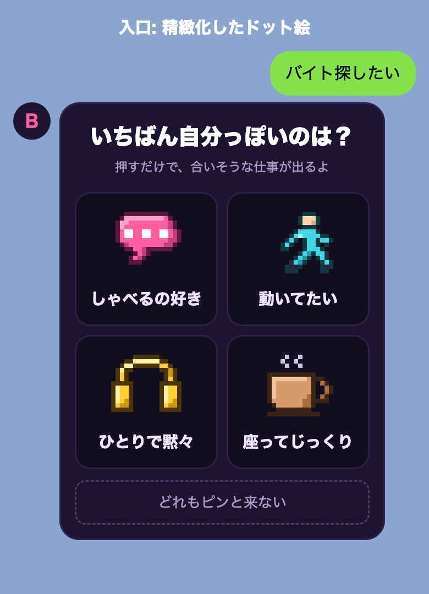
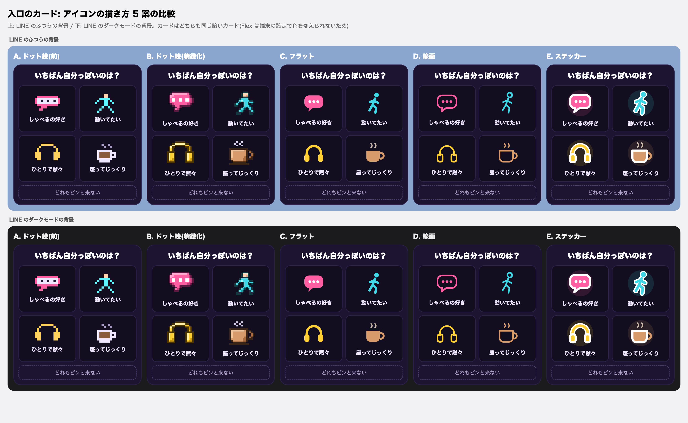

# 設計メモ: アルバイトの相談を 1 タップで始める

日付: 2026-10-27。状態: 提案。対象: アルバイト・パートの相談(`dip_mcp/baito/`、PRD v4.1)の始まり方と、LINE のトークの見せ方。

## 1. 結論

- 入口は、絵 4 枚のカード 1 枚だけにする。問いは「いちばん自分っぽいのは？」。問題の数も「診断」の文字も出さない。
- **1 タップ目で、合いそうな職種を 3 つ出す。**
- HARD の条件は、本人が「近くで探す」を押したときだけ聞く(年齢、エリア、時間帯の 3 タップ)。4 タップ目で本物の求人を出す。
- そのほかの条件(週の日数、通勤、時給など)は、求人を見た後の「もっと絞る」で、今のハーネスの流れのまま聞く。
- アイコンは、16×16 の手描きのドット絵(ふち・ハイライト・影つき)。カードは暗い色 1 つで、字はふつうのゴシック。

## 2. なぜ

利用者の意見(2026-10-27、要旨):

- 質問が多すぎる。本人は基本、短気。
- 「30 秒バイト診断(10 問)」のような、どこにでもある診断の入口は、見た瞬間に興味がなくなる。
- 4 つの職種から選ばせると、範囲が狭い。どれも嫌な人が多い。
- 「どれならガマンできる？」はネガティブすぎる。
- UI が雑だとワクワクしない。

[hearing-progress-ui.md](hearing-progress-ui.md) の帯とプロフィールカードは、入力の進み具合しか見せず、ワクワクが無いと判断された。アルバイトの始まり方は、このメモで置き換える。

## 3. 流れ

| タップ | 本人がすること | 返すもの |
|---|---|---|
| 0 | 「バイト探したい」などで相談を始める | 入口のカード(§4) |
| 1 | 4 枚のどれか、または「どれもピンと来ない」を押す | 合いそうな職種 3 つ(§5)と、[近くで探す] [ほかのタイプも見る] |
| 2 | [近くで探す] | 「3 つだけ！年齢は？」(ボタン) |
| 3 | 年齢 | 「どのあたりで？」(東京 / 神奈川 / 埼玉 / どこでも) |
| 4 | エリア | 「いつ働けそう？」(朝 / 昼 / 夕方 / 夜) |
| 5 | 時間帯 | 本物の求人のカルーセル(§6)と、[もっと絞る] [ちがう] |
| 6〜 | [もっと絞る] | 今のハーネスの流れで、残りの条件を聞く(§7) |

- 職種の結果まで 1 タップ、本物の求人まで 4 タップ(タップ 2〜5)。
- 「ほかのタイプも見る」は入口のカードをもう一度出す。「ちがう」は、求人を見た後に好みを直す入口。

## 4. 入口のカード



| 絵 | 文字 | 入れる値(確信度は low) |
|---|---|---|
| ふきだし | しゃべるの好き | `customer_facing` = `like` |
| 走る人 | 動いてたい | `physical` = `standing_ok` |
| ヘッドホン | ひとりで黙々 | `customer_facing` = `avoid` |
| コーヒー | 座ってじっくり | `physical` = `seated` |
| (下のボタン) | どれもピンと来ない | 値は入れない。「ちょっとだけ」系(§5)へ |

- 問いと文字は、前向きな言い方にする(「自分っぽい」「好き」「たい」)。「ガマン」「ムリ」は使わない。
- 4 枚で、2 つの軸(人と話す / 黙々、動く / 座る)の両端を押さえる。カタログの 24 職種は、どれかに当たる。
- 値の確信度は low にする。1 タップの粗い読みなので、後で本人が直せるようにするため(PRD v4.1 の確信度の決まりのまま)。

## 5. 1 タップ目の結果

```
┌──────────────────────┐
│ [ヘッドホン] ひとりで黙々           │
│ にぴったりの仕事                    │
│ 1 スーパーの品出し     朝もOK       │
│ 2 工場の軽作業        静か          │
│ 3 飲食店のキッチン     接客少なめ    │
│ [近くで探す ▶] [ほかのタイプも見る]  │
└──────────────────────┘
```

- 職種は、今のハーネスの `eligible_jobs` で、入れた値から並べた上位 3 つ。
- 年齢がまだ分からないので、未成年として扱う(`eligible_jobs` は年齢が不明なら未成年の決まりで絞る)。18 歳からの職種と重い作業は出ない。
- 職種の横のタグは、カタログの値だけから作る(`times` に朝がある → 「朝もOK」、`noise` が quiet → 「静か」、`cf` が low → 「接客少なめ」)。カタログに無いこと(まかない、時給など)は書かない。
- 「どれもピンと来ない」には、カタログの `remote` か `spot` が true の職種から 3 つを出す。見出しは「ちょっとだけ」、吹き出しは「それなら、まずは『ちょっとだけ』から試すのもアリ！」。
- リアクションの吹き出し(「黙々派ね。…」)は、生成の段(モデル)が作る。職種とタグは、コードが決める。

## 6. 「近くで探す」と本物の求人

- 聞くのは 3 つ。年齢(`age_band`)、エリア、時間帯(`time_slots`)。どれもボタンで答える。打った答えの読み方は、今の決まり(task 258)のまま。
- 求人は、dip の `recommend` で探す。渡すのは、エリア(`AREA_GROUPS` の広い言い方)、時間帯、1 タップ目の値から作る `max_talk_level` / `min_talk_level` / `max_physical_level` / `min_physical_level`。
- 返すのは、今の求人のカルーセル(`line_channel._cards_message`)。吹き出しは「昼・東京で、手を動かす仕事は 9 件！」のように、件数と、効いた条件を言う。件数は検索の結果の数を、そのまま使う。
- **0 件のとき**は、件数を言わずに、1 つ条件を外した件数を出す(「時間帯を外すと 12 件」)。黙って 0 件にしない。
- **中学生**は、求人を出さない(今の決まり。task 258)。
- **未成年**は、深夜の時間帯を選べない(ボタンに出さない)。深夜 NG は今のまま、コードで強制する。

## 7. その後(「もっと絞る」)

- [もっと絞る] を押すと、今のハーネス(PRD v4.1)の流れに入る。区分、残りの HARD(週の日数、通勤、区分ごとの HARD)、MID を聞く。すでに入った値は聞かない。
- [hearing-progress-ui.md](hearing-progress-ui.md) の帯とプロフィールカードは、この「もっと絞る」の間だけ出す。入口から求人までの 4 タップには出さない。
- review と結果は、今のまま。

## 8. アイコンとカードの見た目



- 5 つの描き方(ドット絵の前の版、ドット絵の精緻化、フラット、線画、ステッカー)から、**B: ドット絵の精緻化**を選んだ(利用者、2026-10-27)。
- 16×16 のマスに、1 つのアイコンで 4〜5 色(ふち、ハイライト、ベース、影)。描いたデータは [sprites.json](../images/baito-quick-start/sprites.json)(各マスの色)。今の 4 枚のほかに、「ちょっとだけ」の絵を 1 枚足す。
- LINE の Flex には、64×64 の PNG(1 マス 4 px)にして、Render の static から出す。`image-rendering` は Flex で指定できないので、拡大しない大きさで作る。
- カードは暗い色(`#1c1430`)1 つ。Flex は、端末のライト・ダークで色を変えられない(公式の資料に無い。推測)。暗いカードは、LINE のふつうの背景でもダークモードの背景でも読めた(写真で確かめた)。
- 字は、LINE のふつうのゴシック。ドット絵のフォントは使わない(やりすぎ、と判断された)。
- 実機の LINE では、まだ見ていない。

## 9. ハーネスとの関係

- ハーネスに、最初のフェーズ `quick_pick` を足す。何を聞くか、いつ求人を出すかは、今までどおりハーネスが決める。モデルは、リアクションの 1 行だけを作る。
- PRD v4.1 のフェーズの順(icebreak → hard_filter → …)は、「もっと絞る」に入ってから使う。PRD を直すかは、利用者が決める(このメモが、アルバイトの始まり方の正)。
- 機能フラグ `BAITO_HARNESS_VERSION` は今のまま。v4 のときだけ、この始まり方になる。

## 10. 確かめ方

- 入口から職種の結果まで 1 タップ、本物の求人まで 4 タップで着くテスト(偽のモデルで、ランタイムを通す)。
- 1 タップ目の結果に、18 歳からの職種と重い作業が出ないテスト。タグがカタログの値だけから作られるテスト。
- 0 件のときに、1 つ外した件数が出るテスト。中学生に求人が出ないテスト。
- モックの 20 ペルソナ(`evals.baito_sim`)が通る(「もっと絞る」の後の流れ)。
- 画面の写真(入口、結果、「ちょっとだけ」、求人)を `docs/images/` に置く。実機の LINE で見ていないことを、確かめていないこととして書く。

## 11. 決めたこと、決めていないこと

決めたこと(2026-10-27、利用者):

1. 入口は「いちばん自分っぽいのは？」の絵 4 枚と「どれもピンと来ない」。
2. 1 タップで職種を出し、HARD は「近くで探す」を押したときだけ聞く。
3. アイコンは B(ドット絵の精緻化)。カードは暗い色、字はふつう。

決めていないこと:

- アイコンを、今の手描きのまま使うか、素材やデザイナーで作り直すか。
- 週の日数を「近くで探す」の 3 つに入れるか。今の `recommend` は週の日数で絞れないので、入れるなら `recommend` に足す。
- 正社員のヒアリングにも、同じ始まり方を使うか。

## 12. タスク

| 順 | タスク | 先に要るもの |
|---|---|---|
| 1 | アイコン: sprites.json から 64×64 の PNG を作るスクリプトと、5 枚の PNG(static) | このメモのマージ |
| 2 | 入口と 1 タップ目の結果: `quick_pick` フェーズ、入口のカード、職種の結果、「ちょっとだけ」、[ほかのタイプも見る] | 1 |
| 3 | 「近くで探す」と求人: 3 タップ、`recommend` へのつなぎ、0 件の扱い、[もっと絞る] で今の流れへ | 2 |
