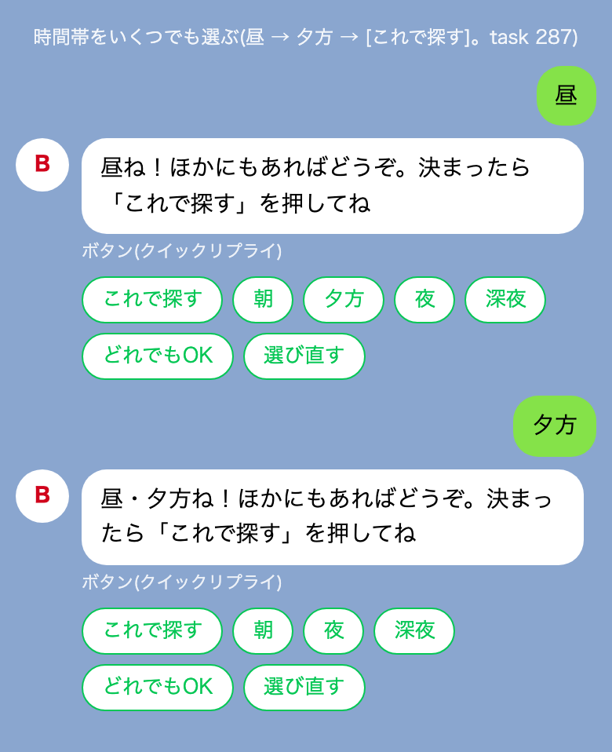

# 設計メモ: アルバイトの相談を 1 タップで始める

日付: 2026-10-27。状態: 提案。対象: アルバイト・パートの相談(`dip_mcp/baito/`、PRD v4.1)の始まり方と、LINE のトークの見せ方。

## 1. 結論

- 入口は、絵 4 枚のカード 1 枚だけにする。問いは「いちばん自分っぽいのは？」。問題の数も「診断」の文字も出さない。
- **入口の絵を 1 回押すと、合いそうな職種を 3 つ出す。**
- HARD の条件は、本人が「近くで探す」を押したときだけ聞く(年齢、エリア、時間帯)。入口から数えて 5 タップ目(時間帯を選んで [これで探す] なら 6 タップ目以降。§6.2)で、本物の求人を出す。
- そのほかの条件(週の日数、通勤、時給など)は、求人を見た後の「もっと絞る」で、今のハーネスの流れのまま聞く。
- 未成年の決まり(深夜を出さない、重い作業を出さない、中学生に求人を出さない)は、求人の検索でもコードで強制する。
- アイコンは、16×16 の手描きのドット絵(ふち・ハイライト・影つき)。カードは暗い色 1 つで、字はふつうのゴシック。

## 2. なぜ

利用者の意見(2026-10-27、要旨):

- 質問が多すぎる。本人は基本、短気。
- 「30 秒バイト診断(10 問)」のような、どこにでもある診断の入口は、見た瞬間に興味がなくなる。
- 4 つの職種から選ばせると、範囲が狭い。どれも嫌な人が多い。
- 「どれならガマンできる？」はネガティブすぎる。
- UI が雑だとワクワクしない。

[hearing-progress-ui.md](hearing-progress-ui.md) の帯とプロフィールカードは、入力の進み具合しか見せず、ワクワクが無いと判断された。アルバイトの始まり方は、このメモで置き換える。

## 3. 流れ

| タップ | 本人がすること | 返すもの |
|---|---|---|
| 0 | 「バイト探したい」などで相談を始める | 入口のカード(§4) |
| 1 | 4 枚のどれか、または「どれもピンと来ない」を押す | 合いそうな職種 3 つ(§5)と、[近くで探す] [ほかのタイプも見る] |
| 2 | [近くで探す] | 「3 つだけ！年齢は？」(中学生以下 / 15〜17歳 / 18歳以上 / ひみつ) |
| 3 | 年齢 | 「どのあたりで？」(東京 / 神奈川 / 埼玉 / どこでも) |
| 4 | エリア | 「いつ働けそう？（いくつでも選べるよ）」(§6.2 のボタンと [どれでもOK]) |
| 5 | 時間帯(いくつでも押せる) | 「昼ね！…」と、[これで探す]、残りの時間帯、[どれでもOK]、[選び直す] |
| 6 | [これで探す] | 本物の求人のカルーセル(§6)と、[もっと絞る] [ちがう] |
| 6〜 | [もっと絞る] | 今のハーネスの流れで、残りの条件を聞く(§7) |

- 職種の結果まで 1 タップ、本物の求人まで 6 タップ([どれでもOK] なら 5 タップ)。
- 「ほかのタイプも見る」は、入口のカードをもう一度出す。「ちがう」は、入口のカードを出し直して好みを選び直す。
- 年齢で「中学生以下」を押したら、そこで止める(求人に進まない。今の決まり)。

## 4. 入口のカード

| 絵 | 文字 | ハーネスに入れる値(確信度 low) | 求人の検索に渡す値 |
|---|---|---|---|
| ふきだし | しゃべるの好き | `customer_facing` = `like` | `min_talk_level` = 3 |
| 走る人 | 動いてたい | `physical` = `standing_ok` | `min_physical_level` = 2 |
| ヘッドホン | ひとりで黙々 | `customer_facing` = `avoid` | `max_talk_level` = 2 |
| コーヒー | 座ってじっくり | `physical` = `seated` | `max_physical_level` = 1 |
| (下のボタン) | どれもピンと来ない | 値は入れない | 渡さない |

- 問いと文字は、前向きな言い方にする(「自分っぽい」「好き」「たい」)。「ガマン」「ムリ」は使わない。
- 4 枚で、2 つの軸(人と話す / 黙々、動く / 座る)の両端を押さえる。
- 値の確信度は low にする。1 タップの粗い読みなので、「もっと絞る」で本人が直せるようにするため。`quick_pick` の答えは `DIRECT` に入れない。
- 求人の検索に渡す値の 1〜3 は、求人の `talk_level` と `physical_level` の段階(`dip_mcp/data.py`)。

## 5. 1 タップ目の結果

- 職種は、ハーネスの `eligible_jobs` で並べた上位 3 つ。年齢が分からないので未成年として扱う(`minor_mode`)。18 歳からの職種と重い作業は出ない。
- **`eligible_jobs` に 1 つ足す**: `physical` が `standing_ok` のとき、`phys` が standing の職種に +1、`noise` が lively の職種に +0.5。今は `standing_ok` に点が無く、「動いてたい」の結果がカタログの順(「しゃべるの好き」とほぼ同じ)になるため。
- 今のコードで年齢が不明のときの結果(main で `eligible_jobs` を動かした):

| 押した絵 | 上位 3 つ |
|---|---|
| しゃべるの好き | コンビニスタッフ / スーパーのレジ / カフェスタッフ |
| 動いてたい | (上の +1 を足した後に決まる。今はコンビニスタッフ / スーパーのレジ / スーパーの品出し) |
| ひとりで黙々 | スーパーの品出し / 飲食店のキッチン / データ入力 |
| 座ってじっくり | データ入力 / 書店スタッフ / 清掃スタッフ |

- **職種の横のタグ**は、カタログの値から 1 つだけ選ぶ。次の順で、最初に当たるものにする。カタログに無いこと(まかない、時給など)は書かない。
  1. `remote` が true → 「在宅」
  2. `spot` が true → 「1日だけOK」
  3. `cf` が none → 「人と話さない」
  4. `cf` が low → 「接客少なめ」
  5. `noise` が quiet → 「静か」
  6. `noise` が lively → 「にぎやか」
  7. `times` に morning がある → 「朝もOK」
  8. どれにも当たらなければ、タグを付けない
- 例(ひとりで黙々): スーパーの品出し「接客少なめ」/ 飲食店のキッチン「接客少なめ」/ データ入力「在宅」。
- **「どれもピンと来ない」**には、カタログの `remote` か `spot` が true の職種から、未成年の決まり(18 歳から、重い作業、深夜だけ)で外した残りを、カタログの順に 3 つ出す。今のカタログでは、イベントスタッフ(案内・誘導) / データ入力 / ポスティング。見出しは「ちょっとだけ」、吹き出しは「それなら、まずは『ちょっとだけ』から試すのもアリ！」。
- リアクションの吹き出し(「黙々派ね。…」)は、生成の段(モデル)が作る。職種とタグは、コードが決める。

## 6. 「近くで探す」と本物の求人

### 6.1 聞くこと

- 聞くのは 3 つ。年齢(`age_band`)、エリア、時間帯(`time_slots`)。どれもボタンで答え、確信度は high。打った答えの読み方は、今の決まり(task 258)のまま。
- 年齢で「ひみつ」を押した人は、今の決まりのまま未成年として扱い、次へ進む。

### 6.2 時間帯のボタンと、言葉の対応

| ボタン | ハーネスの `time_slots` | 求人の検索の `time_band`(求人の `time_bands` の言葉) | 出す人 |
|---|---|---|---|
| 朝 | morning | 早朝 | 全員 |
| 昼 | daytime | 日中 | 全員 |
| 夕方 | evening | 夕方 | 全員 |
| 夜 | evening | 夜 | 18 歳以上だけ |
| 深夜 | late_night | 深夜 | 18 歳以上だけ |

- 今の `recommend` の `time_band` は、求人の `time_bands` の言葉と文字が一致するかだけを見る。ボタンの言葉をそのまま渡すと 0 件になるので、必ずこの表で直してから渡す。
- 未成年(15〜17 歳、ひみつ)には、「夜」と「深夜」のボタンを出さない。
- 時間帯はいくつでも選べる(task 287。利用者の「昼 夕方 夜全部OK 何で1つしか選べないの？」から)。LINE のクイックリプライは
  1 回押すと 1 つの発言になるので、押すたびに足していく形にする。
  - 押した時間帯はボタンから消し、吹き出しで「昼・夕方ね！ほかにもあればどうぞ。決まったら「これで探す」を押してね」と言う。
    ボタンは [これで探す](先頭)、残りの時間帯、[どれでもOK]、[選び直す](選んだものを空にする)。モデルは呼ばない。
  - [これで探す] で決める。[どれでもOK] は出しているボタン(未成年なら朝・昼・夕方)を全部選んで、すぐ決める。
    出しているボタンを全部押したときも、そこで決める。
  - 打った答えは、ボタンの言葉と「全部」「だけ」、つなぎの言葉(と・も・OK など)だけでできていれば読む。2 つ以上
    (「昼と夕方」「昼 夕方 夜全部OK」)なら足して決める。「〜だけ」は前に押したものと入れ替えて決める。1 つ(「夕方も」)なら足すだけ。それ以外(「朝〜夕方」「朝から夕方まで」のような範囲も)は読まず、
    「下のボタンから選んでね！」で聞き直す。未成年が「夜」「深夜」を打っても読まない。
  - 求人の検索には、選んだ時間帯を §6.2 の表で直した `time_band` の list で渡す。どれか 1 つに合う求人を出す。
    全部選んだときは、吹き出しで時間帯を言わない(「東京で、〜は 9 件！」)。
  - 決めた時間帯は `time_slots`(確信度 high)に入り、相談を閉じるとプロフィールの「時間帯」に「昼・夕方〜夜」のように保存する。
    前の相談で 1 つの文字で持っている答えも、そのまま読む。
  - 画面の写真(LINE をまねた HTML。実機ではない): 

### 6.3 未成年の決まりを、求人の検索でも強制する

今の `logic.recommend` には年齢の引数が無い。中学生を止める処理(`dip_mcp/baito/session.py` の `job_block`)は、MCP のツールの層にしか無い。なので、次を足す。

- `recommend` と `relax` に、未成年かどうかの引数を足す。`relax` では、この引数を外す候補にしない(「未成年を外すと N 件」を出さないため)。未成年のときは、次の求人を外す。
  - `time_bands` に「深夜」がある求人
  - `shift` の終わりの時刻が 22 時より後の求人。`shift` の文から時刻が読めない求人も外す(安全側)。例:「居酒屋 18:00〜翌1:00」は外す。
  - `physical_level` が 3 の求人
  - `shift` の始まりの時刻が 5 時より前の求人(今の求人には無いが、法律の深夜の範囲に入るため)
- 中学生には、検索の前に止める(`job_block` と同じ扱い)。
- ハーネスとランタイムは、未成年のとき必ずこの引数を付けて呼ぶ。付け忘れを防ぐため、年齢が不明のときも未成年として呼ぶ。

### 6.4 返すもの

- 求人は、`recommend` で探す。渡すのは、エリア(`AREA_GROUPS` の広い言い方)、§6.2 で直した時間帯、§4 の talk・physical の値、未成年かどうか。
- 返すのは、今の求人のカルーセル(`line_channel._cards_message`)。吹き出しは「昼・東京で、手を動かす仕事は 9 件！」のように、件数と効いた条件を言う。件数は検索の結果の数を、そのまま使う。
- **0 件のとき**は、今の `relax`(条件を 1 つずつ外した件数を返す)を使い、いちばん件数の増える 1 つを出す(「時間帯を外すと 12 件」)。黙って 0 件にしない。

## 7. その後(「もっと絞る」)

- [もっと絞る] を押すと、今のハーネス(PRD v4.1)の流れに入る。区分、残りの HARD(週の日数、通勤、区分ごとの HARD)、MID を聞く。すでに入った値は聞かない。
- [hearing-progress-ui.md](hearing-progress-ui.md) の帯とプロフィールカードは、この「もっと絞る」の間だけ出す。入口から求人までには出さない。
- review と結果は、今のまま。

## 8. アイコンとカードの見た目

- 5 つの描き方(ドット絵の前の版、ドット絵の精緻化、フラット、線画、ステッカー)から、**B: ドット絵の精緻化**を選んだ(利用者、2026-10-27)。
- 16×16 のマスに、1 つのアイコンで 4〜5 色(ふち、ハイライト、ベース、影)。描いたデータは [sprites.json](../images/baito-quick-start/sprites.json)(各マスの色)。入口の 4 枚(`talk`、`move`、`solo`、`sit`)と、「ちょっとだけ」の芽(`light`)の 5 枚。
- LINE の Flex には、64×64 の PNG(1 マス 4 px)にして、Render の static から出す。Flex では拡大の補間を指定できないので、表示する大きさで作る。
- カードは暗い色(`#1c1430`)1 つ。Flex は、端末のライト・ダークで色を変えられない(公式の資料に無い。推測)。暗いカードは、LINE のふつうの背景でもダークモードの背景でも読めた(写真で確かめた)。
- 字は、LINE のふつうのゴシック。ドット絵のフォントは使わない(やりすぎ、と判断された)。
- 実機の LINE では、まだ見ていない。

## 9. ハーネスとランタイムの受け持ち

- **ハーネス**(`dip_mcp/baito/`):
  - 新しい相談は、最初のフェーズ `quick_pick` から始める。途中の相談(今の State を持つもの)は、今の流れのまま続ける。
  - `quick_pick` の後に、「近くで探す」の 3 問のフェーズを置く。何を聞くか、いつ求人を出すかは、ハーネスが決める。モデルは、リアクションの 1 行だけを作る。
  - ターンの結果で、入口のカード、職種の結果、求人の検索の条件をランタイムに渡す。
- **dip**(`dip_mcp/logic.py`): `recommend` と `relax` に、未成年の引数(§6.3)を足す。
- **ランタイム**(`line_runtime/runtime.py` の `_baito_turn`、`line_runtime/line_channel.py`):
  - 今の `_baito_turn` は、文とクイックリプライ(と帯の Flex)しか返せない。求人のカードは、トークの AI のツールの結果からしか作らない。
  - 入口のカード(絵 4 枚と下のボタン。押すと、その文字を本人の発言として送る)、職種の結果のカード、求人のカルーセルを、ハーネスのターンの結果から作れるようにする。
  - Web のトーク(`talk-core.js`)では、入口のカードと職種の結果を、文とボタンに落とす。
- 機能フラグ `BAITO_HARNESS_VERSION` は今のまま。v4 のときだけ、この始まり方になる。
- PRD v4.1 のフェーズの順は、「もっと絞る」に入ってから使う。PRD を直すかは、利用者が決める(このメモが、アルバイトの始まり方の正)。

## 10. 確かめ方

- 入口から職種の結果まで 1 タップ、本物の求人まで 7 タップ(時間帯 2 つと [これで探す])で着くテスト(偽のモデルで、ランタイムを通す)。
- 1 タップ目の結果に、18 歳からの職種と重い作業が出ないテスト。タグが §5 の順で、カタログの値だけから選ばれるテスト。
- 「動いてたい」と「しゃべるの好き」の結果が、同じ 3 つにならないテスト。
- 未成年に、「夜」「深夜」のボタンが出ず、深夜・22 時より後に終わる・`physical_level` 3 の求人が出ないテスト。年齢が不明のときも同じ。中学生に求人が出ないテスト。
- 時間帯のボタンが、§6.2 の表どおりに `time_band` に直るテスト。
- 0 件のときに、`relax` の 1 つが出るテスト。
- モックの 20 ペルソナ(`evals.baito_sim`)が通る(「もっと絞る」の後の流れ)。
- 画面の写真(入口、結果、「ちょっとだけ」、求人)を `docs/images/` に置く。実機の LINE で見ていないことを、確かめていないこととして書く。

## 11. 決めたこと、決めていないこと

決めたこと(2026-10-27、利用者):

1. 入口は「いちばん自分っぽいのは？」の絵 4 枚と「どれもピンと来ない」。
2. 1 タップで職種を出し、HARD は「近くで探す」を押したときだけ聞く。
3. アイコンは B(ドット絵の精緻化)。カードは暗い色、字はふつう。

決めていないこと:

- アイコンを、今の手描きのまま使うか、素材やデザイナーで作り直すか。
- 週の日数を「近くで探す」の 3 つに入れるか。今の `recommend` は週の日数で絞れないので、入れるなら `recommend` に足す。
- 正社員のヒアリングにも、同じ始まり方を使うか。

## 12. タスク

| 順 | タスク | 先に要るもの |
|---|---|---|
| 1 | 未成年の検索と時間帯: `recommend` と `relax` の未成年の引数(§6.3)、時間帯の対応(§6.2)、そのテスト | このメモのマージ |
| 2 | アイコン: sprites.json から 64×64 の PNG を作るスクリプトと、5 枚の PNG(static) | このメモのマージ |
| 3 | 入口と 1 タップ目の結果: `quick_pick` フェーズ、`eligible_jobs` の `standing_ok` の加点、タグ、「ちょっとだけ」、入口のカードと職種の結果のカード(ランタイムと line_channel)、Web の文 | 2 |
| 4 | 「近くで探す」と求人: 3 問のフェーズ、未成年のボタン、`recommend` へのつなぎ、0 件の `relax`、求人のカルーセル、[もっと絞る] で今の流れへ | 1、3 |
