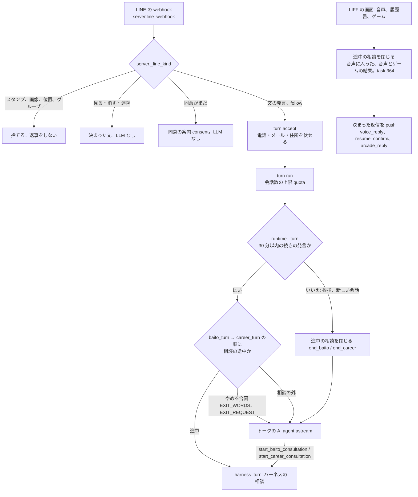
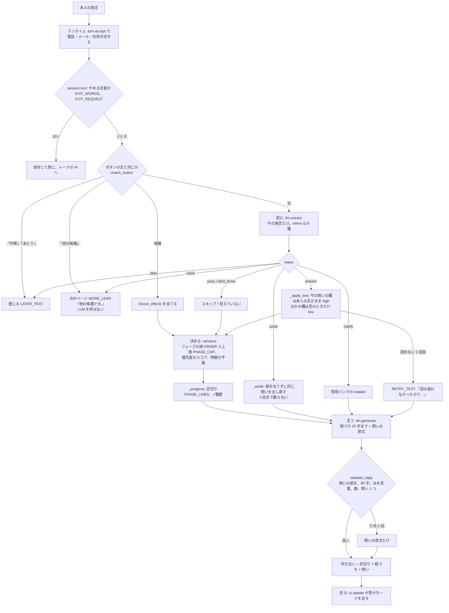
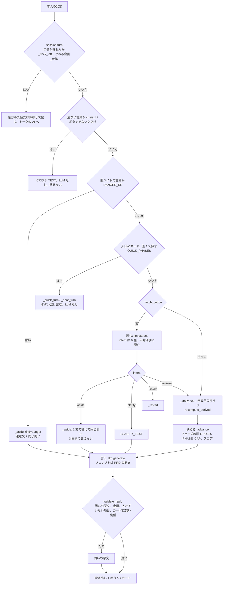

# 会話の層を設計し直す: 全部の入り口に共通にする(設計メモ、2026-10-28)

LINE のトークで本人と話す全部の入り口(アルバイト・パートの相談、正社員ヒアリング、トークの AI と、そのほかの入り口)に共通する、
会話の受け答えの作りを設計し直す。本番の LINE で運営者が正社員ヒアリングを試し、「アホすぎ」と言った(jyoka/tasks#326 のトーク)。
運営者は、どの入り口から始まっても同じ要求になると追記した。硬い流れから、雑談や脱線にも自然に応じる形に、入り口をまたいで直す。
目に見える不具合は #326 が今の作りのまま直す。このメモは、その上の作りの見直しで、実装はまだしない(task 327)。
決めたことは [ADR-0011](../adr/0011-conversation-layer.md) にある。

## 1. 結論

- **会話の層を、全部の入り口に共通の部品にする。** 置き場所は dip の `dip_mcp/convo/`(新しい)。入り口ごとに違うもの
  (欄、質問バンク、事実、言い回しの調子、決まった文、上限、画面)は「入り口の定義」(データ)にする。新しい入り口は、
  層を作り直さずに、入り口の定義を足すだけで同じ振る舞いになる(§4.1)
- **1 ターンは 3 段(読む → 決める → 言う)のまま、段ごとの受け持ちを広げる。** 何を聞くか、値の確かさ、いつ終えるかは、
  今と同じくハーネスが決める。LLM に何を聞くかを任せる作り(エージェント)には戻さない
- **読む: 発言を 1 つの intent でなく、複数の「発言の働き」(act)で読む。** 答え、ほかの欄の答え、直す、取り消す、迷う、雑談、
  逆質問、感情、危ない話、**別の入り口の話**などを、1 つの発言から同時に取る。雑談の中の値も捨てない
- **決める: ハーネスが「応じ方の計画」を作る。** 何に応じるか、渡す事実、区切りの 1 行、次の問いを、返事の部品の並びにする。
  問いの順は固い順でなく、今分かっていることから選ぶ。前の答えから推せる欄は聞かずに、まとめで確かめる
- **言う: LLM は計画から 1 つの返事を書く。** 部品の順、言い回しの重複、事実を作らないことは、ハーネスが確かめる。
  問いの文は質問バンクに 2〜3 通りの言い方を置き、そこから選ぶ(自由な言い換えはさせない)。言い回しの調子は入り口の定義に置く
- **入り口を途中で変えられる。** 「やっぱり正社員で」は、その場で次の入り口へ移り、分かっている値を引き継ぐ。
  「正社員も考えてる」は移らずに、移るボタンを出す。値は共通の値(dip の希望の項目と、新しい引き継ぎの記録)で渡し、
  移った先で聞き直さない。年収と時給のような換算はしない(数を作らない)(§4.5)
- **入り口ごとの扱いを分ける**(§4.13)
  - 正社員ヒアリングとアルバイト・パートの相談は、層に載せ替える(`CAREER_HARNESS_VERSION=c2`、`BAITO_HARNESS_VERSION=v5`)
  - トークの AI はエージェントのまま。共通の守りの前処理、事実のデータ、共通の値だけを足す(`TALK_LAYER_VERSION=t1`)
  - 履歴書の確認、ゲームの後、音声相談の後、同意は、LLM を呼ばない決まった返信のまま、層に入れない
  - 音声相談(`voice_resume/`)の会話そのものも層に入れない。共通にするのは、事実のデータ、危ない言葉の表、共通の値だけ
- **守りは今の決まりを残し、足りないものを足す。** 事実を作らない(ADR-0003)、数字は本人の発言にあるものだけ、回数と時間の上限は今のまま。
  危ない言葉(希死念慮)の確かめは、今はアルバイト・パートの相談の中にしかない。これを層の前処理にして、全部の入り口で LLM の前に見る
- **1 ターンの LLM の呼び出しは、どの入り口も今と同じ数**(ハーネスは 2 回、上限 4)。入り口を移すターンは、トークの AI を挟まないので減る
- **物差しは場面の一覧**(`evals/scenes/`。入り口ごとと、入り口をまたぐもの)。入り口をまたいで同じ形で、コードで判定する条件と LLM の採点の条件で書く
- **移る順は、正社員 → アルバイト・パート → トークの AI。** 入り口ごとに環境変数で切り替え、始めた相談は始めた版のまま最後まで進める(§4.15)

## 2. 今の作りの棚卸し

調べたのは 2026-10-28 の main(`86ba60e`)。読んだもの:

- 正社員: [fulltime-hearing.md](fulltime-hearing.md)、[ADR-0010](../adr/0010-fulltime-hearing-harness.md)、
  `dip_mcp/career/harness.py`、`bank.json`、`session.py`、`store.py`、`dip_mcp/prompts/career/`、`line_runtime/career_chat.py`
- アルバイト・パート: [ADR-0009](../adr/0009-baito-consultation-harness.md)、`dip_mcp/baito/harness.py`、`session.py`、
  `bank_v4.json`、`crisis_v4.json`、`line_runtime/baito_chat.py`、`baito_cards.py`
- 振り分けとほかの入り口: `line_runtime/server.py`、`turn.py`、`runtime.py`、`agent.py`、`resume_confirm.py`、`arcade_reply.py`、
  `voice_reply.py`、`voice_rooms.py`、`consent.py`、`dip_mcp/prompts/entries.json`、`dip_mcp/logic.py`
- 音声相談: `voice_resume/agent.py`、`advisor.py`、`config.py`

このメモでは、1 ターンの 3 段を「読む」(今の抽出、Stage 1)、「決める」(判断、Stage 2)、「言う」(生成、Stage 3)と呼ぶ。

### 2.1 入り口と振り分け

LINE の 1 つのイベントは、次の順で入り口に振り分けられる。



| 入り口 | 始まり方 | 1 ターンの処理 | 1 ターンの LLM | 返事の文 |
|---|---|---|---|---|
| トークの AI(入口 A、挨拶 visit / revisit) | 相談の外の発言、follow | `agent.build_agent`(LangGraph)。dip のツールで事実を取る | 上限 10 回(`MAX_MODEL_CALLS_PER_TURN`)。平均は測っていない(不明) | LLM が書く。挨拶の入口のボタンはコード(`greeting_entries`) |
| アルバイト・パートの相談(v4) | トークの AI が `start_baito_consultation` を呼ぶ | §2.3 | ボタン 1 回、打った文 2 回、上限 4 回 | 固定の文が多い(`NOTICE`、`RETRY_TEXT` など) |
| 正社員ヒアリング(c1) | トークの AI が `start_career_consultation` を呼ぶ | §2.2 | ボタン 1 回、打った文 2 回、上限 4 回 | 固定の文と、LLM の 25 字の相づち |
| 履歴書の確認 | LIFF で送る | 読み取り → `resume_confirm.resume_bubbles`(コード)→ トークの AI のターン | 読み取り 1 回 + トークの AI | 決まった文(`INTRO`、`EMPTY`) |
| ゲームの後 | LIFF で下書きを保存 | `arcade_reply` → `add_arcade_result` → push | 0 回 | 決まった文 |
| 音声相談の後 | 音声のワーカーが結果を送る | `voice_reply` → `add_voice_result` → push | 0 回 | 決まった文(`INTRO`、`NO_ITEMS`) |
| 同意、見る・消す、連携 | 最初の発言、決まった言葉 | `consent`、`_line_data` | 0 回 | 決まった文 |
| 音声相談(LiveKit) | LIFF の画面 | `voice_resume/agent.py` の 1 つのエージェント。文字起こし → LLM → 読み上げ | 発話ごと | LLM が話す |

- リッチメニューはイベントを作らない。「求人を探す」はふつうの発言として届く。音声、履歴書、ゲームは LIFF の画面を直に開く
- 入り口の間で値を渡すのは、dip の状態だけ。希望の項目(`stated_preferences`。名前は `logic.PREFERENCE_KEYS`)、区分(`search_track`)、
  正社員の `career_profile`、相談のまとめ。正社員は始めるときに希望の項目を読んで聞かない(`career/store.prefill`)。
  アルバイト・パートは始めるときに読まない(`baito/session.start`)
- ハーネスが希望の項目に書くのは、相談を終えたときと、途中で閉じたときだけ。どちらも確かめた値(high)だけ(`baito/session.result_preferences`)

### 2.2 正社員ヒアリング(c1)の 1 回の発言



- LLM の呼び出しは、ボタンの答えで 1 回(言う)、打った答えで 2 回(読む + 言う)。まとめ、結果、「他の候補」は 0 回。
  出力が壊れたら 1 回やり直す。上限は 1 ターン 4 回(`session.MAX_LLM_CALLS`)
- モデルは `LINE_SIM_MODEL`(既定 `claude-sonnet-5-5`)を、思考を切って呼ぶ(`baito_chat.default_llm` を流用)
- 読む段に渡すのは今の発言だけ(`baito_chat.messages_for`)。言う段には直前のやりとり 8 件(`HISTORY_MESSAGES`)を渡す

### 2.3 アルバイト・パートの相談(v4)の 1 回の発言



- intent は 6 種(`answer`、`clarify`、`show_result`、`restart`、`aside`、`danger`。`harness.INTENTS`)。直す、迷う、感情、
  「わからない」の行き先は無い。まとめ(review)の外で、今の問いでない欄を言い直すと推測(low)になり、確かめた値(high)を上書きしない(`apply_update` の `low_over_high`)
- LLM の呼び出しは、ボタンの答えで 1 回、打った文で 2 回、上限 4 回(`session.MAX_LLM_CALLS`)。入口のカードと近くで探すは 0 回
- 上限は `MAX_TURNS = 15`、`MAX_ASIDES = 3`、フェーズごとの `PHASE_CAP`。時間の予算は無い(正社員だけにある)
- プロンプト 4 種(`dip_mcp/prompts/baito/`)は PRD の原文のまま。`evals/baito_sim.py` が PRD の単体チェック 131 件と 20 人のペルソナを回す(ADR-0009)
- 言い回しはくだけた話し言葉(「〜だよ」「〜してね」)。正社員は丁寧語。調子は入り口ごとに違ってよい

### 2.4 トークの AI と、そのほかの入り口

- **トークの AI**(`agent.py`)は、LangGraph のエージェント。プロンプトは `PLATFORM_PROMPT`、dip の Prompt(`baitoru_assistant.md` と
  `entries.json`)、`channel_note` をつなぐ。事実は dip のツールで取る(ADR-0003)。何をするかが開いている(求人を探す、使い方、データ、
  相談を始める)ので、質問バンクで聞くことを決める作りではない
- **最初のひとこと。** 入口 A(`entries.json` の `A`)は、挨拶だけで意図が分からないとき、メニュー代わりの選択肢を LLM が出す。
  区分が分からないときの問い方は、プロンプトの中の言葉だけで決まる
- **相談を始めるとき。** トークの AI が `set_search_track` と `get_counseling_playbook` を呼び、playbook の指示で `start_*` を呼ぶ。
  始めた最初の発言の中の値(「正社員で年収 500 万以上」の 500 万)は、ハーネスに渡らない。トークの AI が `save_user_preferences` を呼ぶかは LLM しだい
- **決まった返信の入り口**(履歴書の確認、ゲームの後、音声相談の後、同意)は、どれも LLM を呼ばず、80 字以内の吹き出しを返す。
  その後の本人の発言は、ふつうの発言として §2.1 の振り分けに入る。会話の記録には「[イベント: …]」の本人側の行が残り、トークの AI が読む
- 音声相談とゲームの後(task 364 で確かめて直した): 直す前は、途中のハーネスの相談を閉じず、結果の後の本人の発言がまたハーネスに入っていた。
  本番の組み合わせ(v4、c1、形 D)の E2E(`tests/test_consultation_after_voice_and_game.py`。偽の LLM)で、4 通りとも起きた。
  アルバイト・パートの入口のカードの後に、音声の結果の「条件を変えて探す」かゲームの結果の「求人を探す」を押すと、
  「下のボタンから選んでね！」が選択肢なしで返った(カードは上に流れている)。正社員の「なぜ今」の途中では、押した文を「なぜ今」の答えとして読み、
  「働きたい場所」へ進んだ(偽の LLM は今の問いの答えとして読む。実モデルでどう読むかは確かめていない)
- 今は、アップロードと同じく会話の外のイベントとして閉じる(そこまでの確かめた答えは保存する。`server._end_consultations` →
  `LineRuntime.end_consultations`)。音声は本人が部屋に入ったとき(`/api/voice/session` の joined)に閉じる。音声のワーカーは面談の中で
  希望をその場で保存するので、結果のときに閉じると、閉じるときの保存が音声で話した新しい希望を上書きする(E2E で確かめた)。
  joined の後なら、音声はハーネスで答えた値を読んで聞き直さない。結果を足す前にも閉じる(joined が届かなかったとき)。ゲームは下書きの保存のときに閉じる。
  結果の後の発言はトークの AI が受け、相談と結果のターンを文脈に読む。相談の続きに戻さないのは、本人の次の発言が結果の返信(と選択肢)への
  返事で、前の問いの答えではないため。続けたければ、トークの AI がもう一度始める(正社員は保存した項目を聞かない。アルバイト・パートの v4 は初めから)

### 2.5 入り口の間で、同じことを別々に作っている所

| 同じこと | アルバイト・パート | 正社員 | ほかの入り口 |
|---|---|---|---|
| 発言の種類(intent) | `baito/harness.INTENTS`(6 種) | `career/harness.INTENTS`(8 種、別の一覧) | トークの AI は種類に分けない |
| 抽出の出力の型 | `baito_chat.ExtractOut` | `career_chat.ExtractOut` | - |
| 抽出と返事の検証 | `baito/harness.validate_extract`、`validate_reply` | `career/harness.validate_extract`、`validate_reply` | `runtime.render`(求人の id と URL だけを絞る) |
| LLM のやり直し | `baito/harness._call_llm` | `career/harness._call_llm` | `agent.build_model`、`server.arcade_client`、`voice_resume/voice_llm` |
| ボタンの照らし合わせ | `baito/harness.match_button` | `career/harness.match_button` | - |
| 答えでない発言 | `baito/harness._aside` | `career/harness._aside` | - |
| やめる合図 | `baito/session.EXIT_WORDS`、`EXIT_REQUEST`(正社員へ) | `career/session.EXIT_REQUEST`(バイトへ。`EXIT_WORDS` は読み込み) | 音声は「面談を終える」のパケット |
| 相談の保存と読み出し | `baito/session`(キー `baito`) | `career/session`(キー `career`) | LangGraph の checkpoint |
| 危ない言葉 | `crisis_v4.json`、`crisis_hit`(ここだけ) | 無い | トークの AI、音声相談に無い |
| 80 字の吹き出し | `validate_reply` | `BUBBLE_MAX` | `resume_confirm.MAX_CHARS`、`voice_reply.MAX_CHARS`、`logic.CONVERSATION_RULES` |
| 個人情報 | `scrub_note` | `personal_value`(`career/store.py`) | `turn.accept`、`arcade.scrub_pii`、`voice_resume/advisor.has_pii` |
| 進み具合の画面 | `baito/progress.py`、`progress_ui.py` | `career/ui.py`、`career_ui.py` | - |

すでに共有しているのは、`EXIT_WORDS`、`EXIT_HOLD`、`NeedLLM`、`ReplayLLM`(正社員がアルバイト・パートから読み込む)、
LLM の呼び方(`baito_chat.default_llm`、`messages_for`、`history`)、ランタイムの呼び直しのループ(`runtime.HARNESSES`、`_harness_turn`)。

### 2.6 硬さの原因

今の作りで、#326 のほかにも同じ根から出る不具合を確かめた。正社員の分は、決まった JSON を返す偽の LLM でハーネスを動かして確かめた(§7)。
アルバイト・パートと入り口をまたぐ分は、コードを読んで確かめた。

| # | 原因 | 場所 | 起きること(場面の一覧の id) | 確かめ |
|---|---|---|---|---|
| 1 | 発言の種類を決まった数にしか分けない。1 つの発言に 1 つの intent。感情、直す、取り消す、聞き方への不満の行き先が無い | 正社員 `harness.INTENTS`、`prompt_extract_ja.txt` の決まり 5、`career_chat.ExtractOut`。アルバイト・パート `harness.INTENTS`(6 種) | 雑談も逆質問も不安も同じ aside で、1 文で答えて同じ問いに戻るだけ。「だから年収だって。同じこと何回聞くの?」の怒りに応じる道が無い(emotion-angry-reask、baito-emotion-tired) | コードを読んだ |
| 2 | 答えでない発言の行き先が「同じ問いを出し直す」だけ。aside の中の値を捨てる | 両方の `harness._aside` | 年収の問いに「駅から歩けるところがいい」と言い足すと、勤務地に入らない(multi-answer-other-question) | 動かした(正社員) |
| 3 | 前に答えた欄を、まとめの外では直せない | 正社員 `harness._apply_text` の `kept_existing`。アルバイト・パート `harness.apply_update` の `low_over_high` | 「やっぱり勤務地は横浜」が捨てられ、「読み取れなかったので…」と聞き直す(correct-area-midway、baito-correct-days) | 動かした(正社員)。アルバイト・パートはコードを読んだ |
| 4 | 返事の文の多くが固定の文。LLM が書けるのは問いの前の短い相づちだけ | 正社員 `MORE_LEAD`、`RETRY_TEXT`、`CLARIFY_AGAIN`、`ASIDE_FALLBACK`、`REACTION_MAX`。アルバイト・パート `RETRY_TEXT`、`CLARIFY_TEXT` | 「他の候補です。」(#326 の A)。「はい」「うん」に「読み取れなかった」「うまく受け取れなかった」(short-hai、baito-short-un) | 動かした(正社員) |
| 5 | 吹き出しを、区切りの行 + LLM の返事の順で貼り合わせる | 正社員 `harness.bubble`、`_progress` | 「次は希望の条件です」が相づちより先に来る(#326 の D、t326-order) | 動かした |
| 6 | 相づちの言い回しを前のターンと比べない | 両方の `validate_reply` | トーク 1、3、5 がどれも「〜ですね。」(t326-salary-reask の ack_varies) | コードを読んだ |
| 7 | 問いの順が固定。フェーズの順(`ORDER`)と上限(`PHASE_CAP`) | 両方の `harness.next_phase`、`pick_question` | 本人が話している話題と関係なく、次のフェーズの問いに飛ぶ | コードを読んだ |
| 8 | 前の答えを次の問いと候補に使わない。候補のページは固定 | 正社員 `bank.json` の `pages`、`choice_effects` がほかの欄に効かない | 「年収を上げたい」を押した人に「いちばん上げたいのは?」を聞く(multi-infer-raise-target)。年収の候補に「今より上げたい」(#326 の C) | 動かした |
| 9 | 読む段に会話の前後を渡さない | `baito_chat.messages_for`(両方の extract は今の発言だけ) | 「さっきの年収、600万以上で」の「さっきの」を、どの欄か決められない(correct-salary-later) | コードを読んだ |
| 10 | 危ない言葉の確かめが、アルバイト・パートの相談の中にしか無い | `baito/harness.crisis_hit`。正社員、トークの AI、音声相談に無い | 正社員とトークで「もう死にたい」が雑談か、LLM 任せの返事になる(safety-crisis、talk-crisis) | コードを読んだ |
| 11 | スタンプに返事をしない | `line_runtime/server.py` の `_line_kind`(文だけ受ける) | スタンプを送っても何も返らない(chat-sticker、baito-chat-sticker) | コードを読んだ |
| 12 | 入り口の途中で、別の入り口の話を受けられない。受けるのは正規表現の強い頼みだけ | 両方の `session.EXIT_REQUEST`、`EXIT_HOLD` | 「正社員も考えてる」は aside で捨てられる(baito-switch-also-fulltime)。「とりあえずバイトでいい」は正規表現に当たらず、答えとして読まれうる(switch-career-to-baito) | コードを読んだ |
| 13 | 入り口を移すとき、移る発言の中の値と、確かめていない値を捨てる。アルバイト・パートは希望の項目を読まない | `session._exits` で閉じてから読まない。`result_preferences` は high だけ。`baito/session.start` は prefill しない | 「とりあえずバイトでいい。週3くらいで」の週 3 が残らない。正社員で話した勤務地を、アルバイト・パートでは使わない(switch-career-to-baito) | コードを読んだ |
| 14 | 入り口を移すたびに、トークの AI を挟む | `runtime._turn` が閉じた後に `agent.astream`。AI が `set_search_track`、`start_*` を呼ぶ | 移るだけのターンで LLM を何回も呼ぶ。最初の問いの言い方が AI しだい | コードを読んだ |
| 15 | 相談の外の最初のひとことで、区分を聞く形がプロンプトの言葉だけ | `entries.json` の `A` | 「仕事探してる」に、区分を聞かずに求人の話を始めうる(talk-job-search) | コードを読んだ |

まとめると、硬さの根は 4 つある。

1. **読む段が狭い。** 1 つの発言を 1 つの箱に入れるので、箱に無い発言(直す、怒る、言い足す、別の入り口の話)は落ちる
2. **言う段が狭い。** 返事は固定の文と問いの原文の貼り合わせで、LLM は短い相づちしか書けない。並べる順もコードが固定している
3. **決める段が前の答えを見ない。** 問いの順と候補は、何が空いているかだけで決まる。分かっていることの中身を見ない
4. **入り口の間に、会話の層が無い。** 入り口ごとに同じ部品を別々に作り、入り口をまたぐ話は正規表現とトークの AI に任せている

場面ごとに直すと、この箱を 1 つずつ、入り口の数だけ足すことになる。#326 の 4 つの不具合も、2 と 3 の現れ。

### 2.7 守るべき今の良さ

| 良さ | 場所 | なぜ残すか |
|---|---|---|
| 何を聞くかを質問バンク(データ)とハーネスが決める | `bank.json`、`bank_v4.json`、`pick_question`、ADR-0009、ADR-0010 | 聞き漏れと際限の無い深掘りを防ぐ。実 API で正社員の事実が 2.5 → 7.7 項目になった(fulltime-hearing.md §7) |
| 値の確かさ(high / low)と出どころ(from)をハーネスが決める | `confidence_for`、`set_slot` | 推測を確かめた値として保存しない。high は low で上書きしない |
| 本人の言葉のまま入れる。数は発言に数字で書いてあるときだけ | 正社員 `_free_entry`、`number_in_text` | 数字を作らない関門(fulltime-hearing.md §6.4)を守る |
| LLM に事実を作らせない | ADR-0003、両方の `validate_reply` の数と職種の確かめ | 求人や相場はツールで得る事実。言う段は渡した事実だけを使う |
| 未成年と闇バイトの決まりをコードで強制する | `baito/harness.minor_mode`、`visible_choices`、`DANGER_RE`、`NOTICE` | 法律にかかわる。LLM に任せない |
| 危ない言葉に決まった文を返す。LLM を呼ばない | `crisis_v4.json`、`crisis_hit` | 返事がぶれない。全部の入り口に広げる |
| 回数と時間の上限 | `MAX_TURNS`、`stop_at`、`MAX_ASIDES`、`MAX_LLM_CALLS`、`MAX_MODEL_CALLS_PER_TURN` | 短気な本人の時間を守り、費用の上限を決める |
| 返事の検証とやり直し、だめなら決まった文 | `validate_reply`、`_call_llm` | 出力が壊れても会話が止まらない |
| dip は LLM を呼ばない(出力を受け取りながらやり直す) | `session.turn`、`ReplayLLM` | HLD 1.1 の境界。新しい層も同じ形にする |
| ボタンの答えは読む段を呼ばない。入口のカードは LLM を呼ばない | `match_button`、`QUICK_PHASES` | 速く、安い |
| スキップと「中断」、まとめで一度に確かめる | task 315、`build_card`、`CLOSING_JA` | 逃げ道があり、確かめが 1 回で済む |
| 決まった返信の入り口は LLM を呼ばない | `voice_reply`、`arcade_reply`、`resume_confirm` | 会話数を余計に使わない |
| 前の相談の値を聞かない | `career/store.prefill` | 入り口をまたぐ引き継ぎの土台になる |
| モックの回帰(費用 0) | `evals/career_sim.py`、`evals/career_choices.py`、`evals/baito_sim.py` | 毎回の変更で回せる |

## 3. 場面の一覧(設計の物差し)

### 3.1 置き場所と形

`evals/scenes/` に、入り口ごとに 1 フォルダ(`career/`、`baito/`、`talk/`)、種類ごとに 1 ファイル。読み込みと形の確かめは
`evals/scenes/__init__.py`、テストは `tests/test_conversation_scenes.py`。形はペルソナ(`evals/fulltime_hearing/personas.py` と
`evals/personas/fulltime_hearing/`)に合わせた: 1 件 1 オブジェクトの JSON、欄の名前は事実表と同じ、読み込むときに `validate` で形を確かめる。
入り口をまたいで同じ形にした。

1 場面は、入り口(`entry`)、架空の前の会話(`known`、`profile`、`history`、`asking`)、本人の発言(`says`)、期待する振る舞い(`expect`)。

- `entry` は、どの入り口の途中か。`talk` は相談の外(最初のひとこと、相談の前後)で、`asking` と `known` を置かない
- `known` の欄の名前は、その入り口のもの(正社員は `career/harness.SLOTS`、アルバイト・パートは `baito/harness.SLOTS` と `near.area`)。
  アルバイト・パートの値は区切りのキー(`"3-4"` など)で書き、`validate` が区切りにあるかを確かめる
- `profile` は共通の値(§4.5)。区分 `track` と、dip の希望の項目(`logic.PREFERENCE_KEYS`)の名前で書く
- 打った発言には、読む段の正解 `reading` を置く(task 354)。§4.3 の act の並び(`acts`)と、相づちに使う本人の言葉(`hook`)、
  候補に使える本人の言葉(`mentions`)。値の act の `text` は発言の部分文字列、`number` は発言に数字で書いてある数、
  アルバイト・パートの `value` は区切りのキーで、`validate` が確かめる。ボタンには置かない(ボタンは読む段を呼ばない)。
  場面を回すときは、台本の LLM がこれを読む段の出力として返す(§7)

期待する振る舞いは言葉でなく、確かめられる条件で書く。条件は 2 種類ある。

- **コードで判定する条件(30 種)。** 次の問い(`asks`、`not_asks`、`keeps_question`)、欄の値(`slot`、`slot_open`、`slot_not_high`、`no_slot_contains`)、
  返事の字(`reply_contains`、`order`、`ack_varies`、`no_repeat`、`no_made_up_number`)、ボタン(`choices_include`、`choices_ascending`)、
  数え方(`counted`、`not_counted`)、閉じたか、危ない言葉への決まった文、LLM の呼び出しの数、
  入り口(`switches_to`、`stays`、`offers_entries`)、共通の値(`profile`)
- **LLM の採点の条件(12 種)。** `responds_first`(問いに戻る前に 1 文で応じた)、`answers_from_facts`(渡した事実の範囲で答えた)、
  `no_invented_facts`、`empathy`、`no_advice_beyond`、`personal_touch`、`no_pressure`、`no_falsify`、`light_tone`、`acknowledges_prior`、`natural`、
  `tone_matches`(入り口の言い回しの調子に合っている)

- 状態を見る条件(`asks`、`not_asks`、`slot` など)には `entry` を書ける。入り口を移した後に、移った先の状態を見るため。
  「入り口を変えても、もう分かっている値を聞き直さない」は、`switches_to` と、移った先の `not_asks` で書く
- `no_made_up_number` は、返信の数が本人の発言、`known`、ボタンのラベル、場面で渡す事実(`answers_from_facts` の `facts`)のどれかにあれば合格にする。
  ボタンは、その返信のボタンと今の問いの候補だけ。入り口の決まった文(問いの文、注意、相談窓口の番号)の中の数は数えない。
  漢数字(「五百万円」)も数える(task 354)
- `slot_not_high` は、欄が空か推測(low)なら合格にする(冗談や取り消しのように、空でも推測でもよい場面に使う)

どの場面にも、コードで判定する条件を 1 つ以上置いた(費用 0 で回せるように)。条件の一覧と引数は `evals/scenes/__init__.py` の `CODE_CHECKS` と `JUDGE_CHECKS`。

### 3.2 中身

数は 2026-10-28 のもの。テストは、全部で 60 場面以上、種類ごとに 3 場面以上、入り口ごとに決めた種類を 1 場面以上、を確かめる。

| 種類 | ファイル | 正社員 | アルバイト・パート | 相談の外 | 例 |
|---|---|---|---|---|---|
| 雑談、関係ない話 | `chat.json` | 8 | 3 | - | 天気、食べ物、愚痴、冗談の年収、絵文字だけ、スタンプだけ、推しの話、脱線 3 回 |
| 逆に質問される | `ask.json` | 8 | 3 | - | あなたは誰、何に使うの、おすすめの会社、年収の相場、時給の相場、おすすめのバイト、人間か AI か、あと何問 |
| 1 回に複数の答え | `multi.json` | 6 | 3 | - | 「東京で500万以上、リモートがいい」、「土日だけ、駅近で」、年齢と日数、まだ聞いていない時期、推せる欄 |
| 直す、取り消す、迷う | `correct.json` | 8 | 3 | - | 途中で勤務地や日数を直す、取り消す、時給で迷う、わからない、特にない、前の問いに戻る |
| 身の上話、感情 | `emotion.json` | 6 | 2 | - | 長い身の上話、不安、聞き直しへの怒り、家事と育児の疲れ、強い言葉の転職理由、怒鳴られて辞めた |
| 守り | `safety.json` | 8 | 4 | - | 答えたくない、伏せた住所と電話、氏名、病歴、希死念慮、ハラスメント、闇バイト、中学生 |
| 短い答え、言い方 | `short.json` | 8 | 3 | - | 「はい」「うん」、ひらがなの地名、打ち間違い、数字でない数、方言、話し言葉 |
| 操作と再開 | `flow.json` | 9 | 3 | - | 「ほかには?」、スキップ、「中断」、「また今度」、「やめる」、次の相談で「続きから」、「もう結果見せて」 |
| 入り口をまたぐ | `switch.json` | 3 | 3 | 6 | 「正社員も考えてる」、「とりあえずバイトでいい」、「こんにちは」、「仕事探してる」、最初のひとことで区分と値、音声の後、引き継いだ値を聞き直さない |
| #326 のトーク 1〜7 | `t326.json` | 4 | - | - | 相づちと区切りの順、年収の候補の聞き直し、「他の候補」の後の吹き出し、1〜7 を続けて |

- どれも架空(会社と人は「みほん」)。#326 のトークは、本番の文をそのまま `history` に使った
- 期待する振る舞いには、今の決まりを残すもの(数字を作らない、未成年の決まり、闇バイトの注意、打ち消しの「正社員じゃなくて」で移らない、
  残りの問いの数を出さない)も入れた。新しい層で前の約束が崩れないことも、同じ一覧で見る
- 相談の外(`talk`)の場面は、入り口をまたぐ種類だけに置いた。トークの AI は質問バンクで進めないので、ほかの種類の物差しは当てない(§4.13)
- 場面を回して条件を判定する仕組みは `evals/scenes/runner.py`(`python -m evals.scenes`。§5 の 1 枚目のカード、task 354)。
  回し方は [evals/scenes/README.md](../../evals/scenes/README.md)、今の作りの点は §7

## 4. 新しい会話の層

### 4.1 層の分け方: 共通の部分と、入り口ごとのデータ

会話の層は、dip の新しいパッケージ `dip_mcp/convo/` に置く。入り口(正社員、アルバイト・パート、これから足す入り口)は、
入り口の定義(データ)と、必要なら入り口の決まり(小さなコード)を渡すだけにする。

| 共通の部分(`dip_mcp/convo/`) | 中身 | 今の場所 |
|---|---|---|
| 守りの前処理 | 危ない言葉、伏せた印、やめる言葉、「あとで」 | `baito/harness.crisis_hit`、両方の `session._exits` |
| 読む | act の型(§4.3)、読む段のプロンプトの骨組み、出力の検証(部分文字列、数字、知っている欄か) | 両方の `validate_extract`、`ExtractOut` |
| 値を当てる | act ごとの当て方、確かさ、出どころ(§4.4) | 正社員 `_apply_text`、アルバイト・パート `_apply_ext` |
| 入り口を移す | `switch` の act、引き継ぎの記録、共通の値との対応(§4.5) | 両方の `EXIT_REQUEST` |
| 応じ方の計画 | act から返事の部品の並びを作る表(§4.6) | 両方の `_aside`、固定の文 |
| 問いの選び方 | 群とスコアと話題のおまけ(§4.7) | 両方の `pick_question`、`next_phase` |
| 言う | 言う段のプロンプトの骨組み、返事の検証、決まった組み立て(§4.8) | 両方の `validate_reply`、`_say` |
| 状態の器と呼び直し | ターンの数、脱線の数、直前の返信、LLM の呼び出しの数、`_call_llm`、`match_button`、相談の保存 | 両方の harness と session |

| 入り口ごとのデータ(入り口の定義) | 中身 | 正社員の例 | アルバイト・パートの例 |
|---|---|---|---|
| 欄 | 名前、種類(文、数、区切り)、優先度、HARD | `career/harness.SLOTS` | `baito/harness.SLOTS` |
| 質問バンク | 問い、言い方 2〜3 通り(`variants`)、候補、ボタンの効き目、群 | `bank.json` | `bank_v4.json` |
| 事実 | 逆質問に答えてよい事実(§4.6) | `career/facts.json`(新しい) | `baito/facts.json`(新しい) |
| 言い回しの調子 | 丁寧語かくだけた話し言葉か、絵文字、相づちの例、決まった組み立ての相づち | 丁寧語 | 「〜だよ」「〜してね」(今のプロンプトの調子) |
| 決まった文 | まとめ、閉じる、「あとで」、危ない言葉の文、注意 | `PHASE_LINES`、`LATER_TEXT` | `NOTICE`、`CLOSING_JA`、`CRISIS_TEXT` |
| 上限 | `MAX_TURNS`、時間の予算、`MAX_ASIDES` | 16 ターン、時間の予算あり | 15 ターン、時間の予算なし |
| 画面 | ボタンの数とページ、カード、帯(形 B / C / D) | 形 C / D の Flex | 入口のカード、職種のカード |
| 移る先 | 移れる入り口、移るボタンの文、共通の値との対応(§4.5) | 「アルバイト・パートで探す」 | 「正社員で探す」 |

| 入り口の決まり(コード。無くてよい) | 正社員 | アルバイト・パート |
|---|---|---|
| 値を当てた後の決まり | 職歴カードの欄、まとめの作り方 | 未成年の決まり(`minor_mode`、`visible_choices`)、区分の確かめ、闇バイト |
| 結果 | まとめ、職務経歴書の下書き | 職種のカード、近くで探す、求人 |

- **これから足す入り口は、入り口の定義だけで動く。** たとえば「派遣」や「応募の前の確かめ」を足すなら、欄、質問バンク、事実、調子、決まった文、
  上限、移る先をデータで書く。読む、計画、問いの選び方、言う、守りは層がそのまま受け持つ。決まりが要るときだけ、入り口の決まりを足す
- **データの形を 1 つにする。** 入り口の定義は `dip_mcp/<入り口>/entry.json`(新しい)と質問バンクにする。形は層の側で確かめる
  (知らない欄、言い方の無い問い、事実の無い逆質問の答え)。質問バンクの形は、今の 2 つ(`bank.json` と `bank_v4.json`)の差を
  層の読み込みで吸う(書き換えない。アルバイト・パートのバンクは PRD の原文なので)
- **トークの AI と音声相談は、入り口の定義を持たない**(§4.13)。共通の部分のうち、守りの前処理と事実と共通の値だけを使う

### 4.2 1 ターンの全体

```mermaid
flowchart TD
    U[本人の発言] --> RT{ランタイムの振り分け<br/>今のまま: 相談の途中か}
    RT -- 相談の外 --> TA[トークの AI<br/>前に守りの前処理だけ通す]
    RT -- 相談の途中 --> G0[守りの前処理<br/>伏せる(今のまま)、危ない言葉、やめる言葉、「あとで」]
    G0 -- 危ない言葉 --> FX[決まった文。LLM を呼ばない]
    G0 --> B{ボタンか}
    B -- ボタン --> E[choice_effects<br/>ほかの欄への効き目も]
    B -- 文 --> R[読む(LLM 1 回)<br/>直前のやりとりも見て、act を複数返す]
    R --> V1[読む段の出力の検証<br/>抜き出しは今の発言の部分文字列か、数は数字か]
    E & V1 --> M[決める 1: 値を当てる<br/>答え、言い足し、直す、取り消す、迷う]
    M --> SW{別の入り口の話か}
    SW -- 移る --> HO[引き継ぎの記録を残し、今の相談を閉じる<br/>同じターンで移った先の最初の問いへ]
    SW -- 移らない --> P[決める 2: 応じ方の計画<br/>何に応じるか、渡す事実、注意、移るボタン]
    P --> Q[決める 3: 次の問い<br/>優先度 + 今の話題 + 予算。推せる欄は聞かない]
    Q --> C[言う(LLM 1 回)<br/>計画の部品を 1 つの返事に。入り口の調子で]
    HO --> C
    C --> V2{返事の検証<br/>部品の順、問いの言い方、重複、事実、数、字数}
    V2 -- だめ 2 回 --> FB[決まった組み立て]
    V2 -- 良い --> O[吹き出し 1 つ + ボタン + 入り口の画面の部品]
    FB --> O
```

ハーネスの決める段の外側に、「読む」と「言う」を広げた層を置く。値、予算、まとめ、結果、下書き、保存は、入り口の今の作りを使う。

### 4.3 読む: 発言の働き(act)

読む段は、1 つの発言から act の並びを返す。1 つの発言に act は何個あってもよい。読む段のプロンプトには、入り口の定義から
欄の名前と説明、今の問い、移れる入り口を差し込む。

| 群 | act | 中身 |
|---|---|---|
| 値 | `answer` | 今の問いへの答え |
| | `add` | 今の問いでない欄の値(まだ聞いていない欄も、もう答えた欄への言い足しも) |
| | `correct` | もう答えた欄を直す(「やっぱり横浜」) |
| | `retract` | もう答えた欄を取り消す |
| | `unsure` | 迷っている(「450か500か」) |
| | `dont_know`、`pass` | 覚えていない、言いたくない、特にない(今の intent と同じ) |
| 操作 | `more`、`clarify`、`go_back`、`show_result`、`restart`、`later`、`stop` | 他の候補、聞き返し、前の問いに戻る、まとめて、最初から、あとで、やめる |
| | `confirm` | まとめへの「合ってる」「うん」(今の `review_ack` の all。task 354 で足した) |
| 入り口 | `switch` | 別の入り口の話。`to`(入り口)と `strength`(`want`: 移りたい、`consider`: 考えている) |
| 話 | `chitchat` | 雑談、あいさつ、冗談、絵文字やスタンプ |
| | `ask_service` | aica やこの相談についての質問(誰、何に使う、どこに残る、あと何問) |
| | `ask_advice` | 求人、会社、相場(年収、時給)、制度についての質問 |
| | `emotion` | 感情(`feeling`: anxious / angry / tired / sad) |
| | `story` | 長い身の上話(値は `answer` と `add` で別に取る) |
| | `complaint` | aica の聞き方への不満(「同じこと何回聞くの」) |
| | `falsify` | 事実と違うことを書く頼み |
| 守り | `sensitive` | 病歴などの要配慮の部分(`span`) |
| | `name` | 本人や他人の氏名の部分(`span`) |
| | `crisis` | 危ない言葉の表に無い、希死念慮らしい言い方 |
| | `danger` | 闇バイトらしい話(アルバイト・パートの入り口だけ。今の `DANGER_RE` の後ろの網) |

- 値の act は、今と同じく `slot`、`text`(今の発言の部分文字列)、`number`、`unit`、`choice` を持つ。ハーネスが部分文字列か、数が数字で書いてあるかを確かめる。
  アルバイト・パートの欄は区切りのキー(`"3-4"`)で返し、ハーネスが区切りにあるかを確かめる(今の `validate_extract` と同じ)
- ほかに、相づちに使う本人の言葉 `hook`(発言の部分文字列、15 字まで)と、候補に使える本人の言葉 `mentions`(職種や経験の名詞)を返す
- act が 1 つも無い発言もある。働きを読めない「はい」「うん」だけの答えで、場面の読む段の正解(`reading`)では `acts` を空にした
- 読む段にも、直前のやりとり 4 件を渡す。「さっきの年収」の「さっきの」を、どの欄か決めるため。値の `text` は今の発言からだけ抜き出す
  (前の発言から推し量って埋めない、は今のまま)。直前のやりとりはハーネスの状態(`convo`)に覚え、読む段のシステムプロンプトに入れる。
  モデルへのメッセージは今の発言だけにする(task 355。ランタイムの会話の記録に頼らず、場面の一覧でも同じに回せるように)
- 自由に打った文を正規表現で読まない、は今のまま。例外は、守りの前処理の言葉(やめる言葉、危ない言葉の表、闇バイトの言葉)と、
  入り口を移す強い頼み(今の `EXIT_REQUEST` と `EXIT_HOLD`)だけ。`EXIT_REQUEST` に当たれば、読む段を呼ばずに `switch`(`want`)にする。
  当たらない言い方(「とりあえずバイトでいい」)は、読む段の `switch` で受ける

### 4.4 決める 1: 値を当てる

| act | 当て方 | 今との違い |
|---|---|---|
| `answer` | 今の問いの欄に、本人の文のまま(区切りの欄は区切りのキーで)high | 同じ |
| `add` | 空の欄には low。もう値がある文の欄には、言い足しとしてつなげる(確かさは前の値の低い方) | 今は空の欄だけ(正社員)。aside の中の値は捨てていた |
| `correct` | その欄を直した値で high(本人がはっきり直したので) | 今はどちらもまとめの中だけ。外では推測(low)になり、high を上書きしない |
| `retract` | その欄を空にする。HARD ならまとめで「未定」と出る | 新しい |
| `unsure` | 本人の文のまま low。今ここで決めさせず、まとめで確かめる | 今は読めなければ聞き直し。アルバイト・パートの境目の二択(`PICK_TEXT`)は残す |
| `pass`(場面の二択) | その欄を「こだわりなし」にし、同じ欄の二択を続けない | 今は欄を埋めず、同じ欄の二択が続く(正社員) |
| `sensitive` | その部分を含む値は入れない。部分を除いて残る言葉があれば、それを入れる | 新しい(§4.11) |
| `name` | 値から、その部分を除く | 新しい(§4.11) |

- HARD が high になるのは、直接聞いたときと、本人がはっきり直したときだけ(正社員の `spam_hard_high` の決まりを広げる)。
  例外は、ほかの入り口から引き継いだ値(§4.5)
- ボタンのほかの欄への効き目(§4.7)は、ハーネスが low で入れる。正社員の今の `_apply_choice` は、効き目のどの欄にも問いのフェーズの確かさ
  (直接聞くフェーズなら high)を使うので、5 枚目のカードで直す
- 値を当てるのは、雑談や逆質問や `switch` のターンでも同じ。どの act のターンでも、値の act は捨てない
- 入り口の決まりは、値を当てた後に走る(アルバイト・パートの未成年の決まり、区分の確かめ)。層は決まりの結果(注意の文、出さない候補)を計画に入れる

### 4.5 入り口を移す、値を引き継ぐ

CONTEXT.md の「区分の切り替え」(本人に見える形で起き、本人が取り消せる)に合わせる。

| 読んだこと | 振る舞い |
|---|---|
| `switch` の `want`(「やっぱり正社員で探したい」「とりあえずバイトでいい」) | 引き継ぎの記録を残し、今の相談を閉じ、同じターンで移った先の相談を始める。返事は「正社員で探しましょう」のような 1 文(ack)と、移った先の最初の問い |
| `switch` の `consider`(「正社員も考えてる」「バイトも並行して」) | 移らない。ack で受け止め、note で「正社員でも探せます」を 1 回だけ添え、移るボタン(入り口の定義の文)を今の問いのボタンの前に足す。押せば `want` と同じ |
| 打ち消し(「正社員じゃなくて」。今の `EXIT_HOLD`) | 移らない。答えとして読む(今のまま) |
| 移った先で、すぐ「やっぱりバイトで」 | 同じく `want`。引き継ぎの記録で、元の入り口の値も戻る(取り消せる) |

**引き継ぎの記録(新しい)。** dip の状態の本人の行に、1 回だけ使う `handoff` を置く。中身は、元の入り口、閉じたときの全部の値
(low も、出どころつき)、移る発言の中の値の act。移った先の相談は、始めるときにこれを読んで消す。新しい会話(30 分)で消える。

**共通の値。** 今の dip の希望の項目(`stated_preferences`)を共通の値にする(新しい置き場所は作らない)。相談を閉じるときに high だけを書く、は今のまま。
引き継ぎの記録は、確かめていない値を、次の入り口へ 1 回だけ渡すためのもの。

**値の対応は入り口の定義に置く。** 例(正社員 ↔ アルバイト・パート):

| 正社員の欄 | アルバイト・パートの欄 | 対応 |
|---|---|---|
| `area`(勤務地。文) | `near.area`(エリアのボタン)と、希望の項目の `area` | 同じ意味。都道府県の名前が文の中にあるときだけ `near.area` に入れる。地名から県を推さない |
| `work_style` の「リモート多め」 | `remote` の「在宅がいい」 | 近い意味。low で入れる |
| `work_hours`(働ける時間。文) | `days_per_week`、`time_slots` | 近い意味。数と時間帯が文にあるときだけ。low |
| `start_timing` | (無い) | 希望の項目に残すだけ |
| `min_annual_salary` | `hourly_wage_min` | **換算しない。** 年収を時給にすると数を作ることになる。希望の項目に残し、移った先では聞く |
| (無い) | `age_band` | 正社員では使わない。保存もしない(今のまま) |

- **同じ意味の値は、元の確かさのまま入れる。近い意味の値は low で入れる。** どちらも、移った先では直接聞き直さない。
  HARD で low の値は、まとめで確かめる(`spam_hard_high` の例外。場面 switch-career-carried-area)
- 移った先の最初の問いは、その入り口の決まりで選ぶ(正社員は segment、アルバイト・パートは入口のカードか年齢)。
  ただし、引き継いだ値で埋まった問いは飛ばす
- 移るターンは、トークの AI を挟まない。ランタイムは、ハーネスの結果の `switch_to` を見て、同じターンで移った先の `start` を呼ぶ。
  区分(`search_track`)も層が書く。今のトークの AI の `set_search_track` → `start_*` の流れは、相談の外から始めるときのために残す
- 相談の外から始めるとき(「正社員で年収500万以上の仕事を探したい」)は、トークの AI が `start_*` に本人の発言(`text`)を渡す。
  層は、それを最初の発言として読み、値を当ててから最初の問いを選ぶ(場面 talk-fulltime-with-salary)

### 4.6 決める 2: 応じ方の計画

ハーネスは、act から返事の部品の並び(計画)を作る。部品は 5 種類で、並ぶ順は決まっている。

`ack`(相づち)→ `answer`(逆質問の答え)→ `note`(注意の 1 行)→ `phase_line`(区切り)→ `ask`(問い)

| 読んだこと | 部品 | 次の問い | ターン |
|---|---|---|---|
| 答え、言い足し、迷う、スキップ | ack(短く) | 選び直す | 数える |
| 直す、取り消す | ack(「横浜に直しました」のように何をしたか) | 今の問いを出し直す | 数えない |
| 前の問いに戻る | ack | 前の問いを直す問いとして | 数えない |
| 雑談 | ack(軽く) | 同じ問いを、前と違う言い方で | 3 回まで数えない |
| 逆質問(aica について) | ack なし、answer(渡す事実) | 同じ問い | 同上 |
| 逆質問(求人、相場) | answer(「求人は相談の後に出せます」の事実)。相場の数は言わない | 同じ問い | 同上 |
| 感情 | ack(受け止め) | 同じ問い。疲れなら note と「急ぐ」 | 同上 |
| 聞き方への不満 | ack(短く詫びる) | 今の欄を閉じて次へ | 数える |
| 事実と違う頼み | note(決まった文で断る) | 同じ問い | 数えない |
| 別の入り口を考えている(`consider`) | ack、note(移れること)、移るボタン | 同じ問い | 数えない |
| 別の入り口へ移る(`want`) | ack(移ること) | 移った先の最初の問い | 移った先で 0 から |
| 闇バイト(アルバイト・パート) | note(今の `NOTICE` の danger の文) | 同じ問い | 今のまま(3 回まで数えない) |
| 危ない言葉(表に当たる) | 決まった文だけ | 同じ問い(次のターン) | 数えない。LLM を呼ばない |
| 危ない言い方(読む段の `crisis`) | 決まった文だけ | 同上 | 数えない |
| やめる、あとで | 決まった文 | 閉じる | - |

- **渡す事実はデータにだけ置く。** aica とこの相談の事実(誰か、何に使うか、保存の期間と消し方、求人は架空のデモであること)を
  入り口ごとの `facts.json` に置き、運営者が確かめる。aica 全体の事実は `dip_mcp/convo/facts.json` に 1 つ置き、入り口は足すだけにする。
  言う段はここにある事実だけで答える。無い事実は「お答えできません」と言う
- **「急ぐ」(疲れたとき)。** 本人が疲れたと言ったら、HARD のほかの問いを聞かずにまとめへ進む(正社員は `can_ask` が HARD だけを通す)。
  note で「「中断」と送れば、ここまで残ります」を 1 回だけ添える
- **脱線が続いたとき。** 答えでないターンが 2 回続いたら、3 回目に note で「中断」を 1 回だけ添える。数えないのは今と同じ 3 回まで。
  数えないターンも、読む時間は本人の推定時間に足す(今のまま)
- **今出している問いのボタンを、脱線のターンでも出す。** LINE はクイックリプライが次の発言で消えるので、1 回押せば戻れるようにする
- **「あとで」をどの入り口にも置く。** 今は正社員だけ(`LATER_TEXT`)。アルバイト・パートの「また今度」も、閉じて続きから始められるようにする(場面 baito-flow-later)

### 4.7 決める 3: 次の問いの選び方

固い順(`ORDER` のフェーズの順と `PHASE_CAP`)をやめ、問いを群に分ける。群は入り口の定義に置く。正社員の例:

| 群 | 中身 | 区切りの 1 行 |
|---|---|---|
| はじめ | segment、なぜ今 | なし |
| 条件 | HARD の条件(勤務地、年収、時期、segment だけの HARD) | 「次は希望の条件です」 |
| 職歴 | 職歴カード 2 枚 | 「次は職歴です」 |
| 好み | MID と LOW(働き方、次にやりたいこと、場面の二択、逆選択) | 「あと少しで完成です」 |

アルバイト・パートは、今のフェーズ(icebreak、hard_filter、scenario_game、reverse_pick、fill_gaps)をそのまま群にする。
年齢を最初に聞く決まり(`pick_question` の hf_age)と、入口のカードと近くで探すの流れは、入り口の決まりとして残す。

- **選び方。** スコア = 優先度(今の HARD 5 〜 LOW 1。アルバイト・パートは今の `pick_question` のスコア)+ 今の話題のおまけ(0.5)。
  おまけは、問いの話題が本人の今の発言の話題と同じときに付く(リモートの話をした人には働き方)。0.5 は優先度の 1 段より小さいので、HARD の前に MID が来ることはない
- **群の順は目安。** おまけが効くのは、同じ優先度の問いの間。HARD より先に低い優先度の問いは来ない。
  HARD は質問を止める時刻の前にすべて聞けるように並べ、時刻を過ぎても空いている HARD は、まとめの前の 1 ターンまで聞く(正社員の今の `can_ask` のまま)。
  最初の問い、まとめは必ず 1 回、は今のまま
- **推せる欄は聞かない。** 前の答えから推せる欄は、low で入れて聞かず、まとめで確かめる。推し方は 3 つだけにする
  1. ボタンの効き目を、ほかの欄にも書く(`choice_effects`。「年収を上げたい」は上げたいもの「年収」を low)。効き目はデータで、
     ほかの欄に low で入れるのはハーネス(§4.4)。task 355 では、c1 と同じ質問バンクを変えないように、c2 だけが読む入り口の定義の
     `infer`(`dip_mcp/career/entry.json`)に「年収を上げたい」→「年収」の 1 つだけを置いた。`choice_effects` にまとめるかは 5 枚目のカードで決める
  2. 読む段の `add`(本人がはっきり言った値)
  3. ほかの入り口から引き継いだ値(§4.5)
- **候補の決まり。** どの候補も、問いの欄の値になる(値にならない候補「今と同じくらい」を置かない。質問バンクのテストで確かめる)。
  分かっている値を聞き直す候補を置かない
- **本人の言葉から作る候補。** 正社員の職歴の仕事、活かしたい経験、続けたいことの問いは、本人がこの会話で言った言葉(`mentions`。10 字まで)を
  最初のページの頭に 1 つまで足す。本人の言葉なので誘導ではない(§6 で運営者が決める)。ラベルの合計 40 字の決まりは守る。
  アルバイト・パートの候補はバンクの原文のまま(区切りのキーに結び付いているため)
- **区切りの 1 行は、次の問いの群が前と変わったときに出す。** 並ぶ場所は言う段の部品の順(相づちの後、問いの前)

### 4.8 言う: 返事の組み方

言う段は、計画を 1 つの返事にする。LLM が書くのは、相づち、つなぎ、逆質問の答えの言い方だけ。

- **問いの文は、質問バンクの言い方から選ぶ。** どの問いにも 2〜3 通りの言い方(`variants`)を置く。LLM はそのどれかを一字一句そのまま使い、
  前のターンで使った言い方を避ける(脱線から戻るときは、違う言い方になる)。正社員は task 315 で直した、あいまいでない問いの文を崩さないため。
  アルバイト・パートの原文(PRD)は `variants` の 1 つ目に置く
- **言い回しの調子は入り口の定義から渡す。** 正社員は丁寧語、アルバイト・パートは今のくだけた話し言葉。相づちの例と、決まった組み立ての相づちも入り口ごとに置く
- **相づちは 1 文、40 字まで。** 本人の言葉(`hook`)を 1 つ使ってよい。ほめない、評価しない(今のまま)。
  感情への受け止めでも、根拠の無い約束(「必ず見つかります」)はしない
- **逆質問の答えは、渡した事実だけ。** 吹き出しは 120 字まで(このときだけ。§6)。読む時間は予算に数える
- **注意の 1 行と区切りの 1 行は、データの文をそのまま使う。**(アルバイト・パートの `NOTICE` は法務の確認待ちなので、文を変えない)
- **重複を避ける。** ハーネスは、直前の返信 2 つを状態に持ち、言う段に渡す。検証で、相づちの文の終わり 4 字が前の 2 つと同じなら落とす
  (「〜ですね。」が 3 回続かない)。問いの文のほかで、直前の返信と同じ文があっても落とす
- **検証(ハーネス)。** 次を確かめる
  - 部品の順。問いの言い方、注意、区切りの文が一字一句あるか
  - 数は、本人の発言、事実、ボタンのラベルにあるものだけか。金額を言わない(アルバイト・パートの今の決まり)
  - カードに無い職種を言わない(アルバイト・パートの今の決まり)
  - ほめ言葉が無いか、問いは 1 つか、字数
  - 伏せた印、氏名、要配慮の部分をなぞっていないか
  - 重複(上の 2 つ)
- **だめなら 1 回やり直し、それでもだめなら決まった組み立て。** 決まった組み立ては、入り口のデータの短い相づち(act の種類ごとに 3 つ、順に回す)
  + 注意 + 区切り + 問いの言い方(順に回す)。今の「問いの原文だけ」より自然で、同じ文が続かない
- **ハーネスの決まった文のまま残すもの。** まとめ、結果、閉じる文、危ない言葉の文、闇バイトと未成年の注意。字数と時間と法務を守るため。
  正社員の「他の候補」の前置きは、LLM を呼ばずに問いの短い名前から作る(「年収のほかの区切りです。」。#326 の 1)

### 4.9 LLM に任せる範囲と、ハーネスが決める範囲

| 決めること | 担当 | 確かめ方 |
|---|---|---|
| 発言の働き(act)と、値の抜き出し | LLM(読む) | 部分文字列、数字、知っている欄と区切りか |
| 値の確かさ、出どころ、当てるか | ハーネス | 今のまま |
| 入り口を移すか | ハーネス(`want` で移る、`consider` はボタン) | 場面 switch の条件 |
| 何に応じるか、渡す事実、注意 | ハーネス(計画) | データ |
| 次の問いと候補 | ハーネス | 質問バンクとスコア |
| 相づち、つなぎ、逆質問の答えの言い方 | LLM(言う) | 返事の検証 |
| 問いの文 | 質問バンクの言い方から LLM が選ぶ | 一字一句あるか |
| まとめ、結果、危ない言葉、注意の文 | ハーネスの決まった文 | 今のまま |
| いつ終えるか、上限 | ハーネス | 今のまま |
| 相談の外の受け答え | LLM(トークの AI) | 今のまま。前に守りの前処理 |

### 4.10 自然さ、賢さ、面白さの基準

| 基準 | 中身 | 測り方 |
|---|---|---|
| 自然さ | 問いに戻る前に、本人の発言に 1 文で応じる。相づち → 区切り → 問いの順。同じ言い回しが続かない。「読み取れなかった」と言わない。入り口の調子に合う | コード: `order`、`ack_varies`、`no_repeat`、`reply_not_contains`、`bubble_max`。採点: `responds_first`、`natural`、`tone_matches` |
| 賢さ | 分かっていることを聞き直さない。1 回の発言から複数の値を取る。直した値を受け取る。前の答えに合わない候補を出さない。逆質問に事実で答える。入り口を変えても値を失わない | コード: `not_asks`、`slot`、`choices_exclude`、`switches_to`、`profile`、ペルソナの `wasted` と `reask`。採点: `answers_from_facts`、`acknowledges_prior` |
| 面白さ | 下の 4 つの形 | 採点: `personal_touch`、`light_tone`。ペルソナの会話で、相づちのあるターンのうち `personal_touch` の割合。運営者の実機の確かめ |

面白さは、次の具体的な形にする(キャラクター、得点、物語は今のまま入れない。fulltime-hearing.md §5)。

1. **その人の言葉を拾う一言。** 相づちに本人の言葉を使う(「120社を見てきたなら、」「推しの遠征、楽しみだね!」)。決まり文句の「〜ですね」を減らす
2. **選ぶのが楽しい問い。** 本人が言った言葉が候補の先頭に出る。場面の二択は、本人の職歴の言葉を使った言い方にできる(質問バンクの言い方の 1 つとして)。
   アルバイト・パートの今のシナリオの二択(「お店に長い行列ができた!」)は、この形の手本なので残す
3. **脱線への軽い返し。** 雑談に 1 文で乗ってから、無理なく問いへ戻る(「雨の日は通勤もしんどいですよね。」→ 勤務地の問い)
4. **小さな見返り。** 欄が埋まると成果が見える(正社員の「✓職歴」と形 D のカード、アルバイト・パートの進み具合と職種のカード。変えない)

合格の線(§5 の 9 枚目のカードで使う。入り口ごとに出す):

- 場面の一覧のコードの条件: 新しい作りが 95% 以上合格。守りの条件(`crisis_reply`、`no_made_up_number`、`no_slot_contains`)は 100%
- 場面の一覧の採点の条件: 新しい作りが 85% 以上合格。`no_invented_facts`、`no_falsify`、`no_advice_beyond` は 100%
- 入り口をまたぐ場面: `switches_to`、`stays`、移った先の `not_asks` が 100%
- ペルソナ: 正社員 6 人(fulltime-hearing.md §6.3)は、正しく取れた事実が c1 より 0.3 項目以上減らない。完了率が下がらない。推定時間が目標を超えない。関門はすべて 0。
  アルバイト・パート 20 人(`evals/baito_sim.py`)は、今の合格の線を下回らない
- 面白さ: ペルソナの会話で、相づちのあるターンの 50% 以上が `personal_touch`。運営者が実機で入り口ごとに 1 回通し、「アホ」に見える場面が無い

### 4.11 守り

柔軟にしても崩さないものと、足すもの。

- **事実を作らない(ADR-0003)。** 言う段に渡す事実は `facts.json` とハーネスの状態だけ。求人、会社、相場(年収、時給)は言わない(求人は相談の後に
  dip のツールで出す)。数は本人の発言、事実、ボタンのラベルにあるものだけ(正社員の今の `made_up_number` を広げる)
- **危ない言葉。** 守りの前処理で、全部の入り口の LLM の前に、今のアルバイト・パートの表(`crisis_v4.json` の言葉)で確かめる。当たればモデルを呼ばずに
  決まった文(相談窓口)を返す。文は入り口の調子で書き分け(正社員とトークの AI は丁寧語)、窓口はアルバイト・パートと同じ確かめたものを使う。
  表に無い言い方は、読む段の `crisis` でも同じ文を出す(§6)。やめる頼みと一緒に書かれても、閉じずに文を出す(今のアルバイト・パートの `_exits` の決まり)。
  アルバイト・パートの文と言葉の表は、まだ利用者の確認待ち(ADR-0009)。ほかの入り口の文も同じく確認してから出す
- **闇バイトと未成年。** アルバイト・パートの入り口の決まりとして、今のまま(`DANGER_RE`、`NOTICE`、`minor_mode`、`visible_choices`)。層は文を変えない
- **個人情報。** 電話、メール、住所はランタイムが伏せる(今のまま。`turn.accept`)。伏せた印「[個人情報を削除]」と、読む段が `name` と示した
  氏名は、値にも返事にも出さない。保存のときの `personal_value` の確かめも今のまま
- **要配慮個人情報(病歴など)。** 尋ねない(プライバシーポリシー 2)。書かれたら、その部分を値に入れず、返事でなぞらない(§6)。
  医療、法律、労務の判断をしない(採点 `no_advice_beyond`)
- **ハラスメント。** 受け止めて、判断しない。相談窓口を案内するかは運営者が決める(§6)。案内するなら、確かめた窓口だけをデータに置く
- **入り口を移すとき。** 引き継ぎの記録に、伏せた印、氏名、要配慮の部分を入れない。年齢(`age_band`)は正社員へ渡さない。
  記録は 1 回使えば消し、新しい会話でも消す。データを消す(`forget_data`)ときは一緒に消す
- **回数、時間、費用。** 入り口ごとの `MAX_TURNS`、時間の予算、`MAX_ASIDES = 3`、1 ターンの LLM の呼び出し 4 回までは今のまま。
  移った先のターンの数は 0 から数えるが、1 つの会話の会話数(`quota`)は今のまま 1 つずつ数える。数えないターンも推定時間に足す。
  言う段の出力は 200 トークンまでにする(新しい決まり。今は段によらず 2000)
- **ほめない、2 つ聞かない、面接口調にしない。** 返事の検証と採点で今のまま見る

### 4.12 形 B / C / D と LINE の画面

- 会話の層は、正社員の形 B、C、D のどれにも同じに入る。形の違い(場面の二択と逆選択、Flex)は今のまま
- 吹き出しは 1 つ。部品の順(相づち → 答え → 注意 → 区切り → 問い)は、形と入り口によらず同じ。形 C の「✓職歴」の行は区切りと同じ場所に置く
- 正社員の形 D の Flex(帯、カード、まとめ、完成)は変えない。脱線のターンは値が埋まらないので、帯もカードも付かない(今の `ui.update` のまま)
- アルバイト・パートの入口のカードと職種のカード(`baito_cards.py`)は変えない。カードを出すターンは、今と同じくクイックリプライを付けない
- 移るボタン(§4.5)は、今の問いのボタンの前に 1 つだけ足す。クイックリプライのラベル(20 字まで、合わせて 40 字まで)の決まりに入れる
- 本人の言葉から作る候補も、クイックリプライのラベルの決まりに入れる
- 逆質問の答えで吹き出しが長くなる分は、Flex の字と同じく推定時間に数える
- LINE のスタンプは、ランタイムが「[スタンプ]」の文にしてハーネスに渡す(今は返事をしない。§6)

### 4.13 入り口ごとの扱い

| 入り口 | 扱い | 理由 |
|---|---|---|
| 正社員ヒアリング | 層に載せ替える(c2)。最初に移す | #326 の発端。今の作りが新しく、PRD の縛りが無い。§4.3〜§4.8 はここで先に作る |
| アルバイト・パートの相談 | 層に載せ替える(v5)。2 番目に移す | 硬さの根は正社員と同じ(§2.6)。ただし PRD の縛りがある(下) |
| トークの AI | エージェントのまま。前に守りの前処理を通し、プロンプトに事実のデータと移り方の決まりを足す(t1) | 何をするかが開いているので、質問バンクで聞くことを決められない。事実はツールで取る(ADR-0003) |
| 履歴書の確認、ゲームの後、音声相談の後、同意、見る・消す | 層に入れない。LLM を呼ばない決まった文のまま | 会話の受け答えではなく、知らせ。会話数を余計に使わない |
| 音声相談(`voice_resume/`) | 会話は層に入れない。事実のデータ、危ない言葉の表、共通の値だけを共通にする | 下 |

**アルバイト・パート(v5)と PRD の縛り。** v4 は PRD の参照実装の移植で、PRD の単体チェック 131 件、付録 C の名前、プロンプトの原文で縛っている(ADR-0009)。
v5 は v4 を書き換えず、別の版として層に載せる。

- v5 で残すもの: 質問バンクの原文(`bank_v4.json`)、欄と区切り、`NOTICE`、`crisis_v4.json`、未成年と闇バイトの決まり、入口のカード、近くで探す、職種の結果、まとめ(review)
- v5 で変えるもの: 読む(act)、計画、言う(調子はくだけた話し言葉のまま)、問いの選び方のおまけ、移り方
- v4 の PRD の検査は v4 にかけたまま残す。v5 には、PRD の検査のうち結果を見るもの(未成年の NG、金額を言わない、カードに無い職種を言わない、深夜を出さない)を
  v5 のテストとして移す。`turn()` の形とプロンプトの原文を見る検査は、v5 にはかけない(§6 で運営者が決める)
- 20 人のペルソナ(`evals/baito_sim.py`)は v4 と v5 の両方で回す

**トークの AI(t1)。** 足すのは 3 つだけ。

1. 守りの前処理(危ない言葉)を、`agent.astream` の前に通す。当たれば LLM を呼ばずに決まった文(場面 talk-crisis)
2. プロンプトに、aica の事実(`dip_mcp/convo/facts.json`)と、区分が分からないときは入り口を選ぶボタン(「アルバイト・パート」「正社員」)で 1 問だけ聞く決まりを足す
   (場面 talk-hello、talk-job-search)。ボタンの文は入り口の定義の「移る先」の文を使う
3. `start_*` に本人の発言を渡す(§4.5。場面 talk-fulltime-with-salary)

**音声相談。** 音声の会話そのものは、層に入れない。

- 音声は LiveKit の 1 つのエージェント(`voice_resume/agent.py`、`advisor.py`)で、文字起こし → LLM → 読み上げを発話ごとに回す。
  話し終わりから声が出るまでを短くしたいので、読む → 決める → 言うの 2 回の呼び出しに分けると、待ちが増える(推測。測っていない)
- 音声にはボタンもカードも無く、部品の順(相づち → 区切り → 問い)の多くが要らない。何を聞くかは今も playbook(ADR-0010 のまま)
- 共通にするのは 3 つ。事実のデータ(`facts.json`。「あなたは誰」に同じ事実で答える)、危ない言葉の表(今は音声に無い。指示に表と窓口の文を足す)、
  共通の値(今も音声のワーカーが面談の中で `save_user_preferences` で希望の項目に書く。音声の後のトークで聞き直さない。場面 talk-after-voice)
- 音声に層を入れるかは、正社員とアルバイト・パートの移行の後に、音声の待ち時間を測ってから別に決める

### 4.14 費用と速さ

1 ターンの LLM の呼び出しの数(出力が壊れたときのやり直しを除く)。

| 入り口 | 場面 | 今 | 新しい層 |
|---|---|---|---|
| 正社員 | ボタンの答え | 言う 1 回(まとめ、結果、「他の候補」は 0 回) | 同じ |
| 正社員 | 打った答え、脱線 | 読む + 言う = 2 回 | 同じ |
| アルバイト・パート | ボタンの答え | 言う 1 回(入口のカード、近くで探すは 0 回) | 同じ |
| アルバイト・パート | 打った答え、脱線 | 読む + 言う = 2 回 | 同じ |
| ハーネスの相談 | 危ない言葉(表に当たる) | アルバイト・パート 0 回、正社員 2 回(気づかない) | 0 回 |
| ハーネスの相談 | 入り口を移す(「やっぱり正社員で」) | 閉じて、トークの AI(set_search_track、playbook、start を呼ぶので数回。上限 10)+ 最初の問いの言い方 | 読む 1 回 + 移った先の言う 1 回 = 2 回(強い頼みが正規表現に当たれば 1 回) |
| トークの AI | 発言 | 上限 10 回。平均は不明 | 同じ。危ない言葉は 0 回 |
| 決まった返信の入り口、音声相談 | - | 今のまま | 今のまま |

| | 今 | 新しい層 |
|---|---|---|
| 1 ターンの上限 | 4 回(やり直しを含む) | 同じ |
| 読む段の入力 | 今の発言と問い | 直前のやりとり 4 件、act の説明、移れる入り口が増える |
| 言う段の入力 | 直前のやりとり 8 件と問い | 計画、事実、問いの言い方、直前の返信 2 つ、調子が増える |
| 言う段の出力 | 吹き出し 80 字まで(正社員の相づち 25 字 + 問いの原文) | 吹き出し 80 字まで(相づち 40 字。逆質問の答えだけ 120 字) |

- 呼び出しの数が同じなので、待ち時間が増えるのは、入力と出力が増える分だけと見込む。入力のトークンは 4〜6 割増えると見込む(推測。測っていない)
- 入り口を移すターンは、トークの AI を挟まない分、呼び出しが減り、速くなると見込む(推測)
- 秒での見込みは出せない。今の 1 ターンの待ち時間を、どの入り口でも測っていないため。9 枚目のカードで、今と新しい作りの 1 ターンの待ち時間を同じ場面で測る
- 今の 1 ターンの待ち時間と、ハーネスのモデルだけの費用は、測っていない(不明)。fulltime-hearing.md §6.6 の 1 会話の費用(形 B〜D で $0.05〜0.15)は、
  本人役とジャッジを含む
- 速さが足りなければ、読む段だけを小さいモデル(Haiku 5.5)にする案がある。9 枚目のカードで、場面の一覧のコードの条件で比べる

### 4.15 移り方: 入り口を 1 つずつ移す順と、共存

| 順 | 入り口 | 切り替え | 戻し方 |
|---|---|---|---|
| 1 | 正社員ヒアリング | `CAREER_HARNESS_VERSION=c2`(今は `c1`) | `c1` に戻す |
| 2 | アルバイト・パートの相談 | `BAITO_HARNESS_VERSION=v5`(今は `v4`) | `v4` に戻す |
| 3 | トークの AI | `TALK_LAYER_VERSION=t1`(新しい。無ければ今のまま) | 消す |

- **始めた相談は始めた版のまま最後まで進める。** 状態の `version` で版を分ける(今の `session._load` は版が違う状態を捨てるので、両方を読めるようにする)。
  `logic.career_harness_on` は今 `c1` だけを見るので、`c2` も受けるようにする。アルバイト・パートも同じ
- **共存の間の入り口を移る動き。** 引き継ぎの記録を書くのは新しい版だけで、読むのも新しい版だけ。c2 から v4 へ移るときは、v4 は記録を読まず、
  希望の項目(high だけ)も読まない(今のまま)。v5 に移るまでは、正社員からアルバイト・パートへ移ると、今と同じく聞き直す。
  v5 では、始めるときに希望の項目と記録を読む
- **移るターンのランタイム。** ハーネスの結果に `switch_to` があれば、同じターンで移った先の `start` を呼ぶ。移った先の版が古い(v4)ときは、
  今と同じくトークの AI に渡す。どちらの動きも `runtime._turn` の中で分ける
- **順の理由。** 正社員は #326 の発端で、PRD の縛りが無い。アルバイト・パートは v5 を別の版にするので、正社員で層を測った後に移す。
  トークの AI は足すものが少なく、入り口を移す流れ(§4.5)が両方の相談で動いてから入れる

## 5. 実装のカードの分け方

10 枚に分ける。1 → 2 → 3・4・5 → 6 → 7 → 8 → 9 → 10 の順。3・4・5 は 2 の後なら並べて進められる。2〜5 が「共通の層を作り、最初の入り口(正社員)を移す」カード、
6〜8 が「残りの入り口を移す」カード、9 が「実モデルで比べる」カード。

| # | カード | 満たす設計の基準 | 確かめる場面 |
|---|---|---|---|
| 1 | 場面の一覧を回す仕組みと、今の作りの点(費用 0) | 場面の条件をすべて判定できる。正社員 c1、アルバイト・パート v4、トークの AI の今の点が出る | すべて(コードの条件)。採点の条件は台本の LLM でテスト |
| 2 | 共通の層の土台と、正社員の読む段(`dip_mcp/convo/`、act、直前のやりとり、守りの前処理、値の当て方、入り口の定義の読み込み) | §4.1、§4.3、§4.4、§4.11 の危ない言葉と個人情報 | career の multi-\*、correct-\*(go-back を除く)、safety-crisis、safety-health、safety-pii-redacted、safety-full-name、safety-third-party-name、chat-grumble |
| 3 | 応じ方の計画(事実のデータ、脱線、感情、急ぐ、不満、断る、あとで) | §4.6、§4.11 の事実 | career の chat-\*、ask-\*、emotion-\*、safety-falsify、safety-harassment、safety-refuse-salary、correct-go-back、flow-\* |
| 4 | 返事を組む(言う段のプロンプト、調子、問いの言い方、順、重複、決まった組み立て) | §4.8、§4.10 の自然さ | t326-\*、career の short-\*、correct-vague-why、chat-three-in-a-row、emotion-angry-reask、emotion-long-story |
| 5 | 問いの選び方と候補(群とスコア、ほかの欄への効き目、候補の決まり、本人の言葉の候補) | §4.7、§4.10 の賢さ | multi-infer-raise-target、multi-career-in-why-now、t326-salary-reask、t326-more-lead、flow-more-typed、short-ok-ambiguous、`evals.career_sim` の 6 人 |
| 6 | 入り口を移す(`switch` の act、引き継ぎの記録、値の対応、ランタイムの直の移り) | §4.5、§4.15 の共存 | career の switch-\*、baito-switch-hold、baito-switch-also-fulltime(v4 のときは今のまま) |
| 7 | アルバイト・パートを移す(v5。`BAITO_HARNESS_VERSION=v5`) | §4.13 の v5、§4.5 の引き継ぎを読む | baito の全部、baito-switch-to-fulltime、switch-career-to-baito、`evals.baito_sim` の 20 人と、PRD の結果の検査 |
| 8 | トークの AI に、守りの前処理、事実、入り口を選ぶ問い、`start_*` への発言の受け渡しを足す(`TALK_LAYER_VERSION=t1`)。音声相談の指示に事実と危ない言葉を足す | §4.13 のトークの AI と音声相談 | talk の全部 |
| 9 | 実モデルで、入り口ごとに今と新しい作りを比べる | §4.10 の合格の線、§4.14 の費用と速さ | 場面の一覧の全部 × 今と新しい作り × 2 回、ペルソナ(正社員 6 人、アルバイト・パート 20 人) |
| 10 | 本番の切り替え(入り口ごと) | 今の本番を止めない。戻せる | 9 の入り口ごとの合格。切り替えの E2E(始めた古い版の相談が古い版のまま終わる。移るときに古い版の入り口へはトークの AI を通る) |

各カードの中身:

1. **場面の一覧を回す仕組み。** `python -m evals.scenes --entry career|baito|talk --version …`。場面ごとに読む段の正解(`reading`)を足し、
   モックで回す(費用 0)。コードの条件はここで判定する。採点の条件は、実モデルの回(9)で使うジャッジのプロンプトを作り、台本の LLM でテストする。
   トークの AI の場面は、モックでは守りの前処理と `stays` だけを判定し、残りは 9 で見る。今の作りの点を、このメモの §7 に書く。
   場面の条件そのものが運営者の考えと合うかも、ここで運営者に見てもらう。
   (task 354 で作った。版の名前は、正社員 `c1`、アルバイト・パート `v4`、トークの AI の今の動きは `t0`(`TALK_LAYER_VERSION` が無いとき)。
   新しい版は `runner.VERSIONS` に回し方を足す。点の数え方と結果は §7)
2. **共通の層の土台と、正社員の読む段。** `dip_mcp/convo/` に、状態の器、`_call_llm`、`match_button`、守りの前処理(危ない言葉の確かめを
   `baito/harness.crisis_hit` から移す。アルバイト・パートは同じ関数を読み込む形にし、v4 の動きは変えない)、act の型、読む段の検証、
   入り口の定義の読み込みを置く。正社員の c2 の読む段のプロンプトと型、直前のやりとりを渡す、値の当て方。c1 の動きは変えない
3. **応じ方の計画。** 計画の型、`facts.json`(運営者が確かめる)、act ごとの部品(§4.6 の表)、脱線と急ぐの数え方。
   LINE のスタンプを「[スタンプ]」の文にしてハーネスに渡す(`line_runtime/server.py` の `_line_kind`。新しい版の相談の間だけ)
4. **返事を組む。** 言う段のプロンプトの骨組みと正社員の調子、質問バンクの `variants`、返事の検証(`dip_mcp/convo/reply.py`)、決まった組み立て、
   「他の候補」の前置き。#326 で直したところと重なるので、#326 のマージの後に始める
5. **問いの選び方と候補。** 群とスコア、話題のおまけ、`choice_effects` のほかの欄への効き目、候補の決まりのテスト、本人の言葉の候補。
   モックの回帰(`evals.career_sim`、`evals.career_choices`)が c1 より悪くならないこと
6. **入り口を移す。** `switch` の act、`EXIT_REQUEST` の当たりを `switch` にする、引き継ぎの記録(dip の状態、消し方)、入り口の定義の値の対応、
   `runtime._turn` の直の移り、区分を層が書く。c2 からは、v4 へ移るときは今と同じくトークの AI を通る
7. **アルバイト・パートを移す。** v5 の入り口の定義(`bank_v4.json` と欄と調子と決まった文を読む)、入り口の決まり(未成年、闇バイト、区分の確かめ、
   入口のカード、近くで探す、職種の結果)、始めるときに希望の項目と引き継ぎの記録を読む、「あとで」。v4 は残す。
   PRD の結果の検査を v5 のテストに移す(運営者の判断の後。§6)
8. **トークの AI。** `TALK_LAYER_VERSION=t1` で、守りの前処理を `agent.astream` の前に通す、プロンプトに事実と入り口を選ぶ問いの決まりを足す、
   `start_*` に本人の発言を渡す。音声相談の指示(`voice_resume/prompts.py`)に、事実と危ない言葉の決まった文を足す(音声の会話の作りは変えない)
9. **実モデルで比べる。** 場面の一覧とペルソナを、入り口ごとに今と新しい作りで回す。新しい台帳(`evals/budget-conversation-layer.jsonl`)と上限を、
   運営者が決めてから回す。読む段を Haiku 5.5 にした回も比べる。結果を §7 に書き、入り口ごとに §4.10 の合格の線に届いたかを報告する。
   費用の見込み(推測。場面 1 回 $0.01〜0.03 は見込み。ペルソナ 1 会話は、正社員 $0.10(task 248 の形 B〜D の平均)、アルバイト・パート $0.08(v4 の P3)):

   | 回すもの | 数 | 見込み |
   |---|---|---|
   | 場面の一覧 | 101 場面 × 今と新しい作り × 2 回 = 404 回 | $4.0〜12.1 |
   | 正社員のペルソナ(本番の形 D だけ) | 6 人 × c1 と c2 × 2 回 = 24 会話 | 約 $2.4 |
   | アルバイト・パートのペルソナ | 20 人 × v4 と v5 × 1 回 = 40 会話 | 約 $3.2 |
   | 読む段を Haiku 5.5 にした新しい作り | 正社員とアルバイト・パートの 95 場面 × 1 回 | $1.0〜2.9 |
   | 合計 | | $10.6〜20.6 |

   入り口ごとに台帳を分けず、1 つの台帳で入り口の順(正社員 → アルバイト・パート → 相談の外)に回す。上限に近づいたら、2 回目の場面の一覧と Haiku の回を削る
10. **本番の切り替え。** §4.15 の順に、入り口ごとに環境変数を変える。9 でその入り口が合格してから。状態の `version` で版を分け、始めた相談は始めた版のまま最後まで進める。
    HLD、LLD、`docs/configuration.md`、`docs/usage.md`、CONTEXT.md を直す。デプロイは運営者がする

## 6. 運営者が決めること

| # | 決めること | おすすめ | 理由 |
|---|---|---|---|
| 1 | 面白さの方向 | 本人の言葉を拾う一言と、本人の言葉から作る候補(§4.10 の 1〜4)。キャラクターや強いユーモアは入れない | 大人の転職の場で、値踏みや悪ふざけに見えない。賢く見えることが面白さの土台になる |
| 2 | LLM に任せる範囲 | 相づち、つなぎ、逆質問の答えの言い方だけ。問いの文は質問バンクの言い方 2〜3 通りから選ぶ | 自由に言い換えさせると、task 315 で直したあいまいな問いに戻りうる。言い方を増やせば単調さは消える |
| 3 | 逆質問に答える事実 | `facts.json` の事実だけ。相場(年収、時給)と会社のことは答えない | ADR-0003。相場の数は確かめた出典が無い |
| 4 | 実モデルの比べの費用の上限 | $21(新しい台帳 1 つ) | 見込み $10.6〜20.6(§5 の 9)。超えそうなら、2 回目の場面の一覧と Haiku の回を削る |
| 5 | 1 ターンの LLM の呼び出し | 今と同じ 2 回(上限 4) | 待ち時間を増やさない |
| 6 | 入り口を移す順 | 正社員 → アルバイト・パート → トークの AI(§4.15) | 正社員は #326 の発端で PRD の縛りが無い。トークの AI は足すものが少なく、移り方が動いてからがよい |
| 7 | 入り口を考えているだけの発言(「正社員も考えてる」) | 移らずに、移るボタンを出す | 区分の切り替えは本人に見える形で起こす(CONTEXT.md)。迷っている人を勝手に移さない |
| 8 | ほかの入り口から引き継いだ値 | 聞き直さず、まとめで確かめる。年収と時給は換算しない | 「アホ」に見える聞き直しを防ぐ。換算は数を作ることになる |
| 9 | アルバイト・パートの v5 で、PRD の検査をどう扱うか | 結果を見る検査(未成年、金額、職種、深夜)は v5 にも移す。`turn()` の形とプロンプトの原文の検査は v4 だけに残す | 守りは崩さず、受け答えは層にそろえる。v4 は残すので戻せる |
| 10 | アルバイト・パートの言い回しの調子 | 今のくだけた話し言葉のまま | 利用者の年齢層に合わせた今の調子を、入り口の定義のデータにするだけ |
| 11 | トークの AI をハーネスにするか | しない。前処理、事実、入り口を選ぶ問いだけを足す | 何をするかが開いていて、質問バンクで決められない。事実はツールで取る |
| 12 | 音声相談に層を入れるか | 今は入れない。事実、危ない言葉、共通の値だけを共通にする | リアルタイムの待ち時間とボタンの無い画面。移行の後に待ち時間を測って決める |
| 13 | 病歴などの要配慮の言葉 | 値に入れない。返事でなぞらない | ポリシー 2 は「お尋ねしません」。保存の範囲を広げない |
| 14 | ハラスメントや労働の相談窓口の案内 | 今は案内しない | 確かめた窓口の一覧が無い。案内するなら、運営者が窓口を確かめてデータに足す |
| 15 | 危ない言い方が言葉の表に無いとき(読む段の `crisis`) | 決まった文を出す | 表は完全にならない(ADR-0009)。出しすぎても 1 ターン失うだけ |
| 16 | 危ない言葉の決まった文を、正社員とトークの AI と音声に広げる | 広げる。文は入り口の調子で書き分け、窓口は同じ | 今は正社員、トーク、音声で LLM 任せ。アルバイト・パートの文の確認と一緒に確認する |
| 17 | 氏名を書かれたとき | 返事でなぞらず、値からも除く | 氏名は伏せられない(privacy.md 3.2)。職務経歴書の材料に要らない |
| 18 | 本人の言葉から作る候補を、評価の「誘導」に数えるか | 数えない | 本人がこの会話で言った言葉で、決めつけていない |
| 19 | 疲れたと言った人の、HARD のほかの問い | 聞かずにまとめへ進む | 短気な本人の時間を守る(fulltime-hearing.md §6.1) |
| 20 | 逆質問の答えのときだけ吹き出しを 120 字まで | 認める | 80 字では答えにならない。読む時間は予算に数える |
| 21 | LINE のスタンプに返事をする | する(ランタイムが「[スタンプ]」の文にする) | 今は何も返らず、壊れたように見える |

## 7. 確かめたことと、確かめていないこと

確かめたこと(task 327。費用 0):

- §2.6 の「動かした」の 6 つは、正社員の c1 のハーネスを、決まった JSON を返す偽の LLM で動かして確かめた。直した勤務地は残らず
  「読み取れなかったので…」と返る。形 D の吹き出しは「次は希望の条件です」が相づちより先。「他の候補」は「他の候補です。」と
  「300万円未満 / 今と同じくらい / 今より上げたい」。「3か月以内」を押した後の次の問いは「いちばん上げたいのは」(hf_raise)。
  aside の中の勤務地は入らない。「はい」に「読み取れなかったので…」
- アルバイト・パート、振り分け、ほかの入り口(§2.1、§2.3〜§2.5)は、コードを読んで確かめた。動かしていない
- 場面の一覧の形は `tests/test_conversation_scenes.py` で確かめた(押したボタンが質問バンクにあるか、欄と区切りがその入り口にあるかを含む)

確かめたこと(task 364。費用 0。本番の組み合わせ v4、c1、形 D。偽の LLM と偽の LINE で、dip の MCP は本物):

- 音声相談やゲームの後に、途中のハーネスの相談が閉じずに残り、結果の後の発言がまたハーネスに入っていた(アルバイト・パートと正社員、
  音声とゲームの 4 通りとも)。閉じるように直し、今はトークの AI が受ける(§2.4。`tests/test_consultation_after_voice_and_game.py`)
- 音声の結果のときに閉じると、ハーネスで答えた勤務地が、音声で話した新しい勤務地を上書きした。本人が部屋に入ったときに閉じるようにして、
  音声の値が残ることを確かめた(同じテスト)
- 実モデルで、押した結果の選択肢をハーネスがどう読んでいたかは確かめていない(偽の LLM は今の問いの答えとして読む)

確かめたこと(task 354。§5 の 1 枚目。費用 0):

- 場面の一覧を回す仕組み(`python -m evals.scenes`)で、全部の場面(101)のコードの条件を判定できる。career と baito は dip の相談のツール
  (`session.start`、`session.turn`)を、ランタイムと同じ呼び直しで台本の LLM で回した。talk は本物のランタイム(dip の MCP も本物)を、
  モックのトークの AI で回した。テストは `tests/test_scene_runner.py`
- 今の作りの点(2026-10-29。台本の LLM。「すべて満たした場面」の分母は、モックで判定したコードの条件がある場面):

  | 入り口 版 | 場面 | コードの条件をすべて満たした場面 | コードの条件 | 守りの条件 | モックで判定しない条件 | 採点の条件 |
  |---|---|---|---|---|---|---|
  | career c1 | 68 | 48/68(71%) | 212/243(87%) | 20/24(83%) | 0 | 61 |
  | baito v4 | 27 | 16/26(62%) | 60/77(78%) | 7/7(100%) | 7 | 19 |
  | talk t0 | 6 | 2/3(67%) | 3/5(60%) | 0/1(0%) | 15 | 5 |

  §4.10 の合格の線(コードの条件 95% 以上、守りの条件 100%)には、どの入り口も届かない。
  モックで判定しない条件は、相談を閉じてトークの AI がそのターンを受けたとき(移るか、区分と値を引き継ぐかはトークの AI しだい)と、
  逆質問の答えの部品(`order` の answer。部品の並びを返す層でないと文から見分けられない)。
  talk の `stays` は、モックのトークの AI がツールを呼ばないので、ランタイムのコードが相談を始めないことだけを見ている(t0 では必ず合格する)
- 種類ごとのコードの条件の合格:

  | 種類 | career c1 | baito v4 |
  |---|---|---|
  | 雑談 chat | 29/32 | 7/8 |
  | 逆質問 ask | 26/26 | 7/7 |
  | 複数の答え multi | 25/27 | 8/11 |
  | 直す correct | 16/23 | 6/10 |
  | 感情 emotion | 19/20 | 5/5 |
  | 守り safety | 22/29 | 11/13 |
  | 短い答え short | 21/24 | 7/9 |
  | 操作 flow | 26/26 | 3/6 |
  | 入り口をまたぐ switch | 8/14 | 6/8 |
  | #326 t326 | 20/22 | - |

- 落ちた場面と、§2.6 の原因の対応:

  | 落ちたこと | 場面 | §2.6 |
  |---|---|---|
  | 直した値、取り消し、迷いを受け取らない | correct-area-midway、correct-salary-later、correct-retract、correct-unsure、baito-correct-days、baito-correct-unsure-wage | 1、3 |
  | 答えでない発言の中の値を捨てる | multi-answer-other-question | 2 |
  | 「はい」に「読み取れなかった」 | short-hai | 4 |
  | 相づちの終わりが 3 回続けて「ですね。」 | t326-salary-reask、t326-whole-talk、chat-three-in-a-row | 6 |
  | ボタンの効き目をほかの欄に書かない、二択の「どっちでも」で同じ欄の二択が続く | multi-infer-raise-target、short-ok-ambiguous | 8 |
  | 前の問いに戻れない。疲れと 3 回目の脱線に「中断」を添えない。「あとで」が無い | correct-go-back、emotion-tired、chat-three-in-a-row、baito-flow-later | 1 |
  | 危ない言葉で、モデルを呼ぶ | safety-crisis(c1 は 2 回)、talk-crisis(1 回) | 10 |
  | 伏せた印、氏名、病名が値に入る | safety-pii-redacted、safety-full-name、safety-health | (新しい。§4.11) |
  | スタンプに返事をしない | chat-sticker、baito-chat-sticker | 11 |
  | 入り口を移さない、移るボタンを出さない | switch-career-to-baito、switch-career-also-baito、baito-switch-also-fulltime | 12、13 |
  | 「やめる」でトークの AI を挟む(モデルを少なくとも 1 回呼ぶ) | baito-flow-stop | 14 |
  | 値を読めない「うん」と打ち消しで、聞き直さずに次の問いへ進む | baito-short-un、baito-switch-hold | (新しい。v4) |
  | 年齢をはっきりした形でしか読まない(下) | baito-safety-under15、baito-multi-age-days | (v4 の決まり) |

- 走らせて分かった、§2.6 に無かったこと
  - c1 の形 C の「✓職歴1「…」」の行は、本人の言葉をそのまま出すので、氏名も返事に出る(safety-full-name)
  - v4 は、読む段の出力が正しい形で値が無いと、聞き直さずに次の問いへ進む(聞き直すのは、出力が壊れたときだけ)
  - v4 は task 258 から、年齢を「17歳」のようなはっきりした形だけで読み、「中2です」「17の高校生」はボタンで 1 回聞き直す。
    場面は、その場で中学生以下として止めることと、15〜17 歳として入れることを期待している。どちらに合わせるかは運営者が決める
  - baito-switch-to-fulltime(「やっぱり正社員で探したい」)は、v4 が相談を閉じてトークの AI に渡すので、移ったかどうかのコードの条件は
    モックでは決まらない(9 枚目で実モデルで見る)。トークの AI を挟まずに同じターンで移るのは 6 枚目の仕事
  - 合格したが、中身は条件より弱い: c1 は今の問いへの答えを本人の文のまま入れるので、multi-area-salary-remote の勤務地は
    「東京で500万以上、リモートがいい」のまま high で、`contains: 東京` を満たす。emotion-long-story の why_now も長い話の全部が入る
- 今の版の点は、場面の `reading` を今の読む段の語彙に写す決まり(`runner.to_c1`、`to_v4`)で決まる。値があれば answer、答えでない話だけなら aside、
  あとで・やめる・まとめて・他の候補・聞き返し・パスは今の intent に、行き先の無い act(取り消し、別の入り口、前の問いに戻る)は aside にした。
  つまり、今の読む段のモデルが正しく読むとしたときの点
- 台本の LLM の言う段は、わざと単調な相づち(本人の言葉か押したボタン +「〜ですね。」、バイトは「〜なんだね！」)を返す。
  言い回しを散らすのはハーネスの仕事にするので、モデルの運で点が変わらないようにした
- 採点の条件のジャッジ(`evals/scenes/judge.py`)のプロンプトと出力の受け取り方を作り、台本の LLM で確かめた(プロンプトに場面と返信と渡す事実が入る、
  条件の番号ごとに受け取る、返さなかった条件は不合格、根拠が返信に無ければ印を付ける)。実モデルでは回していない

確かめたこと(task 355。§5 の 2 枚目。費用 0。偽の LLM と台本の LLM):

- 作ったもの: `dip_mcp/convo/`(守りの前処理 `guard`、act の型と読む段の検証 `acts`、値の当て方 `values`、入り口の定義の読み込み `entry`、
  状態の器 `state`、呼び直しの部品 `turn`)と、正社員の c2(`dip_mcp/career/c2.py`、`entry.json`、読む段のプロンプト
  `dip_mcp/prompts/convo/read_ja.txt` と `prompts/career/prompt_read_ja.txt`、出力の形 `line_runtime/career_chat.ReadOut`)。
  c2 は c1 の決める段(問いの選び方、予算、まとめ、結果)と言う段を使い、守りの前処理、読む段、値の当て方だけを層に替えた
- 確かめる場面(career の multi-\* 6、correct-\* の go-back を除く 7、safety-crisis、safety-health、safety-pii-redacted、safety-full-name、
  safety-third-party-name、chat-grumble の 19 場面)と emotion-long-story のコードの条件が、c2 で全部合格する(`tests/test_career_c2.py`)
- 場面 multi-area-salary-remote と emotion-long-story に、値の欄にほかの欄の言葉が混じらない条件(`slot` の `not_contains`)を足した
  (jyoka/tasks#354 の Decision)。c1 は文を丸ごと 1 つの欄に入れるので、この条件で落ちる
- 点(2026-10-29。台本の LLM。条件を足したので、c1 の点は task 354 の表から変わった):

  | 入り口 版 | 場面 | コードの条件をすべて満たした場面 | コードの条件 | 守りの条件 |
  |---|---|---|---|---|
  | career c1 | 68 | 46/68(68%) | 212/245(87%) | 20/24(83%) |
  | career c2 | 68 | 58/68(85%) | 228/245(93%) | 24/24(100%) |

  種類ごとに c2 で上がったのは、直す correct(16/23 → 21/23)、複数の答え multi(25/28 → 28/28)、守り safety(22/29 → 29/29)、
  感情 emotion(19/21 → 20/21)。c2 で落ちる 10 場面は、どれも後のカードの仕事: スタンプ、前の問いに戻る、疲れと 3 回目の脱線の「中断」
  (3 枚目)、相づちの言い回し、「はい」への聞き直し(4 枚目)、二択の「どっちでも」(5 枚目)、入り口を移す(6 枚目)
- 本人から見た流れ(`tests/test_career_c2.py`。LINE の Webhook、本物のランタイムと dip の MCP、偽のモデル): 勤務地の問いに
  「東京で500万以上、リモートがいい」→ 勤務地は「東京」だけ(high)、年収と働き方は推測で入り、年収の問いを聞かない。
  まとめの「これでOK」で年収も確かめた値として保存する。途中の「もう死にたい」には、モデルを呼ばずに窓口の文(丁寧語)を返し、
  「続ける」で同じ問いに戻る。読む段へのメッセージは今の発言だけで、前の問いと答えはシステムプロンプトの直前のやりとりに入る
- ほかに確かめたこと(同じテストと `tests/test_convo.py`): 始めた相談はフラグを変えても始めた版のまま進む。c2 は「消えたい。やめる」を
  閉じずに窓口の文を返す(c1 は閉じる)。返事が氏名をなぞったら 2 回とも捨てて問いの文だけにする。読む段が発言に無い字や数を返したら、
  その値は入れない。形の壊れた出力は 1 回やり直す。入り口の定義の形の誤りは、読み込むときに止まる
- 今の版は変えていない: c1、v4、トークの AI の今のテストは、そのまま通る(変えたのは場面の一覧のテスト 2 つで、知らない版の例に使っていた
  「c2」を「c9」にした)。モックの回帰 `evals.baito_sim`(20 人)と `evals.career_sim`(6 人 × 形 B〜D)は「すべて合格」のまま。
  c1 と v4 の `_call_llm`、c1 の `match_button`、v4 の危ない言葉の確かめは、同じ中身の層の関数を読み込む形にした
- 危ない言葉の表: 層の表(`dip_mcp/convo/crisis.json`)は、v4 の表(`dip_mcp/baito/crisis_v4.json`)と同じ言葉と窓口にした。
  v4 のテストが `crisis_v4.json` を読むので、v4 の表は残し、2 つが同じであることをテストで確かめる
- 決めたこと(設計に細かく書いていなかったところ)
  - 確かめた値(high)のある文の欄への言い足し(`add`)は、つないだ値を推測(low)にする(§4.4 の「前の値の低い方」を、言い足しの low と比べる、と読んだ)。
    まとめで確かめ直す
  - 今の問いに答えず、ほかの欄の値だけを言ったターンは、脱線と同じ数え方(3 回まで数えない)で同じ問いを出し直す。直す・取り消すだけのターンは数えない
  - ほかの欄の「わからない」「パス」(「時期はまだ分からない」)は、その欄を空のままにする(まとめで「未定」と出る)
  - 言う段のモデルには、今の発言の氏名と要配慮の部分を「…」にした文を渡す(呼び出しの `model_text`)。危ない言葉の決まった文のターンには、
    形 D の部品(まとめの Flex など)を付けない
  - 危ない言葉の決まった文を読む時間は、ほかの数えないターンと同じく、本人の推定時間に足す(§4.6 の「数えないターンも、読む時間は足す」)。
    文が長い(約 320 字、46 秒)ので、そのぶん問いを止める時刻に早く着く

確かめていないこと:

- 正社員の危ない言葉の文(丁寧語。`dip_mcp/career/entry.json` の texts)は、利用者がまだ確かめていない(§4.11。アルバイト・パートの文と一緒に確かめる)。
  c2 は本番に出していない
- 実モデルが、c2 の読む段のプロンプトで、場面の `reading` のとおりに act を読むか(9 枚目のカード)。出力の形(`ReadOut`)を実モデルの
  構造化出力に通していない
- 個人情報で残っているところ(4 枚目のカードの返事の検証で見る): 言う段に渡す前のターンのやりとり(ランタイムの会話の記録)は伏せていない。
  氏名は、読む段が示した部分と同じ字だけを除く(「みほん太郎」を示して、返事が「みほんさん」なら見逃す)。読む段が失敗したターンは、
  氏名の部分が分からないので伏せない
- 採点の条件(career 61、baito 19、talk 5)の判定。実モデルのジャッジで、9 枚目のカードで回す
- talk の場面の、守りの前処理と `stays` のほかの条件(15 個)。トークの AI がどのツールを呼ぶかで決まり、モックでは決まらない
- 実モデルの読む段が、場面の `reading` のとおりに読むか(今の版の点は、正しく読むとしたときの点)
- 場面の前の会話を、相談を始めた後の状態に直に入れた形(known、asking)が、本当の会話でその場面に着いたときと同じか。推定時間は 0 から数えた。
  入り口を移した後の場面(switch-career-carried-area など)は、引き継いだ値を known に置いたので、今の版でも合格しうる
- talk の場面の前の会話(history)は、ランタイムの会話に入れていない(モックのトークの AI は読まないので、判定には効かない)
- 新しい層が実モデルで設計どおりに動くか(9 枚目のカードの仕事)
- 1 ターンの待ち時間と、ハーネスのモデルだけの費用(どの入り口も、今も新しい作りも不明。§4.14 の見込みは推測)
- トークの AI の 1 ターンの平均の呼び出しの数(不明)
- 場面の一覧の期待する振る舞いが、運営者の考えと合うか(1 枚目のカード、task 354 の PR で運営者に見てもらう)
- LLM の採点の条件が、人の判断とどのくらい合うか
- LINE のスタンプのイベントを受けて文にする作り(ランタイムの変更が要る)
- 音声相談に読む → 決める → 言うを入れたときの待ち時間(§4.13 の理由は推測)
