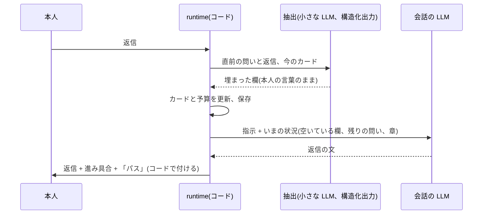

# 正社員のヒアリングを作り直す(設計メモ、2026-10-26)

正社員のヒアリングを、アルバイト・パートと同じやり方(決まりを書く、コードで確かめる、実 API で測る)で作り直す。
あわせて、ヒアリングの苦痛を減らすために、ゲームの仕組みを会話の中に入れる。

## 1. 結論

- ヒアリングの単位を「職歴カード」にする。直近の職歴 2〜3 件を 1 枚ずつ、3 つの欄(何をしていたか、どのくらいの規模か、どうなったか)で埋める。
- 何が埋まったか、残りの問いの数、進み具合は、コードが持つ。何をどう聞くかは、これまでどおり LLM が決める(ADR-0001 を守る)。
- ゲームは、仕組みと UI で入れる。残りが見える、答えるとすぐ 1 行できる、パスできる、途中で止めて続きから戻れる。カードが目の前で埋まっていく画面にする。テキストだけで最初から最後まで進めない。
- 本人は「短気で、時間がなく、いちばん手早く終えたい」と決めて、厳しく測る。問いは「面白さで、離脱する前にどこまで正しい情報を取れるか」。
- 評価の基準と改善のループは、作る前に決めて固定する(§7)。チャットと音声の両方で、トークでもカードを埋める。アーケードは、遊びたい人のための別の道として残す。

## 2. 今の問題

調べた結果(2026-10-26 の main)。

| 問題 | 根拠 |
|---|---|
| 正社員の音声には、コードのチェッカーも計測もない | `voice_resume/prompts.py` の `STAGES` と `flow.py` はアルバイト・パートだけ。`scripts/voice/eval_hearing.py` は区分がアルバイト・パートに固定(`TRACK`)。会話の記録の見本もアルバイト・パートだけ |
| 問いの予算が弱い | アルバイト・パートは「2 問目は聞かずに次へ」と止め方がある。正社員は 7 項目を 8〜10 問で聞くとだけあり、職歴ごとの上限が数字の問いにしかない |
| 誘導を止める決まりが正社員にない | アルバイト・パートは「〜は得意ですか?」を名指しで禁じる。正社員の強みは「成果の話から、本人の言葉で」だけ |
| 職歴が少ない人の道がない | アルバイト・パートは学校、家事、ボランティアを経験として聞く。正社員はブランクを「不安」として受け止めるだけ |
| チャットでは職務経歴書の材料を集めない | `fulltime_chat.md` は書類をゲームに任せる。相談の問いは 4 問までで、強みを掘る余地がほぼない。「6 回目の返信までに段階に入る」と「4 問まで」が並んでいて、どちらが先か書いていない |
| 測っていない | 正社員の相談のペルソナは `T-career-fulltime` と `T-switch-to-fulltime` だけ。4 問の変更のあと、`T-career-fulltime` は測り直していない(`line-sim-scenarios.md` §18) |
| 会話そのものに、進み具合も見返りもない | トークに進み具合、残りの数、できた行を見せる仕組みがない(クイックリプライと求人のカードだけ) |

ヒアリングがつまらない原因は、次の 4 つと考える(推測。利用者の声と、上の作りから)。

1. 終わりが見えない。あと何問あるか分からない。
2. 見返りが最後まで来ない。答えても、何ができたか見えない。
3. 思い出すのがつらい。「強みは?」「数字は?」と聞かれても、すぐには出てこない。
4. 詰まると逃げ道がない。「特にない」と言いにくい。

## 3. 設計の原則

### プロンプト

- **集めるものと、話し方を分ける。** 集めるもの(職歴カードの欄)は表で決める。話し方(1 回 1 問、2 文まで、受け止めてから聞く)は共通の決まりに置く。
- **欄ごとに「埋まった」の条件を書く。** 例: 規模は「人数、件数、金額、期間のどれか 1 つ。本人が『覚えていない』と言ったら、空欄のまま埋まったとする」。
- **予算を数字で書く。** 職歴 1 件につき問いは 3 つまで。全体で 10 問まで。
- **禁止は具体例で書く。** 誘導の例(「リーダーシップは得意ですか?」「売上は伸びましたか?」)と、言い換えの例を並べる。
- **本人の言葉だけを使う。** 数字を作らない、推測で埋めない、は今の決まりのまま。

### ハーネス

- **状態はコードが持つ。** 職歴カードの欄、残りの問いの数、章の進み具合。毎ターン、短い「いまの状況」として指示に渡す。
- **状態の更新を LLM の呼び忘れに頼らない。** ADR-0001 が段階をツールにしなかったのは、毎ターンの呼び出しを LLM が忘れるからだった。職歴カードは、本人の返信のたびにコードが小さな抽出(構造化出力)を呼んで更新する。会話の LLM はツールを呼ばなくてよい。
- **次の問いはコードが決めない。** コードが渡すのは「まだ埋まっていない欄」と「残りの予算」だけ。どの欄をどう聞くかは LLM が本人の話の流れで決める。v1 の相談モードの浅さ(項目を順に埋めるだけ)を戻さないため。
- **見た目はコードで付ける。** 進み具合の表示と「パス」のボタンは、挨拶の入口のボタン(`line-sim-scenarios.md` §23)と同じく、コードが付ける。LLM に毎回書かせない。
- **確かめ方を先に作る。** チェッカーと計測を、プロンプトを直す前に作る。直す前後を同じ台本で測る。

## 4. ヒアリングの形

3 つの章で進める。章の順は目安で、本人の話に合わせて入れ替えてよい。

| 章 | 集めるもの | 問いの予算 |
|---|---|---|
| 1. なぜ今 | 目的・転職の理由。具体的な場面を 1 回だけ掘る | 2 問 |
| 2. 職歴カード | 直近の職歴 2〜3 件。1 件ごとに 3 つの欄 | 1 件 3 問まで |
| 3. 次の一手 | やりたいこと、避けたいこと、条件(選択肢つき) | 3 問 |

### 職歴カードの欄

| 欄 | 中身 | 聞き方の例 | 埋まったとする条件 |
|---|---|---|---|
| 何をしていたか | 役割と担当した業務 | 「そこでは、どんな役割でしたか?」 | 役割か業務が 1 つ出た |
| どのくらい | 規模(人数、件数、金額、期間) | 「何人くらいのチームでしたか?」 | 数字が 1 つ出た、または本人が「覚えていない」と言った |
| どうなったか | 結果、変えたこと、評価されたこと | 「それで、何が変わりましたか?」 | 結果か評価が 1 つ出た |

- 履歴書にある職歴は、聞かずに確認形で使う。埋まっている欄は聞かない。
- 職歴が 4 件以上なら、直近の 2〜3 件だけをカードにする。古いものは勤め先と期間だけ。
- 職歴が少ない、またはブランクが長い人は、カードの対象を広げる。学校、資格の勉強、家族の介護、地域の活動を 1 枚にしてよい。
- 強みは問いで聞き出さない。カードの「どうなったか」から下書きの側で作る。今の音声の「自己PRは聞いた事実から作る」と同じ。

## 5. 会話に入れるゲームの仕組みと UI

キャラクター、得点、物語はトークに入れない。正社員の相談は大人の転職の場で、物語の遊びは軽く見える(推測)。物語はアーケードに任せる。
トークに入れるのは、苦痛を減らす仕組みと、それを目に見せる UI にする。

### 5.1 仕組み

| 苦痛 | 仕組み | トークでの形 | 音声での形 |
|---|---|---|---|
| 終わりが見えない | 残りが見える | カードの進み具合のバーと「2/3」。章が変わるときに「あと 2 問で終わります」 | 章の変わり目に「あと少しです」と 1 文 |
| 見返りが来ない | 答えるとすぐ 1 行できる | 欄が埋まると、カードのその欄に本人の言葉の 1 行が入る | 言わない(長くなる)。終わりに下書きをまとめて見せる |
| 思い出すのがつらい | 思い出しやすい問い | 規模は区切りのボタン(「5 人くらい」「10 人くらい」「20 人以上」「覚えていない」)。強みではなく場面を聞く | 「覚えている範囲で大丈夫です」を 1 回だけ |
| 打つのが面倒 | 押すだけで答えられる | 答えの候補はボタンにする。打つのは、ボタンに無いときだけ | なし |
| 詰まると逃げ道がない | パスしてよい | どの問いにも「パス」のボタン。パスした欄は下書きの空欄になり、今の空欄の仕組み(`line-sim-scenarios.md` §14)であとから埋める | 「飛ばしても大丈夫です」 |
| 一度に長い | セーブポイント | 章ごとに保存。「続きはあとで」のボタンで止めて、次に開いたら続きから | 面談は 1 回で終える。続きはトークで |
| 何ができたか分からない | 完成の瞬間 | 埋まったカードを並べたカルーセルと、下書きを開くボタン、空欄の数 | 今と同じ(終わるとトークに届く) |

### 5.2 UI(LINE のトーク)

| 場面 | 見せるもの | 部品 |
|---|---|---|
| 始める | 「職務経歴書を 3 分で」の 1 枚。3 つの章のアイコンと、かかる時間。ボタンは「始める」「履歴書の写真から始める(いちばん早い)」「あとで」 | Flex の bubble |
| 職歴カード | 1 社 1 枚。頭に勤め先と期間、3 つの欄(空いている欄は点線の枠、埋まった欄は本人の言葉の 1 行)、進み具合のバー | Flex の bubble。欄が埋まったときだけ送り直す(LINE は送ったメッセージを書き換えられないため。毎ターン送ると流れが埋まる) |
| 問い | 問いの文は 1 つの吹き出し。答えの候補、「パス」、「続きはあとで」はボタン | クイックリプライ(最大 13 個、ラベル 20 字まで) |
| カードの完成 | 「完成」の小さなスタンプの絵と、次のカードへ | Flex の画像。絵はアーケードと同じドット絵の色にそろえ、Render の static から出す |
| 全部の完成 | 埋まったカードを並べたカルーセルと、下書きを開くボタン(LIFF の下書きの画面)、空欄の数 | Flex の carousel |

- 1 回の返信は、吹き出しとカードを合わせて 3 つまで。
- 画像には必ず代わりの文(altText)を付ける。通知とトークの一覧にはそれが出る。
- Web のトーク画面(`talk.html`)で Flex のカードをどう出すかは調べていない(不明)。同じ形で出せないなら、文とボタンに落とす。
- いちばん早い道は「履歴書の写真から始める」にする。読み取りでカードを先に埋め、空いている欄だけを聞く。

### 5.3 守ること

- 区切りのボタンは本人が選んだ値として保存し、「くらい」をつけたまま下書きに書く。こちらから数字を言わない、の決まりと両立させるため。
- 得点、順位、本人の経歴の評価(「すごい」「会心の一撃」)は出さない。本人の経歴を値踏みしているように見えるため。
- カードの 1 行は、本人の言葉を短くしたものにする。盛らない。下書きを作る決まり(`CAREER_DRAFTER_SYSTEM`)と同じ。
- カードのヒアリングは、相談の「問いは 4 問まで」の外に置く。カードの予算(§4)で数える。

## 6. ハーネスの作り

- **状態**: 本人ごとに `career_cards`(職歴ごとの 3 つの欄、出どころ、空欄)と、章と残りの問いの数を持つ。履歴書の読み取り結果からカードを先に作る。
- **抽出**: 本人の返信のたびに 1 回。会話の LLM とは別に呼ぶ。本人の言葉にない値は返さない(返したら捨てる)。
- **いまの状況**: 毎ターンの指示の最後に、数行で渡す。例: 「職歴カード 2/3(倉庫の現場リーダー): 『どうなったか』が空き。残り 4 問」。
- **下書き**: `CAREER_DRAFTER_SYSTEM` に、会話の記録とあわせてカードを渡す。数字を作る危険が減る。
- **チャットと音声で同じ**: カードは同じ状態に置く。音声で埋まった欄は、トークで聞き直さない。

## 7. 評価の基準と改善のループ

作る前に、この節の本人役、指標、合格の線、ループの手順を決めて固定する。途中で基準を変えると、前と比べられないため。基準を変えるときは、この節を直してから測り直す。

### 7.1 本人役: 短気で、時間がなく、いちばん手早く終えたい

すべてのペルソナに共通の性格として、次を入れる。

- **我慢のゲージ。** 100 から始まり、0 になったら「もういいです」と言って離脱する。会話はそこで終わる。
- **時間の上限。** 本人の推定時間が 5 分を超えたら離脱する。推定時間は、読む 400 字/分、スマホで打つ 40 字/分、ボタン 1 回 2 秒で数える。
- **疲れると答えが短くなる。** ゲージが 50 を切ったら、答えは短い言葉 1 つ。25 を切ったら、ボタンがあればボタン、無ければ「パス」。
- **事実は事実表からだけ答える。** ペルソナごとに、本当の職歴と数字の表を隠して持つ。聞かれたことだけを答え、聞かれないことは言わない。

ゲージの増減(初めの値。固定してから測る):

| できごと | 増減 | 誰が判定するか |
|---|---|---|
| AI の返信 1 回 | -8 | コード |
| 打って答えた | -6 | コード |
| ボタンで答えた | -1 | コード |
| 返信が長い(120 字を超える、または吹き出し 3 つを超える) | -10 | コード |
| もう答えたことを聞かれた | -25 | ジャッジ(LLM) |
| 答えにくい問い(抽象的、一度に 2 つ、誘導) | -15 | ジャッジ(LLM) |
| 残りが見えた | +3 | コード |
| 自分の言葉の 1 行ができた | +5 | コード |
| カードが 1 枚完成した | +8 | コード |

本人役は、AI の返信を「文 + ボタンのラベル + カードの中身を文にしたもの」として受け取る。本人役は絵を見られないので、UI の効き目は計測では近似になる。UI の効き目は、§7.5 の人の確認で確かめる。

### 7.2 ペルソナ

| # | 人 | 事実表の特徴 |
|---|---|---|
| 1 | 職歴が多い | 4 社。直近 2 社に数字のある成果 |
| 2 | 数字を覚えていない | 2 社。数字は「覚えていない」が本当 |
| 3 | ブランクがある | 1 社のあと 3 年の介護。職歴が少ない |
| 4 | 答えが短い | 2 社。「特にない」を 2 回まで言う |
| 5 | 履歴書を先に送っている | 2 社。読み取り結果で欄の半分が埋まっている |

### 7.3 指標と合格の線

主な指標は「離脱する前に、正しく取れた情報」にする。

| 指標 | 中身 | 合格の線(初め) |
|---|---|---|
| 正しく埋まった欄 | 事実表の欄のうち、カードに正しく入った割合 | 70% 以上 |
| 完了率 | 離脱せずに下書きまで行った割合 | 80% 以上 |
| 推定時間 | 完了までの本人の時間 | 履歴書あり 3 分以内、なし 5 分以内 |
| 打った字数 | 本人が打った字の合計 | 150 字以内 |
| 終わりのゲージ | 完了したときの残り | 記録だけ(比べるため) |

次は 1 つでも破れば不合格(関門):

- 数字を作った(下書きかカードの数字が、事実表にも本人の選んだ区切りにもない): 0 件
- 誘導した: 0 件
- もう答えたことを聞いた: 0 件
- 1 回の返信で 2 つ以上聞いた: 0 件
- 下書きが事実表と食い違う: 0 件

### 7.4 比べる形

「面白さでどこまで取れるか」を分けて見るため、層を 1 つずつ足して比べる。

| 形 | 中身 |
|---|---|
| A | 今の正社員のヒアリング(直す前) |
| B | 職歴カードと予算だけ。文だけ |
| C | B に仕組みを足す(進み具合、1 行、パス、セーブポイント)。文だけ |
| D | C に UI を足す(カード、ボタン、完成のカルーセル) |

同じペルソナ、同じ事実表で、形ごとに 1 ペルソナ 3 回ずつ回す。

### 7.5 ループの手順

1. **本人役を確かめる。** 台本の悪い AI(聞き直す、長い、抽象的)で離脱し、台本の良い AI で完了することを、実 API なしのテストで確かめる。確かめられない本人役では測らない。
2. **A を測る。** 結果を §11 に書く。
3. **1 回に 1 つだけ変える。** プロンプト、予算、UI のどれか 1 つ。
4. **全ペルソナ × 3 回を回し、前の一番よいものと比べる。** 関門を全部通り、主な指標が良くなったら残す。そうでなければ戻す。
5. **§11 の表に 1 行足す。** 変えたこと、指標、残したか戻したか。
6. **止める。** 合格の線に届いたら止める。3 回続けて良くならなければ止めて、利用者に相談する。
7. **人が確かめる。** D ができたら、利用者が実機の LINE でストップウォッチを使って 1 回通す。同僚にも頼めれば頼む。かかった時間と、いらっとした場面を §11 に書く。

- 費用は、別の台帳 `evals/budget-fulltime-hearing.jsonl` で数え、$5 で止めて相談する(`evals.run` の `--ledger` と `--limit-usd`)。
- 音声は、文字起こしの形で同じ本人役と指標を使う。UI の部分は数えない。
- チェッカー: `flow.py` に正社員の段階を足し、予算(職歴 1 件 3 問、全体 10 問)、誘導、聞き直しを数える。

## 8. ADR-0001 との関係

ADR-0001 は「会話の段階と次の問いはツールにしない」と決めた。この設計はそれを守る。

- 次の問いは、これまでどおり LLM が決める。
- 職歴カードは「段階」ではなく、書類の材料の状態として持つ。更新は会話の LLM のツールではなく、コードが毎回呼ぶ抽出で行う。

ただし、コードが毎ターン状態を持って指示に足すのは新しい形なので、ADR-0009 として残す。

## 9. タスクの分け方

| 順 | タスク | 確かめ方 | 先に要るもの |
|---|---|---|---|
| 1 | 評価のループ: 本人役、ペルソナ 5 人、チェッカー、指標、報告。A を測る | §7.5 の 1 と 2 | なし |
| 2 | ADR-0009 と、職歴カードの状態、抽出、いまの状況 | 台本の会話で、カードが本人の言葉で埋まる | なし |
| 3 | 正社員の playbook(音声、チャット)を、章と予算と欄の条件で書き直す(B と C) | 1 のループ | 1、2 |
| 4 | トークの UI(始める 1 枚、職歴カード、ボタン、完成) | 画面のテストと、実機の LINE | 2 |
| 5 | 下書きにカードを渡す | 数字を作らないことを確かめるテスト | 2 |
| 6 | A〜D を測ってループを回し、§11 に書く | §7.5 | 1、3、4、5 |

## 10. 決めたこと(2026-10-26)

1. トークでも職務経歴書のヒアリングをする。アーケードは、遊びたい人のための別の道として残す。
2. ゲームは、仕組みと UI で入れる。キャラクターや物語はトークに入れない。
3. 抽出には小さいモデル(Haiku)を使う。費用は 1 のタスクで見積もる。
4. 本人役は「短気で、時間がなく、いちばん手早く終えたい」。評価の基準とループは §7 で先に固定する。

## 11. 計測の記録

(1 のタスクから書き足す)

| 日付 | 形 | 変えたこと | 正しく埋まった欄 | 完了率 | 推定時間 | 打った字数 | 関門 | 判断 |
|---|---|---|---|---|---|---|---|---|
