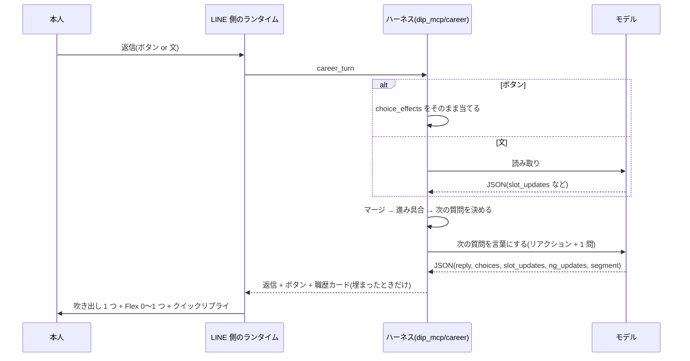

# 正社員のヒアリングを作り直す(設計メモ、2026-10-26)

正社員のチャットのヒアリングを、アルバイト・パートの作り直し(PRD「バイト探しの相棒 v3」、task 242、PR #115、ADR-0009)と同じ形で作り直す。
何を聞くか、いつ切り替えるか、いつ終えるかはハーネス(コード)が決め、プロンプトは「どう言うか」だけを受け持つ。
あわせて、ヒアリングの苦痛を減らすために、ゲームの仕組みと UI を会話の中に入れる。評価の基準と改善のループは、作る前にこの文書で固定する。

## 1. 結論

- **形はアルバイト・パートの v3 にそろえる。** 質問バンク(データ)、条件表(優先度つき)、フェーズ、出題のスコア、モデルの決まった JSON、まとめのカード、モックの LLM での回帰。置き場所も同じく dip 側(`dip_mcp/career/`)。
- **正社員だけのものは「職歴カード」。** 職務経歴書の材料として、直近の職歴 2 件(余裕があれば 3 件)を 1 枚ずつ、3 つの欄(何をしていたか / どのくらい / どうなったか)で埋める。
- **ゲームは、仕組みと UI で入れる。** 仕事の場面の二択(好みを推し量る)、職歴カードが目の前で埋まる、残りが見える、押すだけで答えられる、パスできる、最後にまとめて直す。最初から最後まで文だけにはしない。キャラクター、得点、物語は入れない。
- **本人は「短気で、時間がなく、いちばん手早く終えたい」と決めて、厳しく測る。** 問いは「面白さで、離脱する前に、どこまで正しい情報を取れるか」。
- **対象はチャット(LINE のトークと Web のトーク)。** 音声の面談は playbook のまま。質問バンクを音声に使うかは、後で決める。

## 2. 今の問題

調べた結果(2026-10-26 の main と PR #115)。

| 問題 | 根拠 |
|---|---|
| 何を聞くか、いつ終えるかをモデルに任せている | `dip_mcp/playbooks/fulltime_chat.md` は「明らかにすること」の指針だけ。アルバイト・パートは PR #115 でハーネスに移るが、正社員は ADR-0009 の Consequences で playbook のまま |
| 職務経歴書の材料を集めない | `fulltime_chat.md` は書類をゲームに任せる。相談は 4 問まで(`evals/checks.py` の `consult_length_violations`)で、成果や数字を聞く余地がない |
| 測れない | 構造化された出力がなく、モックで回せない。正社員の相談のペルソナは `T-career-fulltime` と `T-switch-to-fulltime` だけで、4 問の変更のあとは測り直していない(`line-sim-scenarios.md` §18) |
| 面接のよう | 自由回答の問いが多く、ボタンは条件の問いだけ。進み具合も、答えた見返りも見えない(トークの UI はクイックリプライと求人のカードだけ) |

音声の正社員にも、コードのチェッカーと実 API の計測がない(`voice_resume/flow.py` と `scripts/voice/eval_hearing.py` はアルバイト・パートだけ。会話の見本は `tests/test_voice_track.py` に正社員のものが 1 つある)。音声はこの文書の対象外にし、後のタスクにする。

ヒアリングがつまらない原因は、次の 4 つと考える(推測。利用者の声と、上の作りから)。

1. 終わりが見えない。
2. 答えても、何ができたか見えない。
3. 「強みは?」「数字は?」と聞かれても、すぐには思い出せない。
4. 打つのが面倒で、詰まると逃げ道がない。

## 3. 作り(ハーネス)

アルバイト・パートの v3(PR #115 の `dip_mcp/baito/`、PRD §5〜§9)と同じ作りにする。違うところだけを書く。

- **入口。** トークの AI が正社員の相談に入ると決め、dip のツール `start_career_consultation` を呼ぶ。あとは `career_turn`(トークの AI には見せない)が受け持つ。アルバイト・パートの `start_baito_consultation` / `baito_turn` と同じ。今ゲームのボタンを出している場面(本人が職務経歴書を作りたいと言った、応募の準備の話になった)でも入れる。
- **終わり。** result に着くと、条件を `stated_preferences` に、職歴カードを本人のプロフィールに保存し、トークの AI に戻る。why_now、direction、team_style は今の `PREFERENCE_KEYS` に無い。職歴カードの置き場所も無い。どちらも 2/5 のタスクで足す。
- **あとで。** 「あとで」を押したら、そこまでの分を保存して相談を閉じる(v3 と同じく、相談は次の会話に持ち越さない)。次に始めたときは、保存した slot と欄を high として入れ、聞かない。続きから戻る仕組みは作らない。
- **相談の 4 問の上限は当てはまらない。** 上限は §3.3 の時間とターンで決める。`consult_length_violations`(`evals/checks.py`)が、ハーネスのターン(返信に `career` が付く)を数えないようにする。2/5 のタスクで直す。
- **ADR。** ADR-0010 を書く。「正社員のチャットの相談も、何を聞くかをハーネスが決める。ADR-0009 を正社員に広げる。正社員だけのものは職歴カードと時間の予算」。ADR-0001 の Consequences と、ADR-0009 の Consequences の「正社員は playbook のまま」も直す。

### 3.1 segment(振り分け)

icebreak の `q_segment`「今のあなたに近いのは?」で決める。自由記述から推し量ってもよい。

| segment | 表示 | 想定 | segment だけの HARD |
|---|---|---|---|
| `same_path` | 同じ仕事で上へ | 同じ職種で、年収・役割・規模を上げたい | 上げたいもの(年収 / 役職 / 規模) |
| `change` | 仕事を変えたい | 職種か業界を変えたい | 変えたい理由、活かしたい経験 |
| `return` | ブランクから戻る | 育児、介護、療養などのあと | 働ける時間、ブランクの期間 |
| `early` | 経験が浅い | 社会人 3 年以内、第二新卒 | 続けたいこと、やめたいこと |
| `unknown` | (未回答) | 言わない | なし |

segment と質問の中身は、2/5 のタスクで質問バンクとして書き、PR で利用者が確かめる。

### 3.2 条件表

| slot | 優先度 | 取り方 |
|---|---|---|
| why_now(なぜ今) | HARD | 直接 1 問。場面を 1 回だけ掘る |
| area(勤務地) | HARD | 直接(選択肢) |
| min_annual_salary(年収の下限) | HARD | 直接(区切り 3 つと「こだわらない」) |
| start_timing(働き始める時期) | HARD | 直接(選択肢) |
| work_style(リモート、残業) | MID | 直接、または場面の二択から推し量る |
| direction(次にやりたいこと) | MID | 場面の二択から推し量る(low)。まとめのカードで確かめる |
| team_style(人と働く形) | LOW | 場面の二択から推し量る |
| NG | - | 逆選択(3 つの仕事から一番やりたくないもの)と、本人の言葉 |
| 職歴カード | §4 | 直接。履歴書があれば先に埋める |

- 確信度、マージ、まとめのカード(`build_card`、2 回まで)、こだわりなしの扱いは、v3 と同じ。
- 履歴書の読み取り結果で埋まる slot と欄は、聞かない(high として入れる)。

### 3.3 時間の予算、フェーズ、ターン

本人は短気で時間がないので、聞きたいことを全部は聞けない。そこで、ハーネスはターンの数に加えて、**本人の推定時間**を予算として持つ(v3 に無い、正社員だけの決まり)。

- 推定時間は §6.1 と同じ式で数える(読む 400 字/分、打つ 40 字/分、ボタン 1 回 2 秒。読む字は吹き出し、ボタンのラベル、Flex の中の字の合計)。
- **目標時間**は、履歴書あり 180 秒、なし 300 秒(§6.4 の合格の線と同じ)。
- **質問を止める時刻** = 目標時間 - 90 秒(review 2 回分の 70 秒と、ゆとり 20 秒)。履歴書ありは 90 秒、なしは 210 秒。この時刻を過ぎたら、空いている HARD のほかは聞かずに review に進む。
- **空いている HARD は、時刻を過ぎても聞く**(`MAX_TURNS` の中で)。HARD を先に聞く順にしてあるので、ふつうは時刻の前に埋まる。
- `MAX_TURNS = 16`。時間とターンの、先に尽きた方で止まる。v3 と同じく、review のために 2 ターンを残す。
- 1 ターンの字数の予算: 吹き出し 80 字まで、ボタンのラベルは合わせて 40 字まで、職歴カードの Flex の中は 60 字まで。帯の Flex の中は 24 字まで、プロフィールカードの Flex の中は 80 字まで([hearing-progress-ui.md](hearing-progress-ui.md) §3)。
- 形 D の Flex の字も時間に数える。D は C より 1 ターンあたりの時間が長く、聞ける数が減る。それも含めて、UI が情報を増やすかを測る(§6.5)。
- 出題の優先度: HARD > 1 枚目の職歴カード > 2 枚目の職歴カード > MID と LOW。予算が尽きたら、低いものから聞かない。聞かなかったものは、まとめのカードで「未定」と出る。
- パスの扱い: 条件の slot は「こだわりなし」(high)として埋まる(v3 と同じ)。why_now と職歴カードの欄は空欄として埋まり、もう聞かない。どちらも「HARD が空」には数えない。

フェーズの順と、予算が足りたときの配分(目安。2/5 のタスクがモックで決める):

| 順 | フェーズ | ターン | 中身 |
|---|---|---|---|
| 1 | icebreak | 2 | segment(ボタン)、なぜ今(ボタン + 文)。掘り下げは予算が残るときだけ |
| 2 | hard_filter | 3〜4 | 勤務地、年収、時期(ボタン)。segment だけの HARD |
| 3 | career_cards | 3〜6 | 職歴カード 1〜2 枚(1 枚 3 問。履歴書で埋まった欄は聞かない) |
| 4 | scenario_game | 0〜2 | 仕事の場面の二択(形 C と D だけ) |
| 5 | reverse_pick | 0〜1 | 一番やりたくないもの → NG(形 C と D だけ) |
| 6 | review | 1〜2 | まとめのカード(条件 + 職歴カード)を一度に直す |

予算が足りても合計は 18 ターンになりうるが、`MAX_TURNS` と時間で先に止まる。予算の中でどこまで取れるかが、この設計の問い(§6)そのものになる。

## 4. 職歴カード

| 欄 | 中身 | 聞き方の例 | 埋まったとする条件 |
|---|---|---|---|
| role(何をしていたか) | 勤め先、期間、役割、担当した業務 | 「直近のお仕事を一言で教えてください(例: 物流会社で現場リーダー、6 年)」 | 勤め先か役割が 1 つ出た |
| scale(どのくらい) | 規模(人数、件数、金額、期間) | 「何人くらいのチームでしたか?」と区切りのボタン(5 人くらい / 10 人くらい / 20 人以上 / 覚えていない) | 数字が 1 つ出た、区切りを選んだ、または「覚えていない」 |
| result(どうなったか) | 結果、変えたこと、評価されたこと | 「それで、何が変わりましたか?」 | 結果か評価が 1 つ出た、または「パス」 |

- 1 枚につき問いは 3 つまで。パスした欄、「覚えていない」の欄は空欄として残し、下書きの空欄の仕組み(`line-sim-scenarios.md` §14)で、あとから埋める。
- 職歴が 3 件以上なら、直近の 2 件をカードにする。古いものは勤め先と期間だけ。
- 職歴が少ない(`return`、`early`)人は、学校、資格の勉強、家族の介護、地域の活動を 1 枚にしてよい。
- 強みは問いで聞き出さない。カードの result から下書きの側で作る。
- 区切りのボタンの値は、本人が選んだ値として「くらい」をつけたまま保存し、下書きにもそのまま書く。こちらから数字を言わない。
- 職歴カードを入れる場所、保存の期間、見る・消す・書き出すは、プライバシーポリシー 1.4 の §6・§7 の範囲に入るかを 2/5 のタスクで確かめる。送り先(Anthropic にトークの内容を送る)は 1.4 で足りている。

## 5. ゲームの仕組みと UI

キャラクター、得点、順位、本人の経歴の評価(「すごい」)は出さない。正社員の相談は大人の転職の場で、経歴を値踏みしているように見えるため。物語の遊びはアーケードに任せる。

### 5.1 仕組み

| 苦痛 | 仕組み | 形 |
|---|---|---|
| 終わりが見えない | 残りが見える | 職歴カードの「1/2」と進み具合のバー。フェーズが変わるときに「あと 3 問です」。何かが埋まったターンに、プロフィール全体の帯(「6/10」と、いま埋まった 1 行。[hearing-progress-ui.md](hearing-progress-ui.md)) |
| 見返りが来ない | 答えるとすぐ 1 行できる | 欄が埋まると、カードのその欄に本人の言葉の 1 行が入る |
| 思い出せない | 思い出しやすい問い | 規模は区切りのボタン。強みではなく場面を聞く |
| 打つのが面倒 | 押すだけで答えられる | 条件、規模の区切り、segment、場面の二択、逆選択はボタンで答えられる。role と result は誘導になるので答えの候補を出さず、「パス」と「覚えていない」だけを出す(履歴書にあれば「はい、そうです」の確認のボタン) |
| 詰まると逃げ道がない | パスしてよい | どの問いにも「パス」。パスは「こだわりなし」か空欄として扱い、深追いしない |
| 好みを言葉にできない | 仕事の場面の二択 | 例:「月曜の朝、うれしいのは? A 新しい企画の打ち合わせ / B 散らかった仕事を片付ける」。推し量った好みはまとめのカードで一度に直す |
| 一度に長い | あとで | 「あとで」のボタン。そこまでを保存して閉じる。次は保存した分を聞かない(§3) |
| 何ができたか分からない | 完成の瞬間 | 埋まったカードを並べたカルーセルと、下書きを開くボタン、空欄の数 |

### 5.2 UI(LINE のトーク)

| 場面 | 見せるもの | 部品 |
|---|---|---|
| 始める | 「職務経歴書を 3 分で」の 1 枚。フェーズのアイコンと、かかる時間。ボタンは「始める」「履歴書の写真から始める(いちばん早い)」「あとで」 | Flex の bubble |
| 職歴カード | 1 社 1 枚。頭に勤め先と期間、3 つの欄(空きは灰色の「まだ」、埋まると本人の言葉の 1 行)、進み具合のバー。3 つの欄が埋まると、同じ bubble に「完成」の小さなスタンプの絵が付く | Flex の bubble。欄が埋まったターンだけ付ける(LINE は送ったメッセージを書き換えられないため。毎ターン付けると流れが埋まる)。絵はアーケードと同じドット絵の色で、Render の static から出す |
| 問い | リアクションと問いを 1 つの吹き出しに(80 字まで)。答えの候補、「パス」、「あとで」はボタン | クイックリプライ(13 個まで、ラベル 20 字まで) |
| 帯 | 条件か職歴カードの欄が埋まったターンに、プロフィール全体の進み具合のバー、「6/10」、いま埋まった 1 行。職歴カード、プロフィールカード、まとめを付けるターンと、review のターンには付けない | Flex の小さな bubble。[hearing-progress-ui.md](hearing-progress-ui.md) §3.1 |
| プロフィールカード | hard_filter と career_cards から次のフェーズに移った最初のターンに、条件の埋まった項目と、まだの項目。review の前には付けない(まとめが同じ役を持つ) | Flex の bubble。[hearing-progress-ui.md](hearing-progress-ui.md) §3.2 |
| まとめ | 条件と職歴カードのまとめ。直すところをボタンで選ぶ | Flex の bubble |
| 全部の完成 | 埋まったカードのカルーセル(先頭は条件のプロフィールカード)、下書きを開くボタン(LIFF の下書きの画面)、空欄の数 | Flex の carousel |

- 1 回の返信は、吹き出し 1 つ + Flex 0〜1 つ。LINE の 1 回の返信の上限(5 メッセージ)に収まる。
- Flex のメッセージには、通知とトークの一覧に出る代わりの文(altText)を付ける。
- Web のトーク(`talk-core.js`)は、求人のカルーセルしか描かない。今回は、Web では職歴カードを文とボタンに落とす。主な入口は LINE なので、Web の見た目は後にする。
- いちばん早い道は「履歴書の写真から始める」。読み取りで職歴カードと条件を先に埋め、空いているところだけを聞く。

## 6. 評価の基準と改善のループ

作る前に、この節を決めて固定する。途中で基準を変えると、前と比べられないため。基準を変えるときは、この節を直してから測り直す。

### 6.1 本人役: 短気で、時間がなく、いちばん手早く終えたい

すべてのペルソナに共通の性格として、次を入れる。

- **時間の上限。** 本人の推定時間が 5 分を超えたら離脱する。推定時間は、AI の返信を読む 400 字/分、スマホで打つ 40 字/分、ボタン 1 回 2 秒で数える。読む字は、吹き出し、ボタンのラベル、Flex の中の字を合わせたもの。
- **いらいらの上限。** 次のできごとが 3 回たまったら、「もういいです」と言って離脱する。もう答えたことを聞かれた / 1 回に 2 つ聞かれた / 面接口調 / 吹き出しが 80 字を超えた。
- **疲れると答えが短くなる。** 推定時間が 3 分を超えたら、ボタンがあればボタン、無ければ短い言葉 1 つ。
- **事実は事実表からだけ答える。** ペルソナごとに、本当の職歴、数字、希望の表を隠して持つ。聞かれたことだけを答える。

ゲームの仕組みに点を足す決まり(「1 行できたら +5」など)は入れない。入れると、仕組みのある形が作りの上で勝ってしまうため。面白さの効き目は、時間(ボタンで速くなる)、いらいら(聞き直しが減る)、取れた情報に出るはずのものだけで測る。

本人役は、AI の返信を「吹き出しの文 + ボタンのラベル + Flex の中の字」として受け取る。絵は見られないので、UI の見た目の効き目は計測では測れない。それは §6.6 の人の確認で見る。

### 6.2 2 つの本人役

| 本人役 | 使う場面 | 費用 |
|---|---|---|
| モック(台本) | ハーネスの回帰。毎回の変更で回す(v3 の `simulate.py` と同じ) | 0 |
| 実 LLM の本人役 | 形の比べと、言い方の確認。いらいらのできごとは LLM のジャッジが判定する | 実 API |

モックの本人役は、事実表とペルソナの答え方(短い、「特にない」が多い、など)をコードで持つ。モックの読み取りは正解を返すので、モックで確かめられるのはハーネスの動きだけ。

| 確かめること | モック | 実 API |
|---|---|---|
| 完了率、推定時間、ターン、HARD が空、`wasted`、予算で止まること | ○ | ○ |
| 正しく取れた事実(文の意味) | × | ○ |
| 誘導、面接口調、1 回に 2 つ聞く、数字を作った | × | ○ |

### 6.3 ペルソナ

| # | 人 | segment | 事実表の特徴 |
|---|---|---|---|
| 1 | 営業 8 年、同じ職種で年収を上げたい | same_path | 3 社。直近 2 社に数字のある成果 |
| 2 | 経理から IT へ | change | 2 社。数字は「覚えていない」が本当 |
| 3 | 介護で 3 年のブランク | return | 1 社のあと 3 年の介護。職歴が少ない |
| 4 | 答えが短い | early | 1 社 2 年。「特にない」を 2 回まで言う |
| 5 | 履歴書を先に送っている | same_path | 2 社。読み取り結果で職歴カードの半分と勤務地が埋まっている |
| 6 | 属性を最後まで言わない | unknown | 2 社。segment の問いに答えない |

### 6.4 指標と合格の線

主な指標は「離脱する前に、正しく取れた事実の数」にする。事実表の項目(why_now、HARD の条件、職歴カードの欄)のうち、会話の終わりの状態に正しく入ったもの。

| 指標 | 中身 | 合格の線 |
|---|---|---|
| 正しく取れた事実 | 事実表の項目のうち正しく取れた割合 | 70% 以上 |
| 完了率 | 離脱せずに result に着いた割合 | 80% 以上 |
| 推定時間 | result までの本人の時間 | 履歴書あり 3 分、なし 5 分以内 |
| 打った字数 | 本人が打った字の合計 | 150 字以内 |
| ボタンの割合 | 本人の返信のうちボタンだったもの | 記録だけ |

「正しく取れた」の決め方:

- 数字: 事実表の値と同じ。区切りのボタンは、事実表の値がその区切りに入っていれば正しい。
- 「覚えていない」: 事実表が「覚えていない」なら正しい。
- 文: LLM のジャッジが事実表の文と同じ意味かを判定する。2 回判定して両方「同じ」のときだけ正しい。
- 形 A(今のヒアリング。状態を持たない)は、会話の記録から同じジャッジで事実を取り出して数える。A の「完了」は、離脱せずに要約か求人の提案に着いたこと。
- 良くなったとみなす差(実 API の比べに使う): 正しく取れた事実の平均が 1 項目以上増え、離脱した会話が 12 会話のうち 1 つ以上は増えないこと。12 会話では差の検定はできないので、向きを見る目安として使う。主に B、C、D の間で比べ、A は参考にする。

次は 1 つでも破れば不合格(関門)。コードで判定できるものはコードで判定する。

- 数字を作った(状態か下書きの数字が、本人の発言にも選んだ区切りにもない): 0 件
- もう high で埋まっている slot を聞いた(v3 の `wasted`): 0 件
- 1 回の返信で 2 つ以上聞いた: 0 件
- 誘導した(本人が言っていない強みや作業を候補として挙げた): 0 件
- HARD が空のまま result に着いた(本当の segment で数える): 0 件
- v3 の受け入れチェック(PRD §11.3 の 1〜3、5〜7)を正社員に置き換えたもの

### 6.5 比べる形

「面白さでどこまで取れるか」を分けて見るため、層を 1 つずつ足して比べる。

| 形 | 中身 |
|---|---|
| A | 今の正社員の相談(`fulltime_chat.md`) |
| B | ハーネス + 職歴カード + ボタン(§5.1 で決めたところ)とパス。ゲームの仕組みは切る(場面の二択と逆選択をせず、MID は直接聞く。進み具合と 1 行を見せない)。Flex なし |
| C | B + ゲームの仕組み(場面の二択、逆選択、進み具合と 1 行を文で見せる)。Flex なし |
| D | C + UI(Flex の職歴カード、帯、プロフィールカード、まとめ、完成のカルーセル)。D が C より遅いときは、帯を切った D も測る |

ボタンは B、C、D のどれにもある。B と C の切り替えは、ハーネスの設定 1 つ(2/5 のタスク)。C と D の切り替えは、UI の設定 1 つ(3/5 のタスク)。

### 6.6 ループの手順

1. **本人役を確かめる。** 台本の悪い AI(聞き直す、2 つ聞く、長い)で離脱し、台本の良い AI で完了することを、実 API なしのテストで確かめる。確かめられない本人役では測らない。
2. **A を測る。** 実 LLM の本人役で、6 人 × 2 回。結果を §7 に書く。
3. **モックで回す。** ハーネスの変更は、モックの本人役で 6 人を回す(費用 0)。見るのは §6.2 の表の「モック ○」の行だけ(完了率、推定時間、ターン、HARD が空、`wasted`)。1 回に 1 つだけ変える。良くなれば残し、そうでなければ戻す。§7 に 1 行足す。
4. **実 API で比べる。** B、C、D を実 LLM の本人役で 6 人 × 2 回。A と比べる。正しく取れた事実と、実 API でしか見られない関門(誘導、面接口調、2 つ聞く、数字を作った)は、ここで見る。
5. **止める。** 合格の線に届いたら止める。3 回続けて良くならなければ止めて、利用者に相談する。
6. **人が確かめる。** D ができたら、利用者が実機の LINE でストップウォッチを使って 1 回通す。同僚にも頼めれば頼む。かかった時間と、いらっとした場面を §7 に書く。

- 実 API の費用は、別の台帳 `evals/budget-fulltime-hearing.jsonl` で数える(`evals.run` の `--ledger` と `--limit-usd`)。上限は §8。
- 1 回の会話の費用は、§18 の実績(本人役とジャッジを含む)で $0.13〜0.15。A〜D × 6 人 × 2 回で 48 会話、約 $7 の見込み(推測。正社員の会話は長いので増えうる)。5/5 のタスクで A を測るときに、1 会話の実際の費用を §7 に書き、見込みを直す。

### 6.7 評価の実装

§6 の評価は `evals/fulltime_hearing/` にある。実行のコマンドと引数(形、ペルソナ、回数、台帳、上限)は、[evals/fulltime_hearing/README.md](../../evals/fulltime_hearing/README.md) に書く。

- 離脱の判定(推定時間、いらいらの回数)はコードが持つ。LLM の本人役は、返信の文と「押すボタン」だけを返す。ジャッジがいらいらのできごとにラベルを付け、コードが数えて離脱を決める。実 API なしのテスト(§6.6 の 1)でも離脱を確かめるため(1/5 のタスクで決めた)。
- 80 字を超えた吹き出しは、ジャッジではなくコードが数える。
- 台本の良い AI は、§3.3 の時間の予算(質問を止める時刻)で聞く数を決める。予算を持たない台本は、良い聞き方でも、本人役が事実表の文をそのまま打つと 5 分を超えた(台本の本人役のテストで確かめた)。
- 形 B〜D は、終わりの状態を事実表と同じ key で返す(`evals/fulltime_hearing/judge.py` の docstring)。
- 数の事実は、単位も事実表と同じときだけ正しい。取れた値は数か区切りの単位(`unit`)を持ち、事実表の単位の頭(括弧の前。「社」「件」「年」など)と比べる。単位の違う区切り(120 社に「20人以上」)と数(3 年に「3か月」)は、§6.4 の「同じ値」「その区切りに入る」に当たらないため。単位の無い文は、事実表の単位がすぐ後ろに付いた数だけを見る。
- 形 A の事実の取り出しには、本人が先に送った履歴書の読み取り結果も渡す。形 B〜D が履歴書の欄を high として入れるのと、条件をそろえるため。
- 形 A が `wait` を記録したときは、要約が付いていても、離脱(AI が閉じた)に数え、そこで止める。
- 形 A で本人が「今はいい」と返し、その返信で会話が閉じたときは、離脱(本人が断った)に数える。playbook は 1 問でも答えていれば `consult` と要約を記録するが、答えた数で完了と離脱が分かれないようにするため。
- PRD v3 の受け入れチェック(§6.4 の関門の最後)の置き換えは、PRD が main に入ってから足す。

## 7. 計測の記録

(1/5 のタスクから書き足す)

| 日付 | 形 | 本人役 | 変えたこと | 正しく取れた事実 | 完了率 | 推定時間 | 打った字数 | 関門 | 判断 |
|---|---|---|---|---|---|---|---|---|---|

## 8. 決めたこと(2026-10-26)と、決めていないこと

決めたこと:

1. 正社員のチャットのヒアリングを、アルバイト・パートの v3 と同じ作り(ハーネスが何を聞くかを決める)にする。
2. トークでも職務経歴書の材料(職歴カード)を集める。アーケードは、遊びたい人のための別の道として残す。
3. ゲームは、仕組みと UI で入れる。キャラクターや物語はトークに入れない。
4. 本人役は「短気で、時間がなく、いちばん手早く終えたい」。評価の基準とループは §6 で先に固定する。

決めていないこと:

- 実 API の費用の上限(利用者が決める。実 API を呼ぶのは 5/5 のタスクだけ)。
- 音声の正社員の面談に、質問バンクを使うか。

## 9. タスクの分け方

| 順 | タスク | 先に要るもの |
|---|---|---|
| 1 | 評価: 事実表つきのペルソナ 6 人、実 LLM の本人役、ジャッジ、指標と関門の報告、§6.6 の 1(実 API なし) | なし |
| 2 | ハーネス: `dip_mcp/career/`(質問バンク、条件表、職歴カード、時間の予算、フェーズ、JSON、形 B と C の設定)、モックの本人役での回帰、ADR-0010 | task 242(PR #115)のマージ、1(事実表) |
| 2b | トークのつなぎと保存: `start_career_consultation` / `career_turn`、ランタイムのつなぎ、職歴カードの置き場所、`consult_length_violations` の除外、HLD と LLD(2 が大きすぎたので、2026-10-27 に分けた) | 2 |
| 3 | UI: 始める 1 枚、職歴カードの Flex(完成のスタンプつき)、帯とプロフィールカード(アルバイトの UI の部品を使う)、ボタン、まとめ、カルーセル、形 C と D の設定 | 2、2b、アルバイトの相談の UI([hearing-progress-ui.md](hearing-progress-ui.md) §8) |
| 4 | 下書き: 職歴カードから職務経歴書の下書きを作る。数字を作らない関門 | 2、2b |
| 5 | 測ってループを回す: A を測る(§6.6 の 2)、B〜D と比べる、§6.6 の 3〜6、§7 に書く | 1、3、4、費用の上限 |
