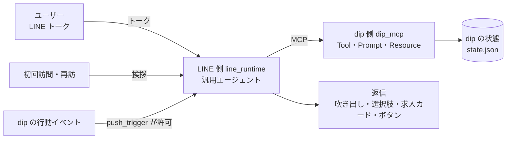

# line-sim の仕組み

LINE 公式アカウントの AI アシスタント(バイトルのアルバイト探し)の会話体験を、手元で再現して試すためのシミュレーター。
**LINE 側(会話の頭脳)と事業者 dip 側(求人とユーザー理解)を MCP で分ける**という本番の境界をそのまま作り、
dip が書ける Prompt とツールの中身だけで、狙った会話体験になるかを確かめられるようにしている。

コードはこのリポジトリの直下。動かし方はリポジトリの README。評価の結果と費用の記録は
旧リポジトリ `jyoka/aica_ra_a2a_poc` の `docs/line-sim-eval-record.md`(結果はこのリポジトリに持ってきていない)。

## 全体像

- **LINE 側(`line_runtime/`)は業務の知識を持たない。** LINE 共通のルール(違法な依頼に応じない、個人情報を聞き出さない、返信の形式)と、
  dip から MCP で受け取ったシナリオ(Prompt)とツールだけで会話する。LangChain `create_agent`、構造化返信 `LineReply`。
- **dip 側(`dip_mcp/`)が業務のすべてを持つ。** 求人、ユーザーの行動、応募の手続き、会話結果の記録、プッシュしてよいかの判断、
  長期メモリ。ツールは LLM を使わず、速く・決定的に・事実だけを返す。文面を作るのは LINE 側の LLM だけ。
- 体験を変えるレバーは dip の Prompt(`dip_mcp/prompts/`)とツールが返す中身。LINE 側のコードには手を入れない。

## 会話の入口

Web 公開のプロダクトなので、トークを開いたことをイベントにできる(LINE 公式アカウントの配信基盤は前提にしない。
LINE 由来の follow / crm_reply は 2026-09-27 の CRM 削除で、初回訪問・再訪の2イベントに置き換えた。jyoka/tasks#56)。

| イベント | 入口(シナリオ) | 始まり方 | 送ってよいか |
|---|---|---|---|
| `message` | A: トーク | ユーザーが書く | - |
| `visit` | V: 初回訪問 | こちらから挨拶 | 常に挨拶する |
| `revisit` | R: 再訪(トークを開き直した) | こちらから挨拶 | 常に挨拶する |
| `form_exit` | D: 応募フォームの途中離脱 | こちらからプッシュ | dip の `push_trigger` |

トーク以外のイベントは新しい会話を始め、入口に合う dip のシナリオを使う。シナリオとユーザーIDは会話の途中で変えないので、
プロンプトキャッシュが効く(キャッシュが無いと1ターンのコストが約4倍という以前のメモがあるが、再計測はしていない。
評価の指標 `cache_hit_rate` で実際の割合を記録できる)。

再訪(`revisit`)の挨拶は2つの振る舞いを持つ: 長期メモリの希望があれば確認形の挨拶、行動履歴だけなら最近の閲覧に1回だけ触れる
(旧 R-revisit / F-follow-back の中身を継承)。評価シナリオは `R-revisit`(希望あり)と `R-revisit-browsing`(行動履歴のみ)、
オフラインの台本テストは `tests/test_revisit.py`。

### プッシュの判定(`dip_mcp/logic.py` の `push_trigger`)

プッシュしてよいかは dip が決定的なコードで決める。LLM に「送るか」を任せると、頻度と拒否の尊重がモデル次第になるため。

- 送らない条件: dip ID と未連携 / 直近 3 日以内に接触済み / 話しかける根拠の事実がない。3 日はシミュレーション用の仮の値。
- 許可したら接触として記録し、根拠の事実(求人・残りの入力項目)を LINE 側に渡す。
- LINE 側は判断せず、受け取った事実を1通目の1文目で伝えてから1問だけ聞く。

## dip のツール(MCP)

| ツール | 役割 |
|---|---|
| `get_user_conversation_summary` | ユーザーの状況の要約(今の雇用区分・直近の応募・フォーム離脱・閲覧の傾向・直近の接触・本人が話した希望)。会話の最初に呼ぶ。閲覧した求人名は返さない |
| `get_user_recent_applications` / `get_application_status` | 応募と選考の状況 |
| `get_user_form_exit` / `resume_application_form` | 途中の応募フォームの続き。個人情報の項目はトークで受け取らず LIFF 画面へ |
| `recommend_jobs` | 条件に合う求人を最大3件、理由と `match_score` つきで返す |
| `relax_conditions` | 求人が少ないとき、どの条件を外すと何件になるか |
| `answer_job_question` | 仕事内容・面接などの質問に答える材料(FAQ・求人情報) |
| `save_job` | 求人の保存 |
| `save_user_preferences` | 本人が話した希望の保存(長期メモリ) |
| `set_search_track` | 雇用区分(アルバイト・パート / 正社員 / 未定)の切り替え。根拠は本人の発言そのまま。履歴(いつ・どの区分へ・根拠・取り消しか)を残し、取り消しも同じツールで記録する |
| `record_conversation_outcome` | 会話の結果(提案・相談・支援・待つ)の記録。待つ(wait)はユーザーが断ったときだけ受け付ける |

ほかに Resource `baitoru://faq` と、入口ごとのシナリオを返す Prompt `baitoru_assistant(entry)`。

## 主な仕組み

### 求人の推薦と `match_score`

`recommend_jobs` は条件(エリア・時間帯・職種・時給の下限・キーワード)で絞り込み、本人の傾向との合い具合で並べる。
点数は LLM を使わずに計算し(`match_breakdown`)、各求人に `match_score` と内訳 `score_breakdown` を付けて返す。

| 軸 | 点 |
|---|---|
| 職種 | 本人の傾向の1番目の職種 2点、2番目 1点 |
| 時間帯 | 傾向の時間帯と重なれば 1点 |
| エリア | 傾向のエリアなら 1点 |
| 駅近 | 徒歩10分未満ほど高い(0〜1点) |
| 時給 | 時給 ÷ 2000 |

本人の傾向は、90日以内の応募と30日以内の閲覧・保存から数える。応募済みの求人は出さない。

### 求人カード

求人カードは、dip のツールが返した求人だけをコードで描画する。
モデルが選ぶのは出す求人の ID だけで、どのツールも返していない ID はカードにならない。カードの形は dip の `job_card()` に一本化。

### 長期メモリ(本人が話した希望)

本人が会話で話した希望(エリア・時間帯・職種・時給の下限・経験・週の日数・できること・資格)を `save_user_preferences` で dip に保存し、
次の会話の要約(`stated_preferences`)で返す。再訪時は確認形で1回だけ使い、同じことを聞き直さない。
長期メモリは業務の知識なので LINE 側ではなく dip 側が持つ。決まった項目だけ受け付け、電話番号・メールアドレス・住所らしい値は保存しない。

### LLM のプロバイダ(OpenAI が既定)

LINE 側エージェントの LLM は環境変数で差し替えられ、既定は OpenAI(`LINE_SIM_PROVIDER=openai`、
モデルは `gpt-6-sol`、思考の深さ `LINE_SIM_EFFORT=low`)。`LINE_SIM_PROVIDER=anthropic` にすると
既定モデルは `claude-opus-5` になる。評価の模擬ユーザーとジャッジもプロバイダに追随する
(OpenAI なら gpt-6-sol、Anthropic なら模擬ユーザー Sonnet 5・ジャッジ Opus 5)。
gpt-6-sol の水準は 2026-09-26 の12シナリオ評価(`sim-20260926-130904`)で確認済み
(旧リポジトリの `docs/line-sim-eval-record.md`)。

### 音声相談(voice-resume との連携)

voice-resume 本体は旧リポジトリ `jyoka/aica_ra_a2a_poc`(`cda42fd`)の `voice-resume/` を `voice_resume/` に移植した(task 62)。

トークの中の導線(AI が差し出す [話して伝える(音声・約5分)]、入力欄の「+」→「音声で相談する」。task 91)から、音声アドバイザー(`voice_resume/`)に LIFF のように入れる。
音声で聞いた希望・提案した求人・履歴書の下書きは、同じユーザーの dip の状態とトークに戻る。

- ユーザーの対応付け: 旧リポジトリの `line_user_id`(LINE のユーザー)の代わりに、トークのユーザー
  `匿名ID:シナリオユーザー`(マルチユーザーの匿名ユーザーID のスコープ)を使う。dip の MCP ツールの引数名は `line_user_id` のまま。
- 導線: [話して伝える] /「+」→「音声で相談する」→ `GET /liff/voice?user=<ユーザーID>` → voice-resume の会話ページ(`?user=` つき)。
  ユーザーID は LiveKit の participant metadata(`{"user_id": ...}`)で音声ワーカーまで届く。
- 会話中: ワーカーは会話の前に dip の要約(`get_user_conversation_summary`)を読み、前に話した希望が
  あれば確認形で1回だけ使う。求人検索(`recommend_jobs` / `relax_conditions`)はそのユーザーID で呼び、
  本人が言った希望(経験・できること・資格を含む8項目)は `save_user_preferences` で保存する(上の長期メモリと同じ入れ物)。
- 終わり: 会話結果はコードが propose(提案できた)/ consult(提案なし)だけを記録する
  (wait は断っていない人を wait にしない決まりのため、音声側からは記録しない)。求人と下書きは `POST /api/voice/result`(`user_id` つき)で
  トーク(line_runtime)へ送られ、dip の `record_voice_result` が未受け取りの `voice_results` として預かる。
  トークが `POST /api/voice/{user}/pull` で未受け取り分を受け取り、求人カード(`job_id` を dip の求人データと
  照合してコードで作り直す。dip に無い求人はカードにならない)と「履歴書の下書きを見る」
  (`GET /liff/voice/draft`)を描く。
- 起動手順と画面の流れは `README.md` の「音声相談(voice-resume との連携)」、
  音声側の構成は `voice_resume/README.md`。

### 返信のルール(dip の Prompt)

- 1回の返信で質問は1つ。初回は必ず質問で終える。3ターン以内に 提案・相談・支援・待つ のどれかに進む。
- 相談モード(「まず相談する」か迷いのサインで入る)では、経験・興味・不安・生活の制約を1問ずつ聞き、3ターン規則を緩める。
  別のエージェントではなく Prompt のステージ指針。詳細は `line-sim-scenarios.md` の10章。
- 選択肢(クイックリプライ)は最大4つ。質問するときは「今はいい」か「それ以外」を含める。
- 返信は必ず選択肢で終える(締めくくりにも「求人を探す / 応募履歴を確認 / 使い方」)。クイックリプライはボタンを押すか
  新しいメッセージが届くまで消えないので、次に開いた人が書くしかない状態を減らせる。
- 「今はいい」「送らないで」は理由を聞かずに短く終え、wait を記録する。終わりの挨拶は拒否として扱わない。
- 履歴には90日以内の行動だけに、確認形で1回だけ触れる。閲覧した求人名は挙げない。
- 個人情報はトークで受け取らず、dip の LIFF 画面を案内する。リッチメニューには触れず、メニュー相当はトーク内の選択肢で出す。

### シミュレーター画面とリアルタイムの処理

`LineRuntime.handle_stream` が1ターンの途中経過(LLM の呼び出し・ツールの呼び出し)を順に出し、最後に返信を出す。
`handle`(評価・API 用)も同じ処理を最後まで回して返信だけを返す。返信は、会話を保存し直した状態から作る。
画面(`line_runtime/static/talk.html`)は `POST /api/event/stream` から1行1件の JSON を受け取り、
右の構成図の動いている部分を光らせ、処理の流れ(時間・トークン・キャッシュから読めた分・ツールの引数と結果)を出す。
左の操作パネルはシナリオの一覧(評価と同じ `evals/scenarios.json`)。押すと `POST /api/scenarios/{id}/start` でそのユーザーの
dip の状態を初期に戻し、続けて `/api/event/stream` を呼んで LINE 側 AI が1通目(挨拶・プッシュ)を作る。
ユーザーが先に書き込む形(入口 A)は画面のシナリオには無いが、本番の入口として Prompt には残す。
1通目の後の入力は、その会話の続きのトークとして扱う(入口のシナリオは変えない)。
シナリオごとの会話設計は [line-sim-scenarios.md](line-sim-scenarios.md)。

### 状態と会話の保存

- dip の状態は JSON ファイル(`data/state.json`)。MCP の子プロセスと Web プロセスが共有するので、ファイルロックをかけて毎回読み書きする。
  評価は実行ごとに一時ファイルを使う。
- 会話は AsyncSqliteSaver(`data/line_checkpoints.db`)。会話番号は再起動後にチェックポイントから復元し、古い会話に追記しない。

## 評価の仕組み(`evals/`)

- 6 シナリオ(`evals/scenarios.json`。シミュレーター画面と同じ一覧)を、設定を与えた模擬ユーザー
  (OpenAI なら gpt-6-sol、Anthropic なら Sonnet 5)と会話させる。
  どのシナリオも AI 側の1通目から始まる: 初回訪問・再訪の挨拶か、dip のプッシュ(本番と同じく `push_trigger` を通す)。
  始める前にそのユーザーの dip の状態を初期に戻す(`evals/scenarios.py`)。
- 採点はコードが中心(`evals/checks.py`): 1ターン1問、選択肢の数と逃げ道、吹き出し80字、求人は最大3件で理由つき、
  個人情報をトーク経由で送らない、最後の返信を選択肢なしで終えない、断られていないのに待つ(wait)を記録しない、
  「今はいい/送らないで」の後に質問や求人を続けない、
  事実性(返信の金額・徒歩分数・件数・日付・求人名を、dip から来た情報と本人の発言に単位ごとに照合)、
  保存した希望が本人の発言に基づくか。
- LLM ジャッジ(OpenAI なら gpt-6-sol、Anthropic なら Opus 5)は既定でオフ。トーンや設計の主観的な部分を見たいときだけ `--judge` で回す。
- 結果は evalkit の形で書き出し、集計(95% 区間つき)と前後の比較(ノイズ幅を超えた差だけ改善・悪化と判定)ができる。

## 以前の構成との違い

求職者側は以前、転職の求職者エージェント ca-agent(と旧 PoC 本体 aica-poc)で作っていた。line-sim は、
事業者のツールを決定的にし LLM には会話だけをさせる構成で、Opus 5 での費用は1ターン $0.021(ca-agent は $0.036)、
1会話 $0.074(ca-agent は $0.32)になった。課題の重さ(短いアルバイト探しと、長いヒアリングを伴う転職相談)が違うので、単純には比べられない。
比較の詳細は旧リポジトリ `jyoka/aica_ra_a2a_poc` の `docs/design/ca-agent-vs-line-sim.md`。ca-agent と aica-poc は削除済みで、
削除前の状態は旧リポジトリのタグ `archive/ca-agent-aica-poc-2026-09-24` に残している。
