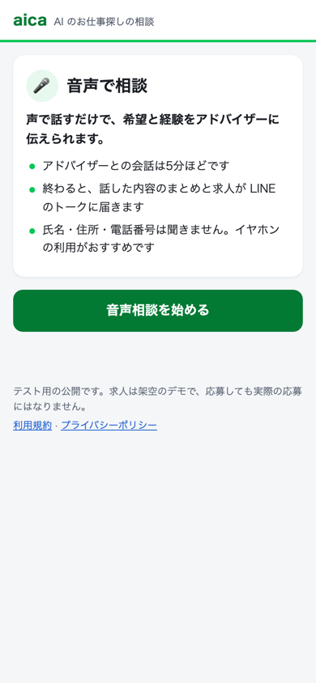
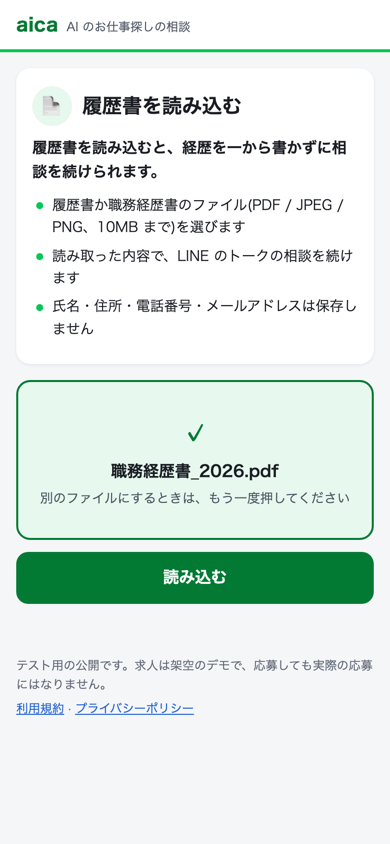
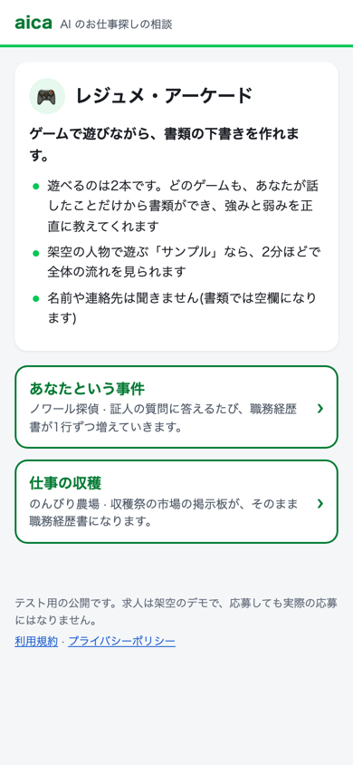
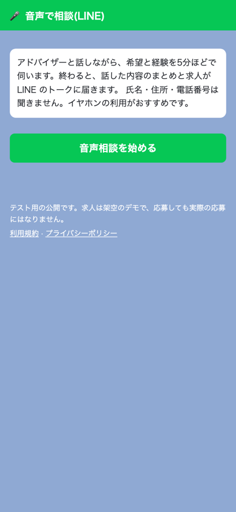
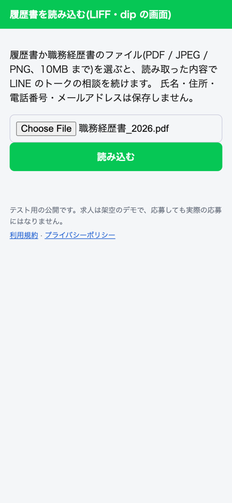
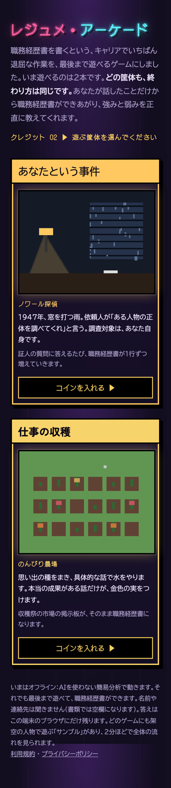

# LIFF の 3 つの最初の画面(task 241)

LINE のリッチメニューから開く、ミニアプリ(LIFF)の 3 つの最初の画面を、直す前(before)と後(after)で撮った写真。
iPhone の幅(390px)で、LIFF の SDK を偽物に差し替えたブラウザ(Playwright の Chromium)で撮った。
「同意の前」は、リッチメニューから直接開いた、まだ使い始める同意をしていない人が最初に見る画面(task 239)。

| 画面 | 同意の前 | 同意の後 |
|---|---|---|
| 音声相談 `/liff/line/voice` | [before](before-voice-consent.png) / [after](after-voice-consent.png) | [before](before-voice.png) / [after](after-voice.png) |
| 履歴書の読み込み `/liff/line/resume/upload` | [before](before-resume-consent.png) / [after](after-resume-consent.png) | [before](before-resume.png) / [after](after-resume.png)、ファイルを選んだ後 [before](before-resume-picked.png) / [after](after-resume-picked.png) |
| ゲームの一覧 `/liff/line/arcade` | [before](before-arcade-consent.png) / [after](after-arcade-consent.png) | [before](before-arcade.png) / [after](after-arcade.png) |

音声相談の同意の前は、画面の下から出る同意のシート(talk-core.js)で、「同意して始める」に移った位置の写真。

## 直した後

| 音声相談 | 履歴書の読み込み | ゲームの一覧 |
|---|---|---|
|  |  |  |

## 直す前

| 音声相談 | 履歴書の読み込み | ゲームの一覧 |
|---|---|---|
|  |  |  |
