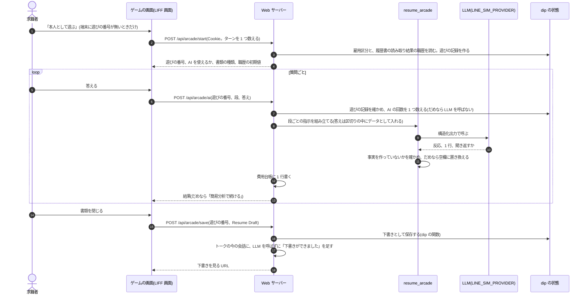

# PRD: レジュメ・アーケード - 遊びながら、本人の言葉だけで職務経歴書を仕上げる

設計の経緯: task 186(2026-10-25、運営者との対話で決めたことを文書にした)。この PRD はコードを変えません。
用語は [CONTEXT.md](../../CONTEXT.md) と [HLD の 10 章](../architecture/hld.md#10-用語)に従います。
置き場所の決め方は [HLD の 1.1](../architecture/hld.md#11-境界と新しい機能を置く場所)、守る境界は
[ADR-0003](../adr/0003-agent-gets-facts-only-through-dip-tools.md) です。元のゲームはリポジトリの外にあります(末尾の「元資料」)。

## ねらい

この PRD の「目的」は、CONTEXT.md の語(本人が仕事探しで得たいもの)の意味でだけ使います。機能のねらいは次のとおりです。

求職者が、遊びながら職務経歴書(アルバイト・パートなら履歴書の自己PR)を最後まで仕上げ、応募へ進めるようにする。
書類に載るのは本人が話したことだけで、足りない数字は本人に見える形で空けておく。

成功は「書類ができて、応募へ進んだか」で測ります。遊んだ時間では測りません。

## Problem Statement

- 職務経歴書を書くのは退屈で、手が止まりやすい。aica の音声相談でも下書きは作れるが、職場ごとの成果と数字を
  掘り下げきれないことがある(aica v2 の G で職務経歴書の下書きを足した)
- 2026-10-24〜25 に、claude.ai の Artifact として 8 本のドット絵ゲームとハブ(レジュメ・アーケード)を作った。
  どのゲームも本人に質問し、答えから職務経歴書と強み・弱みの診断を作る。AI が使えなくても最後まで遊べる
- ただし今のゲームは claude.ai の上でしか AI を使えない(`window.claude.use("sample")`)。答えも書類も aica の
  プロフィールにつながらず、トークや音声相談から入れない
- 試した人の声: 「文字が読みにくい」「ルールが分かりにくい」。運営者の言葉では "our goal is to navigate gamers to complete their resume"(遊ぶ人を職務経歴書の完成まで連れていく)。
  これを受けて、あなたという事件には案内の部品(下の「必ず入れる案内の部品」)を足した。ほかの 7 本にはまだ無い
  (元資料で「次にやること」「聞かれていること」の文を探して、あなたという事件にだけ見つかった)

## 利用者

| 利用者 | 雇用区分 | 欲しいもの |
|---|---|---|
| 転職を考えている人(経歴が厚い) | 正社員 | 職場ごとの成果が数字つきで並んだ職務経歴書 |
| 経歴は短いが正社員を目指す人 | 正社員 | 何を書けばよいか分かる案内と、空欄の見える下書き |
| アルバイト・パートを探す人(バイトルの利用者) | アルバイト・パート | 履歴書の自己PRに使える短い文。重すぎない言い方 |
| まだ決めていない人 | 未定 | どちらの書類にするかを自分で選べること |
| 運営者 | - | 完成率と応募への移動を測れること、費用に天井があること |

## 成功の指標

| 指標 | 中身 | 目標 |
|---|---|---|
| 完成率(主) | 下書きを保存した人 ÷ ゲームを始めた人 | 基準を測ってから決める(不明) |
| 応募への移動(主) | 下書きを保存してから 7 日以内に、求人を保存したか、応募フォームを開いたか、応募した人の割合 | 同上 |
| 下書きの厚さ | 職場ごとに 2 行以上ある下書きの割合。数字の入った行の割合 | 同上 |
| 数字の空欄が埋まる | `[+X% ← 数字を入れる]` のうち、保存までに本人が埋めた割合 | 同上 |
| 事実でない数字(守り) | AI が出した数字のうち、本人の答えに無かったもの | 0(コードが空欄に置き換えた件数を数える) |
| 所要時間(守り) | 始めてから保存までの時間の中央値 | 15 分以内。長いほど良いとは扱わない |
| 費用(守り) | 下書き 1 件あたりの LLM の費用 | 既定のプロバイダ(OpenAI)で $0.10 以下(下の「費用の上限」。見込みは推測) |

- 測るために、ゲームを始めたこと、保存したこと、空欄の数を dip の状態に記録します。答えの中身は記録しません
- 遊んだ時間、ゲームの中の得点は指標にしません

## 守る原則

ゲームのつくりが違っても、次の 4 つは変えません。

1. **答えが 1 行ずつ書類になり、本人に見える**: 答えるたびに、その答えから書類の 1 行ができ、画面に出る
2. **あいまいな答えには 1 回だけ聞き返す**: 数字や具体的な行動が無いときだけ、1 回聞き返す。2 回目は聞き返さずに受け取る
3. **事実を作らない**: 会社名、数字、役職、実績を AI が足さない。数字が無い行は、見える空欄 `[+X% ← 数字を入れる]`
   (または `[X円 ← 数字を入れる]`、`[N件 ← 数字を入れる]`)で終える。強みと弱みには、本人の答えを根拠として添える。
   これは ADR-0003 の「事実は決まった道からだけ得る」と同じ考え方で、本人について書く事実は本人の発言からだけ取る
4. **AI が無くても最後まで終わる**: AI が使えない、断られた、上限に達したときは、決まった質問と端末の中の簡単な判定
   (日付を数字と数えない数字の検出、文字数であいまいさを見る、です・ます調を言い切りにする)で、最後まで遊べて書類ができる。
   そのときは「オフライン:AIを使わない簡易分析」と正直に出す

### 必ず入れる案内の部品

aica で出すゲームは、どれも次の部品を持ちます。あなたという事件にはすでにあり、ほかのゲームには出す前に足します。

| 部品 | 中身 | あなたという事件での形 |
|---|---|---|
| 次にやること | 画面の上に常に出る 1 行。いまやることと、次に押すボタン | 「次にやること」「いまやること」の案内の帯 |
| 進み具合 | 職場ごとの書類の行数。目安は 1 職場 2 行以上。目安に届いたら、閉じてよいと出す | 「目安:各職場で2行以上」「書類を作れる量になりました」 |
| 聞かれていること | ゲームの言い方の質問の横に、平たい言葉で何を答えればよいかを出す | 「聞かれていること:」と、聞き返しの「もうひと押し:」 |
| その場の確かめ | 答えを書いている間に、入っている要素(行動、数字)と、できる 1 行の見本を出す | 書きながら出るチェックと 1 行の見本 |
| 下書きを見る | 途中でいつでも、今の書類の下書きを開ける | 「職務経歴書の下書きを見る」 |

- 本文は 15px 以上、行間は 1.7 前後、ドット絵のフォントは見出しと飾りだけ(元資料の JA_BRIEF.md と同じ)
- どの質問も飛ばせる。飛ばしても書類はできる

## 組み込み方の案 A-D と推奨

aica は会話が中心のサービスです。ゲームの仕組みを、会話のどこにどう入れるかの案を 4 つ並べます。

| 案 | 中身 | 良い点 | 気になる点 |
|---|---|---|---|
| A. トークの「1 行追加」 | LINE と Web のトークで、本人が答えるたびに「職務経歴書に1行追加」のカードを返す。カードには進み具合のゲージと、選択肢(飛ばす / これ以上ない)を付ける | 会話の中で完結する。LINE でも今すぐ使える(LIFF 画面の本人の問題が無い) | ゲームの楽しさは薄い。エージェントの会話に行を作る役が足される |
| B. 音声で証人に聞かれる | 音声相談(`voice_resume`)で、上司・同僚・お客さん・ライバルが 1 問ずつ聞く | 話すだけで済む。音声の下書きが厚くなる | 声を人ごとに替えると、待ち時間と費用が増える(未検証) |
| C. 称号のカード | 「修理屋タイプ」のような称号だけを画像にして共有できる | 広がる入口になる | 経歴の中身が漏れない作りが要る |
| D. ゲームを LIFF 画面で | 8 本のゲームとハブを、そのまま LIFF 画面(`/liff/...`)で遊べるようにする | 運営者が作ったものをそのまま使える。いちばん楽しい | LINE で開くと本人が決まらない(HLD の 4.8)。会話の外に出る |

**推奨**:

- 求職者への届け方は **A を最初、B を 2 番目** にします。会話が中心の aica では、トークの中で 1 行ずつ増える形がいちばん自然で、
  LINE でも動くからです
- B は、最初は 1 つの声のまま言い方だけを替えて、上司・同僚・お客さん・ライバルを演じ分けます。声の切り替えは、
  待ち時間と費用を測ってから決めます(未検証)。4 人の観点(成果、仕事ぶり、誰のために働いたか、弱み)は、音声の playbook の
  「明らかにすること」に書き、聞く順はコードで決めません(ADR-0001 と playbook の定義に合わせる)
- C は A か D で称号が出るようになってから足します
- D は、A-C と比べて選んだのではありません。運営者が、ゲームそのものを aica の機能にすると決めています。そのため、
  この PRD の続きのタスク (2/3) と (3/3) で、Web のトークの利用者に向けて先に作ります
- (3/3) で作る「行の作り方の決まり」(数字の検出、空欄、事実を作らない確かめ)と下書きの保存の場所は、A がそのまま使います。
  そのため、作る順は (2/3) → (3/3) → A → B とします。届け方の主役は A のままで、D は Web で遊びたい人への入口です
- A を (2/3) と (3/3) より先に作るかは「決まっていないこと」の 1 に残します

## User Stories

### 遊んで仕上げる
1. As a 正社員を探す求職者, I want トークに出たボタンからゲームを始められる, so that 職務経歴書を書こうと決心しなくても始められる
2. As a ゲームで遊ぶ求職者, I want 答えるたびに書類の 1 行が増えるのが見える, so that 何のために答えているかが分かる
3. As a ゲームで遊ぶ求職者, I want 画面の上の「次にやること」と、平たい言葉の「聞かれていること」を読めば迷わない, so that ルールを覚えなくても進める
4. As a あいまいに答えた求職者, I want 1 回だけ、何が足りないかを具体的に聞き返される, so that 強い 1 行にできる
5. As a 数字を覚えていない求職者, I want 数字の無い行が空欄つきで残る, so that 後で埋めればよく、作り話を書かされない
6. As a 求職者, I want 1 職場 2 行の目安に届いたら終えられる, so that 長く遊ばなくても書類ができる
7. As a 弱みを話したくない求職者, I want ライバルの質問を飛ばせる, so that 書類と診断は弱みなしでもできる
8. As a AI が使えないときの求職者, I want それでも最後まで遊べて書類ができる, so that 待たされない

### aica につながる
9. As a 求職者, I want できた下書きがプロフィールに残り、あとで見て、直して(数字の空欄を埋めるのを含む)、消せる, so that 自分の書類を自分で扱える
10. As a 求職者, I want ゲームを終えるとトークに「下書きができました」と出て、そのまま求人を探せる, so that 応募まで流れが切れない
11. As a 履歴書をアップロード済みの求職者, I want 職場の名前と期間が最初から入っている, so that 同じことを打ち直さなくてよい
12. As a アルバイト・パートを探す求職者, I want 職務経歴書ではなく、履歴書の自己PRに使える文ができる, so that 自分に要る書類になる
13. As a トークで相談している求職者, I want エージェントが下書きの空欄のある行を知っていて、その数字を聞いてくれる, so that 書類が仕上がる(聞いた数字を下書きに書き戻すのは A のタスク。(3/3) では本人が下書きの画面で埋める)

### 運営者
14. As a 運営者, I want ゲームの AI の費用が費用台帳に載り、上限を超えたら簡易分析に切り替わる, so that 費用が暴走しない
15. As a 運営者, I want 完成率と応募への移動を数えられる, so that 遊ばせるだけの機能になっていないかを確かめられる

## Implementation Decisions

### 最初に出すゲーム

最初に求職者へ出すのは **あなたという事件** と **仕事の収穫** の 2 本と、ハブです。

| ゲーム | ファイル | 判断 | 理由 |
|---|---|---|---|
| あなたという事件 | `the-case-of-you.html` | 最初に出す(正社員の既定) | 案内の部品がすべてある。純粋なロジックが `the-case-of-you.logic.js` に分かれていて、頭なしの Chrome で最後まで遊ぶ確かめもある。証人ごとに上司・同僚・お客さん・ライバルの観点で聞く作りは、A と B にもそのまま使える |
| 仕事の収穫 | `harvest-of-work.html` | 最初に出す(アルバイト・パートの既定) | 質問が職種によらない(どんな状況で、何をして、何が変わったか)。のんびりした言い方で、バイトルの利用者に重すぎない。ただし今は、案内の部品が無い、見本の人物がエンジニア、強みの分け方の言葉が IT 寄り、作るのは職務経歴書。アルバイト・パート向けの直しが要る((2/3) と (3/3)) |
| 職歴ダンジョン | `dungeon-of-past-jobs.html` | 後で | 敵がエンジニアの仕事(古いコード、不安定なテスト、障害)で、職種が狭い |
| キャリアペット | `career-pet.html` | 後で | 質問に「何人のユーザー」「何チーム」が多く、IT の仕事に寄って見える(質問の文を一部読んだだけ) |
| キャリアファイター、実績デッキ | `career-fighter.html`、`deck-of-deeds.html` | 後で | 本人が求人票を貼りつける作り。dip の求人と戦う形にできれば面白いが、dip の事実の扱いを別に決める必要がある |
| キャリアクエスト、スターログ | `career-quest.html`、`star-log.html` | 後で | 案内の部品が無い。中身はこの PRD では詳しく見ていない |

- 残りの 6 本も (2/3) で LIFF 画面として置きますが、ハブにもトークにも出しません。リンクは開発者画面にだけ置きます。
  URL を知っていれば開けますが、AI を使わず、本人のデータも読み書きしません。案内の部品を足したものから、ハブに出します
- 雇用区分で既定のゲームを決めるだけで、本人はハブでもう 1 本を選べます

### 置き場所(LIFF 画面のルート)

| パス | 中身 |
|---|---|
| `GET /liff/arcade` | ハブ。最初の 2 本を出す |
| `GET /liff/arcade/{game}` | 各ゲーム。`game` はファイル名と同じ(`the-case-of-you`、`harvest-of-work` など 8 本)。知らない名前は 404 |
| `GET /liff/arcade/draft?rid=…` | ゲームで作った下書きを見て、直す((3/3))。`{game}` のルートより先に登録し、`draft` はゲームの名前に使わない |

- ファイルは `line_runtime/static/arcade/` に置きます。Artifact の形(doctype、html、head、body が無い)をやめ、普通の HTML にします
- 画面は LINE 側(`line_runtime/`)です。HLD の 1.1 の表で「画面」にあたります
- 本人は、ほかの LIFF 画面と同じく Cookie の匿名ユーザーIDで決めます。URL にユーザーIDを載せません。
  開発者画面のシナリオユーザーは `scenario_user` で渡します(`logic.liff_url` と同じ)
- エージェントがトークで出すボタンは `/liff/` で始まるので、今の `render` の決まり(`/liff/` の URL だけを出す)のまま出せます
- ボタンの URL はエージェントに書かせません。今の応募フォームと同じく、dip が作った URL(`logic.liff_url`。`scenario_user` も付く)を
  dip の要約で渡し、エージェントはそれをボタンにするだけです
- HLD の 10 章の「LIFF 画面」は「dip の画面のモック」です。ゲームは dip の画面ではないので、(2/3) で語の意味を
  「`/liff/*` の画面。dip の画面のモックと、レジュメ・アーケード」に広げます

**LINE のチャネルは、本物の LIFF の本人があるときだけゲームのボタンを通します**(2026-10-25 に直しました。jyoka/tasks#204)。
前は、LINE のアプリで LIFF 画面を開くと Cookie が無いので本人にならず、ゲームのボタンを出さない決まりでした。
LIFF の ID トークンで LINE の本人を決める仕組み(jyoka/tasks#203)ができたので、次のようにします(HLD の 4.8、4.11)。

- LIFF の設定(`LINE_LIFF_ID` と `LINE_LIFF_CHANNEL_ID`)があれば、LINE のチャネル(`line_channel.to_messages`)は `/liff/arcade…` の
  ボタンを LIFF URL(`https://liff.line.me/<LIFF ID>/arcade…`)にします。LINE は `/liff/line/arcade…` を開き、LIFF の本人を確かめてから
  ゲームを出します。LINE のアプリのハブ(`/liff/line/arcade`)は、サーバーがほかの LIFF の最初の画面と同じ枠で出し、リンクは
  `/liff/line/arcade/…` です(task 241)
- LIFF の設定が無ければ、`/liff/arcade` のボタンを LINE に出しません(公開 URL では本人にならないため。守りとして残す)
- エージェントには窓口(Web / LINE)と、LINE でゲームを開けるかを伝えます(`agent.channel_note`)。開けなければ勧めません
- LIFF の設定があれば、dip の要約は LINE のユーザーID(`l-…`)にもゲームの URL を載せ(`arcade.game_url`)、エージェントは
  Web と同じ場面で LINE にゲームのボタンを出します(jyoka/tasks#219)
- LINE のアプリで開いたゲーム(`/liff/line/arcade/<ゲーム>`)には、サーバーが LIFF の設定(`window.AICA_LIFF`)と LIFF SDK を入れます。
  ゲームの部品(`arcade-ai.js`)は、Web の `/api/arcade/…` と同じ中身の `/api/liff/arcade/…` を LIFF の本人(Cookie `aica_liff`)で呼びます。
  AI の回数の上限は Web と同じです。ターン数は LINE のユーザーごとと全体で数え、IP ごとには数えません
- 保存した下書きは、その LINE のユーザーの要約(`arcade_draft`)と、トークの「データを見る」に出ます。保存すると、Web と同じく今の会話に
  「下書きができました」を足し、同じ返信をその本人の LINE のトークに 1 回 push します(保存 1 回につき 1 通で、1 人 1 日 3 通まで。月のメッセージ数に数えられます)。
  宛先の LINE の userId は、保存の本文の LIFF の ID トークンを確かめてもらい、届けるまでメモリにだけ置きます。確かめられなければ
  (トークンが無い、期限切れ、別の人)、保存だけして push しません。「下書きを見る」は LIFF URL(`…/arcade/draft?rid=…`)で、
  LINE のアプリで見て直せます
- 本人の Cookie の期限(1 時間)が遊んでいる間に切れたら、ゲームの部品が ID トークンで 1 回だけ確かめ直します

### AI の呼び出し

ゲームの画面は LLM を直接呼びません。Web サーバーの API を通し、aica の LLM のプロバイダで呼びます。



- **画面は指示の文を送らない**: 画面が送るのは、ゲームの名前、段(あなたという事件なら `opening`、`reaction`、`lab`、`verdict`)、
  本人の答えだけです。指示の文と出力の形はサーバーが持ちます。画面が指示の文を送れる形にすると、Web サーバーが
  誰でも使える LLM の中継になり、費用の上限も事実の確かめも効かないからです
- **AI の呼び出しは「遊び」に結びつける**: 費用の上限は 1 回の遊びの単位で数えるので、サーバーがどの遊びの呼び出しかを知る必要があります
  - 始める(`start`)と、サーバーは遊びの番号を返します。番号は推測できない乱数にします
  - 番号は dip の状態の、そのユーザーの遊びの記録に置きます。記録は本人、ゲーム、始めた時刻、AI を使えるか、反応の回数、まとめの残り回数を持ちます。
    答えの中身は持ちません
  - 遊びの記録は、1 人 1 ゲームにつき最新の 1 件だけを持ちます。新しい `start` は、同じゲームの前の記録を置き換えます。
    なので 1 人の記録はゲームの数(最初の版は 2 件)を超えません。ターン数の上限を超えた後に `start` を繰り返し呼ばれても、dip の状態は増えません
  - 置き換えられた前の番号は無効になります。前の番号で `/ai` を呼ぶと簡易分析、`/save` は 403 です。画面は「Markdown でコピー」を案内します
  - 成功の指標の「始めた」は、遊びの記録からは数えません(置き換えで消えるため)。`start` のたびに、指標のための記録の数を 1 つ増やします
  - `/ai` は、Cookie の本人の、有効な遊びの番号を要ります。番号が無い、ほかの人の番号、AI を使えない遊び、回数を使い切った遊び、
    始めてから 24 時間を過ぎた遊びなら、LLM を呼ばずに「簡易分析で続ける」を返します。ターンも費用台帳も増えません
  - `/save` も、Cookie の本人の遊びの番号を要ります。番号が無いか、ほかの人の番号なら保存しません(ほかの API と同じ 403)。
    24 時間を過ぎた遊びでも保存はできます(LLM を呼ばないので費用は増えず、遊んだ答えを失わないため)
  - 画面は、遊びの番号を進み具合と一緒に localStorage に残します。再読み込みでは残っている番号で続け、`start` を呼び直しません。
    `start` を呼ぶのは、番号が無いときと、本人が「最初から遊ぶ」を選んだときだけです。再読み込みでターンと「1 日 3 回」は増えません
  - 「すべて消す」で遊びの記録も消えます。消した後に古い番号で `/ai` を呼ぶと簡易分析、`/save` は 403 になります。画面は「Markdown でコピー」を案内します
- **まとめで送るのは書類の行**: 証拠のまとめと最後のまとめでは、答えの全文を送りません。画面が送るのは、職場の見出し(勤務先、役職、期間)と、
  それまでにできた書類の行(行の文、本人の言葉の引用、数字)です。あなたという事件の元の作りでも、まとめが読むのは答えではなく証拠のカードです
  - 上限はサーバーで確かめます。1 行の文は 120 字、引用は 40 字、1 職場 6 行、送る合計は 4,000 字までです
  - 合計が 4,000 字を超えるときは、画面が行の多い職場から後の行を外して送ります。外した行は書類に残り、AI のまとめに入らないだけです。
    サーバーに 4,000 字を超えて届いたら、LLM を呼ばずにその段を簡易分析で続けます
  - まとめの事実の確かめは、そのとき送られた行と比べます。行の数字は、行を作ったときに本人の答えと比べ済みです。
    比べるのは本人が書いた欄(行の文・引用・数字、職場の見出し、事件ファイルの欄)だけで、行の番号(`e5`)や強みのキーは入れません。
    欄どうしはつなげずに比べます(年数「5」の次の欄の「10人」を「510人」と読まない。2 つの欄にまたがる引用は認めない)
    行は本人の書類なので、本人が画面で直した数字も事実として扱います(確かめるのは AI が足した数字です)
- **置き場所は独立のパッケージ `resume_arcade/`**: LLM を使うが、会話でも業務の規則でもない部品なので、履歴書の読み取り
  (`resume_intake/`)と同じ扱いにします(HLD の 1.1)。指示の文(ゲームの中の文から移す)、段ごとの出力の形(pydantic)、
  事実の確かめ、Resume Draft への写しを持ちます。保存してよいかの決まりは dip の関数に置きます
- **プロバイダ**: `line_runtime/llm.py` の `client()` を使い、`LINE_SIM_PROVIDER`(OpenAI か Anthropic)に従います。
  ゲームの中の反応(元の `modelTier: "quick"`)は安いモデル(模擬ユーザーと同じ `gpt-6-luna` か `claude-haiku-4-5`)、
  最後のまとめ(元の `"default"`)はエージェントと同じモデル(`LINE_SIM_MODEL`)にします。料金は `ledger.PRICES` にあるものを使います
- **費用台帳に書くために、使った量を返す**: 今の `llm.parse()` は結果だけを返し、トークン数を捨てます。費用台帳の
  `Ledger.record(user_id, event, model, usage)` には使った量が要るので、(3/3) で `parse()` が使った量も返せるようにします
  (`resume_intake` は自分で `resp.usage` を読んでいる)。ゲームと段は `event` に `arcade:<game>:<段>` の形で入れ、台帳の行の形は変えません
- **パッケージの依存**: `resume_arcade` は `line_runtime.llm` を使います(`evals` と同じ向き。HLD の 3.2 は import を境界にしない)。
  HLD の 3.2 の図に足します
- **事実の確かめはコードでする**: AI が返した行と診断の数字が、本人の答えに無ければ、その数字を空欄に置き換えます。
  根拠の引用が本人の答えに無ければ、その引用を捨てます。置き換えた件数を数えます(成功の指標の「事実でない数字」)
  - 比べる前に、両方を NFKC でそろえ、桁の区切り(1,200 と 1200)をそろえ、漢数字(三割、半分)を元の検出と同じ規則で読みます
  - 単位の言い換え(三割を 30% に)はそろえません。指示の文で「数字は本人が書いた形のまま」と書き、言い換えたら空欄になる側に倒します
- **数字の検出は依存の無い小さなパッケージに置く**: `the-case-of-you.logic.js` の `findMetric`(日付を数えない)、`isVague`(文字数)、
  `plainEnding`、空欄の文字列を Python に移します。事実の確かめと、A の dip の関数が同じものを使うためです。
  `resume_draft` は「形と個人情報の決まり」の場所なので入れず、ほかに依存しない別のパッケージ(仮の名前 `resume_lines/`)にします。
  dip_mcp と resume_arcade の両方がこれを使い、dip_mcp が resume_arcade や line_runtime を import する形は作りません
- **流れの途中の文字は送らない**: 元のゲームは反応を少しずつ出していました(`onText`)。最初の版は結果をまとめて返し、
  画面が打っているように見せます
- **失敗したら簡易分析**: API が失敗した、上限に達した、AI を止めているときは、その段を端末の簡単な判定で続けます。
  自動で繰り返し呼びません(元の BRIEF.md と同じ)
- **見本の人物では AI を呼ばない**: 「サンプルで遊ぶ」は架空の人物なので、費用をかけずに端末だけで動かします

### 作った書類の保存

| 項目 | 決めたこと |
|---|---|
| 形 | Resume Draft(`resume_draft.schema` の envelope、format_version 1.1)。`source` は `arcade`。書類の種類(`document_kind`)は下の「雇用区分ごとの違い」で決める |
| 写し方 | 職務要約 → `job_summary`、職場 → `work_history`(勤務先、役職、期間、行は `achievements`)、スキル → `skills`、学歴 → `education`、自己PR → `self_pr`。数字の空欄は行に残す。`unconfirmed`(本人に確かめたい点の一覧)には「〇〇の行の数字」のように、空欄のある行ごとに 1 つ書く |
| 個人情報 | `personal` は常に空(envelope がそうする)。保存の前に `scrub_pii` をかける |
| 場所 | dip の状態の、そのユーザーの下書きの記録。保存は dip の関数(`dip_mcp/logic.py` か、分けたモジュール)で、Web サーバーが直接呼ぶ(HLD の 1.1 の「両方にまたがる」の形)。ゲームごとに最新の 1 件を持ち、番号は通し番号にする(履歴書の読み取り結果と同じ作り)。通し番号は `profile._KEPT_ON_FORGET` に足し、「すべて消す」の後に古いリンクが新しい下書きを開かないようにする |
| 強み・弱みの診断 | 最初の版は保存しない。ゲームの画面に出し、写せるようにするだけ。診断は AI の解釈で、本人の発言そのものではないから |
| プロフィール | プロフィール画面に「ゲームで作った下書き」として出し、見る、直す、消すができる(CONTEXT.md のプロフィールの定義どおり)。直すのは下書きの画面(`/liff/arcade/draft`)で、行の文と数字の空欄を本人が書き換える。直すときも保存と同じ決まり(`scrub_pii`、長さの上限)を効かせる。「すべて消す」で消える(`profile.forget_all` が `reset_user` でその人の dip の状態を消すので、同じ場所に置けば消える。テストで確かめる) |
| エージェントから見えるもの | dip の要約(`get_user_conversation_summary`)に、最新の下書きの要点(書類の種類、作った日、職務要約、行の数、空欄のある行を 5 行まで)と、ゲームの URL(Web のユーザーと、LIFF の設定があるときの LINE のユーザー。task 219)を載せる。空欄の無い行の全文は載せない。どの行も本人の発言から作ったものなので、dip の事実として渡してよい。音声アドバイザーも同じ dip の要約を読む |
| トークへの知らせ | 保存したら、今の会話にエージェントの返信として「下書きができました」を足す。LLM を呼ばず、ターンも数えない。文は、LINE 側が dip に保存した下書きの記録(dip の関数の結果)から作る。音声相談の結果(`record_voice_result` の記録から `voice_reply` が作り、`LineRuntime.add_voice_result` で足す)と同じ作りで、HLD の 1.1 の「イベントの入力に添えた事実」の一覧に足す。ボタンは「下書きを見る」、選択肢は「求人を探す」「空欄を埋める」。まだ会話が無いとき(ハブやプロフィールから入ったとき)は足さない。次に開いたときの挨拶が dip の要約で下書きを知る |
| 端末の記録 | ゲームの進み具合は今どおり端末の localStorage に残す(再読み込みで答えを失わないため)。遊びの番号も一緒に残し、再読み込みではその番号で続ける。保存が終わったら、その端末の答えを消すかを本人に聞く。「すべて消す」は別の端末の localStorage を消せない、と画面に書く |

本人の答えの全文は、サーバーに保存しません。AI に送るために Web サーバーを通るだけです。

### 入口(トーク、音声、プロフィール)

| 入口 | いつ | どう | どのタスク |
|---|---|---|---|
| Web のトーク | 本人が「職務経歴書を作りたい」と言ったとき。正社員の相談で、応募の準備の話になり、ゲームの下書きも音声の下書きも無いとき | エージェントがゲームの LIFF 画面へのボタンを出す。いつ出すかは playbook(`dip_mcp/playbooks/` の正社員、アルバイト、未定の chat 版)に書く。何を聞くかは決めない。URL は dip の要約が渡す | (3/3) |
| プロフィール画面 | いつでも | 「ゲームで書類を作る」のリンク | (3/3) |
| ハブを直接開く | いつでも | `/liff/arcade` | (2/3) |
| LINE のトーク | - | ボタンを出さない(ゲームの AI と保存の API が LIFF の本人で呼べないため。上の「LINE では」)。A ならトークの中で動く | A、ゲームの API を LIFF の本人で呼ぶタスク |
| 音声相談 | - | 最初の版は入口を持たない。音声相談の結果のカードに「ゲームで仕上げる」を足すのは B と一緒に決める | B |

- ゲームから雇用区分を切り替えません。区分の切り替えは、本人の発話を根拠にエージェントが `set_search_track` でするものだからです(ADR-0001)
- 終わった後にトークへ戻ると、エージェントは dip の要約で下書きを知っているので、空欄の数字を聞くか、求人の提案に進めます。
  どちらにするかは playbook に書きます

### 雇用区分ごとの違い

| 雇用区分 | 書類の種類 | ゲームが作るもの | 既定のゲーム |
|---|---|---|---|
| 正社員 | 職務経歴書 | 職場ごとに 2〜4 行の実績(体言止めか言い切り)、職務要約(である調)、スキル | あなたという事件 |
| アルバイト・パート | 履歴書 | 自己PR(3〜4 文)と、職歴ごとの短い「工夫・任されたこと」。職務経歴書の行は作らない | 仕事の収穫 |
| 未定 | 本人が選ぶ | 最後に「職務経歴書にする / 履歴書の自己PRにする」を本人が選ぶ。選んでも雇用区分は変わらない。最後のまとめは自己PR も書いておき、選び直しで AI を呼び直さない | ハブで本人が選ぶ |

- 志望動機は、応募先ごとに変わるので最初の版では作りません(「決まっていないこと」の 2)
- アルバイト・パートでは、数字の空欄を無理に出しません。「接客で心がけたこと」のような数字の要らない問いには空欄を付けません。
  空欄を付ける問いの決まりは (3/3) で、ゲームの段ごとに決めます
- 言い方: あなたという事件のノワールの「あんた」は、バイトルの利用者には強すぎるかもしれません。最初の版は、アルバイト・パートの既定を
  仕事の収穫にして避けます。ゲームの世界と言い方を替えられる作り(言い方の設定を指示の文と決まった文の両方に効かせる)にしておきます

### 個人情報

- **氏名、住所、電話、メール、リンクを聞かない**: 元のゲームは最初に氏名を聞き、仕事の収穫は「居住地 · メール · ポートフォリオのURL」も聞きます。
  aica の版ではこの欄を消し、書類には `[氏名]`、`[メール] · [電話] · [居住地] · [リンク]` の空欄を残します。本人が後で書きます
- **AI に送る前に電話とメールを伏せる**: 答えに電話番号やメールがあれば、`resume_draft/pii.py` の決まりで伏せてから送ります。
  トークの発言は伏せずに送っていますが(HLD の 6 章)、ゲームは書類を作るためのもので、連絡先は要らないからです
- **答えの全文をログに出さない**: Web サーバーと `resume_arcade` は、答えの有無と長さだけをログに出します
- **費用台帳**はトークン数と費用だけを持ちます(今と同じ)
- **会社名は送る**: 会社名と仕事の中身は、書類を作るのに要るので LLM のプロバイダに送ります。これはトークと同じ扱いです
- 何をどれだけの期間保存するか(review-2026-10.md の R7)は、この PRD では決めません。下書きは、ほかの下書きと同じく本人が消すまで残ります
- 外の読み込み: ゲームは Google Fonts を読みます。HLD の 6 章の「LLM の出力と外のデータ」に、jsDelivr と並べて書きます

### 費用の上限

元のゲームは、1 回遊ぶと AI を何度も呼びます。あなたという事件では、証人ごとの最初の質問と反応(聞き返しで 2 回)、
証拠のまとめ、最後のまとめがあります。職場は 4 つまで入れられるので、4 職場 × 4 人なら最大 50 回ほどになります
(段の数からの推測。測っていない)。

| 決まり | 提案する値 | 理由 |
|---|---|---|
| 始めるとき | ターンを 1 つ数え、遊びの番号を返す(`POST /api/arcade/start`)。ターンは今の `quota` で数えるので、IP ごとの上限(1 日 150)にも入る | ターン数の上限(1 人 1 日 50)を、遊ぶたびに何十も使わないため |
| 遊びの番号 | `/ai` は有効な遊びの番号が要る。無いときは LLM を呼ばない。再読み込みでは番号で続け、数え直さない(上の「AI の呼び出し」) | 画面を通さずに `/ai` を繰り返し呼んで、上限を迂回させないため |
| 遊びの記録の数 | 1 人 1 ゲームにつき最新の 1 件。新しい `start` が前の記録を置き換える | 上限を超えた `start` は `quota` に数えられないので、記録の数に天井をかけないと dip の状態が際限なく増える |
| ターン数の上限を超えていたら | 始めるのは断らず、AI なしの簡易分析で始める。保存は LLM を呼ばないので、そのままできる | 守る原則の 4(AI が無くても最後まで終わる) |
| 1 回の遊びの AI の回数 | ゲームの中の反応は 50 回まで。超えたら、その後の反応を簡易分析で続ける。最後のまとめ(証拠のまとめを含む)の 2 回は別に取っておく | 経歴の厚い人(4 職場)でも、いちばん大事な最後のまとめが AI で作れる |
| 1 回の答えの長さ | 600 字まで(超えた分は送らない) | 反応 1 回の入力に天井をかける |
| まとめで送る量 | 答えの全文ではなく書類の行。1 行 120 字、引用 40 字、1 職場 6 行、合計 4,000 字まで。超えて届いたら LLM を呼ばずに簡易分析 | 答えを重ねても、まとめの入力が膨らまないようにする |
| 1 人 1 日の AI つきの遊び | 3 回まで(`start` の回数を `quota` と同じく匿名IDで数える)。超えたら、AI を使えない遊びとして番号を返し、簡易分析で始める | 試す分には足り、天井がかかる |
| 全体の天井 | 全体のターン数の上限(1 日 1,000)に、始めた回数として入る | 新しい上限を増やさない |
| 止める | 環境変数で AI を止められる(止めると、すべて簡易分析) | 費用か品質で問題が出たときに、すぐ止める |
| 費用台帳 | AI の呼び出しごとに 1 行(`user_id`、`event` に `arcade:<game>:<段>`、モデル、トークン) | 下書き 1 件あたりの費用を測る |

- 見込み(推測): 上限いっぱいの 1 回を、`ledger.PRICES` の料金で数えました。トークンの数は指示の文の長さからの見積もりで、測っていません。
  日本語は 1 字を 1 トークン前後としました
  - 反応: 上限の 50 回。1 回あたり入力 1,500(指示の文と 600 字までの答え)、出力 200 トークン
  - まとめ: 2 回。1 回あたり入力 5,500(指示の文 1,500 と、上限の 4,000 字の行)、出力は 2 回で合わせて 2,500 トークン
  - OpenAI(既定。反応 `gpt-6-luna`、まとめ `gpt-6-sol`): 反応 $0.0125、まとめ $0.047 で、1 回 $0.06 前後
  - Anthropic(反応 `claude-haiku-4-5`、まとめ `claude-opus-5`): 反応 $0.125、まとめ $0.118 で、1 回 $0.24 前後。守りの $0.10 を超える見込みです(「決まっていないこと」の 5)
- (3/3) で実際の 1 回を測り、上の値を決め直します
- 値の名前と既定値は (3/3) で決め、README の環境変数の一覧に足します

### 語

この PRD で使う語です。(2/3) と (3/3) で HLD の 10 章に足します。

| 語 | 意味 | 使わない語 |
|---|---|---|
| レジュメ・アーケード | ゲームとハブの全体 | Resume Arcade(コードの名前としてだけ使う) |
| ゲーム | 1 本のゲームの LIFF 画面 | 筐体(ハブの中の言い方としてだけ使う) |
| ハブ | ゲームを選ぶ LIFF 画面(`/liff/arcade`) | トップ |
| 書類の行 | 本人の 1 つの答えから作った、職務経歴書か自己PRの 1 行 | 戦利品、証拠(ゲームの中の言い方としてだけ使う) |
| 数字の空欄 | `[+X% ← 数字を入れる]` などの、本人が埋める欄 | プレースホルダー |
| 簡易分析 | AI を使わずに端末で進める形 | オフラインモード |
| 下書き | 今は「音声相談から作った Resume Draft」。ゲームで作った Resume Draft も下書きに含める | ドラフト |

## 注意すること

- **言い方を替えられるようにする**: ノワールの「あんた」はバイトルの利用者には強すぎるかもしれない。ゲームの世界と言い方は替えられる作りにする
- **アルバイト・パートは自己PR**: 職務経歴書の行ではなく、自己PR(と、後で志望動機)の文を作る
- **長く遊ばせない**: 成功は書類ができて応募へ進むことで、遊んだ時間ではない。あなたという事件の証人は 1 職場 4 人までで、
  ライバル以外の証人に 2 人答えて 2 行できたら、閉じてよいと案内する。目安に届いた後は、「次にやること」がライバルへ誘わない
- **弱みの質問は任意**: ライバル(弱み)の質問は飛ばしても進み具合が減らない。弱みは書類に載せず、診断にだけ使う
- **音声では数字を読み返す**: B では、聞き取った数字を「300件で合っていますか」と読み返してから行にする。文字起こしの数字は間違えやすいから
- **事実は本人の発言からだけ**: AI が書類と診断に足してよいのは、言い換えと並べ替えだけ。ADR-0003 と同じ考え方で、コードでも確かめる
- **AI は aica のプロバイダを通す**: `window.claude.use("sample")` は claude.ai にしか無い。aica では Web サーバーを通して `LINE_SIM_PROVIDER` のプロバイダで呼ぶ

## 実装タスクと依存関係

続きのタスクは 2 つです。どちらも `line_runtime/server.py` とゲームの画面を触るので、(2/3) を merge してから (3/3) を始めます。

### (2/3) 9 ページを LIFF 画面にする

AI と保存を持たない形で、9 ページを aica から開けるようにします。AI はまだ使わず、すべて簡易分析で動きます。

届けるもの:

- 9 ページを `line_runtime/static/arcade/` に置く。Artifact の形をやめて普通の HTML にする(doctype、html、head、body を足す)
- `GET /liff/arcade` と `GET /liff/arcade/{game}` を足す。知らない名前は 404。このタスクの画面は本人のデータを読み書きしないので、
  本人を決めなくてよい
- `window.claude` を探す処理と、`downloads` の capability を外す。どのゲームも最初から簡易分析で動き、「オフライン:AIを使わない簡易分析」と出す。
  ダウンロードは、ブラウザで動く形(Blob のリンク)にするか、隠す。「Markdown でコピー」は残す
- ハブの各ゲームへのリンクを、claude.ai の URL から `/liff/arcade/{game}` に替える。ハブには最初の 2 本だけを出す。残りの 6 本は開発者画面からリンクする
- 最初の 2 本で、氏名、居住地、メール、リンクの入力欄を消し、書類には空欄を残す
- 仕事の収穫に「必ず入れる案内の部品」を足す(あなたという事件と同じ 5 つ)
- あなたという事件で、ライバルの証人に「任意」と出す。目安(ライバル以外で 1 職場 2 行)に届いた後は、「次にやること」がライバルではなく「事件を閉じる」を案内する
- 文書: HLD の 3 章(画面の一覧)、4 章(ゲームの置き場所を短く)、6 章(Google Fonts)、10 章(語。「LIFF 画面」の意味を広げる)。README に開き方を 1 行

受け入れの条件:

- ハブ(`/liff/arcade`)と 8 本(`/liff/arcade/{game}`)が 200 を返し、claude.ai の URL を含まない。知らない名前は 404(pytest)
- 最初の 2 本を、見本の人物で、題名から書類の画面まで、390px の幅で最後まで遊べる。JS のエラーが 0 件(Playwright。入っていないときは飛ばす、
  `tests/test_talk_actions.py` と同じ作り)。書類に数字の空欄が出ることを確かめる
- 最初の 2 本の画面に、氏名、メール、居住地の入力欄が無い
- あなたという事件で、ライバルに答えずに事件を閉じられ、書類ができる
- 開発者画面から残りの 6 本を開ける

しないこと: AI の呼び出し、下書きの保存、雇用区分による違い、トークとプロフィールからの入口、費用台帳。

### (3/3) AI と職務経歴書を aica につなぐ

最初の 2 本について、AI を aica のプロバイダで呼び、できた書類をプロフィールに下書きとして残し、トークにつなぎます。

届けるもの:

- `resume_arcade/` パッケージ: 2 本の段ごとの指示の文と出力の形、事実の確かめ(本人の答えに無い数字を空欄に、無い引用を捨てる)、
  Resume Draft への写し。数字の検出と空欄の決まりの Python 版は、依存の無い別のパッケージ(仮の名前 `resume_lines/`)に置く
- API: `POST /api/arcade/start`、`POST /api/arcade/ai`、`POST /api/arcade/save`。どれも Cookie の本人だけ(401、403 はほかの API と同じ)
- 遊びの記録: `start` が遊びの番号を返し、dip の状態に遊びの記録(本人、ゲーム、始めた時刻、AI を使えるか、反応の回数、まとめの残り回数)を置く。
  `/ai` と `/save` は Cookie の本人の遊びの番号を要る。画面は番号を localStorage に残し、再読み込みでは `start` を呼び直さない。
  記録は 1 人 1 ゲームにつき最新の 1 件で、新しい `start` が前の記録を置き換える。「始めた」の数は指標のための記録で数える
- まとめの入力: 証拠のまとめと最後のまとめは、答えの全文ではなく書類の行を送る。1 行 120 字、引用 40 字、1 職場 6 行、合計 4,000 字の上限をサーバーで確かめる
- 画面の差し替え: 最初の 2 本の `sample` の呼び出しを、上の API を呼ぶ小さな部品(`line_runtime/static/arcade/` の共通の JS)に替える。
  失敗したらその段を簡易分析で続ける
- プロバイダとモデル: `LINE_SIM_PROVIDER` に従う。反応は安いモデル、最後のまとめは `LINE_SIM_MODEL`
- 費用の上限: 上の「費用の上限」の表の決まり。ターン数の上限を超えていたら、断らずに簡易分析で始める。AI を止める環境変数
- 費用台帳: `llm.parse()` が使った量も返せるようにし、AI の呼び出しごとに 1 行書く
- 保存: dip の関数で下書きとして保存する。プロフィール画面に出し、見る、直す、消すができる(直すのは `GET /liff/arcade/draft` の画面)。
  「すべて消す」で消え、通し番号は `_KEPT_ON_FORGET` で持ち越す
- dip の要約: `get_user_conversation_summary` に、最新の下書きの要点と空欄のある行(5 行まで)、Web のユーザーにだけゲームの URL を載せる(task 219 で、LIFF の設定があるときは LINE のユーザーにも載せるようにした)
- トーク: 保存したら、今の会話に LLM を呼ばずに「下書きができました」を足す(会話が無ければ足さない)。エージェントがゲームのボタンを出すときを
  playbook に書き、URL は dip の要約のものだけを使うと dip の Prompt に書く。LINE ではボタンを出さない(dip の要約に URL を載せない、
  `line_channel.to_messages` が `/liff/arcade` を出さない)
- 雇用区分ごとの違い: 書類の種類と、作るもの(職務経歴書の行か、自己PRか)。未定は本人が選ぶ。仕事の収穫に、自己PR を作る指示の文と簡易分析、
  アルバイト・パートの見本の人物、職種によらない強みの言葉を足す
- 履歴書の読み取り結果があれば、職場の名前、役職、期間を最初から入れる
- 個人情報: AI に送る前に電話とメールを伏せる。保存の前に `scrub_pii`。答えの全文をログに出さない
- 指標のための記録: 始めたこと、保存したこと、空欄の数、事実の確かめで置き換えた数(答えの中身は記録しない)
- 文書: HLD の 1.1(エージェントが dip の事実を得る道に、ゲームの下書きの知らせを足す)、3.1(dip の要約に載るもの)、3.2(パッケージの依存)、
  4 章(上の流れの図)、4.6(保存するデータ。下書きと遊びの記録。遊びの記録が消えるのは、新しい `start` で置き換えたときと「すべて消す」のとき)、6 章(個人情報、費用)、10 章(下書きの意味)。LLD の Resume Draft に `source: arcade` を足す。README の環境変数

受け入れの条件(どれも実 API を呼ばない台本テストで確かめる):

- 始めて、答えて、保存すると、プロフィールと dip の要約に下書きが出て、トークに「下書きができました」が足される
- LLM のスタブが本人の答えに無い数字を返すと、その数字は数字の空欄に置き換わり、置き換えた数が記録される
- 1 回の遊びの AI の回数、1 人 1 日の回数、AI を止める設定のそれぞれで、API は簡易分析で続けるよう返す。LLM は呼ばれない
- 遊びの番号なしで `/ai` を呼ぶと、LLM は呼ばれず、ターンも費用台帳も増えない。ほかの人の番号、24 時間を過ぎた番号でも同じ
- 遊びの番号なしか、ほかの人の番号で `/save` を呼ぶと、保存されない(403)
- ターン数の上限を超えた後に `start` を 100 回呼んでも、そのユーザーの遊びの記録はゲームごとに 1 件を超えない。置き換えられた前の番号では、`/ai` は LLM を呼ばず、`/save` は 403 になる
- 再読み込みして同じ遊びの番号で続けても、ターン数と 1 日の遊びの回数は増えない(画面を押すテストで、再読み込みの後に `start` が呼ばれないことも確かめる)
- 最後のまとめで、送る合計が 4,000 字を超えると LLM は呼ばれず、簡易分析で書類ができる。上限の内なら、4 職場の書類でも LLM に届く入力が上限に収まる
- ターン数の上限を超えていると、始めるときに AI なしで始めるよう返し、LLM は呼ばれない。そのまま保存はできる
- LINE のユーザーには、dip の要約にゲームの URL が無く、LINE のメッセージにも `/liff/arcade` のボタンが出ない(task 219 の後は、LIFF の設定が無いときだけ)
- 「すべて消す」の後に、前の下書きの番号のリンクを開いても、新しい下書きは開かない
- 事実の確かめが、本人が書いた数字を消さない(1,200 と 1200、全角の数字、本人が「三割」と書いて AI も「三割」と書いたもの)
- 雇用区分が正社員なら職務経歴書、アルバイト・パートなら履歴書の自己PRが保存される。ゲームの後も雇用区分は変わらない
- 「すべて消す」で、ゲームの下書きと遊びの記録も消える。消した後に古い遊びの番号で `/ai` を呼んでも LLM は呼ばれない
- 別の人の Cookie では、始める、呼ぶ、保存する、下書きを見るのどれもできない
- 答えに電話番号があると、LLM のスタブに届く文では伏せてあり、保存した下書きにも無い
- 実 API の確かめは、最後に 1 回だけ手で遊んで費用を測る(予算 $0.50 まで)。結果を PR に書く

### この PRD の後に足すタスク(登録は人がする)

| 順 | タスク | 中身 | 待つもの |
|---|---|---|---|
| 1 | A: トークの「1 行追加」 | 答えるたびに書類の行のカードとゲージ、選択肢(飛ばす / これ以上ない)。行を作って数えるのは dip のツールにし、事実の確かめは (3/3) の Python 版を使う。聞き返しは 1 回だけで、playbook に書く。LINE でも動く | (3/3) |
| 2 | B: 音声で証人に聞かれる | 音声アドバイザーが上司・同僚・お客さん・ライバルの観点で聞く。4 つの観点は音声の playbook の「明らかにすること」に書き、聞く順は決めない。最初は 1 つの声で言い方だけ替える。数字を読み返す。ライバルは任意 | A(行の作り方を共有する) |
| 3 | LINE で LIFF 画面の本人を決める | LIFF のログインで LINE のユーザーIDを決め、ゲームと応募フォームを LINE でも本人の画面にする。LIFF の本人は済み(jyoka/tasks#203、#204。LINE のチャネルはゲームのボタンを LIFF の設定があるときだけ通す)。ゲームの AI と保存の API を LIFF の本人で呼ぶことと、dip の要約が LINE のユーザーにも URL を載せることは残り | (3/3) |
| 4 | C: 称号のカード | 称号とゲームの名前だけを画像にする。経歴の中身、会社名、数字、ユーザーIDを入れない | (3/3) |
| 5 | 残りの 6 本 | 案内の部品と個人情報の欄の削除を足し、AI をつないでからハブに出す。職種が広いものから | (3/3) |

```
(1/3) この PRD → (2/3) 9 ページを LIFF 画面に → (3/3) AI と職務経歴書をつなぐ ─┬→ A トークの 1 行追加 → B 音声の証人
                                                                              ├→ LINE で LIFF 画面の本人を決める
                                                                              ├→ C 称号のカード
                                                                              └→ 残りの 6 本
```

## Testing Decisions

- 良いテストは、本人から見える振る舞い(画面と API から入って、書類、プロフィール、dip の要約、トークに何が出るか)を確かめる。
  実装の内部をなぞらない(aica v2 の PRD と同じ)
- (2/3) と (3/3) の開発中と PR は、実 API を呼ばない。LLM は台本で差し替える。先行例は `tests/test_resume_upload.py`、`tests/test_voice.py`
- 画面を押すテストは Playwright で、入っていないときは飛ばす(`tests/test_talk_actions.py` と同じ)
- 事実の確かめには、正しい答えを壊さない負例を必ず添える。日付(2022年、3月)を数字と数えない、本人が書いた数字は残す、など
- 元資料の `tests/the-case-of-you.e2e.js`(Chrome の CDP)は、中のパスが古い作業場所を指しているので、そのまま使わない。Playwright に書き直す

## Out of Scope

- 8 本すべてを最初から求職者に出すこと(最初は 2 本)
- LINE で LIFF 画面を本人の画面にすること(別のタスク)
- 志望動機を作ること
- 強み・弱みの診断を保存すること
- 音声相談の中でのゲーム(B)、トークの中の 1 行追加(A)、称号のカード(C)。どれも (3/3) の後に別のタスクで作る
- 個人情報を保存する期間(review-2026-10.md の R7)
- ゲームの絵、音、遊び方そのものの作り直し。読みやすさと案内の部品と個人情報の欄の削除だけを直す

## 決まっていないこと

1. **作る順**: この PRD は (2/3) → (3/3) → A としました。届け方の主役は A なので、A を先に作る道もあります。その場合、数字の検出と事実の確かめの
   Python 版(`resume_lines/`)は A で作り、(3/3) はそれを使います。どちらにするかを人が決めます
2. **志望動機**: 応募先ごとに変わるので最初の版では作りません。作るなら、Resume Draft に項目を足す(LLD の 5.5 と format_version を変える)か、
   応募のときに作るかを決める必要があります
3. **あなたという事件の言い方**: アルバイト・パートの既定を仕事の収穫にして避けましたが、あなたという事件にやさしい言い方の版を作るかは未定です
4. **診断を保存するか**: 保存すれば、エージェントが強みを話題にでき、C の称号にも使えます。ただし AI の解釈なので、プロフィールの「本人が話した希望」とは分けて持つ必要があります
5. **費用の上限の値とプロバイダ**: 表の値は提案です。(3/3) で 1 回を実際に測ってから決めます。`LINE_SIM_PROVIDER=anthropic` では 1 回 $0.24 前後の見込みで、
   守りの $0.10 を超えます。Anthropic のときだけ守りの値を変えるか、ゲームの反応のモデルだけを別に選べるようにするかを決める必要があります
6. **成功の指標の目標値**: 基準を測ってから決めます。測り方(dip の状態の記録を数える小さなスクリプト)を作るタスクは、まだありません
7. **Google Fonts**: 本人のブラウザが Google に接続します。フォントを自前で置くかは未定です
8. **B の声**: 人ごとに声を替えたときの待ち時間と費用は測っていません

## Further Notes

### 元資料

リポジトリの外の `/Users/jyoka/AIprogramming PJ/resume-arcade-src/`(2026-10-25 の写し)にあります。(2/3) はここから写します。

| ファイル | 中身 |
|---|---|
| `README.md` | 写しの説明と、claude.ai に公開した URL |
| `games/*.html` | ハブ(`resume-arcade.html`)と 8 本のゲーム。Artifact の形の 1 ファイルの HTML |
| `BRIEF.md` | 元の作りの決まり(事実を作らない決まり、簡易分析、終わりの画面) |
| `JA_BRIEF.md` | 日本語の決まり(数字の検出、文字数、言い切り、職務経歴書の Markdown の形) |
| `the-case-of-you.logic.js` | あなたという事件の純粋なロジック(数字の検出、あいまいさ、行の作り方、指示の文) |
| `tests/the-case-of-you.e2e.js` | 頭なしの Chrome で最後まで遊ぶ例(パスが古い) |

### 元資料で確かめたこと

- どのゲームも、AI が無いと簡易分析で動く作りになっている(BRIEF.md の決まり。ゲームの中に `window.claude` が無いときの分岐がある)
- ゲームの中の反応に `modelTier: "quick"`、最後のまとめに `"default"` を使う(8 本すべて)
- 「次にやること」「聞かれていること」の文は、あなたという事件にだけある
- あなたという事件は 1 職場につき 4 人の証人が 1 問ずつ聞き、目安は 1 職場 2 行以上。ライバルの答えは書類に載らず、診断にだけ使う
- 最初に氏名を聞く(あなたという事件、仕事の収穫)。仕事の収穫は居住地、メール、URL も聞く
- あなたという事件は職場を 4 つまで入れられる
- 仕事の収穫の見本の人物はエンジニアで、作る書類は職務経歴書(ハブの説明文も同じ)
